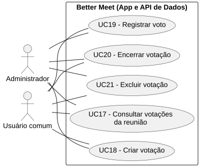
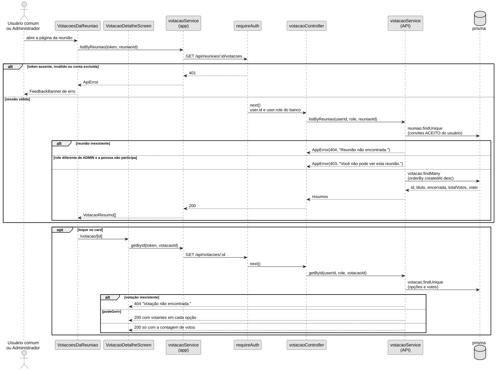
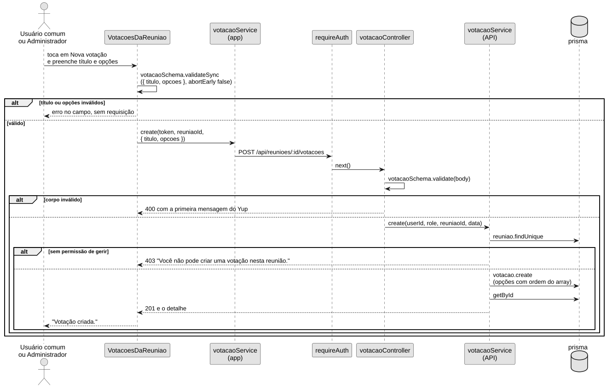
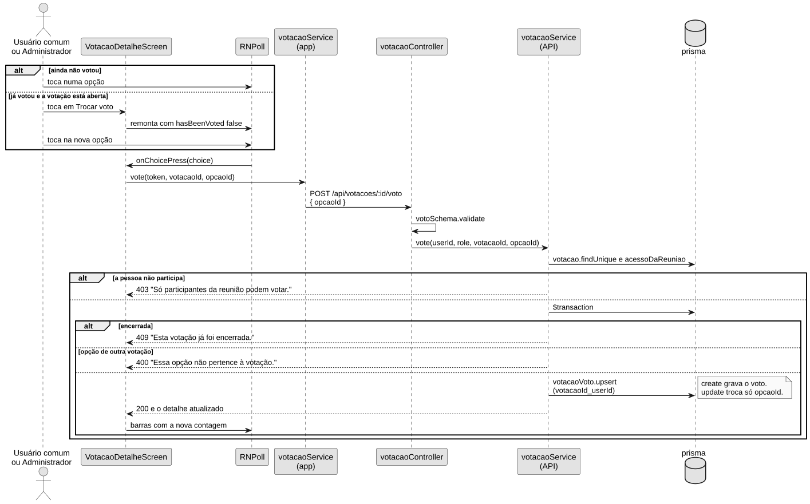
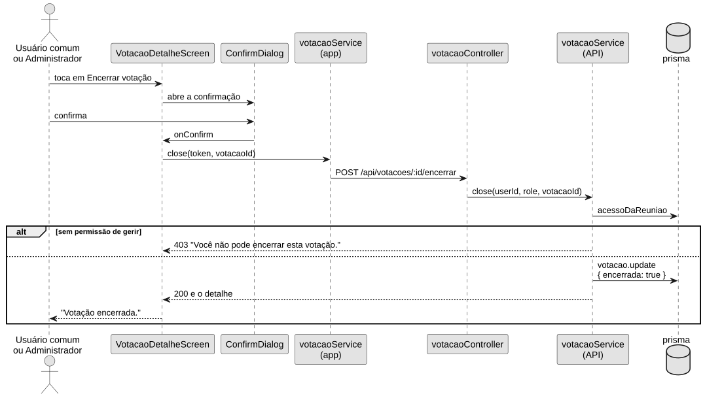
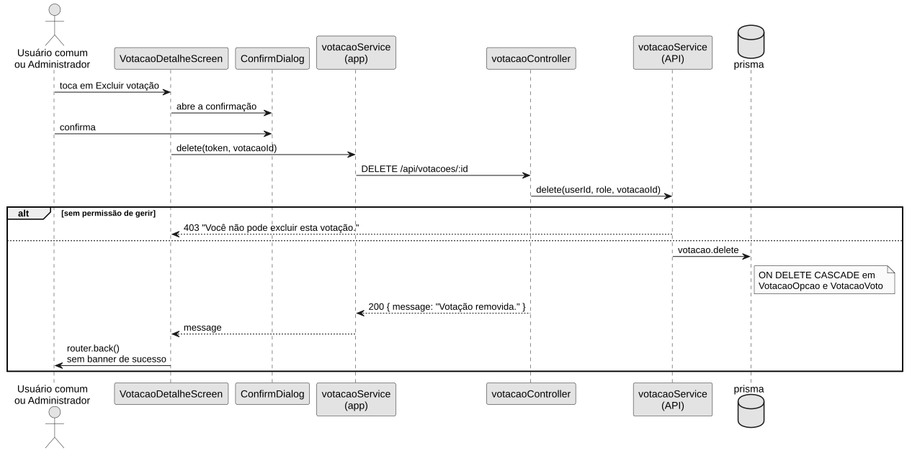
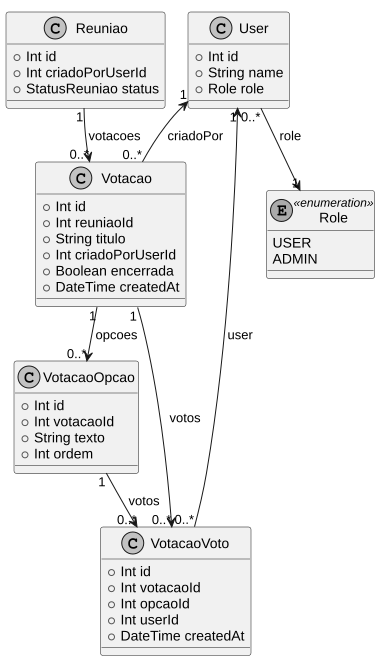
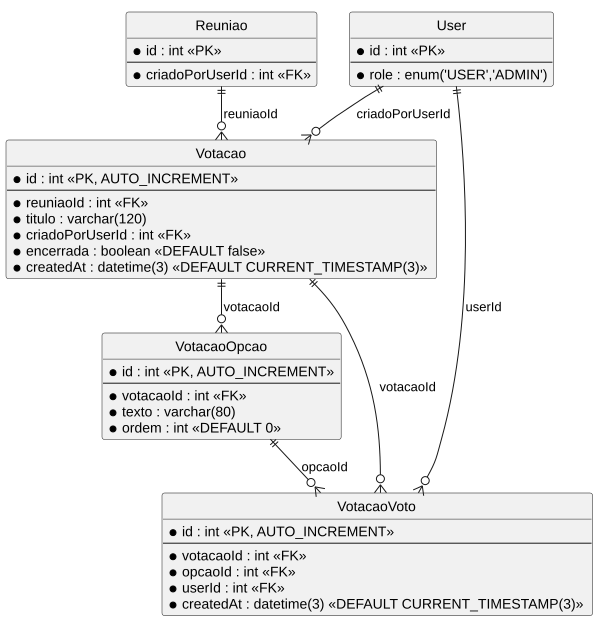

```text
Incremento: Entrega 3 — Di2
Escopo: RF16; RNF44; UC17, UC18, UC19, UC20 e UC21
Branch: development
Commit: 18c26a6e1b9301a177c1bb5fd09aff1d0de7ffa0
Data de revisão: 2026-11-13
Responsável(eis):
Estado: Parcial
Fontes: sistema/api/prisma/schema.prisma; sistema/api/prisma/migrations/20261107140000_votacoes/migration.sql; sistema/api/src/routes/votacaoRoutes.ts; sistema/api/src/controllers/votacaoController.ts; sistema/api/src/services/votacaoService.ts; sistema/api/src/schemas/votacaoSchema.ts; sistema/api/src/middlewares/authMiddleware.ts; sistema/api/src/middlewares/errorMiddleware.ts; sistema/api/src/utils/parseId.ts; sistema/api/src/server.ts; sistema/api/docs/openapi.yaml; sistema/api/tests/votacaoSchema.test.mjs; sistema/better-meet/src/components/VotacoesDaReuniao.tsx; sistema/better-meet/src/app/(tabs)/(reunioes)/votacao/[id].tsx; sistema/better-meet/src/app/(tabs)/(reunioes)/reuniao/[id].tsx; sistema/better-meet/src/services/votacaoService.ts; sistema/better-meet/src/schemas/votacaoSchema.ts; sistema/better-meet/src/components/__tests__/VotacoesDaReuniao.test.tsx; sistema/better-meet/package.json; sistema/better-meet/package-lock.json; sistema/api/package-lock.json; Wiki Requisitos (RF01–RF15 e RNF01–RNF43, lida em 2026-11-12)
```

Este documento cobre só a votação de opções de uma reunião. A votação da ata (`AtaVoto`, descrita em [ata_reuniao.md](ata_reuniao.md)) é outra funcionalidade e não entra aqui.

A página [Requisitos](https://github.com/MiguelIFSP/BRTPDS2-PROJETO-E-DESENVOLVIMENTO-DE-SISTEMAS-2/wiki/Requisitos) da Wiki ainda não lista o RF16 nem o RNF44. O índice precisa ser atualizado na publicação.

# RF16 — Votar em opções de uma reunião

- **Status:** Parcial. Criar, listar, abrir, votar, trocar, encerrar e excluir estão no código. A tela e a API divergem quando a reunião já passou, e o `docs/openapi.yaml` não publica estas rotas.
- **Objetivo:** permitir que a reunião tenha votações com opções, um voto por pessoa e resultado em barras.
- **Atores:** Administrador (`Role.ADMIN`) e Usuário comum (`Role.USER`).
- **Regras de negócio:** RN-VT01 a RN-VT06.
- **Referências do código:**
  - App: `VotacoesDaReuniao`, `VotacaoDetalheScreen`, `votacaoService` do app, `votacaoSchema` do app
  - API: `votacaoRoutes`, `requireAuth`, `votacaoController`, `votacaoSchema`, `votacaoService`, `parseId`, `handleError`

## Descrição

Na página da reunião, a seção **Votações** lista as votações. Quem pode gerir abre um modal, informa o título e de duas a seis opções e cria a votação. O toque no card abre a página da votação. Ali a biblioteca `react-native-poll` desenha as opções. A pessoa participante toca numa opção para votar e pode trocar enquanto a votação estiver aberta. Quem gerencia vê o nome de quem votou em cada opção e pode encerrar ou excluir.

## Regras de negócio

| ID | Regra | Onde está |
|---|---|---|
| RN-VT01 | Título de 3 a 120 caracteres. De 2 a 6 opções, cada uma de 1 a 80 caracteres, sem repetir o texto depois de tirar espaços e ignorar maiúsculas | `votacaoSchema` da API e do app |
| RN-VT02 | No máximo um voto por pessoa na votação. Trocar a opção atualiza `opcaoId` e mantém `createdAt` | `@@unique([votacaoId, userId])` e `votacaoVoto.upsert` |
| RN-VT03 | Criar, encerrar, excluir e ver nomes exigem `role === ADMIN` ou `criadoPorUserId` igual ao usuário | `acessoDaReuniao` em `votacaoService` |
| RN-VT04 | Votar exige ser o criador da reunião ou ter convite `ACEITO`. O Administrador que não participa recebe 403 | `podeVotar` |
| RN-VT05 | A lista de nomes só entra na resposta quando `podeGerir` é verdadeiro | `apresentar` |
| RN-VT06 | Votação encerrada rejeita voto novo ou troca com 409. Encerrar não apaga os votos | `vote` e `close` |

## Atores

| Ator | Tipo | Responsabilidade | Evidência |
|---|---|---|---|
| Administrador | Humano | Vê a reunião mesmo sem participar. Cria, encerra, exclui e vê os nomes. Só vota se for o criador ou tiver convite aceito | `Role.ADMIN` em `schema.prisma`; `acessoDaReuniao` |
| Usuário comum | Humano | Vê, cria, encerra e exclui quando é o criador da reunião. Vota quando é o criador ou aceitou o convite. Sem esse vínculo, recebe 403 | `Role.USER`; mesma função |

Não há ator "Usuário autenticado". Os dois perfis têm associação própria em [Diagramas/DCU-Votacoes.svg](Diagramas/DCU-Votacoes.svg).

## Entradas

| Campo | Origem (tela/rota) | Tipo/formato | Obrigatório | Domínio/validação | Exemplo |
|---|---|---|---|---|---|
| `Authorization` | Cabeçalho; `token` do `authStore` | `Bearer <JWT>` | Sim | `requireAuth` | `Bearer <token>` |
| `id` da reunião | Path de `GET` e `POST /reunioes/:id/votacoes`; `reuniao.id` da tela | `Int` | Sim | Inteiro positivo (`parseId`, texto "da reunião") | `7` |
| `id` da votação | Path de `/votacoes/:id`, `/voto`, `/encerrar` e `DELETE`; parâmetro da rota `/votacao/[id]` | `Int` | Sim | Inteiro positivo (`parseId`, texto "da votação") | `4` |
| `titulo` | Corpo do `POST /reunioes/:id/votacoes`; campo Título do modal | `String` | Sim | `trim`, 3 a 120 caracteres | `"Aprovar a pauta"` |
| `opcoes` | Corpo do mesmo `POST`; campos Opção 1…6 | `String[]` | Sim | 2 a 6 itens; cada um `trim`, 1 a 80 caracteres; sem repetir | `["Sim", "Não"]` |
| `opcaoId` | Corpo de `POST /votacoes/:id/voto`; `id` da opção tocada | `Int` | Sim | Inteiro positivo e opção da mesma votação | `12` |

Não há query string.

## Origem

- Seção **Votações** de `reuniao/[id].tsx`, componente `VotacoesDaReuniao`. O foco da tela chama `listByReuniao`.
- Botão **Nova votação**, só quando `canManage` é verdadeiro, abre o `BottomSheet` e o **Criar votação** chama `create`.
- Toque no card navega para `/votacao/[id]`. A página chama `getById`.
- Toque numa opção do `RNPoll`, ou **Trocar voto** e depois outra opção, chama `vote`.
- **Encerrar votação** e **Excluir votação**, depois do `ConfirmDialog`, chamam `close` e `delete`.

`canManage` na página da reunião é `!isHistorical && (user.role === 'ADMIN' || user.id === reuniao.criadoPorUserId)`. `isHistorical` é verdadeiro quando `status` não é `AGENDADA` ou quando `data` e `horaFim` já passaram. A API não lê `status` nem o horário.

## Pré-condições

- A pessoa tem JWT de uma conta que ainda existe.
- Para ver a lista ou o detalhe: é Administrador, ou é o criador da reunião, ou tem convite `ACEITO`.
- Para criar, encerrar, excluir e ver nomes: é Administrador ou é o criador. Na tela, o botão de criar some se a reunião estiver histórica; a API não exige isso.
- Para votar ou trocar: a pessoa participa e `encerrada` é falso.

## Ação

Existem dois `votacaoService`: o do app (`better-meet/src/services/votacaoService.ts`) e o da API (`api/src/services/votacaoService.ts`). No app, cada método chama `apiRequest` (`src/utils/apiClient.ts`). `apiRequest` junta o caminho a `API_URL`, envia `Authorization: Bearer <token>` e chama `fetch`. Na API, a requisição passa por `express.json()` e `cors`, entra em `app.use('/api', apiRouter)` e chega a `apiRouter.use(votacaoRoutes)`. Toda rota de votação chama `requireAuth` antes do controller. O `requireAuth` lê o papel no banco a cada requisição.

### Consultar a lista

1. **Lista → página da reunião.** Na aba Reuniões, o ator toca o `ReuniaoCard`. O `onPress` passado pela lista chama `router.push` com `pathname: '/reuniao/[id]'`. No Histórico, o `Pressable` do card faz o mesmo `router.push`.
2. **Página → seção.** `reuniao/[id].tsx` renderiza `VotacoesDaReuniao` com `reuniaoId={reuniao.id}` e `canManage={canManage}`.
3. **Foco → `load`.** O `useFocusEffect` do componente chama `load`. Se o `authStore` não tiver `token`, `load` encerra sem chamar a API.
4. **Componente → service do app.** `load` chama `votacaoService.listByReuniao(token, reuniaoId)`.
5. **Service do app → `fetch`.** `listByReuniao` chama `apiRequest(\`/reunioes/${reuniaoId}/votacoes\`, { token })`. O `fetch` envia `GET /api/reunioes/:id/votacoes`.
6. **Rota → controller.** A rota `GET /reunioes/:id/votacoes` executa `requireAuth` e depois `votacaoController.listByReuniao`. O controller lê o id com `parseId(request.params.id, 'da reunião')` e chama `votacaoService.listByReuniao(userId, role, reuniaoId)` da API.
7. **Service da API → banco.** `acessoDaReuniao` faz `reuniao.findUnique` e olha os convites `ACEITO`. Sem reunião, 404. Sem participação e sem `ADMIN`, 403. `votacao.findMany` filtra `reuniaoId`, ordena por `createdAt` decrescente e devolve `id`, `titulo`, `encerrada`, `createdAt`, `totalVotos` e `votei`.
8. **Resposta → tela.** O controller responde `200`. `apiRequest` devolve o array a `load`, que chama `setVotacoes`. A seção desenha um `SummaryCard` por votação, ou o texto "Nenhuma votação nesta reunião."

### Criar votação

1. **Botão → modal.** O `Pressable` com `accessibilityLabel` "Nova votação" só é renderizado quando `canManage` é verdadeiro. O `onPress` chama `resetForm()` e `setIsCreateOpen(true)`. O `BottomSheet` "Nova votação" abre. Essa etapa não chama a API.
2. **Botão → `handleCreate`.** O ator preenche Título e as opções. O `Button` "Criar votação" tem `onPress={() => void handleCreate()}`.
3. **Componente → validação.** `handleCreate` chama `votacaoSchema.validateSync({ titulo, opcoes }, { abortEarly: false })`. Se falhar, grava o erro no campo e retorna. O `fetch` não sai.
4. **Componente → service do app.** Se passar, chama `votacaoService.create(token, reuniaoId, { titulo: titulo.trim(), opcoes })`, com cada opção também em `trim`.
5. **Service do app → `fetch`.** `create` chama `apiRequest` com `method: 'POST'` e `body`. O `fetch` envia `POST /api/reunioes/:id/votacoes`.
6. **Rota → controller.** `requireAuth` e `votacaoController.create`. O controller valida de novo com `votacaoSchema.validate` e chama `votacaoService.create` da API.
7. **Service da API → banco.** Sem `podeGerir`, 403. Com permissão, `votacao.create` grava a `Votacao` e as `VotacaoOpcao`, com `ordem` igual ao índice do array, e em seguida `getById`.
8. **Resposta → tela.** A API responde `201` com o detalhe. `handleCreate` fecha o modal, chama `load()` de novo e o `FeedbackBanner` mostra "Votação criada."

### Abrir uma votação

1. **Card → rota.** O `onPress` do `SummaryCard` chama `router.push({ pathname: '/votacao/[id]', params: { id: String(votacao.id) } })`.
2. **Tela → `load`.** `VotacaoDetalheScreen` lê `id` com `useLocalSearchParams`. O `useFocusEffect` chama `load`. Se o id não for inteiro positivo, a tela mostra "Votação não encontrada." e não chama a API.
3. **Tela → service do app.** `load` chama `votacaoService.getById(token, votacaoId)`.
4. **Service do app → `fetch`.** `getById` chama `apiRequest(\`/votacoes/${votacaoId}\`, { token })`. O `fetch` envia `GET /api/votacoes/:id`.
5. **Rota → service da API.** `requireAuth` e `votacaoController.getById`. O controller usa `parseId(request.params.id, 'da votação')` e chama `getById`. `carregar` faz `votacao.findUnique` com as opções em ordem crescente de `ordem`. `apresentar` inclui `votantes` só se `podeGerir`. `podeVotar` é verdadeiro só se a pessoa participa e a votação não está encerrada.
6. **Resposta → tela.** A API responde `200`. `load` chama `setVotacao`. O `Poll` (`RNPoll`) recebe as opções e `onChoicePress`.

### Registrar ou trocar o voto

1. **Barra → `handleVote`.** O toque numa opção do `Poll` dispara `onChoicePress={(choice) => void handleVote(choice.id)}`.
2. **Troca, ainda sem API.** O `Button` "Trocar voto" só chama `setTrocando(true)`. Isso remonta o `Poll` com `hasBeenVoted` falso. O `fetch` acontece no toque seguinte, no passo 1.
3. **Tela → service do app.** Se a opção tocada já é `meuVotoOpcaoId`, `handleVote` só faz `setTrocando(false)` e retorna. Nos outros casos chama `votacaoService.vote(token, votacao.id, opcaoId)`.
4. **Service do app → `fetch`.** `vote` chama `apiRequest(\`/votacoes/${votacaoId}/voto\`, { method: 'POST', token, body: { opcaoId } })`. O `fetch` envia `POST /api/votacoes/:id/voto`.
5. **Rota → banco.** `requireAuth`, `votoSchema.validate` e `votacaoService.vote`. Sem participação, 403. Dentro de `prisma.$transaction`, votação encerrada responde 409 e opção de outra votação responde 400. O caminho válido faz `votacaoVoto.upsert` pela chave `votacaoId_userId`: o `create` grava o voto e o `update` troca só `opcaoId`.
6. **Resposta → tela.** A API responde `200` com o detalhe. `handleVote` chama `setVotacao` e `setTrocando(false)`. Enquanto espera, a tela mostra "Registrando voto...". Não há banner de sucesso.

### Encerrar

1. **Botão → diálogo.** O `Button` "Encerrar votação" só aparece com `podeGerir` e votação aberta. O `onPress` chama `setIsCloseOpen(true)`. Ainda não há `fetch`.
2. **Diálogo → `handleClose`.** No `ConfirmDialog` "Encerrar votação?", o ator toca **Encerrar**. O `onConfirm` chama `handleClose`.
3. **Tela → service do app → `fetch`.** `handleClose` chama `votacaoService.close(token, votacao.id)`. `close` chama `apiRequest` com `method: 'POST'` e envia `POST /api/votacoes/:id/encerrar`, sem corpo.
4. **Rota → banco.** `requireAuth` e `votacaoController.close`. Sem `podeGerir`, 403. `votacao.update` grava `encerrada: true` e `getById` devolve o detalhe.
5. **Resposta → tela.** A API responde `200`. A tela fecha o diálogo e o `FeedbackBanner` mostra "Votação encerrada."

### Excluir

1. **Botão → diálogo.** O `Button` "Excluir votação" só aparece com `podeGerir`. O `onPress` chama `setIsDeleteOpen(true)`. Ainda não há `fetch`.
2. **Diálogo → `handleDelete`.** No `ConfirmDialog` "Excluir votação?", o ator toca **Excluir**. O `onConfirm` chama `handleDelete`.
3. **Tela → service do app → `fetch`.** `handleDelete` chama `votacaoService.delete(token, votacao.id)`. `delete` chama `apiRequest` com `method: 'DELETE'` e envia `DELETE /api/votacoes/:id`.
4. **Rota → banco.** `requireAuth` e `votacaoController.delete`. Sem `podeGerir`, 403. `votacao.delete` apaga a `Votacao`. Opções e votos saem por `ON DELETE CASCADE`.
5. **Resposta → tela.** A API responde `200` com `{ message: "Votação removida." }`. `handleDelete` chama `router.back()` e não exibe essa mensagem.

**Caminho de erro.** Uma falha na API lança `AppError` ou `yup.ValidationError`. O Express encaminha o erro ao `handleError`, registrado com `app.use(handleError)`, e o restante da rota não roda. O `handleError` responde com o status e o `{ error }` da tabela de Saída. No app, `apiRequest` transforma a resposta de erro em `ApiError`. Se o `fetch` falhar, lança `ApiError` com status 0. O `catch` de `load`, `handleCreate`, `handleVote`, `handleClose` ou `handleDelete` chama `monitoringService.reportRequestFailure` e `setFeedback`. O `FeedbackBanner` da tela mostra o aviso.

## Saída

| Situação | Status/resposta | Campos de retorno | Comportamento visual |
|---|---|---|---|
| Lista | `200` | Array de `{ id, titulo, encerrada, createdAt, totalVotos, votei }` | Cards ou o texto "Nenhuma votação nesta reunião." |
| Detalhe | `200` | `{ id, reuniaoId, titulo, encerrada, createdAt, reuniao: { id, titulo }, podeGerir, podeVotar, meuVotoOpcaoId, opcoes: [{ id, texto, votos, votantes? }] }` | Barras, e o card "Quem votou" se `podeGerir` |
| Criada | `201` | O mesmo detalhe | Modal fecha e o banner mostra "Votação criada." |
| Voto registrado ou trocado | `200` | O detalhe atualizado | As barras são remontadas. Não há banner de sucesso |
| Encerrada | `200` | Detalhe com `encerrada: true` | Banner "Votação encerrada." |
| Excluída | `200` | `{ message: "Votação removida." }` | `router.back()`, sem banner |
| Id de URL inválido | `400` | `error`: `Identificador da reunião inválido.` ou `Identificador da votação inválido.` | Banner com essa mensagem |
| Corpo inválido | `400` | `error`: a primeira mensagem do Yup, por exemplo `Informe o título da votação.`, `Informe pelo menos duas opções.` ou `As opções não podem se repetir.` | No modal, o app mostra o erro do campo e não chama a API. Se a API responder 400, o banner mostra a mensagem |
| Opção de outra votação | `400` | `error`: `Essa opção não pertence à votação.` | Banner, e o componente da votação é remontado |
| Sem token | `401` | `error`: `Autenticação necessária.` | Banner |
| Token inválido ou expirado | `401` | `error`: `Token inválido ou expirado.` | Banner |
| Payload do token incompleto | `401` | `error`: `Token inválido.` | Banner |
| Conta excluída | `401` | `error`: `Sessão inválida. Entre novamente.` | Banner |
| Sem vínculo com a reunião | `403` | `error`: `Você não pode ver esta reunião.` | Banner |
| Sem permissão de gerir | `403` | `error`: `Você não pode criar uma votação nesta reunião.`, `Você não pode encerrar esta votação.` ou `Você não pode excluir esta votação.` | Banner |
| Sem permissão de votar | `403` | `error`: `Só participantes da reunião podem votar.` | Banner |
| Reunião ou votação inexistente | `404` | `error`: `Reunião não encontrada.` ou `Votação não encontrada.` | Banner, ou "Votação não encontrada." se o id da rota não for inteiro positivo |
| Votação encerrada | `409` | `error`: `Esta votação já foi encerrada.` | Banner |
| JSON malformado | `400` | `error`: `JSON inválido.` | Banner |
| Violação de unique não tratada no service | `409` | `error`: `Registro já existente.` O voto normal usa `upsert` e não passa por aqui. Duas gravações simultâneas do primeiro voto podem cair neste `handleError` | Banner |
| Erro interno | `500` | `error`: `Erro interno. Tente novamente mais tarde.` | Banner |
| API inacessível | Sem resposta (`ApiError` com status 0) | `Não foi possível conectar ao servidor. Verifique sua conexão.` | Banner |

Falha de carga, criação, voto, encerramento ou exclusão também chama `monitoringService.reportRequestFailure`. Esse método não envia erro de status 1 a 499.

## Destino

| Banco | Tabela/model | Operação | Campos | Vínculos |
|---|---|---|---|---|
| MySQL da API. O nome `bettermeet` apareceu na aplicação da migration em 2026-11-07. Esta revisão não reconectou no servidor | `Votacao` | `INSERT`, `UPDATE` de `encerrada`, `DELETE` | `reuniaoId`, `titulo`, `criadoPorUserId`, `encerrada`, `createdAt` | FK para `Reuniao` e `User` |
| O mesmo | `VotacaoOpcao` | `INSERT` junto da votação; `DELETE` em cascata | `votacaoId`, `texto`, `ordem` | FK para `Votacao` |
| O mesmo | `VotacaoVoto` | `INSERT` ou `UPDATE` de `opcaoId`; `DELETE` em cascata | `votacaoId`, `opcaoId`, `userId`, `createdAt` | FK para `Votacao`, `VotacaoOpcao` e `User` |

Não há tabela nova no banco de monitoramento.

## Fluxos alternativos e exceções

- **1a:** sem `token` no app, a lista não chama a API e a seção para de mostrar "Carregando votações...".
- **5a:** `podeGerir` falso omite `votantes`. A página não mostra "Quem votou", nem encerrar, nem excluir.
- **6a:** validação do modal falha e o `POST` não sai.
- **8a:** a pessoa toca de novo na opção que já é a dela durante a troca. A tela só sai do modo de troca e não chama a API.
- **8b:** a `react-native-poll` desabilita as opções depois do primeiro toque. **Trocar voto** existe para remontar o componente com `hasBeenVoted` falso. Enquanto a pessoa não votou, a biblioteca desenha as porcentagens como zero.
- **9a:** encerrar uma votação que já estava encerrada grava `encerrada: true` de novo e responde 200. Não há rejeição de encerramento repetido.
- **10a:** o app não exibe `message` da exclusão.

## Pós-condições

- Criar: existe uma `Votacao` aberta, com uma `VotacaoOpcao` por texto enviado.
- Votar: existe um `VotacaoVoto` da pessoa. Trocar muda `opcaoId` e conserva o `createdAt` original.
- Encerrar: `encerrada` fica verdadeiro e os votos permanecem. Novo `POST /voto` responde 409.
- Excluir: a votação, as opções e os votos saem do banco.
- Erro 4xx: nenhuma gravação da operação que falhou, salvo o encerramento repetido, que regrava o mesmo valor.

## Efeitos colaterais

- Falha de rede ou status 0 ou 5xx dispara `monitoringService.reportRequestFailure` nas funções `load`, `handleCreate`, `handleVote`, `handleClose` e `handleDelete`.
- Não há notificação, e-mail nem alteração de presença, convite ou ata.
- Excluir a reunião apaga as votações, porque a FK `Votacao.reuniaoId` é `ON DELETE CASCADE`.

## Diagramas e testes relacionados

- Casos de uso: [Diagramas/DCU-Votacoes.svg](Diagramas/DCU-Votacoes.svg) e as fichas abaixo.
- Sequências: [DS-Consultar-Votacoes.svg](Diagramas/DS-Consultar-Votacoes.svg), [DS-Criar-Votacao.svg](Diagramas/DS-Criar-Votacao.svg), [DS-Registrar-Voto.svg](Diagramas/DS-Registrar-Voto.svg), [DS-Encerrar-Votacao.svg](Diagramas/DS-Encerrar-Votacao.svg), [DS-Excluir-Votacao.svg](Diagramas/DS-Excluir-Votacao.svg).
- Classes: [DC-Votacoes.svg](Diagramas/DC-Votacoes.svg).
- Dados: [DER-Votacoes.svg](Diagramas/DER-Votacoes.svg) e o dicionário desta página.
- Testes: [testes_votacoes.md](testes_votacoes.md).

| ID | Cenário | Arquivo | Status |
|---|---|---|---|
| CT-RF16-01 | Título e duas opções válidos | `sistema/api/tests/votacaoSchema.test.mjs` | Passou em 2026-11-12 |
| CT-RF16-02 | Uma opção só e opções repetidas | O mesmo arquivo | Passou em 2026-11-12 |
| CT-RF16-03 | Botão de criar e navegação do card | `VotacoesDaReuniao.test.tsx` | Não executado nesta revisão |
| CT-RF16-04 | HTTP de criar, votar, encerrar e excluir | Nenhum teste localizado | Não executado |

## Divergências encontradas

| Item | Documento ou expectativa | Código | Situação |
|---|---|---|---|
| OpenAPI | RNF05 da Wiki pede as rotas no Swagger | `docs/openapi.yaml` não tem `/votacoes` nem `/reunioes/:id/votacoes` | Pendência de contrato. Não foi alterado neste documento |
| Reunião já realizada ou com horário passado | A tela esconde **Nova votação** | `podeGerir` da API não olha `status` nem horário. A página da votação ainda mostra encerrar e excluir | Comportamento parcial. A ficha registra os dois lados |
| Votação da ata | [ata_reuniao.md](ata_reuniao.md) usa `AtaVoto` e aprovar/reprovar | Esta votação usa `Votacao`, `VotacaoOpcao` e `VotacaoVoto` | Não misturar os dois requisitos |
| UC01–UC12 | Vários documentos reutilizam os mesmos números | Este texto usa UC17–UC21, depois do UC16 dos relatórios | Não renumerar o que já existe. A Wiki não tem índice de UC |
| Banco em execução | Migration `20261107140000_votacoes` | As tabelas não foram relidas no MySQL em 2026-11-12 | Estrutura conferida no schema e no SQL da migration |

# RNF44 — Um voto por pessoa em cada votação

```text
RNF44 — Um voto por pessoa em cada votação
Categoria: Segurança
Escopo: tabela VotacaoVoto; votacaoService.vote
Exigência: a mesma pessoa não pode ter duas linhas de voto na mesma votação. A troca de opção atualiza a linha existente
Métrica/critério de aceitação: existe UNIQUE (votacaoId, userId). O caminho normal de voto usa upsert nessa chave. Uma segunda linha da mesma pessoa e da mesma votação não é o comportamento do service
Método de verificação: inspeção de schema.prisma, da migration 20261107140000_votacoes e de votacaoService.vote. Não houve teste automatizado contra o MySQL
Versões/configuração: @prisma/client 7.10.0 e prisma no lock da API; yup 1.7.1; express 5.2.1. A versão do servidor MySQL não foi consultada nesta revisão
Evidência: @@unique([votacaoId, userId]); UNIQUE INDEX VotacaoVoto_votacaoId_userId_key; upsert com where votacaoId_userId e update { opcaoId }
Resultado: Aprovado na inspeção do schema e da migration em 2026-11-12. Teste de execução contra o banco: Não executado
```

# Casos de uso



Fonte: [Diagramas/DCU-Votacoes.puml](Diagramas/DCU-Votacoes.puml).

Não há `<<include>>`, `<<extend>>` nem generalização. Abrir a lista antes de votar é a ordem da tela, não uma inclusão obrigatória: a API de voto não chama a listagem.

### UC17 — Consultar votações da reunião

- **Objetivo:** ver as votações da reunião e, ao abrir uma, as opções e as contagens.
- **Atores:** Administrador; Usuário comum.
- **RF relacionado:** RF16.
- **Gatilho:** a página da reunião ganha foco, ou o ator toca num card.
- **Entradas:** `Authorization`; `id` da reunião; `id` da votação no segundo passo.
- **Pré-condições (deste UC):** conta autenticada; a pessoa é Administrador, criador da reunião ou convidado com status `ACEITO`.
- **Fluxo principal:**
  1. `VotacoesDaReuniao` chama `votacaoService.listByReuniao`.
  2. A API responde 200 com os resumos.
  3. O ator toca no card e a tela chama `getById`.
  4. A API responde 200. Se `podeGerir`, cada opção traz `votantes`.
- **Fluxos alternativos e erros:** 401, 403 e 404 da tabela de Saída. Lista vazia mostra "Nenhuma votação nesta reunião."
- **Pós-condições (deste UC):** nenhuma gravação.
- **Relações UML:** só as associações com os dois atores.
- **Rastreabilidade:** `votacaoService.listByReuniao` e `getById`; [DS-Consultar-Votacoes.svg](Diagramas/DS-Consultar-Votacoes.svg).

### UC18 — Criar votação

- **Objetivo:** gravar uma votação aberta com título e opções.
- **Atores:** Administrador; Usuário comum.
- **RF relacionado:** RF16.
- **Gatilho:** toque em **Nova votação** e depois em **Criar votação**.
- **Entradas:** `titulo`; `opcoes`; `id` da reunião; `Authorization`.
- **Pré-condições (deste UC):** na API, `podeGerir`. Na tela, além disso, a reunião não pode estar histórica, porque senão o botão não é renderizado.
- **Fluxo principal:**
  1. O modal valida `votacaoSchema`.
  2. O app envia `POST /api/reunioes/:id/votacoes`.
  3. `votacaoService.create` grava a votação e as opções.
  4. A API responde 201 e o banner mostra "Votação criada."
- **Fluxos alternativos e erros:** validação local não chama a API. API 400, 401, 403 ou 404 mostra o banner e não fecha o modal com sucesso.
- **Pós-condições (deste UC):** uma `Votacao` com `encerrada` falso e as opções na ordem digitada.
- **Relações UML:** só as associações com os dois atores.
- **Rastreabilidade:** `votacaoController.create`; [DS-Criar-Votacao.svg](Diagramas/DS-Criar-Votacao.svg); CT-RF16-01 e CT-RF16-02.

### UC19 — Registrar voto

- **Objetivo:** gravar a opção escolhida ou substituir a escolha anterior.
- **Atores:** Administrador; Usuário comum.
- **RF relacionado:** RF16. RNF44.
- **Gatilho:** toque numa opção, ou toque em **Trocar voto** e depois noutra opção.
- **Entradas:** `opcaoId`; `id` da votação; `Authorization`.
- **Pré-condições (deste UC):** a pessoa participa da reunião; a votação existe e não está encerrada; a opção pertence a essa votação.
- **Fluxo principal:**
  1. `VotacaoDetalheScreen.handleVote` chama `votacaoService.vote`.
  2. A API faz `upsert` em `VotacaoVoto`.
  3. A resposta 200 atualiza as barras.
- **Fluxos alternativos e erros:** 403 se não participa; 409 se encerrada; 400 se a opção não é da votação. Tocar de novo na própria opção, no modo de troca, não chama a API.
- **Pós-condições (deste UC):** uma linha por pessoa. Troca altera só `opcaoId`.
- **Relações UML:** só as associações com os dois atores.
- **Rastreabilidade:** `votacaoService.vote`; [DS-Registrar-Voto.svg](Diagramas/DS-Registrar-Voto.svg).

### UC20 — Encerrar votação

- **Objetivo:** impedir votos novos e trocas, mantendo o resultado.
- **Atores:** Administrador; Usuário comum.
- **RF relacionado:** RF16.
- **Gatilho:** toque em **Encerrar votação** e confirmação.
- **Entradas:** `id` da votação; `Authorization`. Sem corpo.
- **Pré-condições (deste UC):** `podeGerir` na API. O botão só aparece se a resposta do detalhe tiver `podeGerir` e `encerrada` falso.
- **Fluxo principal:**
  1. O diálogo chama `close`.
  2. `votacao.update` grava `encerrada: true`.
  3. O banner mostra "Votação encerrada."
- **Fluxos alternativos e erros:** 403 se a pessoa não gerencia. Encerrar de novo, por chamada direta, responde 200.
- **Pós-condições (deste UC):** `encerrada` verdadeiro; votos conservados; `POST /voto` passa a responder 409.
- **Relações UML:** só as associações com os dois atores.
- **Rastreabilidade:** `votacaoService.close`; [DS-Encerrar-Votacao.svg](Diagramas/DS-Encerrar-Votacao.svg).

### UC21 — Excluir votação

- **Objetivo:** remover a votação e os votos.
- **Atores:** Administrador; Usuário comum.
- **RF relacionado:** RF16.
- **Gatilho:** toque em **Excluir votação** e confirmação.
- **Entradas:** `id` da votação; `Authorization`.
- **Pré-condições (deste UC):** `podeGerir` na API.
- **Fluxo principal:**
  1. A tela chama `delete`.
  2. A API apaga a `Votacao`. Opções e votos saem por `ON DELETE CASCADE`.
  3. A API responde 200 e a tela volta.
- **Fluxos alternativos e erros:** 403 se a pessoa não gerencia. 404 se a votação não existe.
- **Pós-condições (deste UC):** não restam linhas dessa votação em `Votacao`, `VotacaoOpcao` nem `VotacaoVoto`.
- **Relações UML:** só as associações com os dois atores.
- **Rastreabilidade:** `votacaoService.delete`; [DS-Excluir-Votacao.svg](Diagramas/DS-Excluir-Votacao.svg).

| Elipse do diagrama | Ficha | Pré-condições | Pós-condições | Fluxos e erros | Verificado no código |
|---|---|---|---|---|---|
| UC17 — Consultar votações da reunião | Ficha acima | Sim | Sim | Sim | Sim |
| UC18 — Criar votação | Ficha acima | Sim | Sim | Sim | Sim |
| UC19 — Registrar voto | Ficha acima | Sim | Sim | Sim | Sim |
| UC20 — Encerrar votação | Ficha acima | Sim | Sim | Sim | Sim |
| UC21 — Excluir votação | Ficha acima | Sim | Sim | Sim | Sim |

# Sequências

Cada figura liga o ator à tela, ao service do app, à rota com `requireAuth`, ao controller, ao service da API e ao Prisma. Os retornos de erro usam `alt`.











# Classes

**Tipo de modelo:** persistência Prisma. O diagrama mostra as três tabelas novas e só os campos de `Reuniao` e `User` usados na autorização. As outras relações desses models foram omitidas. `StatusConviteReuniao` não é coluna da votação: o service filtra `ConviteReuniao.status`.



Os models não têm métodos. Os módulos abaixo exportam objetos, não classes, e por isso ficam fora do desenho.

| Classe/modelo | Camada | Responsabilidade | Atributos e operações relevantes | Caminho no código |
|---|---|---|---|---|
| `Votacao` | Persistência | Uma votação de uma reunião | `titulo`, `encerrada`, `criadoPorUserId` | `schema.prisma` |
| `VotacaoOpcao` | Persistência | Texto escolhível, na ordem de criação | `texto`, `ordem` | `schema.prisma` |
| `VotacaoVoto` | Persistência | Escolha de uma pessoa | `opcaoId`, `userId` | `schema.prisma` |
| `Role` | Persistência (enum) | Separa Administrador e Usuário comum | `ADMIN`, `USER` | `schema.prisma` |
| `votacaoController` | Controller (objeto) | Valida id e corpo e devolve o status | `listByReuniao`, `create`, `getById`, `vote`, `close`, `delete` | `votacaoController.ts` |
| `votacaoService` (API) | Service (objeto) | Autoriza e grava | `acessoDaReuniao`, `listByReuniao`, `getById`, `create`, `vote`, `close`, `delete` | `api/src/services/votacaoService.ts` |
| `votacaoService` (app) | Service (objeto) | Chama a API | os mesmos nomes de operação, com `token` | `better-meet/src/services/votacaoService.ts` |
| `VotacoesDaReuniao` | Tela | Lista e cria | não é classe de domínio | `VotacoesDaReuniao.tsx` |
| `VotacaoDetalheScreen` | Tela | Exibe barras, voto, troca, encerramento e exclusão | usa `RNPoll` | `votacao/[id].tsx` |

# Dados

**Banco:** MySQL da API de dados. **Fontes:** `schema.prisma` e a migration `20261107140000_votacoes`. A estrutura física não foi conferida num banco em execução nesta revisão. O monitoramento não recebe tabela desta funcionalidade.

O banco exige pelo menos zero opções. A RN-VT01 exige de 2 a 6 só na validação do `POST`. O diagrama usa a cardinalidade física `0..*`.



**Dados sem banco:** a escolha ainda não enviada fica no estado React do modal (`titulo`, `opcoes`) e, na página, nas variáveis `trocando` e `pollReset`. Isso não é tabela.

## Dicionário

**Banco:** MySQL da API
**Tabela:** `Votacao`
**Finalidade:** cabeçalho da votação de opções de uma reunião.
**Fonte:** `schema.prisma`; migration `20261107140000_votacoes`.

| Coluna | Tipo físico | Tipo lógico | Tamanho/domínio | Nulo? | Default | Chave/índice | Validação/descrição |
|---|---|---|---|---|---|---|---|
| `id` | `int` | `Int` | Inteiro gerado | Não | `AUTO_INCREMENT` | PK | Identifica a votação |
| `reuniaoId` | `int` | `Int` | Inteiro | Não | — | FK, índice `Votacao_reuniaoId_idx` | Reunião dona |
| `titulo` | `varchar(120)` | `String` | 3 a 120 após `trim` | Não | — | — | Título mostrado no card |
| `criadoPorUserId` | `int` | `Int` | Inteiro | Não | — | FK, índice `Votacao_criadoPorUserId_idx` | Quem enviou o `POST`, não um papel da comissão |
| `encerrada` | `boolean` | `Boolean` | falso ou verdadeiro | Não | `false` | — | Verdadeiro impede voto e troca |
| `createdAt` | `datetime(3)` | `DateTime` | Data e hora com milissegundos | Não | `CURRENT_TIMESTAMP(3)` | — | Ordem da lista, da mais nova para a mais antiga |

**Tabela:** `VotacaoOpcao`
**Finalidade:** uma alternativa da votação.
**Fonte:** os mesmos arquivos.

| Coluna | Tipo físico | Tipo lógico | Tamanho/domínio | Nulo? | Default | Chave/índice | Validação/descrição |
|---|---|---|---|---|---|---|---|
| `id` | `int` | `Int` | Inteiro gerado | Não | `AUTO_INCREMENT` | PK | Vai no `opcaoId` do voto |
| `votacaoId` | `int` | `Int` | Inteiro | Não | — | FK, índice `VotacaoOpcao_votacaoId_idx` | Votação da opção |
| `texto` | `varchar(80)` | `String` | 1 a 80 após `trim` | Não | — | — | Rótulo da barra |
| `ordem` | `int` | `Int` | Índice do array, a partir de 0 | Não | `0` | — | Ordem de exibição |

**Tabela:** `VotacaoVoto`
**Finalidade:** a escolha de uma pessoa.
**Fonte:** os mesmos arquivos.

| Coluna | Tipo físico | Tipo lógico | Tamanho/domínio | Nulo? | Default | Chave/índice | Validação/descrição |
|---|---|---|---|---|---|---|---|
| `id` | `int` | `Int` | Inteiro gerado | Não | `AUTO_INCREMENT` | PK | Identifica a linha |
| `votacaoId` | `int` | `Int` | Inteiro | Não | — | FK, parte da UK | Votação do voto |
| `opcaoId` | `int` | `Int` | Inteiro | Não | — | FK, índice `VotacaoVoto_opcaoId_idx` | Opção escolhida. A troca altera esta coluna |
| `userId` | `int` | `Int` | Inteiro | Não | — | FK, parte da UK, índice `VotacaoVoto_userId_idx` | Pessoa que votou |
| `createdAt` | `datetime(3)` | `DateTime` | Data e hora com milissegundos | Não | `CURRENT_TIMESTAMP(3)` | — | Momento do primeiro voto. A troca não regrava |

**Restrições:**

| Tipo | Nome | Colunas | Integridade referencial |
|---|---|---|---|
| PK | `PRIMARY` | `Votacao.id` | — |
| FK | `Votacao_reuniaoId_fkey` | `reuniaoId` → `Reuniao.id` | `ON DELETE CASCADE`, `ON UPDATE CASCADE` |
| FK | `Votacao_criadoPorUserId_fkey` | `criadoPorUserId` → `User.id` | `ON DELETE RESTRICT`, `ON UPDATE CASCADE` |
| PK | `PRIMARY` | `VotacaoOpcao.id` | — |
| FK | `VotacaoOpcao_votacaoId_fkey` | `votacaoId` → `Votacao.id` | `ON DELETE CASCADE`, `ON UPDATE CASCADE` |
| PK | `PRIMARY` | `VotacaoVoto.id` | — |
| UK | `VotacaoVoto_votacaoId_userId_key` | `votacaoId`, `userId` | RNF44 |
| FK | `VotacaoVoto_votacaoId_fkey` | `votacaoId` → `Votacao.id` | `ON DELETE CASCADE`, `ON UPDATE CASCADE` |
| FK | `VotacaoVoto_opcaoId_fkey` | `opcaoId` → `VotacaoOpcao.id` | `ON DELETE CASCADE`, `ON UPDATE CASCADE` |
| FK | `VotacaoVoto_userId_fkey` | `userId` → `User.id` | `ON DELETE CASCADE`, `ON UPDATE CASCADE` |

O tipo físico `boolean` está escrito assim na migration. Não foi conferido se o servidor MySQL o armazena como `TINYINT(1)`.

# Rastreabilidade

| RF/RNF | UC | Tela | Endpoint ou service | Model | Tabela | Diagrama | Teste | Status |
|---|---|---|---|---|---|---|---|---|
| RF16 | UC17 | `VotacoesDaReuniao`, `VotacaoDetalheScreen` | `GET /reunioes/:id/votacoes`, `GET /votacoes/:id`; `listByReuniao`, `getById` | `Votacao`, `VotacaoOpcao`, `VotacaoVoto` | as três tabelas | DCU, DS-Consultar, DC, DER | CT-RF16-03, não executado nesta revisão | Parcial |
| RF16 | UC18 | `VotacoesDaReuniao` | `POST /reunioes/:id/votacoes`; `create` | `Votacao`, `VotacaoOpcao` | `Votacao`, `VotacaoOpcao` | DS-Criar | CT-RF16-01 e CT-RF16-02, passaram; CT-RF16-04, não executado | Parcial |
| RF16 | UC19 | `VotacaoDetalheScreen`, `RNPoll` | `POST /votacoes/:id/voto`; `vote` | `VotacaoVoto` | `VotacaoVoto` | DS-Registrar | CT-RF16-04, não executado | Parcial |
| RF16 | UC20 | `VotacaoDetalheScreen` | `POST /votacoes/:id/encerrar`; `close` | `Votacao` | `Votacao.encerrada` | DS-Encerrar | CT-RF16-04, não executado | Parcial |
| RF16 | UC21 | `VotacaoDetalheScreen` | `DELETE /votacoes/:id`; `delete` | `Votacao` | as três, por cascata | DS-Excluir | CT-RF16-04, não executado | Parcial |
| RNF44 | UC19 | — | `votacaoVoto.upsert` | `VotacaoVoto` | UK `VotacaoVoto_votacaoId_userId_key` | DER | Inspeção aprovada; teste no banco não executado | Parcial |

# Pendências

- Atualizar o índice da Wiki com RF16 e RNF44. Não há índice de UC para atualizar.
- Publicar as seis rotas no `docs/openapi.yaml`.
- Decidir se reunião histórica deve impedir criar, encerrar e excluir também na API.
- Cobrir com teste os status 401, 403, 404 e 409 e a UK no MySQL.
- A suíte da tela não rodou nesta revisão por falta do resolver `react-native-reanimated/jest/resolver` em `node_modules`.

# Checklist de revisão

| Item | Resultado |
|---|---|
| Cabeçalho com branch e commit | Atendido. Responsável em branco |
| Arquivo em `documentos/entrega3_Di2/` | Atendido. A Wiki ainda não foi publicada a partir dele |
| Identificadores novos | Atendido no texto: RF16, RNF44, UC17–UC21. O índice da Wiki ainda não os lista |
| Status e divergências | Atendido. Estado geral Parcial |
| Atores | Atendido. Administrador e Usuário comum, sem ator autenticado genérico |
| Casos de uso em PlantUML | Atendido. `.puml` e `.svg` na pasta `Diagramas/` |
| Ficha e auditoria de cada elipse | Atendido |
| `include`, `extend` e generalização | Atendido: não há nenhum dos três |
| RF com campos, origem, ação, saída e destino | Atendido |
| Sequências com métodos e erros | Atendido nos cinco `.puml`. O 401 está no diagrama de consulta; os outros começam depois da sessão |
| Classes com tipo de modelo | Atendido. Services e telas ficam na tabela, fora do desenho |
| Diagrama relacional do banco da API | Atendido. O MySQL em execução não foi consultado |
| Dicionário | Atendido para as três tabelas novas |
| RNF com versão e verificação | Atendido. Teste no banco: Não executado |
| Testes | Atendido em [testes_votacoes.md](testes_votacoes.md). Dois passaram; os demais não foram executados |
| Matriz de rastreabilidade | Atendido |
| Nenhum Mermaid | Atendido |
| SVG conferido no GitHub e na Wiki | Não verificado. Os arquivos foram gerados localmente e ainda não foram publicados |
| Segredos | Atendido. Nenhum token nem dado pessoal |
| Pendências | Atendido |
| AI-DLC | Parcial. A engenharia reversa e as duas respostas do arquivo de perguntas foram confirmadas no chat ("confirmei"). O plano de geração não teve um arquivo separado aprovado antes da escrita |
