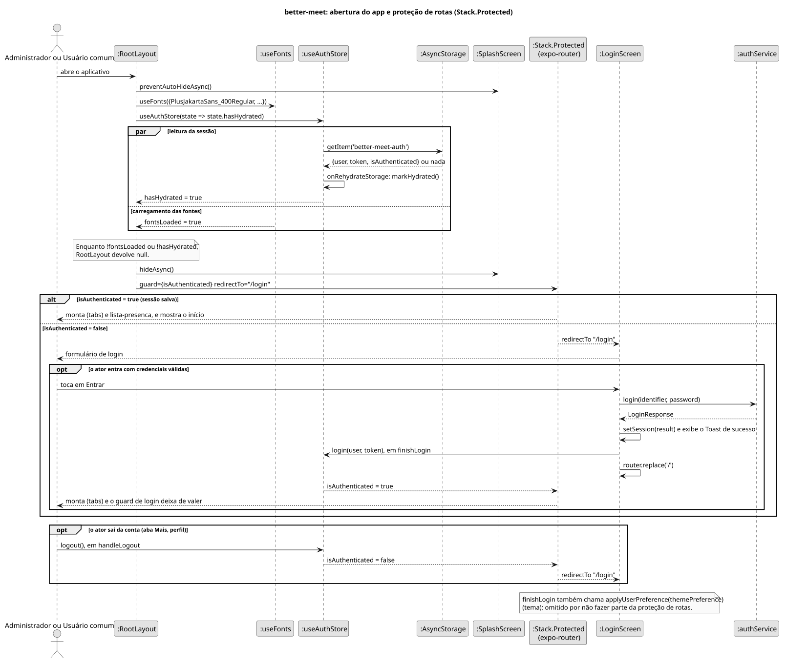
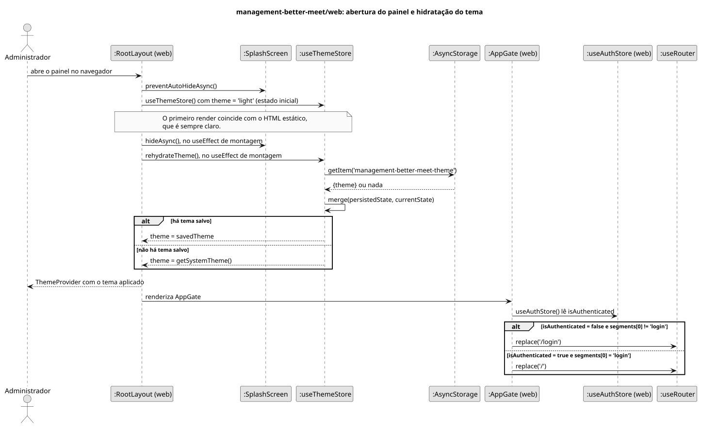

# Diagramas de sequência — Migração para o Expo SDK 58

```text
Incremento: Entrega Di3 — Manutenção: migração para a SDK 58 do Expo
Escopo: fluxos de execução cuja implementação mudou na migração (sem RF nem UC novos); RNF45
Branch: feature/migracao-expo-58
Commit: 0320831
Data de revisão: 2026-11-12
Responsável(eis): [preencher: quem revisou e assina o documento]
Estado: Implementado (verificado no código); não executado em dispositivo
Fontes: sistema/better-meet/src/app/_layout.tsx; sistema/better-meet/src/store/authStore.ts; sistema/better-meet/src/app/login.tsx; sistema/better-meet/src/services/authService.ts; sistema/better-meet/src/app/(tabs)/mais/perfil.tsx; sistema/management-better-meet/web/src/app/_layout.tsx; sistema/management-better-meet/web/src/store/themeStore.ts; sistema/management-better-meet/web/src/store/authStore.ts
Fontes dos diagramas: DS-Protecao-Rotas-Better-Meet.puml; DS-Hidratacao-Tema-Web.puml
```

Os diagramas são PlantUML: a fonte `.puml` e o `.svg` gerado ficam lado a lado nesta pasta. Os `.svg` foram gerados em 2026-11-12 com o PlantUML 1.2026.10 (`plantuml.jar` da release oficial, SHA-256 `e9bc9e6b2eb715e8c0c929f3dcb5fc1923be13f37599b09c293c66d354e88686`), sem erros de sintaxe, e conferidos visualmente em PNG temporário. Os diagramas de sequência não precisam de Graphviz. Para gerá-los de novo, nesta pasta:

```bash
java -jar plantuml.jar -charset UTF-8 -tsvg DS-Protecao-Rotas-Better-Meet.puml DS-Hidratacao-Tema-Web.puml
```

O `-charset UTF-8` evita que os acentos saiam trocados no Windows. A renderização no GitHub e na Wiki ainda não foi conferida.

Os diagramas cobrem só o que mudou de forma na migração. Troca de versões, do caminho de importação do `NativeTabs` e de tipos do React Native não altera o fluxo de execução e não tem diagrama (veja a seção 5 de [migracao_expo_58.md](../migracao_expo_58.md)).

`Stack.Protected` é um componente do `expo-router`. O código-fonte dele não foi lido: o diagrama usa só o que o `_layout.tsx` declara (`guard` e `redirectTo`) e o tipo `Protected.d.ts` instalado, que tem `redirectTo?: Href`. O momento exato do redirecionamento é interno ao Expo Router `[A CONFIRMAR NO CÓDIGO]`.

---

## 1. `better-meet`: abertura do app e proteção de rotas

**Atores:** Administrador (`Role.ADMIN`) e Usuário comum (`Role.USER`). O fluxo vale para os dois e não depende do papel.

**Cenário:** o ator abre o app. O diagrama mostra a espera por fontes e pela leitura da sessão, e depois a escolha entre o início (com sessão) e o login (sem sessão). O trecho final mostra como o `guard` reage à mudança de `isAuthenticated` ao entrar e ao sair da conta.

**Estado anterior (removido na migração):** a decisão era de um componente `AppGate`, com um `useEffect` sobre `useSegments()` e a lista `PUBLIC_ROUTES`, que chamava `router.replace`. Hoje a decisão é declarativa, nos `guard` do `_layout.tsx`.



Fonte: [DS-Protecao-Rotas-Better-Meet.puml](DS-Protecao-Rotas-Better-Meet.puml)

**Pontos verificáveis no código** (`src/app/_layout.tsx`):

| Item | Evidência |
|---|---|
| Splash só some com fontes e sessão prontas | `useEffect(() => { if (fontsLoaded && hasHydrated) void SplashScreen.hideAsync(); }, ...)` e `if (!fontsLoaded \|\| !hasHydrated) return null;` |
| Rotas logadas | `<Stack.Protected guard={isAuthenticated} redirectTo="/login">` com `(tabs)` e `lista-presenca` |
| Login só para quem não tem sessão | `<Stack.Protected guard={!isAuthenticated} redirectTo="/">` com `login` |
| Rotas públicas | `usuario` e `recuperar-senha`, fora de qualquer `Stack.Protected` |

**Erros:** se a leitura do `AsyncStorage` falhar, `markHydrated()` pode não ser chamado e o `RootLayout` continuaria devolvendo `null`. Esse caminho **não foi verificado** `[A CONFIRMAR NO CÓDIGO]`. A rota `POST /login` da API e a validação do formulário (`loginSchema`) não mudaram na migração e não são detalhadas aqui.

---

## 2. `management-better-meet/web`: abertura do painel e hidratação do tema

**Atores:** Administrador (`Role.ADMIN`). O painel é restrito a administradores (`login.tsx` recusa `data.role !== 'ADMIN'`).

**Cenário:** o administrador abre o painel no navegador. O estado do tema nasce `'light'` para coincidir com o HTML estático e só depois lê o tema salvo. Essa correção foi feita nos testes da migração, depois de um erro de hidratação do React; que o SDK 58 seja a causa do erro não foi comprovado.

**Estado anterior:** o `themeStore` nascia com `Appearance.getColorScheme()` e hidratava sozinho na criação da store, antes da montagem.



Fonte: [DS-Hidratacao-Tema-Web.puml](DS-Hidratacao-Tema-Web.puml)

**Observações:**

- O `AppGate` do painel web **não** foi trocado por `Stack.Protected`. A sessão do web não é persistida, de propósito (`authStore.ts`), então a cada carregamento da página o administrador entra de novo.
- Efeito aceito, registrado nas notas do AI-DLC do web: quem usa o tema escuro vê um instante em claro antes de o tema salvo ser aplicado.
- A aplicação do tema da conta no login (`applyAccountTheme`) e o salvamento pelo botão do cabeçalho (`usuarioService.updateTheme`) são funcionalidade nova do mesmo commit e **não** fazem parte da migração; precisam de diagrama no assunto "tema preferido".
- Erros de leitura do `AsyncStorage` na hidratação não foram verificados `[A CONFIRMAR NO CÓDIGO]`.
