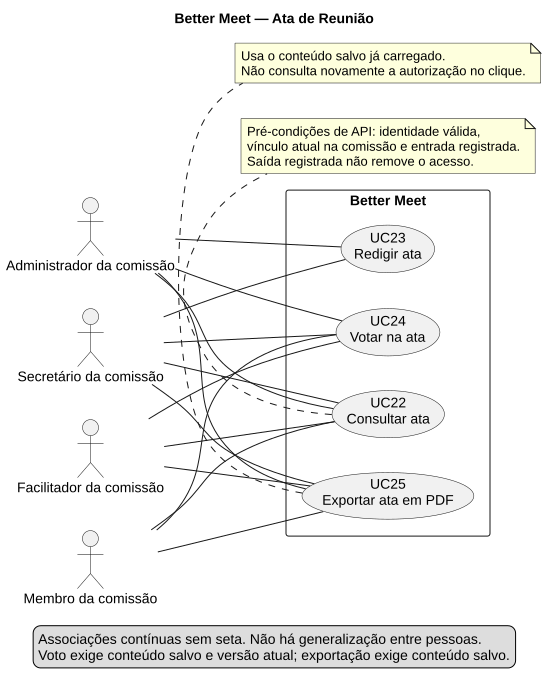
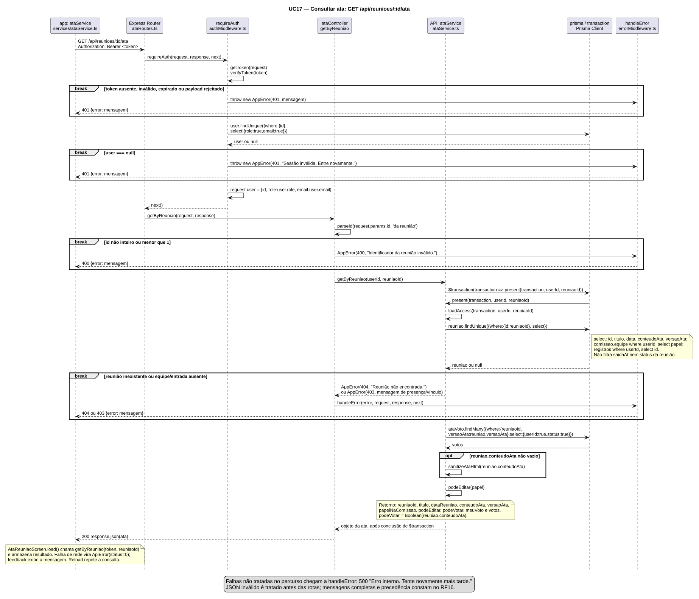
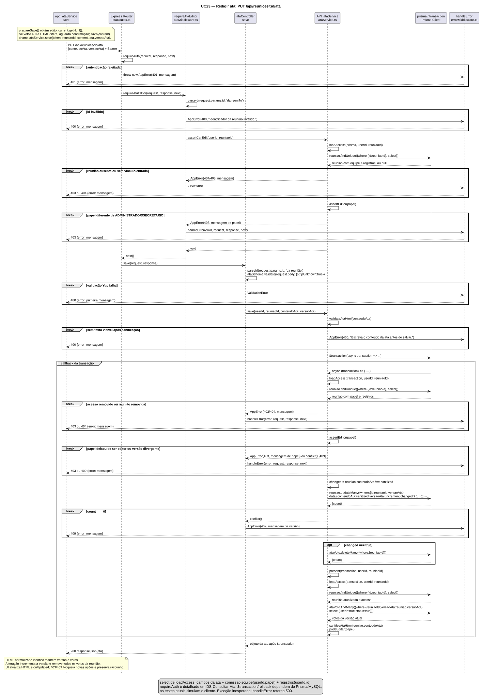
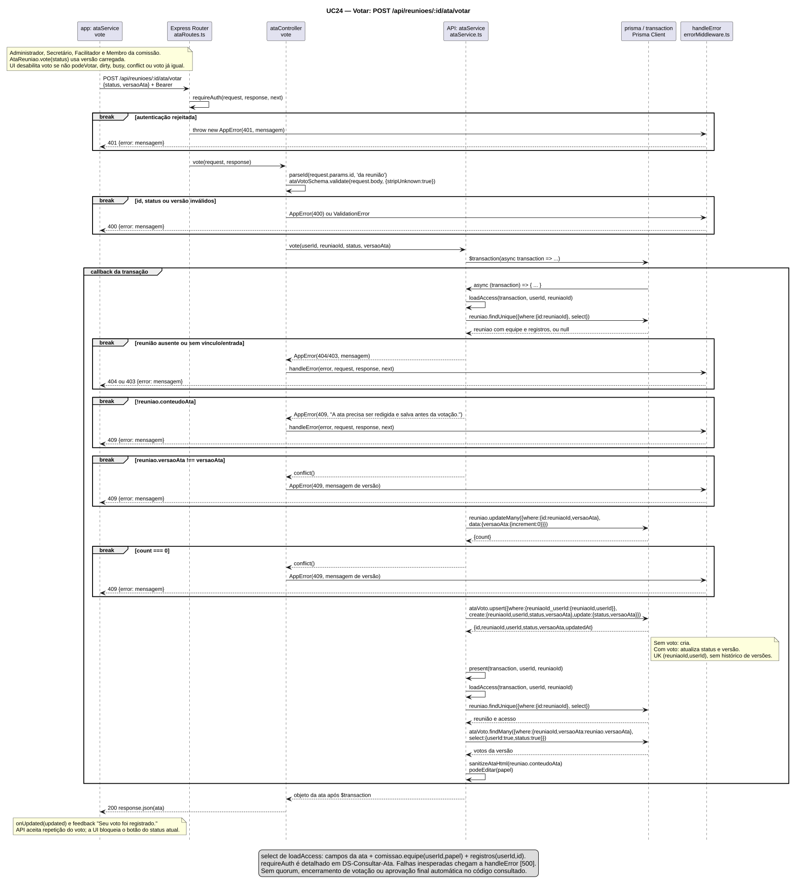
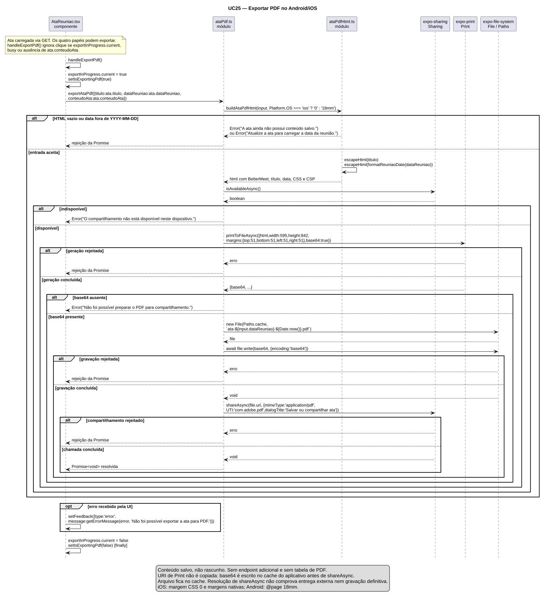
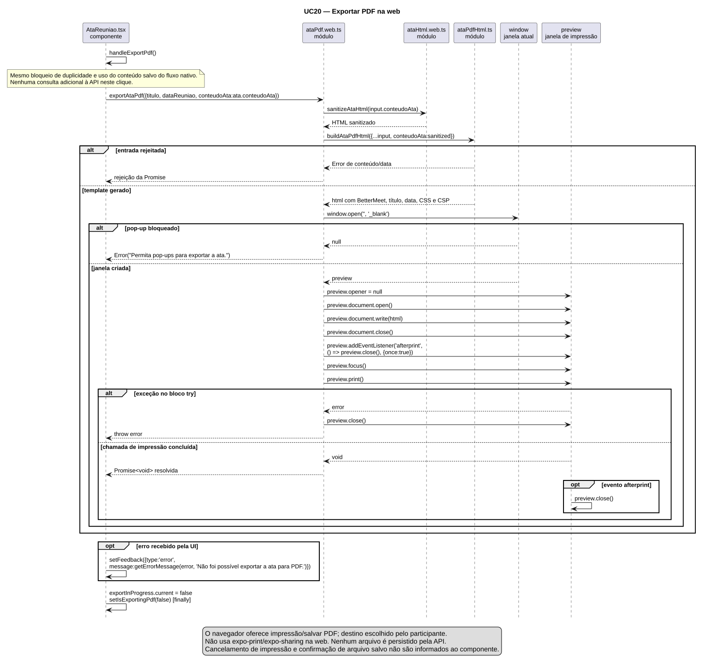
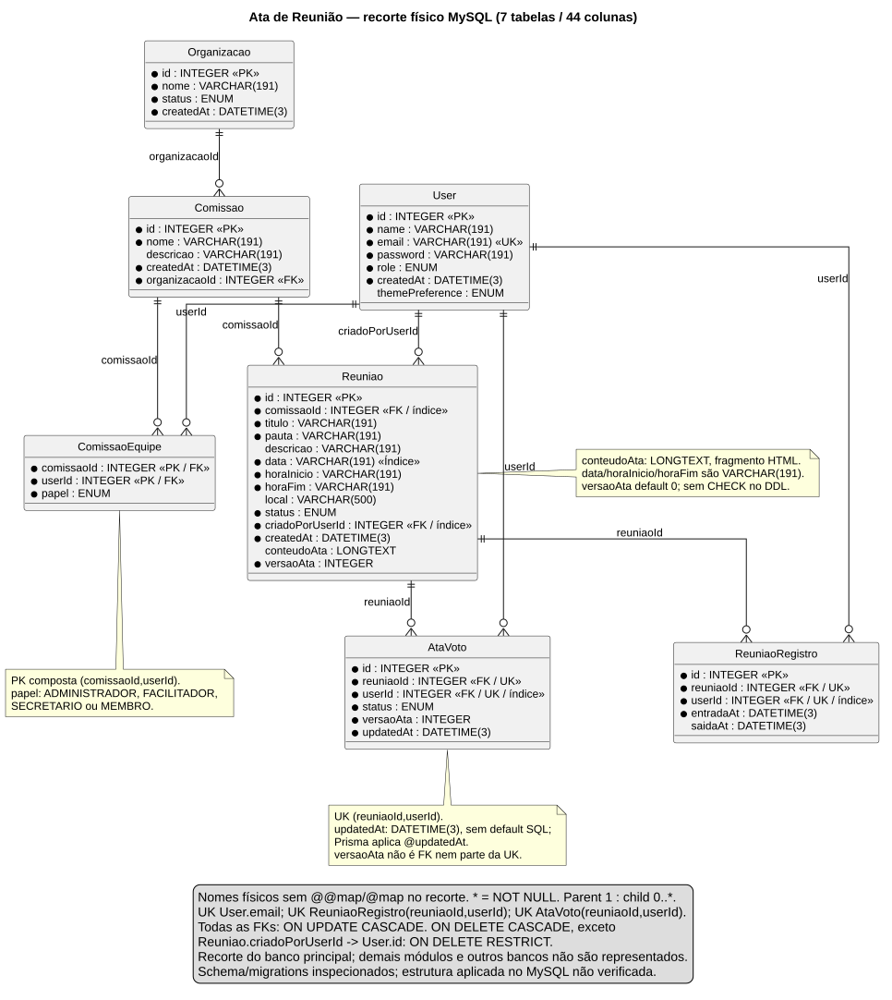

- **Incremento:** 3 — Entrega 4 (entrega4_Di3)
- **Escopo:** RF17, RNF45/RNF46 e UC22–UC25 — editor, acesso, leitura, voto e PDF da ata.
- **Branch:** development
- **Commit:** 945419d84dd6a3dd32aacab736f32f9c7ed806f5
- **Data de revisão:** 2026-11-13
- **Responsável(eis):** Gustavo de Oliveira Tomaz
- **Estado:** Parcial — entrega documental aprovada em 2026-11-13; 138 testes direcionados aprovados, integração física pendente.
- **Fontes:** [schema](../../sistema/api/prisma/schema.prisma), [serviço](../../sistema/api/src/services/ataService.ts), [rotas](../../sistema/api/src/routes/ataRoutes.ts), [componente](../../sistema/better-meet/src/components/AtaReuniao.tsx), [OpenAPI](../../sistema/api/docs/openapi.yaml) e inventário A.1.

# Ata de reunião

## A. Diagnóstico

Integração de 2026-11-13: a fonte foi transferida para entrega4_Di3 conforme a reorganização da equipe em 3832724. O responsável acima foi informado no cabeçalho desse documento remoto, não deduzido da autoria do commit. Preservam-se o Incremento 3 solicitado e a baseline funcional 945419d; Entrega 4 identifica a pasta de publicação. Os patches de dependências posteriores não alteram retroativamente as versões inspecionadas no cabeçalho.

A ata pertence à reunião. Administrador e Secretário da comissão podem redigir; os quatro papéis podem consultar, votar e exportar, respeitando vínculo atual e entrada registrada. Registrar saída não revoga por si só o acesso. O papel global não substitui o papel da comissão.

O código do cabeçalho foi incorporado à development. O HEAD e99249376a971507ddb0105884ec34eb6482120f acrescenta documentação/guias; a comparação sob sistema não mostrou diferenças funcionais. Classes e dicionário de dados foram solicitados **separadamente, fora do repositório, para unificação** em 2026-11-13. O DER permanece neste documento; a incorporação da parte separada fica pendente.

### A.1 Fontes inspecionadas

Caminhos relativos à raiz. IDs S01–S11 agrupam fontes; leitura não equivale a execução de testes.

| Grupo | Arquivos e alcance |
|---|---|
| S01 — HTTP/identidade | sistema/api/src/server.ts; routes/ataRoutes.ts; controllers/ataController.ts; middlewares/authMiddleware.ts, ataMiddleware.ts, errorMiddleware.ts; utils/parseId.ts, prismaErrors.ts; errors/AppError.ts — integrais, caminhos após src/ relativos à API |
| S02 — negócio/HTML | sistema/api/src/services/ataService.ts, schemas/ataSchema.ts, utils/ataHtml.ts — integrais |
| S03 — dados | sistema/api/prisma/schema.prisma integral; migrations 20260918235817_config_usuario, 20260922140000_papeis_organizacao, 20261014120000_alinha_schema_atual, 20261014120100_adiciona_enums_status_tema, 20261021120000_registra_tabelas_reuniao, 20261021120100_registro_entrada_reuniao, 20261023120000_local_reuniao e 20261109140000_ata_reuniao, cada migration.sql integral |
| S04 — presença | API: reuniaoRoutes.ts integral, trechos de reuniaoController.ts e funções assertMembroDaComissao, apresentarReuniao, getById, checkIn/checkOut e respondInvite em reuniaoService.ts; app: src/app/(tabs)/(reunioes)/reuniao/[id].tsx, participantes e botão da ata |
| S05 — tela/cliente | sistema/better-meet/src/app/(tabs)/(reunioes)/ata/[id].tsx; components/AtaReuniao.tsx; services/ataService.ts; utils/apiClient.ts; config/api.ts; store/authStore.ts — integrais, caminhos após src/ relativos ao app |
| S06 — editor/leitor | App src/components/ata/: AtaEditor.tsx, AtaEditor.web.tsx, AtaEditor.types.ts, AtaLeitura.tsx, AtaLeitura.web.tsx, AtaToolbar.tsx, AtaTableMenu.tsx, AtaFormatIcon.tsx; utils/ataFormat.ts, ataNativeBridge.ts, ataTiptap.web.ts, ataHtml.web.ts — integrais; constants/theme.ts e utils/format.ts, trechos usados |
| S07 — PDF | App src/utils/ataPdf.ts, ataPdf.web.ts, ataPdfHtml.ts — integrais |
| S08 — testes/configuração | Nove arquivos relacionados em [testes_ata_reuniao.md](testes_ata_reuniao.md); configurações Jest, TS e ESLint; package.json/lock da API e app, versões selecionadas; app.json; API env.ts/database.ts/prisma.config.ts; docker-compose.yml (serviços/imagens/volumes, sem valores privados) |
| S09 — contrato | sistema/api/docs/openapi.yaml: abertura, segurança, respostas, schemas e três operações da ata |
| S10 — documentação | Fonte anterior deste arquivo integral; aberturas/IDs de votacoes.md/testes_votacoes.md; contexto de lista_presenca.md; entrega2_Di1/dicionario_de_dados.md e requisitos_e_casos_de_uso.md, trechos relacionados; DCU-Gestao-Setup-Reset.puml integral; guias e regras documentais/83–90 do PROMPT_AGENTES_IA.md |
| S11 — presença demonstrativa | App src/hooks/useListaPresencaPreview.ts integral; src/app/lista-presenca.tsx e services/listaPresencaService.ts, trechos/busca de chamadas |

Wiki: snapshot **1226e33743b2d27ec16fd6738986faf7ca745a9b**, reconfirmado no remoto ao iniciar a escrita. Busca em 40 páginas Markdown e 42 arquivos textuais de documentos/; leitura relacionada de Home, [Requisitos](https://github.com/MiguelIFSP/BRTPDS2-PROJETO-E-DESENVOLVIMENTO-DE-SISTEMAS-2/wiki/Requisitos), RF14, RF15 e páginas de comissão/tema. A busca não interpreta IDs apenas em imagens/binários antigos.

### A.2 Divergências e limitações

| Item | Estado | Constatação |
|---|---|---|
| Consulta, redação, voto, PDF | Implementado | S01–S07; 138 testes direcionados aprovados; validação física pendente |
| Permissão “via JWT” | Implementado | Token identifica a pessoa; papel global e papel da comissão são consultados no banco. UI usa podeEditar da API |
| Presença | Implementado | Registro de entrada e vínculo atual; não filtra saidaAt |
| Lista manual de presença | Parcial | S11 é demonstração em memória; marcá-la não cria ReuniaoRegistro |
| Ordem de erros na OpenAPI | Parcial | A ordem geral descrita não representa estas rotas; ver B.1 |
| Dicionário antigo | Parcial | Tema/status foram convertidos de VARCHAR para enums; conteudoAta é LONGTEXT |
| IDs globais repetidos | Parcial | UC04 tem significados distintos em monitoramento, comissão e tema; UC01 também tem usos distintos. Significado canônico [A CONFIRMAR]; não se escolheu nem renumerou |
| RNFs concorrentes após integração | Parcial | O remoto 3832724 trouxe RNF45/RNF46 para compatibilidade Expo e qualidade estática, colidindo com os RNFs de HTML/integridade desta ata e com CT-RNF45/46. Identificadores globais definitivos [A CONFIRMAR]; preservados sem renumeração, conforme a regra 8. Referências desta página designam o assunto Ata de Reunião |
| IDs legados da ata | Parcial | RF-ATA/UC-ATA/CT-ATA preservados em D e no histórico de testes; equivalência formal [A CONFIRMAR] |
| Banco aplicado/concorrência real | Não verificado | Conexão somente de leitura recusada com ECONNREFUSED em 2026-11-12, antes de consultas SQL |
| Uso em Android/iOS | Não verificado | APIs nativas simuladas nos testes existentes; nenhuma confirmação própria em aparelho |
| Índice da Wiki | Planejado | Precisa incorporar RF17/RNF45/RNF46; RF16/RNF44 da fonte de votações também estavam ausentes |
| Classes/dicionário unificados | Planejado | Entrega separada solicitada; integração posterior fora desta edição |

Não há fase de publicação, quórum, encerramento, assinatura, histórico de textos ou estado coletivo de aprovação da ata. Há votos individuais e totais da versão atual. Exportação usa o conteúdo salvo **já carregado**, sem nova consulta ou autorização remota.

## B. Requisitos

### B.1 RF17 — Gerenciar atas de reunião

**Estado:** Implementado no código; 138 testes direcionados aprovados; limites em E. **Objetivo:** consultar, redigir conforme o papel, votar e exportar a ata. **Origem:** pedido do módulo e implementação S01–S07. **Destino:** integrantes da comissão, Reuniao/AtaVoto e arquivo local conforme operação.

Numeração formal posterior aos maiores IDs textuais encontrados: RF16, RNF44 e UC21. Os novos itens consolidam o assunto sem apagar as referências legadas.

#### Atores

| Ator | Tipo | Responsabilidade | Evidência |
|---|---|---|---|
| Administrador da comissão (PapelComissao.ADMINISTRADOR) | Pessoa/papel externo | Consultar, redigir, votar e exportar quando elegível | S02 podeEditar/loadAccess; S05 |
| Secretário da comissão (PapelComissao.SECRETARIO) | Pessoa/papel externo | Consultar, redigir, votar e exportar quando elegível | S02/S05 |
| Facilitador da comissão (PapelComissao.FACILITADOR) | Pessoa/papel externo | Consultar sem edição, votar e exportar quando elegível | S02/S05 |
| Membro da comissão (PapelComissao.MEMBRO) | Pessoa/papel externo | Consultar sem edição, votar e exportar quando elegível | S02/S05 |

“Administrador” isolado significa Role.ADMIN. Nenhum papel global acrescenta privilégio nessa ata. Cada ator exige ComissaoEquipe atual e ReuniaoRegistro da reunião para as operações HTTP.

#### Regras de negócio

| ID | Regra | Evidência | Estado |
|---|---|---|---|
| RN-ATA01 | Leitura/gravação/voto exigem sessão, vínculo atual e entrada; saída não exclui por si só | requireAuth/loadAccess | Implementado |
| RN-ATA02 | Só ADMINISTRADOR/SECRETARIO editam; middleware e transação verificam; UI recebe podeEditar | requireAtaEditor/assertEditor/save | Implementado |
| RN-ATA03 | HTML obrigatório com trim, até 50.000 caracteres antes da sanitização e texto efetivo depois dela | ataSchema/validateAtaHtml | Implementado |
| RN-ATA04 | Versão divergente ou atualização condicional count=0 gera 409 | save/vote | Implementado; concorrência real Não verificado |
| RN-ATA05 | Alterar HTML normalizado incrementa versão e remove votos; texto normalizado idêntico preserva ambos | save | Implementado |
| RN-ATA06 | Quatro papéis votam após texto salvo; um registro por reunião/pessoa, com troca; totais sem decisão coletiva automática | vote/present/AtaVoto | Implementado |
| RN-ATA07 | PDF usa texto salvo carregado, nunca rascunho; não atualiza servidor nem revalida acesso no clique | handleExportPdf/exportAtaPdf | Implementado |
| RN-ATA08 | Rascunho impede voto na UI; 403/409 preserva rascunho e bloqueia edição/voto até recarregar | AtaReuniao | Implementado |

O checkIn para criar presença verifica comissão/organização aceita, integrante criador ou com convite aceito e reunião AGENDADA; registro existente é retornado antes dessa verificação de status. loadAccess da ata não repete critérios de convite, data ou status da reunião/organização. O botão de acesso exige meuRegistro e papelNaComissao; servidor valida independentemente dele.

#### Entradas

| Campo | Tipo e domínio | Validação/origem |
|---|---|---|
| Authorization | Bearer + token | jwt.verify; sub inteiro positivo, role do enum, email presente; User relido. Sessão do authStore |
| id | Parâmetro convertido em number, inteiro > 0 | parseId usa Number/Number.isInteger (primeiro valor se array); tela usa Number.isSafeInteger antes da chamada |
| conteudoAta | string HTML | PUT: trim, obrigatório, máximo 50.000; deve manter texto após sanitização; editor.current.getHtml() |
| versaoAta | number inteiro >= 0 | Obrigatório em PUT/POST; deve coincidir com Reuniao.versaoAta; objeto Ata carregado |
| status | APROVADO ou REPROVADO | POST: string com trim, obrigatória; botão escolhido |
| titulo | string | PDF: ata.titulo; escapado no template, sem validação adicional de tamanho |
| dataReuniao | string AAAA-MM-DD | PDF: padrão textual validado (não calendário completo), formatado sem conversão de fuso |
| conteudoAta do PDF | string HTML salvo | ata.conteudoAta não nulo; template exige trim não vazio; web sanitiza novamente |

Os campos PDF são AtaPdfInput local, não corpo HTTP. Yup realiza coerções/transformações e stripUnknown: true; não promete rejeição de todo tipo JSON inicial diferente. userId e papel não são escolhidos no corpo para conceder permissão.

#### Saída comum da API

GET/PUT/POST retornam **200**, objeto sem envelope:

| Campo | Tipo/domínio | Origem |
|---|---|---|
| reuniaoId | number | ID solicitado |
| titulo | string | Reuniao.titulo |
| dataReuniao | string | Reuniao.data |
| conteudoAta | HTML string ou null | Texto sanitizado novamente em present |
| versaoAta | number | Reuniao.versaoAta |
| papelNaComissao | PapelComissao | ComissaoEquipe.papel |
| podeEditar | boolean | ADMINISTRADOR/SECRETARIO |
| podeVotar | boolean | Boolean do conteúdo persistido, após autorização |
| meuVoto | StatusAtaVoto ou null | Voto próprio na versão atual |
| votos.aprovados | inteiro >= 0 | Contagem APROVADO na versão atual |
| votos.reprovados | inteiro >= 0 | Contagem REPROVADO na versão atual |

Não se devolve a lista de votos individuais de terceiros. Totais filtram versão, mas não o vínculo atual de cada votante: remover alguém da comissão não apaga automaticamente seu voto armazenado.

#### Origem, Saída, Destino e Ação por operação

| Operação | Origem/rota ou função | Saída/destino | Ação e pré/pós-condições |
|---|---|---|---|
| Consultar | Foco/atualização em AtaReuniaoScreen; GET /api/reunioes/:id/ata | Objeto comum para UI | Sessão/vínculo/entrada; getByReuniao abre transação, present/loadAccess consulta reunião e votos, sanitiza e retorna. Sem texto: 200/null, podeVotar false; sem escrita de negócio |
| Salvar | Editor; PUT /api/reunioes/:id/ata | Objeto comum; Reuniao/AtaVoto | Papel editor e versão atual; middleware assertCanEdit, schema, validateAtaHtml, transação reautoriza e compara versão, updateMany grava, deleteMany remove votos se mudou, present retorna; texto idêntico preserva versão/votos |
| Votar | Botão; POST /api/reunioes/:id/ata/votar | Objeto comum; AtaVoto | Conteúdo e versão atuais; validar, loadAccess, conferir conteúdo/versão, updateMany incremento zero, upsert pela UK e present. Troca não duplica; texto permanece |
| Exportar | handleExportPdf; exportAtaPdf(input) | Promise<void>; cache/gaveta ou janela de impressão | Texto salvo carregado; template; nativo verifica Sharing, gera base64, aguarda File.write e compartilha; web sanitiza/abre/imprime; não modifica reunião/votos, nem confirma envio externo |

Prefixo /api vem de server.ts. Nenhum endpoint de PDF. O fluxo detalhado e pré/pós-condições de cada objetivo estão nas fichas UC22–UC25.

#### Erros e ordem de validação

Erros HTTP têm error; propriedades de AppError.details podem ser incorporadas no mesmo nível. Não existe details obrigatório.

| HTTP | Condição | Mensagem literal |
|---|---|---|
| 400 | ID inválido | Identificador da reunião inválido. |
| 400 | JSON malformado | JSON inválido. |
| 400 | HTML ausente | Escreva o conteúdo da ata. |
| 400 | HTML acima do limite | A ata deve ter no máximo 50.000 caracteres de HTML. |
| 400 | Vazio após sanitizar | Escreva o conteúdo da ata antes de salvar. |
| 400 | Versão ausente/inválida como número | Informe a versão da ata. |
| 400 | Versão fracionária / negativa | A versão deve ser inteira. / A versão não pode ser negativa. |
| 400 | Status ausente/inválido | Escolha aprovar ou reprovar a ata. |
| 401 | Bearer ausente/vazio | Autenticação necessária. |
| 401 | Assinatura/expiração | Token inválido ou expirado. |
| 401 | Claims/sub inválidos | Token inválido. |
| 401 | Conta excluída | Sessão inválida. Entre novamente. |
| 403 | Sem vínculo ou entrada | A ata está disponível somente para integrantes da comissão com entrada registrada nesta reunião. |
| 403 | Sem papel de edição | Somente administrador ou secretário da comissão pode editar a ata. |
| 404 | Reunião inexistente | Reunião não encontrada. |
| 409 | Voto antes do texto | A ata precisa ser redigida e salva antes da votação. |
| 409 | Versão divergente/count=0 | A ata foi alterada. Atualize a tela antes de salvar ou votar. |
| 404 / 409 | Prisma P2025 / P2002 genéricos | Registro não encontrado. / Registro já existente. |
| 500 | Exceção não convertida | Erro interno. Tente novamente mais tarde. |

JSON malformado pode falhar antes da autenticação. Com JSON bem formado, requireAuth precede as rotas; PUT verifica papel antes do corpo; loadAccess detecta reunião ausente antes de negar vínculo. Voto repetido normalmente retorna 200 por upsert, não o erro P2002. Falha de rede gera ApiError status 0 no cliente (“Não foi possível conectar ao servidor. Verifique sua conexão.”); 0 não é HTTP.

PDF é local. Mensagens próprias: “A ata ainda não possui conteúdo salvo.”; “Atualize a ata para carregar a data da reunião.”; “O compartilhamento não está disponível neste dispositivo.”; “Não foi possível preparar o PDF para compartilhamento.”; “Permita pop-ups para exportar a ata.”. Print/File/Sharing podem fornecer mensagens próprias; fallback: “Não foi possível exportar a ata para PDF.”.

#### Editor, leitura e PDF

| Grupo | Comportamento implementado (S05–S07) |
|---|---|
| Edição por papel | Admin/Secretário da comissão veem AtaEditor/Salvar; demais, AtaLeitura ou espera. Todos recebem voto/PDF, desabilitados conforme estado |
| Texto/histórico | Negrito, itálico, sublinhado, rasurado, desfazer/refazer |
| Parágrafos | H1/H2/H3; esquerda/centro/direita/justificado; listas ordenadas/não ordenadas; aumentar/diminuir recuo |
| Fonte | Escala 10, 13, 16, 18, 24, 32, 48 px |
| Tabelas | Menu de 1–10 linhas, 1–6 colunas, cabeçalho opcional, adicionar/excluir linha/coluna ou tabela; sem controle de mesclagem |
| Bordas | all, outer, inner, horizontal, vertical, top, bottom, left, right, none em data-ata-border |
| Barra | ScrollView horizontal, fundo escuro, ícones Pell/Ionicons e glifos H1/H2/H3; ações Colors.dark.primary (#1FD5B5); alvos de 44 |
| Plataformas | Pell/WebView/ataNativeBridge no nativo; Tiptap na web; DOMPurify no leitor web; leitor nativo sem JavaScript/acesso a arquivos, navegação só about:blank |

Limites de linhas/colunas são da interface; a API limita tamanho HTML e colspan/rowspan de 1 a 10, sem contar linhas/colunas. HTML preserva tags textuais/tabelas e estilos enumerados; normaliza font/align legados e remove scripts/eventos/recursos externos. Template PDF escapa título/data, mas não é sanitizador do HTML nativo.

prepareSave obtém o HTML atual pelo ref e confirma alteração se houver votos carregados. O servidor compara o texto normalizado. A UI preserva rascunho em falhas; 403/409 bloqueia editar/votar até recarregar. PDF pode usar o conteúdo carregado mesmo após conflito, pois não testa conflict nem renova acesso.

PDF: BetterMeet, título/data, fundo branco, CSS e sans-serif. Nativo gera A4 595×842; iOS usa CSS margin 0 e margens nativas 51; Android @page 18mm. Base64 é gravado em File(Paths.cache, nome com data/Date.now), aguardado antes de compartilhar application/pdf e UTI com.adobe.pdf. O cache permanece para leitura do destinatário. Na web, somente o documento da ata é aberto, opener isolado e print invocado; o navegador decide salvar/imprimir. Cancelar não gera confirmação de envio.

### B.2 RNF45 — Restrições do HTML

- **Categoria/escopo:** Segurança; gravação/apresentação na API, leitura web/nativa e entrada do PDF.
- **Exigência:** HTML limitado a tags/atributos/estilos permitidos; leitor nativo sem JavaScript/acesso a arquivos, navegação só about:blank.
- **Métrica:** nos vetores definidos em CT-RNF45-01, zero scripts/eventos/URLs externas/estilos fora do domínio preservados, mantendo exemplos permitidos. CT-RNF45-02 confere propriedades e comportamento real do leitor.
- **Método:** testes com sanitizadores reais, inspeção e roteiro manual; listar os vetores executados, sem alegar proteção absoluta.
- **Versões:** sanitize-html 2.18.1; DOMPurify 3.4.17; WebView 14.0.1, nos lockfiles.
- **Evidência:** S02/S06 e testes_ata_reuniao.md; CT-RNF45-01 aprovado.
- **Estado:** mecanismos Implementados; validação completa Não verificado.
- **Resultado:** **Não executado** para a exigência completa; CT-RNF45-01 aprovado nas suítes, CT-RNF45-02 em aparelho pendente.

### B.3 RNF46 — Integridade de texto, versão e votos

- **Categoria/escopo:** Integridade/confiabilidade; save/vote e Reuniao/AtaVoto.
- **Exigência:** texto, versão e remoção de votos na mesma transação; máximo de um voto por reunião/pessoa; versão rejeitada não grava; falha transacional não deixa estado parcial.
- **Métrica:** zero pares duplicados, zero votos em versão rejeitada e zero estados parciais nos cenários definidos; conteúdo normalizado idêntico preserva versão/votos.
- **Método:** CT-RNF46-01 inspeciona SQL/chaves; CT-RNF46-02 testa chamadas/conflitos simulados; CT-RNF46-03 exige concorrência e falha controlada em banco de teste. Registrar amostra e condições.
- **Versões:** Prisma/@prisma/client 7.10.0; imagem configurada mysql:8.4.0; versão do servidor em execução [A CONFIRMAR NO CÓDIGO/AMBIENTE].
- **Evidência:** S02/S03, $transaction/updateMany/upsert e UK/FKs; DER e registro de testes.
- **Estado:** mecanismos Implementados; concorrência/rollback reais Não verificado.
- **Resultado:** **Não executado** para a exigência completa; CT-RNF46-02 aprovado com mocks, banco/concorrência/rollback reais pendentes.

Não há metas de tempo/escala sem requisito. Votar, autorizar, exportar e validar campos são RF/regras. Resultado futuro reprovado não autoriza reduzir a exigência.

### B.4 Versões da implementação

| Área | Manifesto → lockfile |
|---|---|
| API | express ^5.2.1 → 5.2.1; prisma/@prisma/client 7.10.0; sanitize-html 2.18.1; yup ^1.7.0 → 1.7.1; jsonwebtoken ^9.0.3 → 9.0.3 |
| App | expo ~58.0.23 → 58.0.23; React 19.3.0; React Native 0.88.1; Pell ^1.10.0 → 1.10.0; WebView 14.0.1 |
| PDF/web | expo-print ~58.0.9 → 58.0.9; sharing ~58.0.23 → 58.0.23; file-system ~58.0.13 → 58.0.13; @tiptap/react ^3.33.0 → 3.33.0; dompurify ^3.4.17 → 3.4.17 |

São versões do código-base, não medidas do celular/produção.

## C. Casos de uso e diagramas

### C.1 Casos de uso

[Fonte PlantUML](Diagramas/DCU-Ata-Reuniao.puml). Fronteira Better Meet, quatro atores concretos de B.1. Sem include/extend/generalização: os objetivos são independentes, com pré-condições próprias. Carregar uma tela antes de agir não constitui relação UML.

### UC22 — Consultar ata

- **Estado/objetivo:** Implementado; obter texto, voto próprio e contagens, inclusive reconhecer ausência de ata.
- **Atores:** Administrador da comissão; Secretário da comissão; Facilitador da comissão; Membro da comissão.
- **RF/regras:** RF17; RN-ATA01/02; RNF45.
- **Gatilho:** abrir Ata de reunião ou Atualizar ata e votos.
- **Entradas:** token string da sessão; reuniaoId number inteiro positivo, convertido do parâmetro id.
- **Pré-condições:** conta válida, vínculo atual e entrada registrada; não exige texto salvo nem ausência de saída.
- **Fluxo:** 1) tela confere token/id; 2) serviço do app envia GET; 3) requireAuth valida identidade; 4) controller resolve id; 5) getByReuniao abre transação, present chama loadAccess; 6) consulta votos da versão e sanitiza texto; 7) responde 200; 8) mostra editor aos dois papéis habilitados e leitor aos demais.
- **Alternativas/erros:** sem ata, 200/null, podeVotar false e aviso para leitores; id local inválido: “Reunião inválida.”; API: 400/401/403/404/500 conforme B.1; rede: ApiError status 0 e nova tentativa. Recarregar com rascunho exige confirmação de descarte.
- **Pós-condições:** estado local recebe o objeto; nenhuma escrita de negócio no banco. Erro não confirma carregamento novo.
- **Relações UML:** nenhuma; associação individual aos quatro atores.
- **Rastreabilidade:** S01/S02/S05/S06; User, ComissaoEquipe, ReuniaoRegistro, Reuniao, AtaVoto; DS-Consultar-Ata; CT-RF17-01–05 e CT-RNF45-01/02.

### UC23 — Redigir ata

- **Estado/objetivo:** Implementado; criar ou alterar o texto Rich Text.
- **Atores:** Administrador da comissão; Secretário da comissão.
- **RF/regras:** RF17; RN-ATA01–05/08; RNF45/RNF46.
- **Gatilho:** editar e tocar Salvar.
- **Entradas:** token string; reuniaoId number; conteudoAta string HTML; versaoAta number inteiro >= 0.
- **Pré-condições:** identidade, vínculo e entrada válidos, papel editor e versão carregada; primeira gravação não exige ata anterior. UI requer alteração local e ausência de ocupação/conflito.
- **Fluxo:** 1) editor fornece getHtml(); 2) confirmar se há votos carregados e mudança; 3) PUT passa por requireAuth e requireAtaEditor; 4) controller valida id/corpo; 5) service sanitiza/exige texto; 6) transação revalida acesso/papel/versão; 7) updateMany grava e incrementa se mudou; 8) deleteMany remove votos se mudou; 9) present devolve 200; 10) UI atualiza rascunho/objeto e informa disponibilidade de votação.
- **Alternativas/erros:** HTML normalizado idêntico preserva votos/versão; cancelar confirmação não envia PUT; 400 de schema/sanitizador; 401/403 de acesso; 404 de reunião; 409 de versão/count=0; 500 de exceção. Rede permite nova tentativa; 403/409 bloqueia editar/votar, preservando rascunho até recarregar.
- **Pós-condições:** sucesso com alteração: HTML normalizado, versão incrementada e votos removidos; sem alteração: versão/votos mantidos. Falha não confirma salvamento. Atomicidade física depende de teste real pendente.
- **Relações UML:** nenhuma; associação aos dois atores elegíveis.
- **Rastreabilidade:** S01–S03/S05/S06; Reuniao/AtaVoto; DS-Salvar-Ata; CT-RF17-06–12/15/16, CT-RNF45-01, CT-RNF46-01–03.

### UC24 — Votar na ata

- **Estado/objetivo:** Implementado; registrar/trocar concordância individual na versão salva.
- **Atores:** Administrador da comissão; Secretário da comissão; Facilitador da comissão; Membro da comissão.
- **RF/regras:** RF17; RN-ATA01/04–06/08; RNF46.
- **Gatilho:** tocar Aprovar ou Reprovar.
- **Entradas:** token string; reuniaoId number; status StatusAtaVoto; versaoAta number inteiro >= 0.
- **Pré-condições:** identidade, vínculo, entrada, texto salvo e versão atual. UI sem rascunho, ocupação ou conflito; botão igual ao voto atual fica desabilitado.
- **Fluxo:** 1) escolher status; 2) POST; 3) autenticar e validar id/corpo; 4) transação/loadAccess; 5) conferir conteúdo e versão; 6) updateMany condicional com incremento zero; 7) upsert pela UK; 8) present calcula voto próprio/totais; 9) 200 atualiza UI e mostra “Seu voto foi registrado.”.
- **Alternativas/erros:** repetição HTTP retorna 200 sem duplicar; troca substitui status; sem texto ou versão antiga, 409; corpo inválido, 400; acesso, 401/403; reunião ausente, 404; exceção, 500. Após edição remota, recarregar e votar na nova versão; não existe encerramento/quórum.
- **Pós-condições:** voto único sobre versão atual, contagens recalculadas e texto preservado. Erro não é confirmado como voto.
- **Relações UML:** nenhuma; quatro associações individuais.
- **Rastreabilidade:** S01–S03/S05; Reuniao/AtaVoto; DS-Votar-Ata; CT-RF17-03–05/11–16 e CT-RNF46-01–03.

### UC25 — Exportar ata

- **Estado/objetivo:** Implementado; preparar documento da versão salva carregada para guardar/compartilhar/imprimir.
- **Atores:** Administrador da comissão; Secretário da comissão; Facilitador da comissão; Membro da comissão.
- **RF/regras:** RF17; RN-ATA07; RNF45 no tratamento do HTML.
- **Gatilho:** tocar Exportar PDF.
- **Entradas:** AtaPdfInput com titulo string, dataReuniao string AAAA-MM-DD e conteudoAta string HTML, do objeto carregado.
- **Pré-condições:** leitura já autorizada no carregamento e texto salvo não vazio; não há reautorização no clique. UI impede exportação repetida em andamento e enquanto busy.
- **Fluxo nativo:** 1) bloquear chamada duplicada; 2) buildAtaPdfHtml valida conteúdo/data e monta template; 3) Sharing.isAvailableAsync; 4) Print.printToFileAsync com base64; 5) exigir base64, criar File em Paths.cache e aguardar write; 6) Sharing.shareAsync; 7) finally libera controle.
- **Alternativa web:** sanitizeAtaHtml, template, window.open, isolar opener, escrever documento, registrar afterprint, focus/print; fechar após evento. O navegador controla salvar/imprimir.
- **Erros:** conteúdo/data inválidos, compartilhamento indisponível, falta de base64, falha de Print/File/Sharing ou janela bloqueada; mensagem/fallback de B.1 e liberação para tentar novamente. Falha de gravação impede compartilhar. Rascunho não é salvo/exportado implicitamente.
- **Pós-condições:** nativo prepara arquivo em cache e invoca gaveta; web invoca impressão isolada. Sem mudança no banco; cancelamento/resolução da chamada não confirma entrega externa.
- **Relações UML:** nenhuma; quatro associações individuais.
- **Rastreabilidade:** S05/S07; dois DS-Exportar-Ata-Pdf; sem tabela/endpoint de PDF; CT-RF17-17–19/21–23 e CT-RNF45-01.

### C.2 Sequências

Cada cenário usa participantes concretos e chamadas reais. Notas definem abreviações dos parâmetros e condições, sem métodos inventados.

**Consulta — UC22**, fontes S01/S02/S05; [PlantUML](Diagramas/DS-Consultar-Ata.puml).

**Salvar — UC23**, fontes S01/S02/S05/S06; [PlantUML](Diagramas/DS-Salvar-Ata.puml).

**Votar — UC24**, fontes S01/S02/S05; [PlantUML](Diagramas/DS-Votar-Ata.puml).

**PDF nativo — UC25**, fontes S05/S07; [PlantUML](Diagramas/DS-Exportar-Ata-Pdf-Nativo.puml).

**PDF web — UC25**, fontes S05/S07; [PlantUML](Diagramas/DS-Exportar-Ata-Pdf-Web.puml).

## D. Persistência e rastreabilidade

### D.1 Recorte relacional

[Fonte PlantUML](Diagramas/DER-Ata-Reuniao.puml). Estado: Implementado no schema/DDL; estrutura física aplicada Não verificado. Recorte de sete tabelas e 44 colunas do banco principal, não inventário de todos os módulos. Banco de monitoramento não é afetado; não há FK entre bancos.

Reuniao contém conteudoAta LONGTEXT nullable e versaoAta INTEGER default 0. AtaVoto guarda status, versão e updatedAt, com UK por reunião/pessoa. ReuniaoRegistro comprova entrada; ComissaoEquipe fornece papel atual. User, Comissao e Organizacao contextualizam identidade e FKs. As relações seguem migrations S03; o vínculo do criador da reunião tem ON DELETE RESTRICT e os vínculos de votos/presença têm CASCADE. A remoção de ComissaoEquipe não apaga automaticamente AtaVoto.

Dados locais: rascunho/flags em estado React; sessão no authStore/AsyncStorage; PDF no cache; janela web temporária. Não são tabelas. Controller e service são objetos de módulo; o modelo de classes separado é de persistência Prisma, sem inventar métodos.

**Entrega separada solicitada:** dados_ata_reuniao.md (dicionário completo, índices, FKs, responsabilidades e dados locais), DC-Ata-Reuniao.puml e DC-Ata-Reuniao.svg foram preparados fora deste repositório para unificação. Sua incorporação à documentação consolidada está pendente. Não há cópias versionadas nem links relativos para arquivos ausentes.

### D.2 Matriz

| RF/RNF/regras | UC | Tela | Endpoint/função | Model/tabela | Diagrama | CT | Estado |
|---|---|---|---|---|---|---|---|
| RF17 consulta; RN-ATA01/02 | UC22 | AtaReuniaoScreen/AtaReuniao | GET /api/reunioes/:id/ata; getByReuniao/present | User, ComissaoEquipe, ReuniaoRegistro, Reuniao, AtaVoto | DCU; DS-Consultar-Ata; DER | CT-RF17-01–05 | Implementado; suítes direcionadas aprovadas; integração real pendente |
| RF17 redação; RN-ATA01–05/08 | UC23 | AtaReuniao/AtaEditor/AtaToolbar | PUT /api/reunioes/:id/ata; save | Reuniao/AtaVoto e modelos de acesso | DCU; DS-Salvar-Ata; DER | CT-RF17-06–12/15/16 | Implementado; suítes direcionadas aprovadas; integração real pendente |
| RF17 voto; RN-ATA01/04–06/08 | UC24 | AtaReuniao | POST /api/reunioes/:id/ata/votar; vote | AtaVoto/Reuniao e modelos de acesso | DCU; DS-Votar-Ata; DER | CT-RF17-03–05/11–16 | Implementado; suítes direcionadas aprovadas; integração real pendente |
| RF17 PDF; RN-ATA07 | UC25 | AtaReuniao | exportAtaPdf/buildAtaPdfHtml; sem endpoint | Dados carregados de Reuniao; arquivo local, sem tabela PDF | DCU; dois DS-PDF | CT-RF17-17–19/21–23 | Implementado; aparelho Não verificado |
| RF17 falha não tratada | UC22/UC23/UC24 | FeedbackBanner | handleError/API; ApiError/app | Sem confirmação de gravação na UI | DS consulta/salvar/votar | CT-RF17-20 | Caminho Implementado; cenário Não executado |
| RNF45 HTML | UC22/UC23/UC25 | Editor/leitor/PDF | sanitizeAtaHtml/validateAtaHtml | Reuniao.conteudoAta | DS consulta/salvar/PDF | CT-RNF45-01/02; CT-RF17-08 | Implementado; resultado Não executado |
| RNF46 integridade | UC23/UC24 | AtaReuniao | save/vote/$transaction | Reuniao/AtaVoto, UK/FKs | DS salvar/votar; DER; DC separado | CT-RNF46-01–03; CT-RF17-11–15 | Implementado; resultado Não executado |

### D.3 Legado preservado

Origem: versão deste arquivo em e99249376a971507ddb0105884ec34eb6482120f. Cobertura de assunto não renumera nem declara equivalência formal; esta permanece [A CONFIRMAR].

| Identificador original e significado | Cobertura de assunto |
|---|---|
| RF-ATA-01 — Redigir/editar texto e tabelas | RF17/UC23 |
| RF-ATA-02 — Ler sem controles de edição | RF17/UC22 |
| RF-ATA-03 — Aprovar/reprovar, voto único/troca | RF17/UC24 |
| RF-ATA-04 — Exigir vínculo e entrada | RN-ATA01/02 |
| RF-ATA-05 — Sanitização, concorrência, invalidar votos | RN-ATA03–05; RNF45/RNF46 |
| RF-ATA-06 — Barra horizontal, histórico e tabelas | RF17/UC23 |
| RF-ATA-07 — Exportar PDF | RF17/UC25 |
| UC-ATA-01 — Redigir ata | UC23 |
| UC-ATA-02 — Consultar ata | UC22 |
| UC-ATA-03 — Votar na ata | UC24 |
| UC-ATA-04 — Exportar ata | UC25 |

CT-ATA-01–CT-ATA-13 e resultados antigos permanecem no [histórico de testes](testes_ata_reuniao.md#histórico-preservado). RF17/RNF45/RNF46 exigem futura atualização do índice Requisitos da Wiki; esta edição não publica.

## E. Testes

Ver [testes_ata_reuniao.md](testes_ata_reuniao.md) para casos, comandos e roteiros. Nesta revisão foram aprovados 138 testes em nove suítes direcionadas: API 58, app 37 e web 43, sem falhas. Os ambientes usam Prisma/serviços nativos simulados e jsdom. O MySQL recusou a conexão de leitura. Não houve teste próprio em aparelho ou navegador real. Geração e revisão dos diagramas são verificações documentais.

## F. Checklist crítico

| Critério | Resultado da escrita | Evidência/limite |
|---|---|---|
| Cabeçalho e baseline | Atendido | Cabeçalhos e S01–S11; assinatura humana a preencher |
| Fatos/lacunas marcados | Atendido | A.2 e estados por item |
| Atores concretos | Atendido | B.1 e UC22–UC25 |
| PlantUML/SVG, sem flowchart | Atendido | Oito pares gerados localmente e XML validado; sete na entrega e classes no pacote separado |
| Ficha por elipse | Atendido | UC22–UC25 e tabela final |
| RF com campos/contratos/erros | Atendido | B.1 |
| Sequências com métodos/caminhos de erro | Atendido | Cinco sequências confrontadas com S01/S02/S05/S07, com retornos, alternativas e falhas |
| Modelo de classes/dicionário unificados na fonte | Não atendido nesta pasta | Entregues separadamente por instrução expressa; unificação pendente |
| DER do principal e dados locais | Atendido | Sete tabelas/44 colunas confrontadas com schema/migrations; cache/memória descritos fora do DER |
| Estrutura MySQL aplicada | Não verificado | ECONNREFUSED |
| RNFs mensuráveis/versões/resultados | Atendido | B.2/B.3; Não executado sem aprovação presumida |
| Testes com IDs/evidência ou pendência | Atendido | 28 CT documentais, nove fontes, comandos/saídas reais: 138 testes aprovados; pendências físicas explícitas |
| Matriz sem RF órfão | Atendido | D.2; PDF sem endpoint/tabela justificado |
| Segredos/dados pessoais desnecessários | Atendido | Nenhum valor real de credencial ou exemplo pessoal |
| Pendências/divergências | Atendido | A.2 e D |
| Fonte em documentos/ e processo atualizado | Atendido com exceção autorizada | Principal/testes e sete diagramas na fonte; classes/dicionário separados; plano, resumo, estado e auditoria atualizados |
| Etapas finais aprovadas | Atendido | Escrita e Build and Test aprovados; encerramento documental confirmado em 2026-11-13, com pendências explícitas |

### Auditoria de cobertura das elipses

| Elipse | Atores concretos | Ficha/RF | Fluxo, erros, pré/pós | Sequência e CT | Estado |
|---|---|---|---|---|---|
| Consultar ata | Administrador, Secretário, Facilitador e Membro da comissão | UC22/RF17 | UC22 e B.1 | DS-Consultar-Ata; CT-RF17-01–05 | Implementado; suítes direcionadas aprovadas; integração real pendente |
| Redigir ata | Administrador e Secretário da comissão | UC23/RF17 | UC23 e B.1 | DS-Salvar-Ata; CT-RF17-06–12/15/16 | Implementado; suítes direcionadas aprovadas; integração real pendente |
| Votar na ata | Os quatro papéis da comissão, associados individualmente | UC24/RF17 | UC24 e B.1 | DS-Votar-Ata; CT-RF17-03–05/11–16 | Implementado; suítes direcionadas aprovadas; integração real pendente |
| Exportar ata | Os quatro papéis da comissão, associados individualmente | UC25/RF17 | UC25 e B.1 | Dois DS-PDF; CT-RF17-17–19/21–23 | Implementado; uso real Não verificado |
