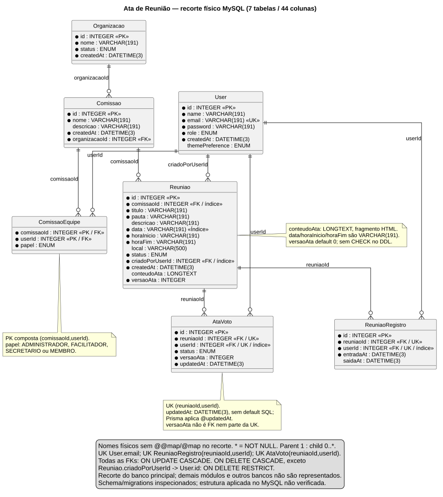
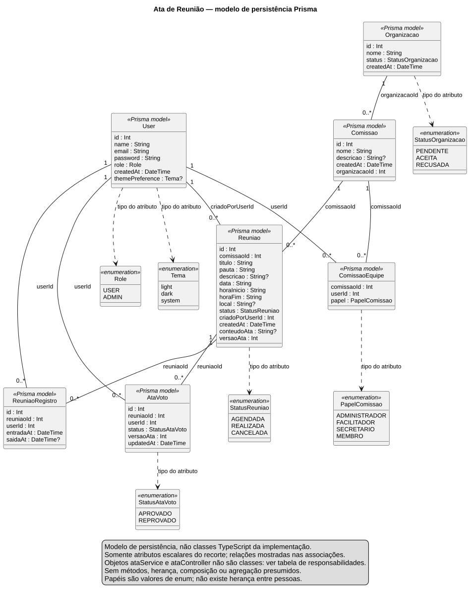

- **Incremento:** 3 — contribuição para unificação de entrega3_Di2
- **Escopo:** Modelo de persistência Prisma e dicionário do recorte de Ata de Reunião; RF16, RNF44/RNF45, UC17–UC20.
- **Branch:** main
- **Commit:** 945419d84dd6a3dd32aacab736f32f9c7ed806f5
- **Data de revisão:** 2026-11-13
- **Responsável(eis):** Gustavo de Oliveira Tomaz
- **Estado:** Parcial — schema e migrations inspecionados; estrutura aplicada no MySQL e unificação pendentes.
- **Fontes:** [schema.prisma](https://github.com/MiguelIFSP/BRTPDS2-PROJETO-E-DESENVOLVIMENTO-DE-SISTEMAS-2/blob/945419d84dd6a3dd32aacab736f32f9c7ed806f5/sistema/api/prisma/schema.prisma), [ataService.ts](https://github.com/MiguelIFSP/BRTPDS2-PROJETO-E-DESENVOLVIMENTO-DE-SISTEMAS-2/blob/945419d84dd6a3dd32aacab736f32f9c7ed806f5/sistema/api/src/services/ataService.ts), [ataHtml.ts](https://github.com/MiguelIFSP/BRTPDS2-PROJETO-E-DESENVOLVIMENTO-DE-SISTEMAS-2/blob/945419d84dd6a3dd32aacab736f32f9c7ed806f5/sistema/api/src/utils/ataHtml.ts), migrations e módulos listados abaixo.

# Ata de reunião — classes e dicionário para unificação

Este material foi entregue fora do repositório por solicitação de 2026-11-13. Não constitui um segundo modelo oficial do projeto. Ao unificar, preservar os identificadores e confrontar o restante do modelo com o código do respectivo cabeçalho. O DER da ata está em [Diagramas/DER-Ata-Reuniao.puml](Diagramas/DER-Ata-Reuniao.puml) e [.svg](Diagramas/DER-Ata-Reuniao.svg).

## 1. Evidência e limites

**Implementado:** sete modelos Prisma e suas migrations, com 44 colunas escalares no recorte. **Não verificado:** estrutura física aplicada no MySQL; a tentativa de conexão na inspeção retornou ECONNREFUSED. Nenhuma execução de teste ou aplicação de migration é afirmada nesta revisão.

As migrations descrevem a estrutura pretendida no banco principal. Existem histórico de db push/baseline e CREATE TABLE IF NOT EXISTS; ler esses arquivos não demonstra que um banco existente recebeu cada alteração. Não foram inventados nome de database, índices implícitos, tabelas de cache ou FK entre bancos. Nenhuma tabela planejada é misturada às implementadas.

Fontes SQL inspecionadas, todas sob sistema/api/prisma/migrations:

- [20260918235817_config_usuario/migration.sql](https://github.com/MiguelIFSP/BRTPDS2-PROJETO-E-DESENVOLVIMENTO-DE-SISTEMAS-2/blob/945419d84dd6a3dd32aacab736f32f9c7ed806f5/sistema/api/prisma/migrations/20260918235817_config_usuario/migration.sql).
- [20260922140000_papeis_organizacao/migration.sql](https://github.com/MiguelIFSP/BRTPDS2-PROJETO-E-DESENVOLVIMENTO-DE-SISTEMAS-2/blob/945419d84dd6a3dd32aacab736f32f9c7ed806f5/sistema/api/prisma/migrations/20260922140000_papeis_organizacao/migration.sql).
- [20261014120000_alinha_schema_atual/migration.sql](https://github.com/MiguelIFSP/BRTPDS2-PROJETO-E-DESENVOLVIMENTO-DE-SISTEMAS-2/blob/945419d84dd6a3dd32aacab736f32f9c7ed806f5/sistema/api/prisma/migrations/20261014120000_alinha_schema_atual/migration.sql).
- [20261014120100_adiciona_enums_status_tema/migration.sql](https://github.com/MiguelIFSP/BRTPDS2-PROJETO-E-DESENVOLVIMENTO-DE-SISTEMAS-2/blob/945419d84dd6a3dd32aacab736f32f9c7ed806f5/sistema/api/prisma/migrations/20261014120100_adiciona_enums_status_tema/migration.sql).
- [20261021120000_registra_tabelas_reuniao/migration.sql](https://github.com/MiguelIFSP/BRTPDS2-PROJETO-E-DESENVOLVIMENTO-DE-SISTEMAS-2/blob/945419d84dd6a3dd32aacab736f32f9c7ed806f5/sistema/api/prisma/migrations/20261021120000_registra_tabelas_reuniao/migration.sql).
- [20261021120100_registro_entrada_reuniao/migration.sql](https://github.com/MiguelIFSP/BRTPDS2-PROJETO-E-DESENVOLVIMENTO-DE-SISTEMAS-2/blob/945419d84dd6a3dd32aacab736f32f9c7ed806f5/sistema/api/prisma/migrations/20261021120100_registro_entrada_reuniao/migration.sql).
- [20261023120000_local_reuniao/migration.sql](https://github.com/MiguelIFSP/BRTPDS2-PROJETO-E-DESENVOLVIMENTO-DE-SISTEMAS-2/blob/945419d84dd6a3dd32aacab736f32f9c7ed806f5/sistema/api/prisma/migrations/20261023120000_local_reuniao/migration.sql).
- [20261109140000_ata_reuniao/migration.sql](https://github.com/MiguelIFSP/BRTPDS2-PROJETO-E-DESENVOLVIMENTO-DE-SISTEMAS-2/blob/945419d84dd6a3dd32aacab736f32f9c7ed806f5/sistema/api/prisma/migrations/20261109140000_ata_reuniao/migration.sql).

O recorte não representa todas as tabelas da plataforma. OrganizacaoMembro, ConviteReuniao, Votacao e outros modelos têm funções próprias; não substituem ComissaoEquipe, ReuniaoRegistro ou AtaVoto. A FK antiga de Organizacao.solicitanteId foi removida em 20260922140000 e não deve ser reintroduzida na unificação.

## 2. Diagrama de classes

**Tipo: modelo de persistência Prisma**, não classes de implementação TypeScript. Campos são atributos escalares, sem métodos inventados. Associações representam relações Prisma e a FK correspondente. Não há fundamento para desenhar composição, agregação ou herança entre esses modelos ou entre papéis humanos.

[Fonte PlantUML](Diagramas/DC-Ata-Reuniao.puml).

| Model | Responsabilidade no recorte | Estado |
|---|---|---|
| User | Identidade persistida consultada na autenticação; alvo dos vínculos de comissão, autoria, presença e voto | Implementado |
| Organizacao | Contexto da comissão; seu status não é condição direta de loadAccess | Implementado |
| Comissao | Agrupa equipe e reuniões; fornece o escopo de autorização | Implementado |
| ComissaoEquipe | Vínculo atual da pessoa com a comissão e PapelComissao usado pelo RBAC | Implementado |
| Reuniao | Guarda HTML atual e versão, além dos metadados da reunião | Implementado |
| ReuniaoRegistro | Registro único de entrada/saída por reunião/pessoa; saída não revoga acesso à ata | Implementado |
| AtaVoto | Escolha individual da versão atual; alterada por upsert e apagada quando o HTML normalizado muda | Implementado |

### 2.1 Enums

Enums abaixo são os tipos dos atributos do recorte. Não representam hierarquia entre atores.

| Enum | Valores exatos | Uso |
|---|---|---|
| Role | USER, ADMIN | User.role |
| Tema | light, dark, system | User.themePreference |
| StatusOrganizacao | PENDENTE, ACEITA, RECUSADA | Organizacao.status |
| PapelComissao | ADMINISTRADOR, FACILITADOR, SECRETARIO, MEMBRO | ComissaoEquipe.papel |
| StatusReuniao | AGENDADA, REALIZADA, CANCELADA | Reuniao.status |
| StatusAtaVoto | APROVADO, REPROVADO | AtaVoto.status |

### 2.2 Relacionamentos e integridade

Todos os filhos têm exatamente um pai em cada FK desta tabela; cada pai pode ter zero ou muitos filhos. Exclusão em cascata não significa composição UML presumida.

| FK física | Filho.coluna → Pai.coluna | Cardinalidade pai/filho | ON DELETE | ON UPDATE | Evidência |
|---|---|---|---|---|---|
| Comissao_organizacaoId_fkey | Comissao.organizacaoId → Organizacao.id | 1 : 0..* | CASCADE | CASCADE | Schema e migration da tabela |
| ComissaoEquipe_comissaoId_fkey | ComissaoEquipe.comissaoId → Comissao.id | 1 : 0..* | CASCADE | CASCADE | Schema e migration da tabela |
| ComissaoEquipe_userId_fkey | ComissaoEquipe.userId → User.id | 1 : 0..* | CASCADE | CASCADE | Schema e migration da tabela |
| Reuniao_comissaoId_fkey | Reuniao.comissaoId → Comissao.id | 1 : 0..* | CASCADE | CASCADE | Schema e migration da tabela |
| Reuniao_criadoPorUserId_fkey | Reuniao.criadoPorUserId → User.id | 1 : 0..* | RESTRICT | CASCADE | Schema e migration da tabela |
| ReuniaoRegistro_reuniaoId_fkey | ReuniaoRegistro.reuniaoId → Reuniao.id | 1 : 0..* | CASCADE | CASCADE | Schema e migration da tabela |
| ReuniaoRegistro_userId_fkey | ReuniaoRegistro.userId → User.id | 1 : 0..* | CASCADE | CASCADE | Schema e migration da tabela |
| AtaVoto_reuniaoId_fkey | AtaVoto.reuniaoId → Reuniao.id | 1 : 0..* | CASCADE | CASCADE | Schema e migration da tabela |
| AtaVoto_userId_fkey | AtaVoto.userId → User.id | 1 : 0..* | CASCADE | CASCADE | Schema e migration da tabela |

A UK de AtaVoto é (reuniaoId,userId), e não (reuniaoId,userId,versaoAta). Não há histórico de votação por versão. Nenhuma FK liga AtaVoto a ComissaoEquipe ou ReuniaoRegistro; a API valida vínculo/presença antes de votar. Também não há FK entre AtaVoto.versaoAta e Reuniao.versaoAta: a coerência depende de loadAccess, comparação de versão, updateMany condicional e transação.

A contagem em present seleciona os votos da versão atual; não refiltra vínculo atual dos votantes. Um ex-integrante não pode fazer nova requisição, mas um voto já registrado pode continuar no total até a edição apagar os votos.

## 3. Dicionário de dados

**Estado das definições: Implementado no schema/migrations. Estado do banco aplicado: Não verificado.**

Nomes físicos coincidem com os models/campos; não há @@map/@map neste recorte. Os CREATE TABLE lidos declaram utf8mb4 e utf8mb4_unicode_ci. “Sem default explícito” para coluna anulável descreve o DDL, não exige que Prisma envie null. Os limites de API não são automaticamente limites SQL.

### User (7 colunas)

| Coluna física | Tipo físico MySQL | Tipo lógico Prisma | Nula? | Default / geração | Chave | Domínio e descrição |
|---|---|---|---|---|---|---|
| id | INTEGER | Int | Não | AUTO_INCREMENT | PK | Inteiro gerado; identidade da pessoa. |
| name | VARCHAR(191) | String | Não | Sem default | — | Nome; campo de cadastro, não retornado pelo DTO da ata. |
| email | VARCHAR(191) | String | Não | Sem default | UK | E-mail de cadastro; consultado por requireAuth. |
| password | VARCHAR(191) | String | Não | Sem default | — | Credencial persistida; não selecionada pelas consultas da ata. O módulo não define seu algoritmo. |
| role | ENUM('USER','ADMIN') | Role | Não | 'USER' | — | Papel global; não concede edição de ata por si só. |
| createdAt | DATETIME(3) | DateTime | Não | CURRENT_TIMESTAMP(3) | — | Criação da pessoa. |
| themePreference | ENUM('light','dark','system') | Tema? | Sim | 'system' | — | Preferência visual; não participa do RBAC. |

### Organizacao (4 colunas)

| Coluna física | Tipo físico MySQL | Tipo lógico Prisma | Nula? | Default / geração | Chave | Domínio e descrição |
|---|---|---|---|---|---|---|
| id | INTEGER | Int | Não | AUTO_INCREMENT | PK | Identificador da organização. |
| nome | VARCHAR(191) | String | Não | Sem default | — | Nome da organização. |
| status | ENUM('PENDENTE','ACEITA','RECUSADA') | StatusOrganizacao | Não | 'PENDENTE' | — | Estado da organização; ataService não o filtra. |
| createdAt | DATETIME(3) | DateTime | Não | CURRENT_TIMESTAMP(3) | — | Criação; acrescentada na migration de alinhamento. |

### Comissao (5 colunas)

| Coluna física | Tipo físico MySQL | Tipo lógico Prisma | Nula? | Default / geração | Chave | Domínio e descrição |
|---|---|---|---|---|---|---|
| id | INTEGER | Int | Não | AUTO_INCREMENT | PK | Identificador da comissão. |
| nome | VARCHAR(191) | String | Não | Sem default | — | Nome da comissão. |
| descricao | VARCHAR(191) | String? | Sim | Sem default explícito | — | Descrição opcional. |
| createdAt | DATETIME(3) | DateTime | Não | CURRENT_TIMESTAMP(3) | — | Criação da comissão. |
| organizacaoId | INTEGER | Int | Não | Sem default | FK | Organizacao.id; contexto da comissão. |

### ComissaoEquipe (3 colunas)

| Coluna física | Tipo físico MySQL | Tipo lógico Prisma | Nula? | Default / geração | Chave | Domínio e descrição |
|---|---|---|---|---|---|---|
| comissaoId | INTEGER | Int | Não | Sem default | PK composta; FK | Comissao.id; vínculo atual que autoriza acesso. |
| userId | INTEGER | Int | Não | Sem default | PK composta; FK | User.id; cada pessoa aparece uma vez por comissão. |
| papel | ENUM('ADMINISTRADOR','FACILITADOR','SECRETARIO','MEMBRO') | PapelComissao | Não | 'MEMBRO' | — | Administrador e Secretário da comissão editam; os quatro papéis podem consultar, votar e exportar com as demais pré-condições. |

### Reuniao (14 colunas)

| Coluna física | Tipo físico MySQL | Tipo lógico Prisma | Nula? | Default / geração | Chave | Domínio e descrição |
|---|---|---|---|---|---|---|
| id | INTEGER | Int | Não | AUTO_INCREMENT | PK | Identificador usado no parâmetro :id. |
| comissaoId | INTEGER | Int | Não | Sem default | FK; índice | Comissao.id; escopo do RBAC. |
| titulo | VARCHAR(191) | String | Não | Sem default | — | Título retornado na consulta e escapado no cabeçalho do PDF. |
| pauta | VARCHAR(191) | String | Não | Sem default | — | Pauta da reunião; distinta de conteudoAta. |
| descricao | VARCHAR(191) | String? | Sim | Sem default explícito | — | Descrição opcional; distinta da ata. |
| data | VARCHAR(191) | String | Não | Sem default | Índice | Data civil com contrato AAAA-MM-DD; SQL armazena texto, não DATE. PDF valida o padrão, não a existência da data no calendário. |
| horaInicio | VARCHAR(191) | String | Não | Sem default | — | Horário no contrato HH:mm; não é TIME físico. |
| horaFim | VARCHAR(191) | String | Não | Sem default | — | Horário final no contrato HH:mm; não é TIME físico. |
| local | VARCHAR(500) | String? | Sim | Sem default explícito | — | Endereço/link livre; nulidade preserva registros anteriores. Não integra o DTO da ata. |
| status | ENUM('AGENDADA','REALIZADA','CANCELADA') | StatusReuniao | Não | 'AGENDADA' | — | Estado da reunião; não existe estado final de aprovação da ata neste campo. ataService não filtra esse estado. |
| criadoPorUserId | INTEGER | Int | Não | Sem default | FK; índice | User.id; autor da reunião, sem permissão especial de edição da ata. |
| createdAt | DATETIME(3) | DateTime | Não | CURRENT_TIMESTAMP(3) | — | Criação da reunião. |
| conteudoAta | LONGTEXT | String? | Sim | Sem default explícito | — | Fragmento HTML do Rich Text sanitizado pela API: parágrafos, títulos, listas, marcas e tabelas permitidas. Nulo antes da primeira gravação; API exige texto visível e entrada até 50.000 caracteres. Não é VARCHAR(191), JSON ou PDF. |
| versaoAta | INTEGER | Int | Não | 0 | — | Versão lógica, inicialmente 0; API exige inteiro >= 0 e incrementa ao mudar o HTML normalizado. SQL não declara CHECK de não negatividade. |

### ReuniaoRegistro (5 colunas)

| Coluna física | Tipo físico MySQL | Tipo lógico Prisma | Nula? | Default / geração | Chave | Domínio e descrição |
|---|---|---|---|---|---|---|
| id | INTEGER | Int | Não | AUTO_INCREMENT | PK | Identificador da presença. |
| reuniaoId | INTEGER | Int | Não | Sem default | FK; parte da UK | Reuniao.id; entrada precisa ser nesta reunião. |
| userId | INTEGER | Int | Não | Sem default | FK; parte da UK; índice | User.id; uma presença por pessoa/reunião. |
| entradaAt | DATETIME(3) | DateTime | Não | CURRENT_TIMESTAMP(3) | — | Momento de entrada; existência do registro é a condição usada por loadAccess. |
| saidaAt | DATETIME(3) | DateTime? | Sim | Sem default explícito | — | Momento de saída; não remove acesso à ata. |

### AtaVoto (6 colunas)

| Coluna física | Tipo físico MySQL | Tipo lógico Prisma | Nula? | Default / geração | Chave | Domínio e descrição |
|---|---|---|---|---|---|---|
| id | INTEGER | Int | Não | AUTO_INCREMENT | PK | Identificador do voto. |
| reuniaoId | INTEGER | Int | Não | Sem default | FK; parte da UK | Reuniao.id; todos os votos são removidos quando o texto normalizado muda. |
| userId | INTEGER | Int | Não | Sem default | FK; parte da UK; índice | User.id; upsert usa reuniaoId_userId. |
| status | ENUM('APROVADO','REPROVADO') | StatusAtaVoto | Não | Sem default | — | Escolha individual; não é aprovação final da reunião. |
| versaoAta | INTEGER | Int | Não | Sem default | — | Versão avaliada; não participa da UK nem de FK. Consistência com Reuniao.versaoAta é conferida no serviço. |
| updatedAt | DATETIME(3) | DateTime | Não | Sem default SQL; Prisma @updatedAt | — | Atualização gerenciada pelo Prisma. A migration não declara DEFAULT CURRENT_TIMESTAMP nem ON UPDATE. |

### 3.1 Conteúdo rico e versão

Reuniao.conteudoAta é **LONGTEXT**. Seu domínio lógico é um fragmento HTML, não um documento completo, texto simples ou caminho de PDF. A API valida entrada até 50.000 caracteres de HTML via Yup e depois exige texto visível após sanitização; tabela vazia, espaços e marcas sem texto não liberam a votação.

Tags permitidas: p, br, div, strong, b, em, i, u, s, strike, ul, ol, li, h1, h2, h3, blockquote, pre, code, span, table, thead, tbody, tfoot, tr, td e th. O sanitizador mantém somente text-align (left/center/right/justify) e font-size (10/13/16/18/24/32/48px) no style. Bordas usam data-ata-border; colspan/rowspan aceitam inteiros de 1 a 10. Recuo usa a estrutura HTML permitida, não um estilo margin arbitrário. A transformação normaliza font/align legados. A allowlist exata é a fonte ataHtml.ts, não uma obrigação de aceitar HTML arbitrário.

Reuniao.versaoAta inicia em 0. Salvar HTML normalizado diferente incrementa a versão e remove todos os AtaVoto da reunião na mesma callback de transação. Salvar o mesmo HTML mantém versão e votos. Versão enviada antiga ou updateMany.count igual a zero produz 409. A inspeção de callback e testes com mocks não comprova isolamento/rollback de um MySQL real.

### 3.2 Chaves e índices

| Tabela | Nome/declaração verificada | Colunas | Tipo |
|---|---|---|---|
| User | PRIMARY | id | PK |
| User | User_email_key | email | UNIQUE |
| Organizacao | PRIMARY | id | PK |
| Comissao | PRIMARY | id | PK |
| ComissaoEquipe | PRIMARY | comissaoId, userId | PK composta |
| Reuniao | PRIMARY | id | PK |
| Reuniao | Reuniao_comissaoId_idx | comissaoId | INDEX |
| Reuniao | Reuniao_criadoPorUserId_idx | criadoPorUserId | INDEX |
| Reuniao | Reuniao_data_idx | data | INDEX |
| ReuniaoRegistro | PRIMARY | id | PK |
| ReuniaoRegistro | ReuniaoRegistro_reuniaoId_userId_key | reuniaoId, userId | UNIQUE |
| ReuniaoRegistro | ReuniaoRegistro_userId_idx | userId | INDEX |
| AtaVoto | PRIMARY | id | PK |
| AtaVoto | AtaVoto_reuniaoId_userId_key | reuniaoId, userId | UNIQUE |
| AtaVoto | AtaVoto_userId_idx | userId | INDEX |

Comissao.organizacaoId e ComissaoEquipe.userId são FKs sem índice secundário nomeado explicitamente nas migrations consultadas. Os índices físicos criados/exigidos pelo mecanismo do MySQL devem ser confirmados com SHOW INDEX; nomes **[A CONFIRMAR NO CÓDIGO]** e no banco aplicado. Não foi presumido um nome de índice igual ao nome da constraint.

## 4. Responsabilidades dos módulos da implementação

Os elementos desta tabela são funções, componentes ou objetos exportados. **Não são classes do diagrama.** Arquivos abaixo são relativos à raiz.

| Arquivo / elemento real | Responsabilidade e métodos relevantes | Persistência/efeito |
|---|---|---|
| sistema/api/src/middlewares/authMiddleware.ts — requireAuth | getToken, verifyToken, consulta User; compõe request.user e chama next | Leitura de User.role/email; identidade de sessão |
| sistema/api/src/middlewares/ataMiddleware.ts — requireAtaEditor | Chama ataService.assertCanEdit após parseId | Sem gravação; exige papel editor e presença |
| sistema/api/src/controllers/ataController.ts — ataController | getByReuniao(request,response), save(request,response), vote(request,response); valida payloads com Yup | Delegação ao serviço; response.json |
| sistema/api/src/services/ataService.ts — ataService | assertCanEdit(userId,reuniaoId), getByReuniao(userId,reuniaoId), save(userId,reuniaoId,conteudoAta,versaoAta), vote(userId,reuniaoId,status,versaoAta) | Transações, updateMany, deleteMany e upsert reais |
| Mesmo módulo — loadAccess, assertEditor, podeEditar, present, conflict | Helpers privados de acesso, DTO e versão | Consulta reunião, equipe, presença e votos |
| sistema/api/src/utils/ataHtml.ts | sanitizeAtaHtml(html), validateAtaHtml(html) | Transforma/valida conteúdo; sem tabela própria |
| sistema/better-meet/src/services/ataService.ts — ataService | getByReuniao(token,reuniaoId), save(token,reuniaoId,conteudoAta,versaoAta), vote(token,reuniaoId,status,versaoAta) | Chama apiRequest nas três rotas |
| sistema/better-meet/src/components/AtaReuniao.tsx — AtaReuniao | prepareSave, save, vote, handleExportPdf; estado local, controles e confirmações | Rascunho em memória; conteúdo salvo vem da API |
| sistema/better-meet/src/components/ata/AtaEditor.tsx e AtaEditor.web.tsx | Pell/WebView no nativo e Tiptap na web; handle getHtml | HTML em edição, sem tabela separada |
| sistema/better-meet/src/utils/ataPdfHtml.ts | buildAtaPdfHtml(input,pageMargin), escapeHtml | Template com título/data escapados, CSS e CSP; sem gravação |
| sistema/better-meet/src/utils/ataPdf.ts | exportAtaPdf(input) | Print gera base64; File escreve cache; Sharing usa file.uri |
| sistema/better-meet/src/utils/ataPdf.web.ts | exportAtaPdf(input) | Sanitiza, abre janela e chama preview.print(); sem API de PDF |

sanitizeAtaHtml e validateAtaHtml recebem html: string; a tabela resume as entradas e não declara assinatura TypeScript completa. O diagrama de classes não atribui esses métodos aos models Prisma.

## 5. Armazenamento fora do banco

| Dado | Armazenamento real | Ciclo de vida / restrição | Evidência |
|---|---|---|---|
| Ata carregada, versão, papel, voto próprio e totais | Estado React em AtaReuniaoScreen e props de AtaReuniao | Consulta ao focar/recarregar; não é cache SQL separado | app/(tabs)/(reunioes)/ata/[id].tsx |
| Rascunho HTML, dirty, confirmação, conflito, busy e flag de exportação | Estado/ref React e estado interno do editor | Não há autosave persistente do rascunho neste módulo; saída/reload pode descartá-lo após confirmação | AtaReuniao.tsx; AtaEditor*.tsx |
| Token e dados de sessão | Zustand persist com AsyncStorage no authStore | Armazenamento local de sessão; a API reconsulta identidade/papel. Não guardar exemplos reais no documento | store/authStore.ts |
| PDF nativo | File em Paths.cache com nome ata-<dataReuniao>-<Date.now()>.pdf | Base64 escrito e aguardado antes de compartilhar; arquivo permanece no cache, gerido pelo sistema operacional | utils/ataPdf.ts |
| Documento de impressão web | DOM de janela preview | Janela fechada após afterprint ou erro; o navegador gerencia destino/impressão | utils/ataPdf.web.ts |
| Presença de demonstração | Memória de useListaPresencaPreview | Não substitui ReuniaoRegistro nem concede acesso à ata | hooks/useListaPresencaPreview.ts |

A ata e o voto são persistidos apenas pelas rotas de ata. Compartilhar não grava registro de envio, destinatário, download ou arquivo PDF no banco. Não há base adicional afetada identificada neste módulo.

## 6. Rastreabilidade e pendências de unificação

| Parte | RF/RNF | UC | Evidência | Verificação vinculada |
|---|---|---|---|---|
| ComissaoEquipe + ReuniaoRegistro + User | RF16 | UC17–UC20 (PDF após consulta) | requireAuth e loadAccess | CT-RF16-02–06 |
| Reuniao.conteudoAta | RF16; RNF44 | UC17/UC18/UC20 | sanitizeAtaHtml, validateAtaHtml, schema/migration | CT-RF16-07–12; CT-RNF44-01/02 |
| Reuniao.versaoAta + AtaVoto | RF16; RNF45 | UC18/UC19 | save/vote e UK | CT-RF16-11–15; CT-RNF45-01–03 |
| Cache/DOM de PDF | RF16 | UC20 | exportAtaPdf nativo/web | CT-RF16-17–19 e manuais 21–23 |

- Unificar os sete models e seis enums com o modelo global, preservando nomes e associações que estiverem comprovados em sua baseline.
- Confirmar estrutura aplicada, índices implícitos, ações de FK e transações em MySQL isolado. **Não executado** nesta revisão.
- Diagrama de classes e dicionário foram entregues separadamente; sua incorporação oficial permanece **Planejada**.
- RNF44/RNF45 não são declarados aprovados a partir deste diagrama. Resultados e roteiros estão em testes_ata_reuniao.md da entrega local.
- Este pacote não inclui dados reais, tokens, senhas nem registros de participantes.
