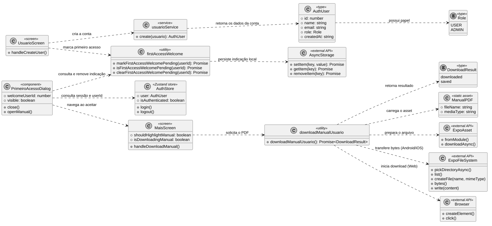

# Diagrama de classes — fluxo do manual

```text
Incremento: Entrega 4 — Di3
Escopo: Diagrama de classes do fluxo do manual (RF19, UC29)
Branch: main
Commit: c45226bd62a95c97cf51ea41140678243b56806d
Data de revisão: 2026-11-13
Responsável(eis): Miguel Augusto Baptista
Estado: Implementado (conferido no código)
Fontes: sistema/better-meet/src/utils/downloadManualUsuario.ts; sistema/better-meet/src/utils/firstAccessWelcome.ts; sistema/better-meet/src/utils/__tests__/firstAccessWelcome.test.ts; sistema/better-meet/src/components/PrimeiroAcessoDialog.tsx; sistema/better-meet/src/app/_layout.tsx; sistema/better-meet/src/app/usuario.tsx; sistema/better-meet/src/app/(tabs)/mais/index.tsx; sistema/better-meet/src/services/usuarioService.ts; sistema/better-meet/src/store/authStore.ts; sistema/better-meet/metro.config.js; sistema/better-meet/package.json; sistema/better-meet/jest.setup.ts; sistema/better-meet/assets/manual/Manual-do-Usuario-Better-Meet.pdf (só a existência; o conteúdo do PDF não foi lido)
```


O fluxo do manual não acrescenta classes de domínio, modelos Prisma ou tabelas ao banco de dados. O diagrama abaixo apresenta, em notação UML, os módulos TypeScript, componentes, tipos e APIs externas que participam do fluxo. Os blocos com estereótipos `screen`, `component` e `utility` representam unidades do código; não significam classes JavaScript/TypeScript instanciadas.



Fonte: [DC-Manual.puml](Diagramas/DC-Manual.puml)

## Leitura do diagrama

- `UsuarioScreen` cria a conta e, após sucesso, tenta registrar a indicação de primeiro acesso.
- `PrimeiroAcessoDialog` usa o usuário autenticado para consultar a indicação local. Ao aceitar, limpa a indicação e navega à tela **Mais**.
- `PrimeiroAcessoDialog` é montado em `_layout.tsx`, fora das abas, e também fecha ao tocar no fundo ou usar o botão voltar.
- `MaisScreen` apresenta o botão na seção **Ajuda**, executa o destaque temporário (parâmetro `highlightManual`) e chama o utilitário de download.
- `downloadManualUsuario` usa o mesmo PDF estático; o navegador inicia o download na Web, enquanto Android e iOS usam o seletor de diretório (`list()` e `createFile()` para achar ou criar o destino), leem os bytes do arquivo de origem, rejeitam arquivo vazio e gravam o conteúdo no destino com `File.write()`.
- Se já existir um arquivo com o nome do manual no diretório escolhido, o utilitário reutiliza esse destino e a gravação substitui seu conteúdo.
- `firstAccessWelcome` grava, consulta e remove a indicação usando `AsyncStorage`. Esse estado não é um registro no banco de dados.
- `usuarioService.create` retorna `AuthUser` (`apiRequest<AuthUser>` em `/usuarios`); é o `id` dele que `UsuarioScreen` usa para marcar a indicação.
- `AuthStore.user` e `PrimeiroAcessoDialog.welcomeUserId` podem estar nulos quando não há usuário autenticado ou aviso pendente, respectivamente.

## Persistência

O fluxo não persiste dados no banco: não há DER nem dicionário de dados do banco. O dado fora do banco é a indicação local no `AsyncStorage` (chave `better-meet:first-access-welcome:<userId>`). Ver [rf19_manual_utilizacao.md](rf19_manual_utilizacao.md).

## Divergências encontradas

Uma correção no diagrama: foram acrescentados `list()` e `createFile()` em `ExpoFileSystem`. `Directory` e `File` do `expo-file-system` continuam agrupados em um único bloco `ExpoFileSystem`. `Role` e `AuthUser` conferem com `authStore.ts`.
