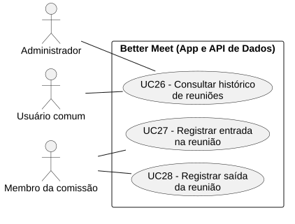
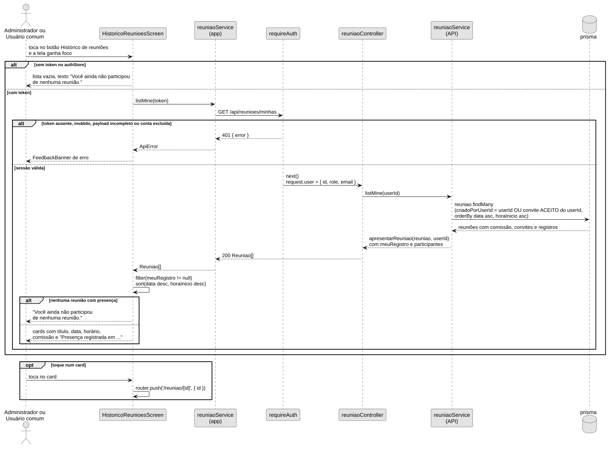
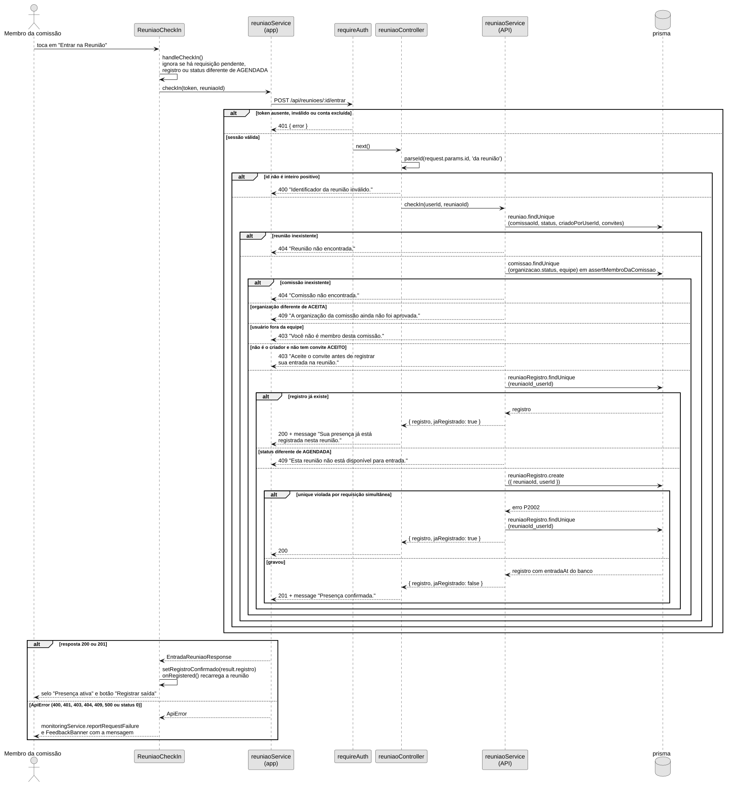
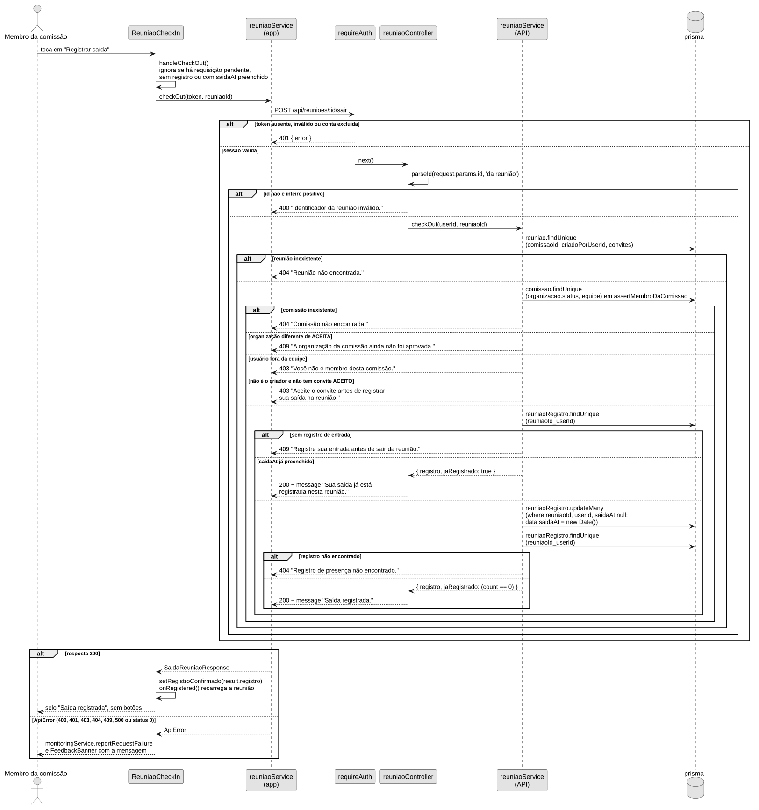
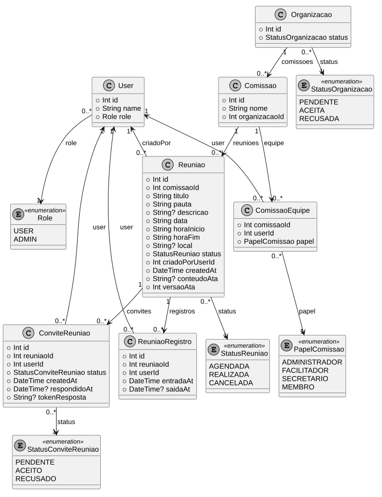
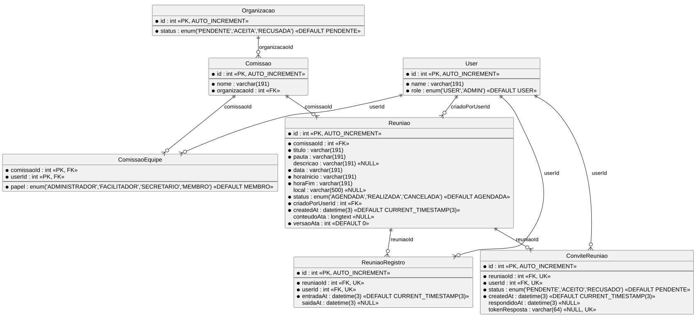

```text
Incremento: Entrega 4 — Di3 — Histórico de reuniões
Escopo: RF18; RNF47 e RNF48; UC26, UC27 e UC28 (identificadores locais; a numeração final de RF, RNF e UC será ajustada depois)
Branch: main
Commit: 3832724b207dfcfef6954e991f70366a66507389
Data de revisão: 2026-11-13
Responsável(eis): Breno Nobre de Souza
Estado: Parcial
Fontes: sistema/better-meet/src/app/(tabs)/(reunioes)/historico.tsx; sistema/better-meet/src/app/(tabs)/(reunioes)/index.tsx; sistema/better-meet/src/app/(tabs)/(reunioes)/reuniao/[id].tsx; sistema/better-meet/src/services/reuniaoService.ts; sistema/better-meet/src/components/ReuniaoCheckIn.tsx; sistema/better-meet/src/utils/apiClient.ts; sistema/better-meet/src/utils/format.ts; sistema/api/src/routes/reuniaoRoutes.ts; sistema/api/src/controllers/reuniaoController.ts; sistema/api/src/services/reuniaoService.ts; sistema/api/src/middlewares/authMiddleware.ts; sistema/api/src/middlewares/errorMiddleware.ts; sistema/api/src/utils/parseId.ts; sistema/api/src/server.ts; sistema/api/prisma/schema.prisma; sistema/api/prisma/migrations/20260918235817_config_usuario/migration.sql; sistema/api/prisma/migrations/20261014120000_alinha_schema_atual/migration.sql; sistema/api/prisma/migrations/20261014120100_adiciona_enums_status_tema/migration.sql; sistema/api/prisma/migrations/20261021120000_registra_tabelas_reuniao/migration.sql; sistema/api/prisma/migrations/20261021120100_registro_entrada_reuniao/migration.sql; sistema/api/prisma/migrations/20261023120000_local_reuniao/migration.sql; sistema/api/prisma/migrations/20261023140000_token_resposta_convite/migration.sql; sistema/api/prisma/migrations/20261109140000_ata_reuniao/migration.sql; sistema/api/docs/openapi.yaml; sistema/api/tests/reuniaoCheckIn.test.mjs; sistema/better-meet/src/components/__tests__/ReuniaoCheckIn.test.tsx; sistema/api/package.json; sistema/api/package-lock.json; sistema/better-meet/package.json; sistema/better-meet/package-lock.json
```

Este documento cobre o histórico de reuniões do usuário (a tela que lista as reuniões em que a presença dele foi registrada) e o registro de entrada e de saída que alimenta esse histórico. Ele não inclui a lista de presença consolidada, a ata, as votações, o cadastro de reuniões nem os convites.

Os números `RF18`, `UC26` a `UC28`, `RNF47`, `RNF48` e `CT-RF18-xx` seguem a ordem dos requisitos do Incremento 3 no slide (Ata, Votação, Histórico, Manual, Manutenção). `RN-HIST-xx` continua sendo identificador local das regras de negócio. Não foram conferidos com o índice da Wiki. Os testes estão em [testes_historico_reunioes.md](testes_historico_reunioes.md).

# RF18 — Consultar o histórico de reuniões e registrar presença

- **Status:** Parcial. Listar o histórico, registrar a entrada e registrar a saída estão no código, com as rotas em `docs/openapi.yaml`. As lacunas são: a tela do histórico não tem teste automatizado, o filtro e a ordenação ficam só no app e o card de presença da página da reunião some depois do horário de término (veja "Divergências encontradas").
- **Objetivo:** permitir que a pessoa veja, em ordem da mais recente para a mais antiga, as reuniões em que registrou presença, e que registre a entrada e a saída na página da reunião.
- **Atores:** Administrador (`Role.ADMIN`) e Usuário comum (`Role.USER`) consultam o histórico. Membro da comissão (qualquer `PapelComissao`) registra entrada e saída.
- **Regras de negócio:** RN-HIST-01 a RN-HIST-08.
- **Referências do código:**
  - App: `HistoricoReunioesScreen` (`historico.tsx`), `reuniaoService` do app (`listMine`, `checkIn`, `checkOut`), `ReuniaoCheckIn`, página `reuniao/[id].tsx`, `apiRequest`, `getErrorMessage`
  - API: `reuniaoRoutes`, `requireAuth`, `reuniaoController` (`listMine`, `checkIn`, `checkOut`), `parseId`, `reuniaoService` da API (`listMine`, `checkIn`, `checkOut`, `assertMembroDaComissao`, `apresentarReuniao`), `handleError`

## Descrição

Na aba Reuniões, o botão com o ícone de relógio (`accessibilityLabel` "Histórico de reuniões") abre a tela de histórico. A tela pede a `GET /api/reunioes/minhas`, que devolve as reuniões criadas pela pessoa ou em que ela aceitou o convite, cada uma com `meuRegistro`. O app descarta as que não têm `meuRegistro`, ordena as restantes da mais recente para a mais antiga e mostra um card por reunião, com a data da entrada.

A presença nasce na página da reunião. Quando a reunião está `AGENDADA` e o horário de término não passou, o card **Presença** mostra o botão **Entrar na Reunião**. A entrada cria um `ReuniaoRegistro` com `entradaAt` gerado pelo banco. Depois da entrada, o botão **Registrar saída** grava `saidaAt`. Repetir a entrada ou a saída devolve o registro original, sem criar outra linha e sem mudar os horários.

## Regras de negócio

| ID | Regra | Onde está |
|---|---|---|
| RN-HIST-01 | A tela de histórico só mostra reuniões com `meuRegistro` diferente de nulo. A API não filtra: `listMine` devolve também as reuniões sem presença | `historico.tsx` (`filter`); `reuniaoService.listMine` da API |
| RN-HIST-02 | O histórico é ordenado do mais recente para o mais antigo: `data` decrescente e, em empate, `horaInicio` decrescente, por comparação de texto (`localeCompare`). A API devolve a lista no sentido contrário (`data` e `horaInicio` crescentes) | `historico.tsx` (`sort`); `listMine` (`orderBy`) |
| RN-HIST-03 | Registrar entrada ou saída exige três vínculos: a reunião existe; a pessoa está na equipe (`ComissaoEquipe`) da comissão da reunião, cuja organização está `ACEITA`; e a pessoa é o criador da reunião ou tem convite `ACEITO` | `checkIn`, `checkOut`, `assertMembroDaComissao` |
| RN-HIST-04 | Há no máximo um registro por pessoa e reunião (`@@unique([reuniaoId, userId])`). Repetir a entrada devolve o registro existente com `jaRegistrado: true` | `reuniaoRegistro` no `schema.prisma`; `checkIn` |
| RN-HIST-05 | A saída só é aceita depois da entrada. Sem registro, a API responde `409` | `checkOut` |
| RN-HIST-06 | A primeira entrada exige reunião `AGENDADA`. Quem já tem registro recebe esse registro mesmo se a reunião estiver `REALIZADA` ou `CANCELADA` | `checkIn` (a consulta do registro vem antes do teste de status) |
| RN-HIST-07 | Repetir a saída devolve o registro com `jaRegistrado: true` e conserva o primeiro `saidaAt`. A gravação só atinge a linha com `saidaAt` nulo | `checkOut` (`updateMany` com `saidaAt: null`) |
| RN-HIST-08 | A identidade vem do JWT e os horários vêm do servidor: `entradaAt` é o `DEFAULT CURRENT_TIMESTAMP(3)` do banco e `saidaAt` é `new Date()` da API. Campos enviados no corpo são ignorados | `checkIn`, `checkOut`; CT-RF18-02 e CT-RF18-04 |

## Atores

| Ator | Tipo | Responsabilidade | Evidência |
|---|---|---|---|
| Administrador | Humano | Consulta o próprio histórico. Só aparece na lista da reunião que criou ou em que aceitou convite, como qualquer pessoa. Registra entrada e saída apenas se também for membro da comissão | `Role.ADMIN` em `schema.prisma`; `listMine` filtra por `criadoPorUserId` ou convite `ACEITO`, sem testar `role` |
| Usuário comum | Humano | Consulta o próprio histórico | `Role.USER`; mesma rota |
| Membro da comissão | Humano | Registra entrada e saída na reunião da própria comissão. Qualquer papel da equipe serve (`ADMINISTRADOR`, `FACILITADOR`, `SECRETARIO` ou `MEMBRO`) | `assertMembroDaComissao` em `reuniaoService`; enum `PapelComissao` |

Não há ator "Usuário autenticado". Quem registra presença também consulta o histórico, mas os dois papéis estão separados porque a regra de acesso é diferente: o histórico não exige comissão, e a presença exige. As associações estão em [Diagramas/DCU-Historico-Reunioes.svg](Diagramas/DCU-Historico-Reunioes.svg).

## Entradas

| Campo | Origem (tela/rota) | Tipo/formato | Obrigatório | Domínio/validação | Exemplo |
|---|---|---|---|---|---|
| `Authorization` | Cabeçalho; `token` do `authStore` | `Bearer <JWT>` | Sim | `requireAuth`: token assinado, com `sub` inteiro positivo, `role` válido e `email`, de conta que ainda existe | `Bearer <token>` |
| `id` da reunião | Path de `POST /reunioes/:id/entrar` e `POST /reunioes/:id/sair`; `reuniaoId` de `ReuniaoCheckIn` | `Int` | Sim | Inteiro positivo (`parseId`, texto "da reunião") | `31` |

`GET /reunioes/minhas` não tem parâmetro de path, query nem corpo. As rotas de entrada e saída não leem o corpo: `userId`, `entradaAt` e `saidaAt` enviados nele não são usados (RN-HIST-08).

## Origem

- Botão com o ícone de relógio na aba Reuniões (`(reunioes)/index.tsx`), que faz `router.push('/(tabs)/(reunioes)/historico')`.
- `HistoricoReunioesScreen`: o `useFocusEffect` chama `loadReunioes`, que chama `reuniaoService.listMine(token)`. O puxar para atualizar (`onRefresh`) chama `loadReunioes` de novo.
- Página da reunião (`reuniao/[id].tsx`), a que se chega ao tocar num card do histórico ou da lista de reuniões. O componente `ReuniaoCheckIn` chama `reuniaoService.checkIn(token, reuniaoId)` e `reuniaoService.checkOut(token, reuniaoId)`.
- Rotas da API: `GET /api/reunioes/minhas`, `POST /api/reunioes/:id/entrar` e `POST /api/reunioes/:id/sair`.

## Pré-condições

- A pessoa tem JWT de uma conta que ainda existe.
- Para o histórico: nenhuma além da sessão. Sem token no `authStore`, a tela não chama a API.
- Para entrar: reunião existente e `AGENDADA`; pessoa na equipe da comissão, de organização `ACEITA`; criador da reunião ou convite `ACEITO`. Na tela, a reunião também precisa estar com o horário de término no futuro (`isHistorical` falso, veja a divergência correspondente).
- Para sair: os mesmos vínculos e um registro de entrada.

## Ação

Existem dois `reuniaoService`: o do app (`better-meet/src/services/reuniaoService.ts`) e o da API (`api/src/services/reuniaoService.ts`). No app, cada método chama `apiRequest` (`src/utils/apiClient.ts`), que junta o caminho a `API_URL`, envia `Authorization: Bearer <token>` e chama `fetch`. Na API, a requisição passa por `express.json()` e `cors`, entra em `app.use('/api', apiRouter)` e chega às rotas de `reuniaoRoutes`. As três rotas chamam `requireAuth` antes do controller. O `requireAuth` verifica o JWT e consulta `user` no banco a cada requisição, para ler o `role` atual e rejeitar conta excluída.

### Consultar o histórico (UC26)

1. **Botão → tela.** Na aba Reuniões, o ator toca no botão do relógio. O `onPress` chama `router.push('/(tabs)/(reunioes)/historico')`.
2. **Foco → `loadReunioes`.** O `useFocusEffect` ativa o indicador de carga e chama `loadReunioes`. Se o `authStore` não tiver `token`, `loadReunioes` limpa a lista, encerra a carga e não chama a API.
3. **Tela → service do app.** Com token, chama `reuniaoService.listMine(token)`.
4. **Service do app → `fetch`.** `listMine` chama `apiRequest('/reunioes/minhas', { token })`, que envia `GET /api/reunioes/minhas`.
5. **Rota → controller.** `requireAuth` e depois `reuniaoController.listMine`, que lê `request.user.id` e chama `reuniaoService.listMine(userId)` da API.
6. **Service da API → banco.** `prisma.reuniao.findMany` filtra `criadoPorUserId = userId` OU convite do usuário com status `ACEITO`, ordena por `data` e `horaInicio` crescentes e seleciona `reuniaoListSelect` (dados da reunião, convites, equipe da comissão e `registros`). `apresentarReuniao` troca `registros` por `meuRegistro` (o registro do usuário ou `null`) e monta `participantes`.
7. **Resposta → tela.** O controller responde `200` com o array. `loadReunioes` aplica `filter(reuniao.meuRegistro != null)` e `sort` por `data` e `horaInicio` decrescentes, e chama `setReunioes`.
8. **Exibição.** Cada reunião vira um `Pressable` com título, "data às horaInicio até horaFim", "Comissão: nome" (se houver) e "Presença registrada em dd/mm/aaaa às hh:mm" (`formatDateTime(meuRegistro.entradaAt)`). Sem reuniões, o texto é "Você ainda não participou de nenhuma reunião.". O toque num card chama `router.push` para `/reuniao/[id]`.

### Registrar entrada (UC27)

1. **Tela → `handleCheckIn`.** Na página da reunião, o ator toca em **Entrar na Reunião**. `handleCheckIn` retorna sem fazer nada se já há requisição pendente, se já existe registro ou se `status` não é `AGENDADA`. Senão, marca a requisição como pendente e ativa `isLoading` ("Confirmando presença...").
2. **Componente → service do app.** Chama `reuniaoService.checkIn(token, reuniaoId)`.
3. **Service do app → `fetch`.** `checkIn` chama `apiRequest` com `method: 'POST'` e envia `POST /api/reunioes/:id/entrar`, sem corpo.
4. **Rota → controller.** `requireAuth` e `reuniaoController.checkIn`, que obtém o id com `parseId(request.params.id, 'da reunião')` e chama `reuniaoService.checkIn(userId, reuniaoId)`.
5. **Service da API → banco, vínculos.** `reuniao.findUnique` seleciona `comissaoId`, `status`, `criadoPorUserId` e `convites`. Sem reunião, `404`. `assertMembroDaComissao` faz `comissao.findUnique` com `organizacao.status` e `equipe`: comissão inexistente dá `404`, organização diferente de `ACEITA` dá `409` e usuário fora da equipe dá `403`. Se a pessoa não é o criador e não tem convite `ACEITO`, `403`.
6. **Service da API → banco, registro.** `reuniaoRegistro.findUnique` pela chave `reuniaoId_userId`. Se existe, retorna `{ registro, jaRegistrado: true }`. Se não existe e `status` não é `AGENDADA`, `409`. Senão, `reuniaoRegistro.create({ data: { reuniaoId, userId } })` faz o `INSERT`; `entradaAt` vem do `DEFAULT CURRENT_TIMESTAMP(3)`. Se duas requisições simultâneas chegam ao `create`, a chave única recusa a segunda com `P2002`; o service busca o registro vencedor e devolve `jaRegistrado: true`.
7. **Resposta → tela.** O controller responde `201` com `{ registro, jaRegistrado: false, message: "Presença confirmada." }`, ou `200` com `jaRegistrado: true` e "Sua presença já está registrada nesta reunião.". O componente guarda `result.registro` em `registroConfirmado`, chama `onRegistered`, que recarrega a reunião com `reuniaoService.getById`, e passa a mostrar o selo **Presença ativa** e o botão **Registrar saída**.

### Registrar saída (UC28)

1. **Tela → `handleCheckOut`.** O ator toca em **Registrar saída**. `handleCheckOut` retorna sem fazer nada se há requisição pendente, se não há registro ou se `saidaAt` já está preenchido. Senão, ativa `isLoading` ("Registrando saída...").
2. **Componente → service do app → `fetch`.** Chama `reuniaoService.checkOut(token, reuniaoId)`, que envia `POST /api/reunioes/:id/sair`, sem corpo.
3. **Rota → controller.** `requireAuth` e `reuniaoController.checkOut`, com `parseId` e `reuniaoService.checkOut(userId, reuniaoId)`.
4. **Service da API → banco, vínculos.** Mesma verificação do passo 5 da entrada (`reuniao.findUnique`, `assertMembroDaComissao` e criador ou convite `ACEITO`), com a mensagem de `403` própria da saída. Não há teste de `status` da reunião.
5. **Service da API → banco, registro.** `reuniaoRegistro.findUnique`. Sem registro, `409`. Com `saidaAt` preenchido, retorna `{ registro, jaRegistrado: true }`. Senão, `reuniaoRegistro.updateMany({ where: { reuniaoId, userId, saidaAt: null }, data: { saidaAt: new Date() } })` faz o `UPDATE` e `findUnique` relê a linha. Se a releitura não achar a linha, `404`. O retorno é `{ registro, jaRegistrado: atualizado.count === 0 }`.
6. **Resposta → tela.** O controller responde `200` com "Saída registrada." ou, se `jaRegistrado`, "Sua saída já está registrada nesta reunião.". O componente guarda o registro, recarrega a reunião e mostra o selo **Saída registrada**, sem botões.

**Caminho de erro.** Uma falha na API lança `AppError` (ou erro do Prisma, ou `SyntaxError` de JSON). O Express 5 encaminha o erro ao `handleError`, registrado com `app.use(handleError)`, e o restante da rota não roda. O `handleError` responde `{ error }` com o status da tabela de Saída. No app, `apiRequest` transforma a resposta de erro em `ApiError` (ou lança `ApiError` com status 0 se o `fetch` falhar). Na tela do histórico, o `catch` de `loadReunioes` chama `setFeedback` com a mensagem do erro e o `FeedbackBanner` a exibe; essa tela não chama `monitoringService`. Em `ReuniaoCheckIn`, o `catch` chama `monitoringService.reportRequestFailure` e `setFeedback`.

## Saída

| Situação | Status/resposta | Campos de retorno | Comportamento visual |
|---|---|---|---|
| Histórico carregado | `200` | Array de `Reuniao` (`id`, `comissaoId`, `titulo`, `pauta`, `descricao`, `local`, `data`, `horaInicio`, `horaFim`, `status`, `criadoPorUserId`, `comissao`, `convites`, `meuRegistro`, `participantes`) | Cards das reuniões com `meuRegistro` |
| Sem reuniões com presença | `200` | Array sem nenhum `meuRegistro` ou vazio | "Você ainda não participou de nenhuma reunião." |
| Sem token no app | Sem chamada | — | Mesma mensagem de lista vazia, sem erro |
| Entrada registrada | `201` | `registro: { id, reuniaoId, userId, entradaAt, saidaAt }`, `jaRegistrado: false`, `message: "Presença confirmada."` | Selo "Presença ativa" e botão "Registrar saída" |
| Entrada repetida | `200` | O mesmo `registro` original, `jaRegistrado: true`, `message: "Sua presença já está registrada nesta reunião."` | Selo "Presença ativa" |
| Saída registrada | `200` | `registro` com `saidaAt`, `jaRegistrado: false`, `message: "Saída registrada."` | Selo "Saída registrada" |
| Saída repetida | `200` | `registro` original, `jaRegistrado: true`, `message: "Sua saída já está registrada nesta reunião."` | Selo "Saída registrada" |
| Id inválido | `400` | `error`: `Identificador da reunião inválido.` | Banner com a mensagem |
| JSON malformado | `400` | `error`: `JSON inválido.` | Banner |
| Sem token | `401` | `error`: `Autenticação necessária.` | Banner |
| Token inválido ou expirado | `401` | `error`: `Token inválido ou expirado.` | Banner |
| Payload do token incompleto | `401` | `error`: `Token inválido.` | Banner |
| Conta excluída | `401` | `error`: `Sessão inválida. Entre novamente.` | Banner |
| Pessoa fora da equipe da comissão | `403` | `error`: `Você não é membro desta comissão.` | Banner |
| Sem convite aceito | `403` | `error`: `Aceite o convite antes de registrar sua entrada na reunião.` ou `Aceite o convite antes de registrar sua saída na reunião.` | Banner |
| Reunião inexistente | `404` | `error`: `Reunião não encontrada.` | Banner |
| Comissão inexistente | `404` | `error`: `Comissão não encontrada.` | Banner |
| Registro sumiu entre a gravação e a releitura da saída | `404` | `error`: `Registro de presença não encontrado.` | Banner |
| Organização da comissão não aprovada | `409` | `error`: `A organização da comissão ainda não foi aprovada.` | Banner |
| Primeira entrada em reunião fora de `AGENDADA` | `409` | `error`: `Esta reunião não está disponível para entrada.` | Banner |
| Saída sem entrada | `409` | `error`: `Registre sua entrada antes de sair da reunião.` | Banner |
| Violação de unique não recuperada | `409` | `error`: `Registro já existente.` Só ocorre se o `P2002` não achar o registro na releitura | Banner |
| Erro interno | `500` | `error`: `Erro interno. Tente novamente mais tarde.` | Banner |
| Falha ao carregar o histórico | Qualquer erro acima | Mensagem do `ApiError` | Banner; o texto de fallback é "Não foi possível carregar seu histórico de reuniões." |
| API inacessível | Sem resposta (`ApiError` com status 0) | `Não foi possível conectar ao servidor. Verifique sua conexão.` | Banner |

Falha de entrada ou saída também chama `monitoringService.reportRequestFailure`. O histórico não chama.

## Destino

| Banco | Tabela/model | Operação | Campos | Vínculos |
|---|---|---|---|---|
| `bettermeet` (MySQL, via Prisma; estrutura física não reconsultada nesta revisão) | `Reuniao` | `SELECT` | `id`, `comissaoId`, `titulo`, `pauta`, `descricao`, `local`, `data`, `horaInicio`, `horaFim`, `status`, `criadoPorUserId` | FK para `Comissao` e `User` |
| O mesmo | `ReuniaoRegistro` | `SELECT` (histórico e verificações); `INSERT` na entrada; `UPDATE` de `saidaAt` na saída | `reuniaoId`, `userId`, `entradaAt`, `saidaAt` | FK para `Reuniao` e `User`; UK `reuniaoId, userId` |
| O mesmo | `ConviteReuniao` | `SELECT` | `userId`, `status`, `reuniaoId` | Identifica o convite `ACEITO` |
| O mesmo | `Comissao`, `ComissaoEquipe`, `Organizacao` | `SELECT` | `Organizacao.status`, `ComissaoEquipe.userId` | Verificam a participação na comissão |

Não há tabela nova nem alteração de tabela por esta funcionalidade. O histórico não é uma tabela: é o resultado de `listMine` filtrado no app. O app não guarda o histórico no aparelho.

## Fluxos alternativos e exceções

- **2a:** sem `token` no `authStore`, `loadReunioes` zera a lista e não chama a API.
- **6a:** nenhuma reunião do usuário tem `meuRegistro` → a tela mostra "Você ainda não participou de nenhuma reunião.".
- **7a:** a chamada falha → o banner mostra a mensagem; a lista fica como estava.
- **1a (entrada):** `ReuniaoCheckIn` ignora o toque se há requisição pendente, se já existe registro ou se `status` não é `AGENDADA`; nesses casos a API não é chamada.
- **5a (entrada):** reunião, comissão, organização, vínculo ou convite inválidos → `404`, `409` ou `403`, sem gravação.
- **6a (entrada):** já existe registro → `200` com `jaRegistrado: true`, mesmo que a reunião esteja `REALIZADA` ou `CANCELADA`, sem gravação.
- **6b (entrada):** reunião não `AGENDADA` e sem registro → `409`.
- **6c (entrada):** duas requisições simultâneas → uma recebe `201` e a outra `200` com o mesmo registro.
- **5a (saída):** sem registro de entrada → `409` "Registre sua entrada antes de sair da reunião.".
- **5b (saída):** `saidaAt` já preenchido → `200` com `jaRegistrado: true`, sem gravação.

## Pós-condições

- Entrada: existe exatamente um `ReuniaoRegistro` da pessoa na reunião, com `entradaAt` e `saidaAt` nulo. A reunião passa a aparecer no histórico da pessoa na próxima carga.
- Saída: o mesmo registro ganha `saidaAt`. `entradaAt` não muda e a reunião continua no histórico.
- Repetição: nenhuma gravação; o registro original é devolvido.
- Erro 4xx ou 5xx: nenhuma gravação da operação que falhou.
- Consultar o histórico não grava nada.

## Efeitos colaterais

- Falha de entrada ou saída dispara `monitoringService.reportRequestFailure` em `ReuniaoCheckIn`.
- Depois de uma entrada ou saída bem-sucedida, `onRegistered` recarrega a reunião (`reuniaoService.getById`).
- `checkIn` e `checkOut` não criam notificação nem e-mail, não alteram `Reuniao.status`, convites, comissão nem ata. Foi conferido no código dos dois métodos.
- Outros módulos leem `ReuniaoRegistro` (`ataService`, `consolidateListaPresenca`, `listaPresenca`): a presença registrada aqui é insumo da lista de presença e da ata. Esses requisitos têm documento próprio.
- Excluir a reunião, o usuário ou a comissão apaga os registros por `ON DELETE CASCADE` (veja o dicionário).

## Diagramas e testes relacionados

- Casos de uso: [Diagramas/DCU-Historico-Reunioes.svg](Diagramas/DCU-Historico-Reunioes.svg) e as fichas abaixo.
- Sequências: [DS-Consultar-Historico.svg](Diagramas/DS-Consultar-Historico.svg), [DS-Registrar-Entrada.svg](Diagramas/DS-Registrar-Entrada.svg), [DS-Registrar-Saida.svg](Diagramas/DS-Registrar-Saida.svg).
- Classes: [DC-Historico-Reunioes.svg](Diagramas/DC-Historico-Reunioes.svg).
- Dados: [DER-Historico-Reunioes.svg](Diagramas/DER-Historico-Reunioes.svg) e o dicionário desta página.
- Testes: [testes_historico_reunioes.md](testes_historico_reunioes.md).

| ID | Cenário | Arquivo | Status |
|---|---|---|---|
| CT-RF18-01 | `listMine` devolve `meuRegistro` só do usuário autenticado e não expõe `registros` | `sistema/api/tests/reuniaoCheckIn.test.mjs` | Passou (informado por Bruno Soares Machado) |
| CT-RF18-02 | `POST /reunioes/:id/entrar`: criação, repetição, concorrência, status, 401, 400, 404, 403 e 409 | `sistema/api/tests/reuniaoCheckIn.test.mjs` | Passou (informado por Bruno Soares Machado) |
| CT-RF18-03 | `ReuniaoCheckIn`: entrada, saída, estados e falha | `sistema/better-meet/src/components/__tests__/ReuniaoCheckIn.test.tsx` | Passou (informado por Bruno Soares Machado) |
| CT-RF18-04 | `POST /reunioes/:id/sair`: saída, repetição e saída sem entrada | `sistema/api/tests/reuniaoCheckIn.test.mjs` | Passou (informado por Bruno Soares Machado) |
| CT-RF18-05 a CT-RF18-09 | Roteiros manuais em dispositivo Android | [testes_historico_reunioes.md](testes_historico_reunioes.md) | Passou (informado por Bruno Soares Machado) |

## Divergências encontradas

| Item | Documento ou expectativa | Código | Situação |
|---|---|---|---|
| Quem filtra o histórico | A versão anterior dizia que a API "filtra apenas aquelas em que existe registro" | `reuniaoService.listMine` devolve todas as reuniões criadas ou com convite aceito. O filtro `meuRegistro != null` está só em `historico.tsx` | Documento corrigido. Decisão de manter o filtro no app |
| Ordem do histórico | A versão anterior dizia "ordem de data e horário" | A API ordena de forma crescente; o app reordena de forma decrescente | Documento corrigido (RN-HIST-02) |
| Status de sucesso da entrada | A versão anterior dizia `200` para entrada e para repetição | `201` na primeira entrada e `200` na repetição (controller, OpenAPI e CT-RF18-02) | Documento corrigido |
| Rótulo do botão | A versão anterior citava "Confirmar presença" | O botão é "Entrar na Reunião" | Documento corrigido |
| Vínculo para registrar | A versão anterior citava só o convite aceito ou a comissão | Exige equipe da comissão, organização `ACEITA` e criador ou convite `ACEITO` | Documento corrigido (RN-HIST-03) |
| Status da reunião | A versão anterior dizia que reunião fora de `AGENDADA` nega a entrada | Só nega a primeira entrada. Quem já tem registro recebe `200` | Documento corrigido (RN-HIST-06) |
| Presença depois do horário | A tela de histórico mostra reuniões já realizadas | O card **Presença** de `reuniao/[id].tsx` só aparece com `isHistorical` falso: reunião `AGENDADA` e `horaFim` ainda no futuro. Depois disso o app não oferece **Registrar saída**, mesmo com o registro aberto. A API aceita a saída a qualquer momento | Comportamento parcial. Decidir se a saída deve continuar disponível depois do término |
| Teste do histórico | CT-RF18-01 apontava para `ReunioesData.test.tsx` | Esse arquivo testa o formulário de nova reunião (data, local, título) e não a tela de histórico. Não há teste de `historico.tsx` | CT-RF18-01 passou a apontar para o teste de `meuRegistro` da API. A tela continua sem teste automatizado |
| Campos de entrada | A versão anterior listava `status` (`ACEITO`, `PENDENTE`) e `token` como entradas | Nenhuma rota recebe `status`. O token é o cabeçalho `Authorization` | Documento corrigido |
| Tamanho das colunas | `reuniaoSchema` aceita pauta com até 1000 e descrição com até 2000 caracteres | `Reuniao.pauta` e `Reuniao.descricao` são `varchar(191)` na migration e no `schema.prisma` (sem `@db.VarChar` nem `@db.Text`) | Fora do escopo deste requisito, mas afeta os dados que o histórico exibe. Conferir no banco em execução |
| Banco em execução | Migrations `20261021120000` e `20261021120100` | Estrutura não relida no MySQL nesta revisão | Conferida só no schema e nos SQL das migrations |
| Numeração | `RF18`, `UC26` a `UC28`, `RNF47` e `RNF48` | Numeração anterior era local (`RF-HIST-01`, `UC01` a `UC03`, `RNF-HIST-xx`, `CT-HIST-xx`), que colidia com outros documentos | Renumerado pela ordem do slide do Incremento 3. Conferir com o índice da Wiki na publicação |

# RNF47 — Uma presença por pessoa em cada reunião, com horário do servidor

```text
RNF47 — Uma presença por pessoa em cada reunião, com horário do servidor
Categoria: Segurança (integridade dos dados)
Escopo: tabela ReuniaoRegistro; reuniaoService.checkIn e checkOut da API; rotas POST /reunioes/:id/entrar e /sair
Exigência: a mesma pessoa não pode ter duas linhas de presença na mesma reunião. O cliente não controla quem registra nem os horários: a identidade vem do JWT, entradaAt vem do banco e saidaAt vem do servidor. Requisições simultâneas resultam em uma só linha
Métrica/critério de aceitação: existe UNIQUE (reuniaoId, userId). Em 100% das gravações, userId é o do token e o corpo é ignorado. Duas entradas simultâneas devolvem o mesmo registro, uma com 201 e outra com 200. Repetir a saída não altera saidaAt
Método de verificação: inspeção de schema.prisma, da migration 20261021120100_registro_entrada_reuniao e de reuniaoService.checkIn e checkOut; testes automatizados da API com banco simulado (CT-RF18-02 e CT-RF18-04)
Versões/configuração: @prisma/client 7.10.0 e prisma 7.10.0; express 5.2.1; jsonwebtoken 9.0.3; jest 30.5.2; supertest 7.3.1 (package-lock.json da API). A versão do servidor MySQL não foi consultada
Evidência: @@unique([reuniaoId, userId]); UNIQUE INDEX ReuniaoRegistro_reuniaoId_userId_key; create({ data: { reuniaoId, userId } }); entradaAt DEFAULT CURRENT_TIMESTAMP(3); updateMany com saidaAt null; tratamento de P2002 em checkIn
Resultado: Aprovado na inspeção do schema, da migration e do service em 2026-11-13. Testes automatizados (banco simulado): Passou (informado por Bruno Soares Machado). Teste contra o MySQL real: Não executado
```

# RNF48 — Autenticação obrigatória e sessão revalidada em cada requisição

```text
RNF48 — Autenticação obrigatória e sessão revalidada em cada requisição
Categoria: Segurança
Escopo: GET /reunioes/minhas, POST /reunioes/:id/entrar e POST /reunioes/:id/sair; requireAuth
Exigência: nenhuma das três rotas executa consulta de negócio sem JWT assinado, com sub inteiro positivo, role válido e email, de conta que ainda existe. O perfil (role) é lido do banco a cada requisição
Métrica/critério de aceitação: 100% das requisições sem token, com token inválido ou expirado, com payload incompleto ou de conta excluída recebem 401, antes de qualquer consulta a reuniao. Ids que não são inteiros positivos recebem 400 antes da consulta
Método de verificação: inspeção de reuniaoRoutes.ts (requireAuth em todas as rotas) e authMiddleware.ts; testes automatizados da API (CT-RF18-02: 401 sem token e com JWT inválido, 400 para os ids abc, 0, -1 e 1.5)
Versões/configuração: jsonwebtoken 9.0.3; express 5.2.1; segredo em env.JWT_SECRET (valor não registrado aqui)
Evidência: routes.get('/reunioes/minhas', requireAuth, ...), routes.post('/reunioes/:id/entrar', requireAuth, ...) e '/sair'; testes "exige autenticação antes de consultar o banco", "recusa JWT inválido" e "recusa id inválido"
Resultado: Aprovado na inspeção em 2026-11-13. Testes automatizados (banco simulado): Passou (informado por Bruno Soares Machado). O 401 de conta excluída e de payload incompleto foi verificado só por leitura do código
```

Não foi identificado RNF de desempenho. O código e os documentos consultados não fixam tempo de resposta, volume de reuniões nem paginação para o histórico: `listMine` devolve todas as reuniões do usuário em uma resposta, sem limite. Por isso não se registra meta de desempenho, para não inventar uma que ninguém definiu. A ausência de paginação está nas pendências.

# Casos de uso



Fonte: [Diagramas/DCU-Historico-Reunioes.puml](Diagramas/DCU-Historico-Reunioes.puml).

Não há `<<include>>`, `<<extend>>` nem generalização. Entrar e sair são casos de uso independentes: a saída exige uma entrada anterior, mas isso é uma pré-condição, e não uma inclusão, porque a rota de saída não chama a de entrada.

### UC26 — Consultar histórico de reuniões

- **Objetivo:** ver as reuniões em que a presença da pessoa foi registrada, da mais recente para a mais antiga.
- **Atores:** Administrador; Usuário comum.
- **RF relacionado:** RF18. RNF48.
- **Gatilho:** toque no botão do relógio da aba Reuniões; ou a tela do histórico voltar ao foco; ou puxar para atualizar.
- **Entradas:** `Authorization` (`Bearer <JWT>`, obrigatório, `token` do `authStore`). Não há parâmetro de path, query nem corpo.
- **Pré-condições (deste UC):** conta autenticada e existente. Sem `token` no app, a tela não chama a API.
- **Fluxo principal:**
  1. `HistoricoReunioesScreen.loadReunioes` chama `reuniaoService.listMine(token)`.
  2. O app envia `GET /api/reunioes/minhas`. `requireAuth` valida a sessão.
  3. `reuniaoController.listMine` chama `reuniaoService.listMine(userId)`, que executa `prisma.reuniao.findMany` (reuniões criadas pelo usuário ou com convite `ACEITO`).
  4. A API responde `200` com as reuniões e `meuRegistro`.
  5. A tela filtra `meuRegistro != null`, ordena por `data` e `horaInicio` decrescentes e desenha os cards.
- **Fluxos alternativos e erros:** sem token → lista vazia sem chamada. Nenhuma reunião com presença → "Você ainda não participou de nenhuma reunião.". `401` ou `500` e falha de rede → banner de erro. Toque num card → página da reunião.
- **Pós-condições (deste UC):** nenhuma gravação.
- **Relações UML:** só as associações com os dois atores.
- **Rastreabilidade:** `historico.tsx`; `reuniaoService.listMine` (app e API); `Reuniao`, `ReuniaoRegistro`, `ConviteReuniao`; [DS-Consultar-Historico.svg](Diagramas/DS-Consultar-Historico.svg); CT-RF18-01 e CT-RF18-05 a CT-RF18-07.

### UC27 — Registrar entrada na reunião

- **Objetivo:** gravar a presença da pessoa na reunião, com o horário de entrada.
- **Atores:** Membro da comissão.
- **RF relacionado:** RF18. RNF47 e RNF48.
- **Gatilho:** toque em **Entrar na Reunião** no card **Presença** da página da reunião.
- **Entradas:** `id` da reunião (`Int` positivo, obrigatório, `reuniaoId` da página); `Authorization`. Sem corpo.
- **Pré-condições (deste UC):** reunião existente; pessoa na equipe da comissão, de organização `ACEITA`; criador da reunião ou convite `ACEITO`; `status` `AGENDADA` (e, na tela, `horaFim` no futuro); ainda sem registro (se já houver, o resultado é `200`).
- **Fluxo principal:**
  1. `ReuniaoCheckIn.handleCheckIn` chama `reuniaoService.checkIn(token, reuniaoId)`.
  2. O app envia `POST /api/reunioes/:id/entrar`. `requireAuth` e `parseId` validam sessão e id.
  3. `reuniaoService.checkIn` confere reunião, comissão, organização e convite, e executa `reuniaoRegistro.create({ data: { reuniaoId, userId } })`.
  4. A API responde `201` com `{ registro, jaRegistrado: false, message: "Presença confirmada." }`.
  5. O componente guarda o registro, recarrega a reunião e mostra "Presença ativa".
- **Fluxos alternativos e erros:** registro existente → `200` com `jaRegistrado: true`, sem gravação. Corrida entre duas requisições → `P2002` tratado, `200` com o registro existente. `400`, `401`, `403`, `404`, `409` e falha de rede → `monitoringService.reportRequestFailure` e banner; o botão volta a ficar ativo.
- **Pós-condições (deste UC):** um `ReuniaoRegistro` com `entradaAt` preenchido e `saidaAt` nulo. A reunião entra no histórico da pessoa.
- **Relações UML:** só a associação com o ator.
- **Rastreabilidade:** `ReuniaoCheckIn.handleCheckIn`; `reuniaoController.checkIn`; `reuniaoService.checkIn`; `ReuniaoRegistro`; [DS-Registrar-Entrada.svg](Diagramas/DS-Registrar-Entrada.svg); CT-RF18-02, CT-RF18-03, CT-RF18-06.

### UC28 — Registrar saída da reunião

- **Objetivo:** fechar a presença gravando o horário de saída, sem perder a entrada.
- **Atores:** Membro da comissão.
- **RF relacionado:** RF18. RNF47 e RNF48.
- **Gatilho:** toque em **Registrar saída**, que só aparece com o selo "Presença ativa".
- **Entradas:** `id` da reunião (`Int` positivo, obrigatório); `Authorization`. Sem corpo.
- **Pré-condições (deste UC):** os mesmos vínculos do UC27; `ReuniaoRegistro` existente. Na tela, o card **Presença** precisa estar visível (reunião `AGENDADA` e `horaFim` no futuro). A API não testa `status` nem horário.
- **Fluxo principal:**
  1. `ReuniaoCheckIn.handleCheckOut` chama `reuniaoService.checkOut(token, reuniaoId)`.
  2. O app envia `POST /api/reunioes/:id/sair`. `requireAuth` e `parseId` validam.
  3. `reuniaoService.checkOut` confere os vínculos e o registro, e executa `reuniaoRegistro.updateMany` com `saidaAt: null` no filtro e `saidaAt: new Date()` nos dados.
  4. A API responde `200` com `{ registro, jaRegistrado: false, message: "Saída registrada." }`.
  5. O componente guarda o registro, recarrega a reunião e mostra "Saída registrada".
- **Fluxos alternativos e erros:** sem entrada → `409` "Registre sua entrada antes de sair da reunião.". `saidaAt` já preenchido → `200` com `jaRegistrado: true`, sem gravação. `400`, `401`, `403`, `404`, `409` e falha de rede → banner.
- **Pós-condições (deste UC):** o mesmo registro com `saidaAt` preenchido; `entradaAt` intacto; a reunião continua no histórico.
- **Relações UML:** só a associação com o ator.
- **Rastreabilidade:** `ReuniaoCheckIn.handleCheckOut`; `reuniaoController.checkOut`; `reuniaoService.checkOut`; `ReuniaoRegistro.saidaAt`; [DS-Registrar-Saida.svg](Diagramas/DS-Registrar-Saida.svg); CT-RF18-03, CT-RF18-04, CT-RF18-07.

| Elipse do diagrama | Ficha | Pré-condições | Pós-condições | Fluxos e erros | Verificado no código |
|---|---|---|---|---|---|
| UC26 — Consultar histórico de reuniões | Ficha acima | Sim | Sim | Sim | Sim |
| UC27 — Registrar entrada na reunião | Ficha acima | Sim | Sim | Sim | Sim |
| UC28 — Registrar saída da reunião | Ficha acima | Sim | Sim | Sim | Sim |

# Sequências

Cada figura liga o ator à tela, ao service do app, ao `requireAuth`, ao controller, ao service da API e ao Prisma. Os retornos de erro usam `alt`. Os diagramas de entrada e saída começam em `ReuniaoCheckIn` e mostram o 401 logo depois da chamada.



Fonte: [Diagramas/DS-Consultar-Historico.puml](Diagramas/DS-Consultar-Historico.puml).



Fonte: [Diagramas/DS-Registrar-Entrada.puml](Diagramas/DS-Registrar-Entrada.puml).



Fonte: [Diagramas/DS-Registrar-Saida.puml](Diagramas/DS-Registrar-Saida.puml).

# Classes

**Tipo de modelo:** persistência Prisma. O diagrama mostra as três tabelas do histórico (`Reuniao`, `ReuniaoRegistro`, `ConviteReuniao`) e só os campos de `User`, `Comissao`, `ComissaoEquipe` e `Organizacao` usados na autorização. As outras relações desses models foram omitidas. `Reuniao.conteudoAta` e `versaoAta` pertencem à ata e estão desenhados só para espelhar o schema.



Fonte: [Diagramas/DC-Historico-Reunioes.puml](Diagramas/DC-Historico-Reunioes.puml).

Os models não têm métodos. Os módulos abaixo exportam objetos ou funções, não classes, e por isso ficam fora do desenho.

| Classe/modelo | Camada | Responsabilidade | Atributos e operações relevantes | Caminho no código |
|---|---|---|---|---|
| `Reuniao` | Persistência | A reunião de uma comissão | `data`, `horaInicio`, `horaFim`, `status`, `criadoPorUserId`, `comissaoId` | `sistema/api/prisma/schema.prisma` |
| `ReuniaoRegistro` | Persistência | A presença de uma pessoa em uma reunião | `reuniaoId`, `userId`, `entradaAt`, `saidaAt`; UK `reuniaoId, userId` | `schema.prisma` |
| `ConviteReuniao` | Persistência | Convite da pessoa para a reunião; o status `ACEITO` dá vínculo | `reuniaoId`, `userId`, `status` | `schema.prisma` |
| `ComissaoEquipe` | Persistência | Membros da comissão e seus papéis | `comissaoId`, `userId`, `papel` | `schema.prisma` |
| `Comissao`, `Organizacao`, `User` | Persistência | Pontas da autorização: comissão da reunião, aprovação da organização e conta | `Organizacao.status`, `User.role` | `schema.prisma` |
| `StatusReuniao`, `StatusConviteReuniao`, `PapelComissao`, `StatusOrganizacao`, `Role` | Persistência (enum) | Domínios das colunas de status e papel | Valores no diagrama | `schema.prisma` |
| `reuniaoController` | Controller (objeto) | Lê o usuário e o id, chama o service e escolhe `200` ou `201` | `listMine`, `checkIn`, `checkOut` | `sistema/api/src/controllers/reuniaoController.ts` |
| `reuniaoService` (API) | Service (objeto) | Verifica vínculos e grava a presença | `listMine(userId)`, `checkIn(userId, reuniaoId)`, `checkOut(userId, reuniaoId)`; função interna `assertMembroDaComissao` | `sistema/api/src/services/reuniaoService.ts` |
| `reuniaoService` (app) | Service (objeto) | Chama a API | `listMine(token)`, `checkIn(token, reuniaoId)`, `checkOut(token, reuniaoId)` | `sistema/better-meet/src/services/reuniaoService.ts` |
| `HistoricoReunioesScreen` | Tela | Filtra, ordena e exibe o histórico | `loadReunioes`, `refreshReunioes` | `sistema/better-meet/src/app/(tabs)/(reunioes)/historico.tsx` |
| `ReuniaoCheckIn` | Componente | Botões e selos de entrada e saída | `handleCheckIn`, `handleCheckOut` | `sistema/better-meet/src/components/ReuniaoCheckIn.tsx` |

# Dados

**Banco:** `bettermeet` (MySQL da API de dados). **Fontes:** `schema.prisma` e as migrations `20261021120000_registra_tabelas_reuniao`, `20261021120100_registro_entrada_reuniao`, `20261023120000_local_reuniao`, `20261023140000_token_resposta_convite` e `20261109140000_ata_reuniao`. A estrutura física não foi conferida num banco em execução nesta revisão. O banco de monitoramento não recebe tabela desta funcionalidade.



Fonte: [Diagramas/DER-Historico-Reunioes.puml](Diagramas/DER-Historico-Reunioes.puml).

**Dados sem banco:** a lista do histórico fica no estado React `reunioes` da tela e some ao fechá-la. O `registroConfirmado` de `ReuniaoCheckIn` também é estado do componente. Nada disso é tabela nem é guardado no aparelho.

## Dicionário

**Banco:** `bettermeet` (MySQL)
**Tabela:** `ReuniaoRegistro`
**Finalidade:** uma linha de presença por pessoa e reunião, com o horário de entrada e o de saída.
**Fonte:** `schema.prisma`; migration `20261021120100_registro_entrada_reuniao`.

| Coluna | Tipo físico | Tipo lógico | Tamanho/domínio | Nulo? | Default | Chave/índice | Validação/descrição |
|---|---|---|---|---|---|---|---|
| `id` | `int` | `Int` | Inteiro gerado | Não | `AUTO_INCREMENT` | PK | Identifica o registro |
| `reuniaoId` | `int` | `Int` | Inteiro | Não | — | FK, parte da UK `ReuniaoRegistro_reuniaoId_userId_key` | Reunião da presença. Vem do path, validado por `parseId` |
| `userId` | `int` | `Int` | Inteiro | Não | — | FK, parte da UK, índice `ReuniaoRegistro_userId_idx` | Pessoa que registrou. Vem do JWT, nunca do corpo (RN-HIST-08) |
| `entradaAt` | `datetime(3)` | `DateTime` | Data e hora com milissegundos | Não | `CURRENT_TIMESTAMP(3)` | — | Horário da entrada, gerado pelo banco. Exibido no histórico por `formatDateTime` |
| `saidaAt` | `datetime(3)` | `DateTime?` | Data e hora com milissegundos | Sim | `NULL` | — | Horário da saída, gravado por `checkOut` com `new Date()`. Nulo enquanto a presença está ativa |

**Restrições:**

| Tipo | Nome | Colunas | Integridade referencial |
|---|---|---|---|
| PK | `PRIMARY` | `id` | — |
| UK | `ReuniaoRegistro_reuniaoId_userId_key` | `reuniaoId`, `userId` | RN-HIST-04 e RNF47 |
| Índice | `ReuniaoRegistro_userId_idx` | `userId` | — |
| FK | `ReuniaoRegistro_reuniaoId_fkey` | `reuniaoId` → `Reuniao.id` | `ON DELETE CASCADE`, `ON UPDATE CASCADE` |
| FK | `ReuniaoRegistro_userId_fkey` | `userId` → `User.id` | `ON DELETE CASCADE`, `ON UPDATE CASCADE` |

**Banco:** `bettermeet` (MySQL)
**Tabela:** `Reuniao`
**Finalidade:** reunião agendada de uma comissão. O histórico lê a data, o horário, o status e a comissão.
**Fonte:** `schema.prisma`; migrations `20261021120000_registra_tabelas_reuniao`, `20261023120000_local_reuniao` e `20261109140000_ata_reuniao`. Validação em `sistema/api/src/schemas/reuniaoSchema.ts`.

| Coluna | Tipo físico | Tipo lógico | Tamanho/domínio | Nulo? | Default | Chave/índice | Validação/descrição |
|---|---|---|---|---|---|---|---|
| `id` | `int` | `Int` | Inteiro gerado | Não | `AUTO_INCREMENT` | PK | Identifica a reunião |
| `comissaoId` | `int` | `Int` | Inteiro | Não | — | FK, índice `Reuniao_comissaoId_idx` | Comissão dona da reunião |
| `titulo` | `varchar(191)` | `String` | Até 80 caracteres na validação | Não | — | — | Título exibido no card |
| `pauta` | `varchar(191)` | `String` | Até 1000 na validação (veja a divergência de tamanho) | Não | — | — | Pauta |
| `descricao` | `varchar(191)` | `String?` | Até 2000 na validação (veja a divergência de tamanho) | Sim | `NULL` | — | Descrição opcional |
| `data` | `varchar(191)` | `String` | Texto `AAAA-MM-DD` | Não | — | Índice `Reuniao_data_idx` | Data da reunião. A ordenação do histórico compara este texto |
| `horaInicio` | `varchar(191)` | `String` | Texto `HH:mm` | Não | — | — | Início; desempata a ordenação |
| `horaFim` | `varchar(191)` | `String` | Texto `HH:mm` | Não | — | — | Término; usado por `isHistorical` na página da reunião |
| `local` | `varchar(500)` | `String?` | Até 500 caracteres | Sim | `NULL` | — | Endereço ou link. Obrigatório na API; nulo só em reuniões antigas |
| `status` | `enum('AGENDADA','REALIZADA','CANCELADA')` | `StatusReuniao` | Os três valores | Não | `AGENDADA` | — | Só `AGENDADA` aceita a primeira entrada (RN-HIST-06) |
| `criadoPorUserId` | `int` | `Int` | Inteiro | Não | — | FK, índice `Reuniao_criadoPorUserId_idx` | Criador. Entra na regra de vínculo e em `listMine` |
| `createdAt` | `datetime(3)` | `DateTime` | Data e hora com milissegundos | Não | `CURRENT_TIMESTAMP(3)` | — | Momento da criação |
| `conteudoAta` | `longtext` | `String?` | Texto longo | Sim | `NULL` | — | Texto da ata; não usado pelo histórico |
| `versaoAta` | `int` | `Int` | Inteiro | Não | `0` | — | Versão da ata; não usado pelo histórico |

**Restrições:**

| Tipo | Nome | Colunas | Integridade referencial |
|---|---|---|---|
| PK | `PRIMARY` | `id` | — |
| Índice | `Reuniao_comissaoId_idx`, `Reuniao_criadoPorUserId_idx`, `Reuniao_data_idx` | `comissaoId`; `criadoPorUserId`; `data` | — |
| FK | `Reuniao_comissaoId_fkey` | `comissaoId` → `Comissao.id` | `ON DELETE CASCADE`, `ON UPDATE CASCADE` |
| FK | `Reuniao_criadoPorUserId_fkey` | `criadoPorUserId` → `User.id` | `ON DELETE RESTRICT`, `ON UPDATE CASCADE` |

**Banco:** `bettermeet` (MySQL)
**Tabela:** `ConviteReuniao`
**Finalidade:** convite de uma pessoa para a reunião. Um convite `ACEITO` dá o vínculo exigido pela entrada, pela saída e pela lista `listMine`.
**Fonte:** `schema.prisma`; migrations `20261021120000_registra_tabelas_reuniao` e `20261023140000_token_resposta_convite`.

| Coluna | Tipo físico | Tipo lógico | Tamanho/domínio | Nulo? | Default | Chave/índice | Validação/descrição |
|---|---|---|---|---|---|---|---|
| `id` | `int` | `Int` | Inteiro gerado | Não | `AUTO_INCREMENT` | PK | Identifica o convite |
| `reuniaoId` | `int` | `Int` | Inteiro | Não | — | FK, parte da UK `ConviteReuniao_reuniaoId_userId_key` | Reunião convidada |
| `userId` | `int` | `Int` | Inteiro | Não | — | FK, parte da UK, índice `ConviteReuniao_userId_status_idx` | Pessoa convidada |
| `status` | `enum('PENDENTE','ACEITO','RECUSADO')` | `StatusConviteReuniao` | Os três valores | Não | `PENDENTE` | Índice `ConviteReuniao_userId_status_idx` | Só `ACEITO` vale como vínculo |
| `createdAt` | `datetime(3)` | `DateTime` | Data e hora com milissegundos | Não | `CURRENT_TIMESTAMP(3)` | — | Momento do convite |
| `respondidoAt` | `datetime(3)` | `DateTime?` | Data e hora com milissegundos | Sim | `NULL` | — | Momento da resposta |
| `tokenResposta` | `varchar(64)` | `String?` | Até 64 caracteres | Sim | `NULL` | UK `ConviteReuniao_tokenResposta_key` | Segredo dos botões do e-mail; fora do escopo do histórico |

**Restrições:**

| Tipo | Nome | Colunas | Integridade referencial |
|---|---|---|---|
| PK | `PRIMARY` | `id` | — |
| UK | `ConviteReuniao_reuniaoId_userId_key` | `reuniaoId`, `userId` | — |
| UK | `ConviteReuniao_tokenResposta_key` | `tokenResposta` | — |
| Índice | `ConviteReuniao_userId_status_idx` | `userId`, `status` | — |
| FK | `ConviteReuniao_reuniaoId_fkey` | `reuniaoId` → `Reuniao.id` | `ON DELETE CASCADE`, `ON UPDATE CASCADE` |
| FK | `ConviteReuniao_userId_fkey` | `userId` → `User.id` | `ON DELETE CASCADE`, `ON UPDATE CASCADE` |

**Tabelas de apoio (só as colunas usadas):** o dicionário completo de `User`, `Comissao`, `ComissaoEquipe` e `Organizacao` está em [dicionario_de_dados.md](../entrega2_Di1/dicionario_de_dados.md) e nas migrations `20260918235817_config_usuario`, `20261014120000_alinha_schema_atual` e `20261014120100_adiciona_enums_status_tema`.

| Tabela | Coluna | Tipo físico | Nulo? | Default | Chave | Uso neste requisito |
|---|---|---|---|---|---|---|
| `User` | `id` | `int` | Não | `AUTO_INCREMENT` | PK | Identidade do JWT; `userId` das três tabelas |
| `User` | `role` | `enum('USER','ADMIN')` | Não | `USER` | — | Lido por `requireAuth`. `listMine` não o usa |
| `User` | `name` | `varchar(191)` | Não | — | — | Nome do convidado na lista de `convites` |
| `Comissao` | `id` | `int` | Não | `AUTO_INCREMENT` | PK | Liga a reunião à equipe |
| `Comissao` | `nome` | `varchar(191)` | Não | — | — | "Comissão: nome" no card |
| `Comissao` | `organizacaoId` | `int` | Não | — | FK para `Organizacao.id` (`ON DELETE CASCADE`) | Chega ao status da organização |
| `ComissaoEquipe` | `comissaoId` | `int` | Não | — | PK composta e FK para `Comissao.id` (`ON DELETE CASCADE`) | Pertencimento à comissão |
| `ComissaoEquipe` | `userId` | `int` | Não | — | PK composta e FK para `User.id` (`ON DELETE CASCADE`) | Pertencimento à comissão |
| `ComissaoEquipe` | `papel` | `enum('ADMINISTRADOR','FACILITADOR','SECRETARIO','MEMBRO')` | Não | `MEMBRO` | — | Qualquer papel basta |
| `Organizacao` | `id` | `int` | Não | `AUTO_INCREMENT` | PK | — |
| `Organizacao` | `status` | `enum('PENDENTE','ACEITA','RECUSADA')` | Não | `PENDENTE` | — | Só `ACEITA` permite registrar presença |

# Rastreabilidade

| RF/RNF | UC | Tela/componente | Endpoint/service | Classe/modelo | Tabela/campos | Diagrama | Teste | Status |
|---|---|---|---|---|---|---|---|---|
| RF18 | UC26 | `HistoricoReunioesScreen` (`historico.tsx`), botão do relógio em `(reunioes)/index.tsx` | `GET /reunioes/minhas`; `reuniaoController.listMine`; `reuniaoService.listMine` (app e API) | `Reuniao`, `ReuniaoRegistro`, `ConviteReuniao` | `Reuniao.data`, `horaInicio`, `ReuniaoRegistro.entradaAt` | DCU, DS-Consultar-Historico, DC, DER | CT-RF18-01, CT-RF18-05 a CT-RF18-07 | Parcial |
| RF18 | UC27 | `ReuniaoCheckIn` em `reuniao/[id].tsx` | `POST /reunioes/:id/entrar`; `reuniaoController.checkIn`; `reuniaoService.checkIn` | `ReuniaoRegistro`, `ComissaoEquipe`, `Organizacao` | `ReuniaoRegistro.reuniaoId`, `userId`, `entradaAt` | DS-Registrar-Entrada, DC, DER | CT-RF18-02, CT-RF18-03, CT-RF18-06 | Parcial |
| RF18 | UC28 | `ReuniaoCheckIn` em `reuniao/[id].tsx` | `POST /reunioes/:id/sair`; `reuniaoController.checkOut`; `reuniaoService.checkOut` | `ReuniaoRegistro` | `ReuniaoRegistro.saidaAt` | DS-Registrar-Saida, DC, DER | CT-RF18-03, CT-RF18-04, CT-RF18-07 | Parcial |
| RNF47 | UC27, UC28 | — | `reuniaoRegistro.create` e `updateMany` | `ReuniaoRegistro` | UK `ReuniaoRegistro_reuniaoId_userId_key` | DER | CT-RF18-02 e CT-RF18-04 (Passou, informado); inspeção aprovada; teste no MySQL não executado | Implementado |
| RNF48 | UC26, UC27, UC28 | — | `requireAuth`; `parseId` | — | — | DS-Consultar-Historico, DS-Registrar-Entrada, DS-Registrar-Saida | CT-RF18-02 (Passou, informado) | Implementado |

# Pendências

- Cobrir `historico.tsx` com teste automatizado (filtro por `meuRegistro`, ordem decrescente, lista vazia e erro). Hoje só há roteiros manuais (CT-RF18-05 a CT-RF18-09).
- Decidir se a saída deve continuar disponível na página da reunião depois do horário de término. Hoje o card **Presença** some quando `isHistorical` é verdadeiro e a pessoa não consegue registrar saída pelo app.
- Decidir se o filtro por presença e a ordenação devem ir para a API. Hoje `GET /reunioes/minhas` devolve também as reuniões sem presença e não tem paginação.
- Conferir no MySQL em execução o tamanho de `Reuniao.pauta` e `descricao` (`varchar(191)` no schema contra 1000 e 2000 na validação).
- Teste de integração contra o MySQL real para a UK `ReuniaoRegistro_reuniaoId_userId_key`.
- Preencher o aparelho e a versão do Android dos roteiros manuais em [testes_historico_reunioes.md](testes_historico_reunioes.md).
- Renumerar RF, RNF e UC e atualizar o índice da Wiki na consolidação.

# Checklist de revisão

| Item | Resultado |
|---|---|
| Cabeçalho com branch e commit | Atendido. Commit `3832724b207dfcfef6954e991f70366a66507389` |
| Arquivo em `documentos/entrega4_Di3/` | Atendido. A Wiki não foi publicada a partir dele |
| Identificadores | Locais (`RF18`, `UC26` a `UC28`, `RNF47` e `02`, `RN-HIST-01` a `08`, `CT-RF18-01` a `09`). Renumeração pendente |
| Status e divergências | Atendido. Estado geral Parcial |
| Atores | Atendido. Administrador, Usuário comum e Membro da comissão, sem ator abstrato |
| Casos de uso em PlantUML | Atendido. `.puml` e `.svg` em `Diagramas/` |
| Ficha e auditoria de cada elipse | Atendido |
| `include`, `extend` e generalização | Atendido: não há nenhum dos três |
| RF com campos, origem, ação, saída e destino | Atendido |
| Sequências com métodos e erros | Atendido nos três `.puml` |
| Classes com tipo de modelo | Atendido. Services e telas ficam na tabela, fora do desenho |
| Diagrama relacional e dicionário | Atendido. Estrutura física em execução não reconsultada |
| RNFs mensuráveis | Atendido para RNF47 e RNF48. Sem RNF de desempenho, com justificativa |
| Testes com ID, como rodar e resultado | Atendido em [testes_historico_reunioes.md](testes_historico_reunioes.md). Resultados informados por Bruno Soares Machado; não executados nesta revisão |
| Rastreabilidade sem RF solto | Atendido |
| Nenhum segredo ou dado pessoal | Atendido. Exemplos usam valores fictícios |
