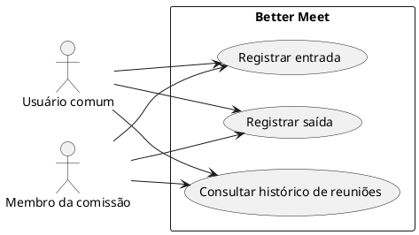
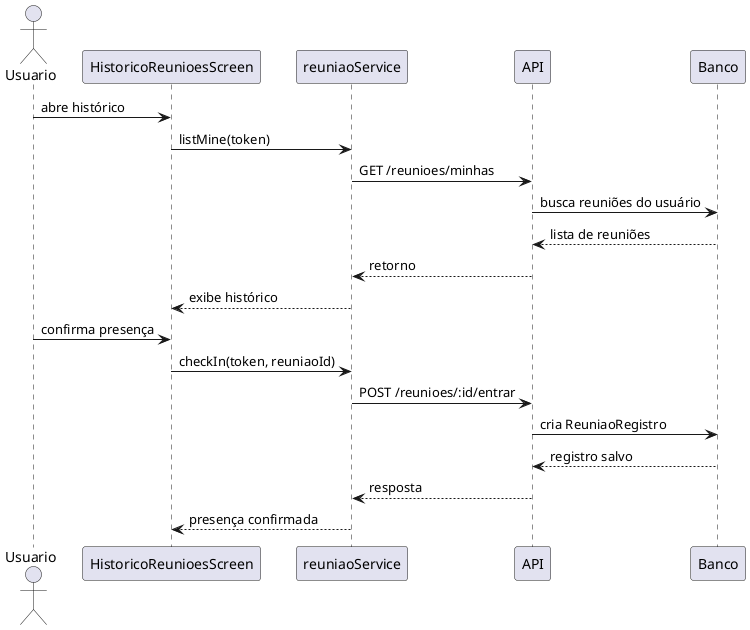

# Incremento 3 — Histórico de reuniões

```text
Incremento: Histórico de reuniões
Escopo: histórico de reuniões em que o usuário participou
Branch: development
Commit: [a confirmar no código consultado]
Data de revisão: 2026-11-12
Responsável(eis): Breno Nobre de Souza
Estado: Parcial
Fontes:
- sistema/better-meet/src/app/(tabs)/(reunioes)/historico.tsx
- sistema/better-meet/src/services/reuniaoService.ts
- sistema/better-meet/src/components/ReuniaoCheckIn.tsx
- sistema/api/src/services/reuniaoService.ts
- sistema/api/src/controllers/reuniaoController.ts
- sistema/api/src/routes/reuniaoRoutes.ts
- sistema/api/tests/reuniaoCheckIn.test.mjs
- sistema/better-meet/src/components/__tests__/ReuniaoCheckIn.test.tsx
```

Este documento cobre somente o histórico de reuniões do usuário e o registro de presença. Ele não inclui relatórios, ata, votação, lista de presença consolidada nem outros módulos adicionais.

# RF-HIST-01 — Histórico de reuniões do usuário

- **Status:** Parcial. A listagem e o registro de entrada/saída estão no código, mas o fator de rastreio do histórico e a revisão final ainda precisam ser confirmados em execução.
- **Objetivo:** permitir que o usuário visualize as reuniões em que participou e acompanhe o registro de presença no app.
- **Atores:** Usuário comum e Membro da comissão.
- **Regras de negócio:** RN-HIST-01 a RN-HIST-06.
- **Referências do código:**
  - App: `HistoricoReunioesScreen`, `reuniaoService` do app, `ReuniaoCheckIn`
  - API: `reuniaoRoutes`, `reuniaoController`, `reuniaoService`, `requireAuth`

## Descrição

Na aba de reuniões, o usuário acessa a tela de histórico. A funcionalidade lista as reuniões relacionadas ao perfil e filtra apenas aquelas em que existe registro de presença. Quando o usuário entra em uma reunião agendada, o app chama o endpoint de check-in e registra a entrada. Se já houver registro anterior, o sistema identifica como duplicado e evita a criação de outra linha.

## Regras de negócio

| ID | Regra | Onde está |
|---|---|---|
| RN-HIST-01 | A tela de histórico só deve mostrar reuniões com presença registrada | `historico.tsx` e `listMine` |
| RN-HIST-02 | a listagem deve seguir a ordem de data e horário | `historico.tsx` |
| RN-HIST-03 | O usuário só pode registrar entrada se tiver vínculo com a reunião | `checkIn` da API |
| RN-HIST-04 | A entrada é única por usuário e reunião | `reuniaoId_userId` em `ReuniaoRegistro` |
| RN-HIST-05 | A saída só pode acontecer depois que existe a entrada | `checkOut` |
| RN-HIST-06 | Reuniões fora do status `AGENDADA` não aceitam check-in | `checkIn` |

## Atores

| Ator | Tipo | Responsabilidade | Evidência |
|---|---|---|---|
| Usuário comum | Humano | consulta o histórico de reuniões e registra entrada/saída | `historico.tsx` |
| Membro da comissão | Humano | participa da reunião e confirma presença | `assertMembroDaComissao` |

## Entradas

| Campo | Origem (tela/rota) | Tipo/formato | Obrigatório | Domínio/validação | Exemplo |
|---|---|---|---|---|---|
| `Authorization` | Cabeçalho; `token` do `authStore` | `Bearer <JWT>` | Sim | `requireAuth` | `Bearer <token>` |
| `reuniaoId` | rota `/reunioes/:id/entrar` e `/reunioes/:id/sair` | `Int` | Sim | inteiro positivo | `31` |
| `token` | tela de histórico e aba de reuniões | `String` | Sim | JWT válido | `jwt-teste` |
| `status` | resposta de convite/presença | `String` | Não | `ACEITO`, `PENDENTE` | `ACEITO` |

Não há query string.

## Origem

- Tela de histórico em `sistema/better-meet/src/app/(tabs)/(reunioes)/historico.tsx`.
- Serviço do app: `reuniaoService.listMine(token)`.
- Rotas da API: `GET /reunioes/minhas`, `POST /reunioes/:id/entrar`, `POST /reunioes/:id/sair`.
- Componente: `ReuniaoCheckIn` para confirmar presença e saída.

## Pré-condições

- O usuário está autenticado.
- A reunião existe e está vinculada ao perfil do usuário ou a um convite aceito.
- O usuário faz parte da comissão da reunião ou foi convidado e aceitou o convite.
- Para check-in, a reunião deve estar em status `AGENDADA`.

## Ação

As rotas estão em `reuniaoRoutes`, e o `server.ts` monta esse router em `/api`, depois de `express.json()` e `cors`. Toda rota chama `requireAuth` antes do controller.

1. O usuário entra na aba de reuniões e acessa a tela de histórico.
2. O app chama `listMine(token)`.
3. A API busca as reuniões do usuário e retorna as reuniões relacionadas ao perfil.
4. O app filtra apenas as que possuem `meuRegistro` para exibir o histórico.
5. O usuário confirma presença em uma reunião agendada.
6. O app chama `checkIn(token, reuniaoId)`.
7. A API valida a reunião e o vínculo do usuário.
8. Se não houver registro anterior, a entrada é criada com `entradaAt` e salva no banco.
9. Se já existe registro, a API retorna `jaRegistrado: true` e evita duplicar o registro.
10. A saída segue o mesmo fluxo: a API verifica a entrada e grava `saidaAt` sem apagar o registro original.

## Saída

| Situação | Status/resposta | Comportamento |
|---|---|---|
| Histórico carregado | `200` | lista de reuniões com registro de presença |
| Sem registros | `200` | a tela mostra "Você ainda não participou de nenhuma reunião." |
| Check-in bem sucedido | `200` | presença registrada e retorno do registro |
| Check-in duplicado | `200` | mantém o registro original e retorna `jaRegistrado: true` |
| Reunião não encontrada | `404` | erro indicando que a reunião não existe |
| Sem vínculo ou convite pendente | `403` | falha ao registrar presença |
| Reunião não agendada | `409` | rejeita entrada fora do status permitido |
| Falha de rede | sem resposta | app mostra mensagem de erro |

## Destino

| Banco | Tabela/modelo | Operação | Campos relevantes | Vínculos |
|---|---|---|---|---|
| MySQL (via Prisma) | `Reuniao` | consulta e associação | `id`, `titulo`, `data`, `horaInicio`, `horaFim`, `status`, `criadoPorUserId` | FK com `comissao` e `user` |
| MySQL (via Prisma) | `ReuniaoRegistro` | `create` / `findUnique` / `updateMany` | `reuniaoId`, `userId`, `entradaAt`, `saidaAt` | chave única `reuniaoId_userId` |
| MySQL (via Prisma) | `ConviteReuniao` | consulta de vínculo | `userId`, `status`, `reuniaoId` | identifica participação aceita |

## Fluxos alternativos e exceções

- **1a:** sem token no app, a tela não tenta carregar o histórico.
- **3a:** se não houver reuniões com registro, a listagem aparece vazia.
- **6a:** o usuário repete o check-in, e a API retorna `jaRegistrado: true` em vez de duplicar o registro.
- **8a:** se a reunião não estiver em `AGENDADA`, a entrada é negada com `409`.
- **9a:** o usuário tenta sair sem ter entrado antes; a API responde `409` com a mensagem "Registre sua entrada antes de sair da reunião.".

## Pós-condições

- O histórico do usuário passa a conter as reuniões em que ele registrou entrada.
- A presença fica persistida pela chave única da tabela de registro.
- A saída atualiza o campo `saidaAt` sem apagar o evento de entrada.
- A reunião não é removida do histórico quando o usuário sai; apenas o registro de saída é preenchido.

## Efeitos colaterais

- O processo de presença afeta apenas a tabela de registros e o histórico do usuário, sem alterar o status da reunião.
- A API e a tela não geram e-mail nem notificação específica para check-in/check-out.
- A entrada e saída não alteram a comissão, os convites ou a ata da reunião.

## Diagramas e testes relacionados

### Diagrama de casos de uso



### Diagrama de sequência



### Testes relevantes

| ID | Cenário | Arquivo | Status |
|---|---|---|---|
| CT-HIST-01 | Listagem do histórico por usuário | `sistema/better-meet/src/components/__tests__/ReunioesData.test.tsx` | Parcial |
| CT-HIST-02 | Confirmar presença na reunião | `sistema/api/tests/reuniaoCheckIn.test.mjs` | Parcial |
| CT-HIST-03 | Entrada e saída da reunião | `sistema/better-meet/src/components/__tests__/ReuniaoCheckIn.test.tsx` | Parcial |

## Divergências encontradas

| Item | Documento ou expectativa | Código | Situação |
|---|---|---|---|
| histórico | tela mostra somente reuniões com `meuRegistro` | API lista reuniões relacionadas ao usuário | comportamento correto do app |
| presença duplicada | não pode existir duas entradas para o mesmo usuário e reunião | chave única `reuniaoId_userId` | atendido |
| status da reunião | check-in só deve permitir reunião agendada | API valida `status` | atendido |

# Casos de uso

### UC01 — Consultar histórico de reuniões

- **Objetivo:** visualizar reuniões em que o usuário participou.
- **Atores:** Usuário comum; Membro da comissão.
- **Gatilho:** abrir a aba de reuniões / tela de histórico.
- **Entradas:** `Authorization`; `token`.
- **Pré-condições:** usuário autenticado.
- **Fluxo principal:**
  1. o app chama `listMine`;
  2. a API busca as reuniões do usuário;
  3. a tela filtra apenas as reuniões com presença registrada.
- **Pós-condições:** usuário vê o histórico de reuniões em que participou.

### UC02 — Registrar entrada

- **Objetivo:** confirmar presença do usuário em uma reunião.
- **Atores:** Usuário comum; Membro da comissão.
- **Gatilho:** clicar em "Confirmar presença".
- **Entradas:** `reuniaoId`; `Authorization`.
- **Pré-condições:** reunião existe; usuário tem vínculo com a reunião; status `AGENDADA`.
- **Fluxo principal:**
  1. o app chama `checkIn`;
  2. a API valida a reunião e o vínculo;
  3. cria o registro de presença.
- **Pós-condições:** a presença fica registrada.

### UC03 — Registrar saída

- **Objetivo:** encerrar a presença do usuário após entrar na reunião.
- **Atores:** Usuário comum; Membro da comissão.
- **Gatilho:** clicar em "Registrar saída".
- **Entradas:** `reuniaoId`; `Authorization`.
- **Pré-condições:** existe registro de entrada.
- **Fluxo principal:**
  1. o app chama `checkOut`;
  2. a API valida a entrada;
  3. grava `saidaAt`.
- **Pós-condições:** o usuário passa a ter presença fechada sem perder o registro de entrada.

## Conclusão

Este incremento trata apenas do histórico de reuniões do usuário e do registro de presença nas reuniões. O comportamento principal está ligado ao fluxo de `listMine`, `checkIn` e `checkOut`, com persistência por meio da tabela `ReuniaoRegistro`, sem ampliar o escopo para relatórios, ata, votos ou outros módulos do sistema.
