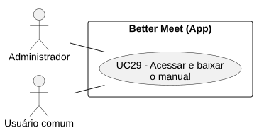
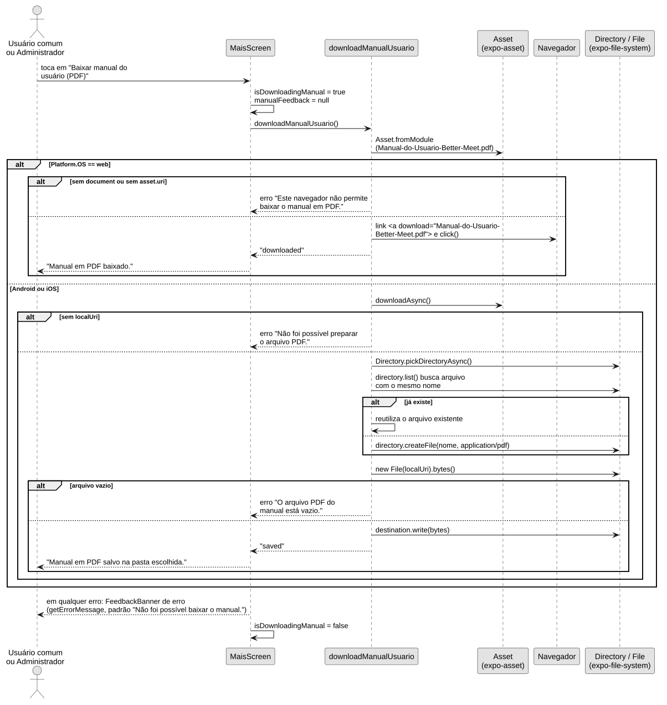
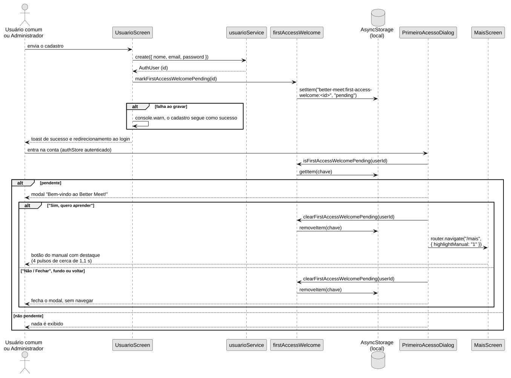

# UC29 — Acessar e baixar o manual

```text
Incremento: Entrega 4 — Di3
Escopo: UC29 — acessar e baixar o manual (RF19)
Branch: main
Commit: c45226bd62a95c97cf51ea41140678243b56806d
Data de revisão: 2026-11-13
Responsável(eis): Miguel Augusto Baptista
Estado: Parcial (implementado; sem testes de interface ou de download)
Fontes: sistema/better-meet/src/utils/downloadManualUsuario.ts; sistema/better-meet/src/utils/firstAccessWelcome.ts; sistema/better-meet/src/utils/__tests__/firstAccessWelcome.test.ts; sistema/better-meet/src/components/PrimeiroAcessoDialog.tsx; sistema/better-meet/src/app/_layout.tsx; sistema/better-meet/src/app/usuario.tsx; sistema/better-meet/src/app/(tabs)/mais/index.tsx; sistema/better-meet/src/services/usuarioService.ts; sistema/better-meet/src/store/authStore.ts; sistema/better-meet/metro.config.js; sistema/better-meet/package.json; sistema/better-meet/jest.setup.ts; sistema/better-meet/assets/manual/Manual-do-Usuario-Better-Meet.pdf (só a existência; o conteúdo do PDF não foi lido)
```


## Objetivo

Permitir que o usuário encontre e obtenha o manual de utilização do Better Meet em PDF.

## Ator principal

Administrador (`Role.ADMIN`) e Usuário comum (`Role.USER`), cada um com associação própria no diagrama. O código não tem comportamento específico por papel neste fluxo.

## Gatilho

A conta cadastrada entra no aplicativo depois de um cadastro que deixou uma indicação local de primeiro acesso (o cadastro não autentica: mostra um toast e redireciona ao login), ou o usuário abre a seção **Ajuda** da aba **Mais** para acessar o manual posteriormente.

## Pré-condições

- O usuário está autenticado para abrir a aba **Mais**.
- Para exibir o convite inicial, existe uma indicação pendente para o ID da conta autenticada no armazenamento local.
- O arquivo PDF está incluído na instalação do aplicativo.

## Fluxo principal — aceitar o convite inicial

1. O componente `PrimeiroAcessoDialog`, montado em `_layout.tsx`, verifica se há uma indicação pendente para o usuário autenticado.
2. O aplicativo apresenta o modal “Bem-vindo ao Better Meet!”.
3. O usuário seleciona **“Sim, quero aprender”**.
4. O aplicativo fecha o modal e solicita a remoção da indicação local.
5. O aplicativo navega para `/mais` com `highlightManual=1` e destaca o botão de download com 4 pulsos.
6. O usuário seleciona **“Baixar manual do usuário (PDF)”**.
7. A função `downloadManualUsuario` prepara o arquivo PDF incluído no aplicativo.
8. Na Web, o navegador recebe a solicitação de download. No Android ou iOS, o usuário escolhe um diretório; o aplicativo reutiliza ali um arquivo de mesmo nome ou cria `Manual-do-Usuario-Better-Meet.pdf`, lê os bytes do PDF incluído no app e os grava no destino com `File.write()`.
9. O aplicativo apresenta “Manual em PDF baixado.” (Web) ou “Manual em PDF salvo na pasta escolhida.” (Android e iOS).

## Fluxos alternativos e exceções

- **A1 — Fechar o convite:** o usuário escolhe **“Não / Fechar”**, toca no fundo ou usa o botão voltar. O modal fecha, a indicação local é removida e a navegação continua normalmente.
- **A2 — Acessar posteriormente:** o usuário abre **Mais → Ajuda** e seleciona o botão do manual sem precisar do convite inicial.
- **E1 — Falha ao preparar ou disponibilizar o PDF:** o aplicativo apresenta uma mensagem de erro, sem confirmar sucesso. Na Web, o erro só é gerado se faltar `document` ou `asset.uri` (“Este navegador não permite baixar o manual em PDF.”); falha do navegador depois do `click()` não é detectada. No Android e iOS, há erro se o asset não tiver `localUri` (“Não foi possível preparar o arquivo PDF.”) ou se o PDF estiver vazio (“O arquivo PDF do manual está vazio.”).
- **E0 — Falha ao registrar a indicação no cadastro:** o aplicativo registra um aviso no console, o cadastro segue como sucesso e o convite não aparece.
- **E2 — Falha ao consultar ou remover a indicação local:** o aplicativo registra um aviso no console. Se a remoção não for concluída, o convite pode voltar a aparecer.
- **E3 — Falha ao gravar no diretório escolhido:** a operação de escrita é interrompida e o aplicativo apresenta a mensagem do erro ou, se não houver, “Não foi possível baixar o manual.”. O código não trata o cancelamento da escolha do diretório de forma específica; o resultado depende do que `pickDirectoryAsync` lançar **[A CONFIRMAR]**. Se já existir um arquivo com o mesmo nome, o conteúdo é substituído ao gravar.

## Pós-condições

- Ao aceitar ou fechar o convite, o aplicativo solicita a remoção da indicação de primeiro acesso local.
- Se a operação for concluída, o PDF é baixado pelo navegador ou salvo no diretório escolhido no dispositivo. No fluxo nativo, a gravação substitui o conteúdo de um arquivo homônimo existente.
- Se ocorrer uma falha, o aplicativo informa que a operação não foi concluída.

## Limitação

A indicação de primeiro acesso fica no armazenamento local da instalação ou navegador em que o cadastro foi realizado. Ela não é sincronizada com o servidor nem com outros dispositivos.

## Persistência de dados

O manual não persiste dados no banco de dados: não há chamada à API, model Prisma, tabela ou migration. Por isso não há diagrama relacional nem dicionário de dados do banco. Os dados **fora do banco** são a indicação de primeiro acesso no `AsyncStorage` (chave `better-meet:first-access-welcome:<userId>`, valor `pending`) e o arquivo PDF gravado no dispositivo, no diretório escolhido pelo usuário. Detalhes em [rf19_manual_utilizacao.md](rf19_manual_utilizacao.md).

## Diagramas



Fonte: [DCU-Manual.puml](Diagramas/DCU-Manual.puml).



Fonte: [DS-Acessar-Manual.puml](Diagramas/DS-Acessar-Manual.puml).

O convite de primeiro acesso é um fluxo distinto (cadastro, indicação local, login e modal):



Fonte: [DS-Primeiro-Acesso-Manual.puml](Diagramas/DS-Primeiro-Acesso-Manual.puml).

Classes: [DC-Manual.svg](Diagramas/DC-Manual.svg) e [diagrama_classes_manual.md](diagrama_classes_manual.md).

## Testes

No código existe `sistema/better-meet/src/utils/__tests__/firstAccessWelcome.test.ts` (2 testes de `firstAccessWelcome`: indicação por conta e remoção). Não foram executados nesta revisão. Não há teste automatizado de `PrimeiroAcessoDialog`, da tela **Mais** nem de `downloadManualUsuario`.

## Divergências encontradas

Resumo das correções feitas neste documento a partir do código (tabela completa em [rf19_manual_utilizacao.md](rf19_manual_utilizacao.md)): o cadastro não autentica e o convite aparece no login seguinte; o ator “Usuário autenticado” foi trocado por Administrador e Usuário comum; o convite também fecha ao tocar no fundo ou voltar; a gravação nativa reutiliza arquivo homônimo e rejeita PDF vazio; a Web não detecta falha posterior ao `click()`; falha ao gravar a indicação no cadastro é só aviso no console.

## Marcações restantes

- **[A CONFIRMAR]** Comportamento ao cancelar a escolha do diretório (depende da API `Directory.pickDirectoryAsync`).
- **[A CONFIRMAR]** Conteúdo do PDF e execução em Web, Android e iOS.
