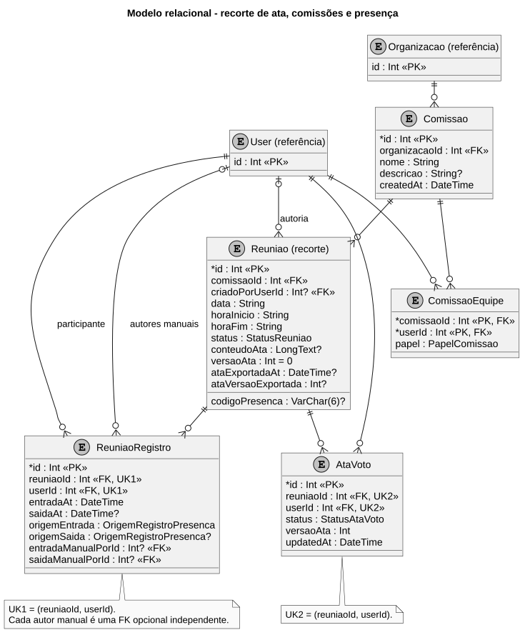
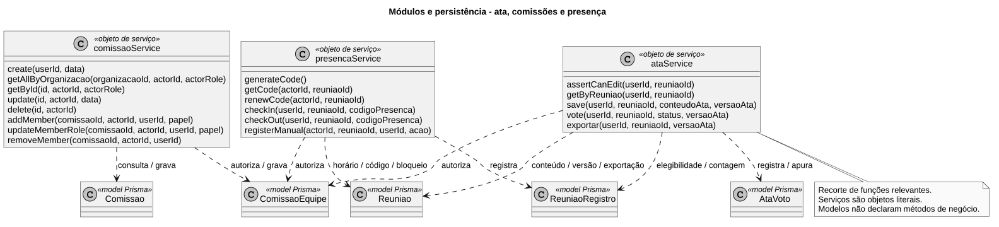

> Entrega final (AF) · Ata, comissões e presença · Versão 1.0 · 27/11/2026.
> Código auditado: `feature/refatoracao-ultima-entrega`, commit <code>614734c</code>. Responsável pela revisão acadêmica: [responsável a informar].
> Estado: implementado, salvo ressalvas expressas. Verificação documental por leitura do código; não equivale à aprovação do professor.

# Dados e módulos - Ata, Comissões e Presença

Este recorte documenta os campos e relacionamentos necessários às funcionalidades da entrega. Chave primária (PK), chave estrangeira (FK) e chave única (UK) são identificadas no diagrama. <code>?</code> indica campo opcional. Campos gerais de reunião e outras entidades permanecem no schema completo.

## Modelo relacional

Relacionamentos e restrições persistentes dos três módulos.

[Fonte PlantUML](https://github.com/MiguelIFSP/BRTPDS2-PROJETO-E-DESENVOLVIMENTO-DE-SISTEMAS-2/blob/feature/documentacao-ata-comissao-presenca/documentos/entrega5_AF/Diagramas/DR-Ata-Comissoes-Presenca.puml)

## Dicionário de dados

A tabela distingue limitações de banco das validações da API. Não existe campo persistido <code>dataInicio</code>: o início é calculado a partir de data, horaInicio e TZ_REUNIOES.

| Entidade/campo | Tipo e nulidade | Regra / finalidade |
|---|---|---|
| Comissao.id | Int obrigatório, PK autoincremental | Identificação. |
| Comissao.organizacaoId | Int obrigatório, FK | Organizacao.id; exclusão da organização em cascata. |
| Comissao.nome / descricao | String / String? | API: nome até 80 e descrição até 500 caracteres; trim. |
| Comissao.createdAt | DateTime obrigatório | Padrão now(). |
| ComissaoEquipe.comissaoId + userId | Int + Int obrigatórios, PK composta e FKs | Um vínculo por pessoa/comissão; ambas as referências com Cascade. |
| ComissaoEquipe.papel | PapelComissao obrigatório | Padrão MEMBRO; ADMINISTRADOR, FACILITADOR, SECRETARIO, MEMBRO. |
| Reuniao.id / comissaoId | Int obrigatório, PK / FK | FK da comissão com Cascade. |
| Reuniao.criadoPorUserId | Int opcional, FK | User.id, SetNull na exclusão da conta. |
| Reuniao.data / horaInicio / horaFim | String obrigatórias | AAAA-MM-DD e HH:mm; conversão considera TZ_REUNIOES. |
| Reuniao.status | StatusReuniao obrigatório | AGENDADA, REALIZADA ou CANCELADA; padrão AGENDADA. |
| Reuniao.codigoPresenca | String opcional, VarChar(6) | API usa exatamente seis dígitos; null é compatibilidade com reuniões antigas; não é globalmente único. |
| Reuniao.conteudoAta | String opcional, LongText | HTML sanitizado; API limita entrada a 50.000 caracteres. |
| Reuniao.versaoAta | Int obrigatório | Padrão zero; incrementa quando o texto efetivamente muda. |
| Reuniao.ataExportadaAt | DateTime opcional | null antes da finalização; timestamp imutável no fluxo de ata. |
| Reuniao.ataVersaoExportada | Int opcional | Versão correspondente ao registro de finalização. |
| ReuniaoRegistro.id | Int obrigatório, PK autoincremental | Identificação do registro. |
| ReuniaoRegistro.reuniaoId + userId | Int + Int obrigatórios, FKs e UK composta | Uma entrada por pessoa/reunião; FKs com Cascade. |
| ReuniaoRegistro.entradaAt / saidaAt | DateTime / DateTime? | Horários do servidor; primeira entrada/saída preservadas em repetição. |
| ReuniaoRegistro.origemEntrada / origemSaida | OrigemRegistroPresenca / opcional | PROPRIO ou MANUAL; entrada padrão PROPRIO. |
| ReuniaoRegistro.entradaManualPorId / saidaManualPorId | Int opcionais, FKs | User.id do executor; SetNull preserva o registro e a origem se a conta for excluída. |
| AtaVoto.id | Int obrigatório, PK autoincremental | Identificação. |
| AtaVoto.reuniaoId + userId | Int + Int obrigatórios, FKs e UK composta | Um voto por pessoa/reunião; FKs com Cascade. |
| AtaVoto.status | StatusAtaVoto obrigatório | APROVADO ou REPROVADO. |
| AtaVoto.versaoAta | Int obrigatório | Versão sobre a qual a pessoa votou. |
| AtaVoto.updatedAt | DateTime obrigatório | Atualizado pelo Prisma em cada alteração. |

A aprovação é calculada pelo serviço, sem enum <code>APROVADA</code> no modelo Reuniao. A API retorna <code>aprovada</code>, <code>exportada</code> e <code>podeExportar</code>. Não confundir StatusAtaVoto (voto individual) com aprovação coletiva.

## Diagrama de classes e módulos

Dependências dos objetos de serviço e dos modelos Prisma.

[Fonte PlantUML](https://github.com/MiguelIFSP/BRTPDS2-PROJETO-E-DESENVOLVIMENTO-DE-SISTEMAS-2/blob/feature/documentacao-ata-comissao-presenca/documentos/entrega5_AF/Diagramas/DC-Ata-Comissoes-Presenca.puml)

## Dicionário dos módulos

A tabela identifica responsabilidades e arquivos reais, sem atribuir métodos aos modelos de dados.

| Módulo | Responsabilidade | Localização |
|---|---|---|
| comissaoService | Vínculos, papéis, visibilidade e gestão das comissões. | sistema/api/src/services/comissaoService.ts |
| presencaService | Código, elegibilidade, horário, idempotência e autoria manual. | sistema/api/src/services/presencaService.ts |
| ataService | Texto, versão, voto, maioria e finalização. | sistema/api/src/services/ataService.ts |
| lockReuniao | Bloqueio da linha da reunião na transação de escrita. | sistema/api/src/utils/lockReuniao.ts |
| confirmPresencaLocal / autenticacaoLocal | Confirmação nativa e tratamento de cancelamento; Web depende do ConfirmDialog chamador. | sistema/better-meet/src/utils/ |
| AtaReuniao / ataPdf | Edição, votação, indicação de aprovação e geração local do PDF. | sistema/better-meet/src/components/AtaReuniao.tsx; src/utils/ataPdf.ts |

## Migrations e integridade

<code>20261121110200_ata_exportada</code> acrescenta os controles de exportação. <code>20261126003222_presenca_codigo_auditoria</code> acrescenta código, origem e autores de registros. As migrations existentes devem ser aplicadas na ordem pelo mecanismo normal do projeto; esta entrega documental não altera schema nem migrations. Conferir o schema e o SQL versionados antes de implantar.

A restrição de último administrador é de serviço, não de banco; sua limitação concorrente está em RNF60. As FKs com Cascade também significam que excluir uma comissão/reunião remove dados dependentes; “imutabilidade após exportação” protege edição e voto no fluxo de ata, não constitui arquivo de retenção independente.

## Histórico de revisão

A revisão registra o recorte documentado nesta entrega.

| Versão | Data | Alteração | Responsável |
|---|---|---|---|
| 1.0 | 27/11/2026 | Consolidação da ata e revisão de comissão e presença conforme código auditado. | [responsável a informar] |
