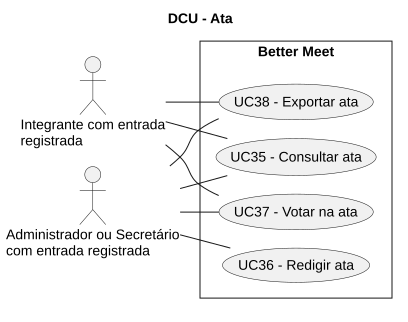

> Entrega final (AF) · Ata, comissões e presença · Versão 1.1 · 27/11/2026.
> Código auditado: `feature/refatoracao-ultima-entrega`, commit <code>614734c</code>. Responsável pela revisão acadêmica: [responsável a informar].
> Estado: implementado, salvo ressalvas expressas. Verificação documental por leitura do código; não equivale à aprovação do professor.

# DCU - Ata

> **Consolidação concluída.** Esta é a referência atual dos casos de uso de ata. As quatro fichas antigas e a documentação do RF40 foram reunidas aqui. Os endereços com “unificar” são mantidos somente para compatibilidade; não representam uma tarefa de consolidação pendente.

A tabela relaciona os documentos de origem às fichas atuais e aos requisitos funcionais (RF). Os textos de origem permanecem preservados no final desta página.

| Documento de origem | Caso de uso atual | Requisito atual |
|---|---|---|
| [Consultar ata](https://github.com/MiguelIFSP/BRTPDS2-PROJETO-E-DESENVOLVIMENTO-DE-SISTEMAS-2/wiki/%28unificar-DCU-%E2%80%90-ATA%29-Caso-de-Uso%3A-Consultar-ata) | [UC35 - Consultar ata](https://github.com/MiguelIFSP/BRTPDS2-PROJETO-E-DESENVOLVIMENTO-DE-SISTEMAS-2/wiki/DCU-%E2%80%90-Ata#uc35---consultar-ata) | [RF44](https://github.com/MiguelIFSP/BRTPDS2-PROJETO-E-DESENVOLVIMENTO-DE-SISTEMAS-2/wiki/RF44) |
| [Redigir ata](https://github.com/MiguelIFSP/BRTPDS2-PROJETO-E-DESENVOLVIMENTO-DE-SISTEMAS-2/wiki/%28unificar-DCU-%E2%80%90-ATA%29-Caso-de-Uso%3A-Redigir-ata) | [UC36 - Redigir ata](https://github.com/MiguelIFSP/BRTPDS2-PROJETO-E-DESENVOLVIMENTO-DE-SISTEMAS-2/wiki/DCU-%E2%80%90-Ata#uc36---redigir-ata) | [RF45](https://github.com/MiguelIFSP/BRTPDS2-PROJETO-E-DESENVOLVIMENTO-DE-SISTEMAS-2/wiki/RF45) |
| [Votar na ata](https://github.com/MiguelIFSP/BRTPDS2-PROJETO-E-DESENVOLVIMENTO-DE-SISTEMAS-2/wiki/%28unificar-DCU-%E2%80%90-ATA%29-Caso-de-Uso%3A-Votar-na-ata) | [UC37 - Votar na ata](https://github.com/MiguelIFSP/BRTPDS2-PROJETO-E-DESENVOLVIMENTO-DE-SISTEMAS-2/wiki/DCU-%E2%80%90-Ata#uc37---votar-na-ata) | [RF46](https://github.com/MiguelIFSP/BRTPDS2-PROJETO-E-DESENVOLVIMENTO-DE-SISTEMAS-2/wiki/RF46) |
| [Exportar ata](https://github.com/MiguelIFSP/BRTPDS2-PROJETO-E-DESENVOLVIMENTO-DE-SISTEMAS-2/wiki/%28unificar-DCU-%E2%80%90-ATA%29-Caso-de-Uso%3A-Exportar-ata) | [UC38 - Exportar ata](https://github.com/MiguelIFSP/BRTPDS2-PROJETO-E-DESENVOLVIMENTO-DE-SISTEMAS-2/wiki/DCU-%E2%80%90-Ata#uc38---exportar-ata) | [RF47](https://github.com/MiguelIFSP/BRTPDS2-PROJETO-E-DESENVOLVIMENTO-DE-SISTEMAS-2/wiki/RF47) |
| [RF40 - Gerenciar atas de reunião (histórico)](https://github.com/MiguelIFSP/BRTPDS2-PROJETO-E-DESENVOLVIMENTO-DE-SISTEMAS-2/wiki/RF40) | Documentação de origem das quatro operações | RF44 a RF47 |

## Atores

Administrador, Secretário, Facilitador e Membro da comissão, todos com entrada registrada. Somente Administrador e Secretário redigem. O papel de Administrador da plataforma (`ADMIN`) não substitui o vínculo na comissão.

DCU significa Diagrama de Casos de Uso. As associações indicam participação; permissões e precondições específicas são detalhadas em cada caso. [Diagramas de sequência](https://github.com/MiguelIFSP/BRTPDS2-PROJETO-E-DESENVOLVIMENTO-DE-SISTEMAS-2/wiki/DS-%E2%80%90-Ata) · [RNF55 a RNF57](https://github.com/MiguelIFSP/BRTPDS2-PROJETO-E-DESENVOLVIMENTO-DE-SISTEMAS-2/wiki/RNFS-%E2%80%90-Ata).

## Diagrama

Casos de uso de ata no aplicativo Better Meet.

[Fonte PlantUML](https://github.com/MiguelIFSP/BRTPDS2-PROJETO-E-DESENVOLVIMENTO-DE-SISTEMAS-2/blob/feature/documentacao-ata-comissao-presenca/documentos/entrega5_AF/Diagramas/DCU-Ata.puml)

As quatro fichas atuais são apresentadas em sequência, no padrão de objetivo, atores, precondições, fluxos, exceções e rastreabilidade. Os cinco textos de origem estão preservados integralmente nos blocos históricos ao final. O RF40 de origem reúne as quatro operações; ele não constitui um quinto caso de uso.

## UC35 - Consultar ata

**Objetivo:** Consultar o texto salvo, permissões, versão, voto próprio e contagens da ata.

**Requisito:** [RF44](https://github.com/MiguelIFSP/BRTPDS2-PROJETO-E-DESENVOLVIMENTO-DE-SISTEMAS-2/wiki/RF44). **Estado:** Implementado.

**Gatilho:** a pessoa solicita “Consultar ata” no aplicativo.

**Precondições:** Sessão válida; vínculo atual na comissão e registro de entrada na reunião. A saída já registrada não elimina a elegibilidade.

**Entradas:** id: inteiro positivo na URL; identidade obtida da sessão. Sem corpo.

**Fluxo principal:**

1. O aplicativo recebe a solicitação e os dados.
2. Consultar vínculo, registro e votos da versão atual; sanitizar HTML; calcular maioria estrita (aprovados > presentes / 2, presentes > 0). Sem texto, retornar null e podeVotar false.
3. O aplicativo apresenta o resultado: 200: objeto Ata com conteudoAta string HTML ou null, versaoAta inteiro, flags podeEditar/podeVotar/podeExportar/aprovada/exportada, exportadaAt data ou null, presentes inteiro, meuVoto enum ou null e contagens de votos.

**Fluxos alternativos e exceções:** 400 id inválido; 401 sem sessão; 403 sem vínculo/presença; 404 reunião inexistente. Todas as rotas exigem sessão (401); erros inesperados retornam 500 com mensagem genérica. Nenhuma resposta de falha deve ser exibida como sucesso.

**Pós-condições:** Nenhuma alteração persistente. A tela recebe a versão vigente.

**Efeitos colaterais:** Sem efeitos de escrita.

**Rastreabilidade:** [DS de consultar ata](https://github.com/MiguelIFSP/BRTPDS2-PROJETO-E-DESENVOLVIMENTO-DE-SISTEMAS-2/wiki/DS-%E2%80%90-Ata); CT-AF-35; RNF55 a RNF57.

## UC36 - Redigir ata

**Objetivo:** Salvar o texto da ata e disponibilizar a versão aos participantes elegíveis.

**Requisito:** [RF45](https://github.com/MiguelIFSP/BRTPDS2-PROJETO-E-DESENVOLVIMENTO-DE-SISTEMAS-2/wiki/RF45). **Estado:** Implementado.

**Gatilho:** a pessoa solicita “Redigir ata” no aplicativo.

**Precondições:** Sessão válida; vínculo atual na comissão e registro de entrada na reunião. A saída já registrada não elimina a elegibilidade. Papel ADMINISTRADOR ou SECRETARIO; ata ainda não exportada.

**Entradas:** id: inteiro positivo; conteudoAta: string HTML, trim, obrigatório, máximo 50.000 caracteres e conteúdo textual após sanitização; versaoAta: inteiro obrigatório ≥ 0.

**Fluxo principal:**

1. O aplicativo recebe a solicitação e os dados.
2. Bloquear a reunião na transação; conferir papel, versão e finalização; sanitizar HTML; se o conteúdo mudar, incrementar versaoAta e excluir votos anteriores na mesma transação. Conteúdo idêntico mantém versão e votos.
3. O aplicativo apresenta o resultado: 200: objeto Ata atualizado.

**Fluxos alternativos e exceções:** 400 conteúdo/versão inválidos; 403 papel não editor; 409 versão desatualizada ou ata exportada. Todas as rotas exigem sessão (401); erros inesperados retornam 500 com mensagem genérica. Nenhuma resposta de falha deve ser exibida como sucesso.

**Pós-condições:** Texto salvo e votação disponível sem depender de voto do presidente.

**Efeitos colaterais:** Alteração efetiva invalida todos os votos da versão anterior.

**Rastreabilidade:** [DS de redigir ata](https://github.com/MiguelIFSP/BRTPDS2-PROJETO-E-DESENVOLVIMENTO-DE-SISTEMAS-2/wiki/DS-%E2%80%90-Ata); CT-AF-36; RNF55 a RNF57.

## UC37 - Votar na ata

**Objetivo:** Registrar aprovação ou reprovação individual da versão salva.

**Requisito:** [RF46](https://github.com/MiguelIFSP/BRTPDS2-PROJETO-E-DESENVOLVIMENTO-DE-SISTEMAS-2/wiki/RF46). **Estado:** Implementado.

**Gatilho:** a pessoa solicita “Votar na ata” no aplicativo.

**Precondições:** Sessão válida; vínculo atual na comissão e registro de entrada na reunião. A saída já registrada não elimina a elegibilidade. Texto salvo e ata não exportada. Não exige voto anterior do presidente.

**Entradas:** id: inteiro positivo; status: APROVADO ou REPROVADO; versaoAta: inteiro obrigatório ≥ 0.

**Fluxo principal:**

1. O aplicativo recebe a solicitação e os dados.
2. Bloquear a reunião; conferir versão e disponibilidade; inserir ou atualizar o voto único de reuniaoId/userId; recalcular maioria dos registros de entrada, incluindo quem já saiu.
3. O aplicativo apresenta o resultado: 200: objeto Ata com voto próprio e contagens atualizadas.

**Fluxos alternativos e exceções:** 400 enum/versão inválidos; 403 sem presença; 409 sem texto, versão desatualizada ou ata exportada. Todas as rotas exigem sessão (401); erros inesperados retornam 500 com mensagem genérica. Nenhuma resposta de falha deve ser exibida como sucesso.

**Pós-condições:** Um voto da pessoa existe para a versão vigente. Antes da exportação, pode ser alterado.

**Efeitos colaterais:** A aprovação calculada pode mudar. Não encerra a votação automaticamente.

**Rastreabilidade:** [DS de votar na ata](https://github.com/MiguelIFSP/BRTPDS2-PROJETO-E-DESENVOLVIMENTO-DE-SISTEMAS-2/wiki/DS-%E2%80%90-Ata); CT-AF-37; RNF55 a RNF57.

## UC38 - Exportar ata

**Objetivo:** Exportar o PDF da versão aprovada e registrar sua finalização.

**Requisito:** [RF47](https://github.com/MiguelIFSP/BRTPDS2-PROJETO-E-DESENVOLVIMENTO-DE-SISTEMAS-2/wiki/RF47). **Estado:** Implementado.

**Gatilho:** a pessoa solicita “Exportar ata” no aplicativo.

**Precondições:** Sessão válida; vínculo atual na comissão e registro de entrada na reunião. A saída já registrada não elimina a elegibilidade. Texto salvo e maioria estrita favorável; nenhum rascunho pendente na tela.

**Entradas:** id: inteiro positivo; versaoAta: inteiro obrigatório ≥ 0; confirmação da exportação no aplicativo.

**Fluxo principal:**

1. O aplicativo recebe a solicitação e os dados.
2. Gerar PDF com exportAtaPdf; no Web confirmar que foi salvo/impresso. Enviar versão à API; bloquear reunião, conferir versão e maioria; gravar ataExportadaAt e ataVersaoExportada. Repetição da versão finalizada é idempotente.
3. O aplicativo apresenta o resultado: 200: objeto Ata com exportada true e exportadaAt; PDF gerado localmente pelo aplicativo, não pelo endpoint.

**Fluxos alternativos e exceções:** 400 versão inválida; 403 sem presença; 409 versão desatualizada ou maioria insuficiente. Falha local não finaliza. Todas as rotas exigem sessão (401); erros inesperados retornam 500 com mensagem genérica. Nenhuma resposta de falha deve ser exibida como sucesso.

**Pós-condições:** Texto e votos ficam imutáveis após a finalização confirmada no servidor. Reexportar a versão finalizada permanece permitido.

**Efeitos colaterais:** Novas entradas passam a ser recusadas; saídas de registros existentes continuam permitidas. O arquivo local e a transação da API não são uma operação atômica.

**Rastreabilidade:** [DS de exportar ata](https://github.com/MiguelIFSP/BRTPDS2-PROJETO-E-DESENVOLVIMENTO-DE-SISTEMAS-2/wiki/DS-%E2%80%90-Ata); CT-AF-38; RNF55 a RNF57.

## Histórico dos casos de uso de origem

As quatro transcrições abaixo pertencem à versão anterior. Os identificadores, contratos e regras nelas registrados não substituem as fichas UC35 a UC38 apresentadas acima.

Conteúdo aprovado de origem — Consultar ata

Fonte: [página anterior](https://github.com/MiguelIFSP/BRTPDS2-PROJETO-E-DESENVOLVIMENTO-DE-SISTEMAS-2/wiki/(unificar-DCU-%E2%80%90-ATA)-Caso-de-Uso%3A-Consultar-ata), revisão da Wiki <code>9082c5d</code>. O identificador antigo é mantido apenas como referência histórica.

# UC17 — Consultar ata

- **Estado/objetivo:** Implementado; obter texto, voto próprio e contagens, inclusive reconhecer ausência de ata.
- **Atores:** Administrador da comissão; Secretário da comissão; Facilitador da comissão; Membro da comissão.
- **RF/regras:** RF16; RN-ATA01/02; RNF44.
- **Gatilho:** abrir Ata de reunião ou Atualizar ata e votos.
- **Entradas:** token string da sessão; reuniaoId number inteiro positivo, convertido do parâmetro id.
- **Pré-condições:** conta válida, vínculo atual e entrada registrada; não exige texto salvo nem ausência de saída.
- **Fluxo:** 1) tela confere token/id; 2) serviço do app envia GET; 3) requireAuth valida identidade; 4) controller resolve id; 5) getByReuniao abre transação, present chama loadAccess; 6) consulta votos da versão e sanitiza texto; 7) responde 200; 8) mostra editor aos dois papéis habilitados e leitor aos demais.
- **Alternativas/erros:** sem ata, 200/null, podeVotar false e aviso para leitores; id local inválido: “Reunião inválida.”; API: 400/401/403/404/500 conforme B.1; rede: ApiError status 0 e nova tentativa. Recarregar com rascunho exige confirmação de descarte.
- **Pós-condições:** estado local recebe o objeto; nenhuma escrita de negócio no banco. Erro não confirma carregamento novo.
- **Relações UML:** nenhuma; associação individual aos quatro atores.
- **Rastreabilidade:** S01/S02/S05/S06; User, ComissaoEquipe, ReuniaoRegistro, Reuniao, AtaVoto; DS-Consultar-Ata; CT-RF16-01–05 e CT-RNF44-01/02.

## Auditoria da ficha

| Elipse do diagrama | Ficha | Pré-condições | Pós-condições | Fluxos e erros | Verificado no código |
|---|---|---|---|---|---|
| UC17 — Consultar ata | Ficha acima | Sim | Sim | Sim | Sim |

## Diagrama de casos de uso

Conteúdo aprovado de origem — Redigir ata

Fonte: [página anterior](https://github.com/MiguelIFSP/BRTPDS2-PROJETO-E-DESENVOLVIMENTO-DE-SISTEMAS-2/wiki/(unificar-DCU-%E2%80%90-ATA)-Caso-de-Uso%3A-Redigir-ata), revisão da Wiki <code>9082c5d</code>. O identificador antigo é mantido apenas como referência histórica.

# UC18 — Redigir ata

- **Estado/objetivo:** Implementado; criar ou alterar o texto Rich Text.
- **Atores:** Administrador da comissão; Secretário da comissão.
- **RF/regras:** RF16; RN-ATA01–05/08; RNF44/RNF45.
- **Gatilho:** editar e tocar Salvar.
- **Entradas:** token string; reuniaoId number; conteudoAta string HTML; versaoAta number inteiro >= 0.
- **Pré-condições:** identidade, vínculo e entrada válidos, papel editor e versão carregada; primeira gravação não exige ata anterior. UI requer alteração local e ausência de ocupação/conflito.
- **Fluxo:** 1) editor fornece getHtml(); 2) confirmar se há votos carregados e mudança; 3) PUT passa por requireAuth e requireAtaEditor; 4) controller valida id/corpo; 5) service sanitiza/exige texto; 6) transação revalida acesso/papel/versão; 7) updateMany grava e incrementa se mudou; 8) deleteMany remove votos se mudou; 9) present devolve 200; 10) UI atualiza rascunho/objeto e informa disponibilidade de votação.
- **Alternativas/erros:** HTML normalizado idêntico preserva votos/versão; cancelar confirmação não envia PUT; 400 de schema/sanitizador; 401/403 de acesso; 404 de reunião; 409 de versão/count=0; 500 de exceção. Rede permite nova tentativa; 403/409 bloqueia editar/votar, preservando rascunho até recarregar.
- **Pós-condições:** sucesso com alteração: HTML normalizado, versão incrementada e votos removidos; sem alteração: versão/votos mantidos. Falha não confirma salvamento. Atomicidade física depende de teste real pendente.
- **Relações UML:** nenhuma; associação aos dois atores elegíveis.
- **Rastreabilidade:** S01–S03/S05/S06; Reuniao/AtaVoto; DS-Salvar-Ata; CT-RF16-06–12/15/16, CT-RNF44-01, CT-RNF45-01–03.

## Auditoria da ficha

| Elipse do diagrama | Ficha | Pré-condições | Pós-condições | Fluxos e erros | Verificado no código |
|---|---|---|---|---|---|
| UC18 — Redigir ata | Ficha acima | Sim | Sim | Sim | Sim |

## Diagrama de casos de uso

Conteúdo aprovado de origem — Votar na ata

Fonte: [página anterior](https://github.com/MiguelIFSP/BRTPDS2-PROJETO-E-DESENVOLVIMENTO-DE-SISTEMAS-2/wiki/(unificar-DCU-%E2%80%90-ATA)-Caso-de-Uso%3A-Votar-na-ata), revisão da Wiki <code>9082c5d</code>. O identificador antigo é mantido apenas como referência histórica.

# UC19 — Votar na ata

- **Estado/objetivo:** Implementado; registrar/trocar concordância individual na versão salva.
- **Atores:** Administrador da comissão; Secretário da comissão; Facilitador da comissão; Membro da comissão.
- **RF/regras:** RF16; RN-ATA01/04–06/08; RNF45.
- **Gatilho:** tocar Aprovar ou Reprovar.
- **Entradas:** token string; reuniaoId number; status StatusAtaVoto; versaoAta number inteiro >= 0.
- **Pré-condições:** identidade, vínculo, entrada, texto salvo e versão atual. UI sem rascunho, ocupação ou conflito; botão igual ao voto atual fica desabilitado.
- **Fluxo:** 1) escolher status; 2) POST; 3) autenticar e validar id/corpo; 4) transação/loadAccess; 5) conferir conteúdo e versão; 6) updateMany condicional com incremento zero; 7) upsert pela UK; 8) present calcula voto próprio/totais; 9) 200 atualiza UI e mostra “Seu voto foi registrado.”.
- **Alternativas/erros:** repetição HTTP retorna 200 sem duplicar; troca substitui status; sem texto ou versão antiga, 409; corpo inválido, 400; acesso, 401/403; reunião ausente, 404; exceção, 500. Após edição remota, recarregar e votar na nova versão; não existe encerramento/quórum.
- **Pós-condições:** voto único sobre versão atual, contagens recalculadas e texto preservado. Erro não é confirmado como voto.
- **Relações UML:** nenhuma; quatro associações individuais.
- **Rastreabilidade:** S01–S03/S05; Reuniao/AtaVoto; DS-Votar-Ata; CT-RF16-03–05/11–16 e CT-RNF45-01–03.

## Auditoria da ficha

| Elipse do diagrama | Ficha | Pré-condições | Pós-condições | Fluxos e erros | Verificado no código |
|---|---|---|---|---|---|
| UC19 — Votar na ata | Ficha acima | Sim | Sim | Sim | Sim |

## Diagrama de casos de uso

Conteúdo aprovado de origem — Exportar ata

Fonte: [página anterior](https://github.com/MiguelIFSP/BRTPDS2-PROJETO-E-DESENVOLVIMENTO-DE-SISTEMAS-2/wiki/(unificar-DCU-%E2%80%90-ATA)-Caso-de-Uso%3A-Exportar-ata), revisão da Wiki <code>9082c5d</code>. O identificador antigo é mantido apenas como referência histórica.

# UC20 — Exportar ata

- **Estado/objetivo:** Implementado; preparar documento da versão salva carregada para guardar/compartilhar/imprimir.
- **Atores:** Administrador da comissão; Secretário da comissão; Facilitador da comissão; Membro da comissão.
- **RF/regras:** RF16; RN-ATA07; RNF44 no tratamento do HTML.
- **Gatilho:** tocar Exportar PDF.
- **Entradas:** AtaPdfInput com titulo string, dataReuniao string AAAA-MM-DD e conteudoAta string HTML, do objeto carregado.
- **Pré-condições:** leitura já autorizada no carregamento e texto salvo não vazio; não há reautorização no clique. UI impede exportação repetida em andamento e enquanto busy.
- **Fluxo nativo:** 1) bloquear chamada duplicada; 2) buildAtaPdfHtml valida conteúdo/data e monta template; 3) Sharing.isAvailableAsync; 4) Print.printToFileAsync com base64; 5) exigir base64, criar File em Paths.cache e aguardar write; 6) Sharing.shareAsync; 7) finally libera controle.
- **Alternativa web:** sanitizeAtaHtml, template, window.open, isolar opener, escrever documento, registrar afterprint, focus/print; fechar após evento. O navegador controla salvar/imprimir.
- **Erros:** conteúdo/data inválidos, compartilhamento indisponível, falta de base64, falha de Print/File/Sharing ou janela bloqueada; mensagem/fallback de B.1 e liberação para tentar novamente. Falha de gravação impede compartilhar. Rascunho não é salvo/exportado implicitamente.
- **Pós-condições:** nativo prepara arquivo em cache e invoca gaveta; web invoca impressão isolada. Sem mudança no banco; cancelamento/resolução da chamada não confirma entrega externa.
- **Relações UML:** nenhuma; quatro associações individuais.
- **Rastreabilidade:** S05/S07; dois DS-Exportar-Ata-Pdf; sem tabela/endpoint de PDF; CT-RF16-17–19/21–23 e CT-RNF44-01.

## Auditoria da ficha

| Elipse do diagrama | Ficha | Pré-condições | Pós-condições | Fluxos e erros | Verificado no código |
|---|---|---|---|---|---|
| UC20 — Exportar ata | Ficha acima | Sim | Sim | Sim | Sim |

## Diagrama de casos de uso

## Documentação unificada do RF40 de origem

As regras atuais e os contratos estão nos [RF44 a RF47](https://github.com/MiguelIFSP/BRTPDS2-PROJETO-E-DESENVOLVIMENTO-DE-SISTEMAS-2/wiki/RF44) e na [documentação completa](https://github.com/MiguelIFSP/BRTPDS2-PROJETO-E-DESENVOLVIMENTO-DE-SISTEMAS-2/wiki/Entrega-final-%E2%80%90-Ata-Comiss%C3%B5es-e-Presen%C3%A7a). O conteúdo aprovado do antigo RF40 está preservado a seguir; o índice da Wiki também utiliza o número 40 para monitoramento, conforme o registro de correspondência da entrega.

Conteúdo aprovado de origem — RF40: Gerenciar atas de reunião

# Gerenciar atas de reunião

**Estado:** Implementado no código; 138 testes direcionados aprovados. **Objetivo:** consultar, redigir conforme o papel, votar e exportar a ata. **Origem:** pedido do módulo e implementação S01–S07. **Destino:** integrantes da comissão, Reuniao/AtaVoto e arquivo local conforme operação.

## Atores

| Ator | Tipo | Responsabilidade | Evidência |
|---|---|---|---|
| Administrador da comissão (PapelComissao.ADMINISTRADOR) | Pessoa/papel externo | Consultar, redigir, votar e exportar quando elegível | S02 podeEditar/loadAccess; S05 |
| Secretário da comissão (PapelComissao.SECRETARIO) | Pessoa/papel externo | Consultar, redigir, votar e exportar quando elegível | S02/S05 |
| Facilitador da comissão (PapelComissao.FACILITADOR) | Pessoa/papel externo | Consultar sem edição, votar e exportar quando elegível | S02/S05 |
| Membro da comissão (PapelComissao.MEMBRO) | Pessoa/papel externo | Consultar sem edição, votar e exportar quando elegível | S02/S05 |

“Administrador” isolado significa Role.ADMIN. Nenhum papel global acrescenta privilégio nessa ata. Cada ator exige ComissaoEquipe atual e ReuniaoRegistro da reunião para as operações HTTP.

## Regras de negócio

| ID | Regra | Evidência | Estado |
|---|---|---|---|
| RN-ATA01 | Leitura/gravação/voto exigem sessão, vínculo atual e entrada; saída não exclui por si só | requireAuth/loadAccess | Implementado |
| RN-ATA02 | Só ADMINISTRADOR/SECRETARIO editam; middleware e transação verificam; UI recebe podeEditar | requireAtaEditor/assertEditor/save | Implementado |
| RN-ATA03 | HTML obrigatório com trim, até 50.000 caracteres antes da sanitização e texto efetivo depois dela | ataSchema/validateAtaHtml | Implementado |
| RN-ATA04 | Versão divergente ou atualização condicional count=0 gera 409 | save/vote | Implementado; concorrência real Não verificado |
| RN-ATA05 | Alterar HTML normalizado incrementa versão e remove votos; texto normalizado idêntico preserva ambos | save | Implementado |
| RN-ATA06 | Quatro papéis votam após texto salvo; um registro por reunião/pessoa, com troca; totais sem decisão coletiva automática | vote/present/AtaVoto | Implementado |
| RN-ATA07 | PDF usa texto salvo carregado, nunca rascunho; não atualiza servidor nem revalida acesso no clique | handleExportPdf/exportAtaPdf | Implementado |
| RN-ATA08 | Rascunho impede voto na UI; 403/409 preserva rascunho e bloqueia edição/voto até recarregar | AtaReuniao | Implementado |

O checkIn para criar presença verifica comissão/organização aceita, integrante criador ou com convite aceito e reunião AGENDADA; registro existente é retornado antes dessa verificação de status. loadAccess da ata não repete critérios de convite, data ou status da reunião/organização. O botão de acesso exige meuRegistro e papelNaComissao; servidor valida independentemente dele.

## Entradas

| Campo | Tipo e domínio | Validação/origem |
|---|---|---|
| Authorization | Bearer + token | jwt.verify; sub inteiro positivo, role do enum, email presente; User relido. Sessão do authStore |
| id | Parâmetro convertido em number, inteiro > 0 | parseId usa Number/Number.isInteger (primeiro valor se array); tela usa Number.isSafeInteger antes da chamada |
| conteudoAta | string HTML | PUT: trim, obrigatório, máximo 50.000; deve manter texto após sanitização; editor.current.getHtml() |
| versaoAta | number inteiro >= 0 | Obrigatório em PUT/POST; deve coincidir com Reuniao.versaoAta; objeto Ata carregado |
| status | APROVADO ou REPROVADO | POST: string com trim, obrigatória; botão escolhido |
| titulo | string | PDF: ata.titulo; escapado no template, sem validação adicional de tamanho |
| dataReuniao | string AAAA-MM-DD | PDF: padrão textual validado (não calendário completo), formatado sem conversão de fuso |
| conteudoAta do PDF | string HTML salvo | ata.conteudoAta não nulo; template exige trim não vazio; web sanitiza novamente |

Os campos PDF são AtaPdfInput local, não corpo HTTP. Yup realiza coerções/transformações e stripUnknown: true; não promete rejeição de todo tipo JSON inicial diferente. userId e papel não são escolhidos no corpo para conceder permissão.

## Saída comum da API

GET/PUT/POST retornam **200**, objeto sem envelope:

| Campo | Tipo/domínio | Origem |
|---|---|---|
| reuniaoId | number | ID solicitado |
| titulo | string | Reuniao.titulo |
| dataReuniao | string | Reuniao.data |
| conteudoAta | HTML string ou null | Texto sanitizado novamente em present |
| versaoAta | number | Reuniao.versaoAta |
| papelNaComissao | PapelComissao | ComissaoEquipe.papel |
| podeEditar | boolean | ADMINISTRADOR/SECRETARIO |
| podeVotar | boolean | Boolean do conteúdo persistido, após autorização |
| meuVoto | StatusAtaVoto ou null | Voto próprio na versão atual |
| votos.aprovados | inteiro >= 0 | Contagem APROVADO na versão atual |
| votos.reprovados | inteiro >= 0 | Contagem REPROVADO na versão atual |

Não se devolve a lista de votos individuais de terceiros. Totais filtram versão, mas não o vínculo atual de cada votante: remover alguém da comissão não apaga automaticamente seu voto armazenado.

## Origem, Saída, Destino e Ação por operação

| Operação | Origem/rota ou função | Saída/destino | Ação e pré/pós-condições |
|---|---|---|---|
| Consultar | Foco/atualização em AtaReuniaoScreen; GET /api/reunioes/:id/ata | Objeto comum para UI | Sessão/vínculo/entrada; getByReuniao abre transação, present/loadAccess consulta reunião e votos, sanitiza e retorna. Sem texto: 200/null, podeVotar false; sem escrita de negócio |
| Salvar | Editor; PUT /api/reunioes/:id/ata | Objeto comum; Reuniao/AtaVoto | Papel editor e versão atual; middleware assertCanEdit, schema, validateAtaHtml, transação reautoriza e compara versão, updateMany grava, deleteMany remove votos se mudou, present retorna; texto idêntico preserva versão/votos |
| Votar | Botão; POST /api/reunioes/:id/ata/votar | Objeto comum; AtaVoto | Conteúdo e versão atuais; validar, loadAccess, conferir conteúdo/versão, updateMany incremento zero, upsert pela UK e present. Troca não duplica; texto permanece |
| Exportar | handleExportPdf; exportAtaPdf(input) | Promise<void>; cache/gaveta ou janela de impressão | Texto salvo carregado; template; nativo verifica Sharing, gera base64, aguarda File.write e compartilha; web sanitiza/abre/imprime; não modifica reunião/votos, nem confirma envio externo |

Prefixo /api vem de server.ts. Nenhum endpoint de PDF. O fluxo detalhado e pré/pós-condições de cada objetivo estão nas fichas UC17–UC20.

## Erros e ordem de validação

Erros HTTP têm error; propriedades de AppError.details podem ser incorporadas no mesmo nível. Não existe details obrigatório.

| HTTP | Condição | Mensagem literal |
|---|---|---|
| 400 | ID inválido | Identificador da reunião inválido. |
| 400 | JSON malformado | JSON inválido. |
| 400 | HTML ausente | Escreva o conteúdo da ata. |
| 400 | HTML acima do limite | A ata deve ter no máximo 50.000 caracteres de HTML. |
| 400 | Vazio após sanitizar | Escreva o conteúdo da ata antes de salvar. |
| 400 | Versão ausente/inválida como número | Informe a versão da ata. |
| 400 | Versão fracionária / negativa | A versão deve ser inteira. / A versão não pode ser negativa. |
| 400 | Status ausente/inválido | Escolha aprovar ou reprovar a ata. |
| 401 | Bearer ausente/vazio | Autenticação necessária. |
| 401 | Assinatura/expiração | Token inválido ou expirado. |
| 401 | Claims/sub inválidos | Token inválido. |
| 401 | Conta excluída | Sessão inválida. Entre novamente. |
| 403 | Sem vínculo ou entrada | A ata está disponível somente para integrantes da comissão com entrada registrada nesta reunião. |
| 403 | Sem papel de edição | Somente administrador ou secretário da comissão pode editar a ata. |
| 404 | Reunião inexistente | Reunião não encontrada. |
| 409 | Voto antes do texto | A ata precisa ser redigida e salva antes da votação. |
| 409 | Versão divergente/count=0 | A ata foi alterada. Atualize a tela antes de salvar ou votar. |
| 404 / 409 | Prisma P2025 / P2002 genéricos | Registro não encontrado. / Registro já existente. |
| 500 | Exceção não convertida | Erro interno. Tente novamente mais tarde. |

JSON malformado pode falhar antes da autenticação. Com JSON bem formado, requireAuth precede as rotas; PUT verifica papel antes do corpo; loadAccess detecta reunião ausente antes de negar vínculo. Voto repetido normalmente retorna 200 por upsert, não o erro P2002. Falha de rede gera ApiError status 0 no cliente (“Não foi possível conectar ao servidor. Verifique sua conexão.”); 0 não é HTTP.

PDF é local. Mensagens próprias: “A ata ainda não possui conteúdo salvo.”; “Atualize a ata para carregar a data da reunião.”; “O compartilhamento não está disponível neste dispositivo.”; “Não foi possível preparar o PDF para compartilhamento.”; “Permita pop-ups para exportar a ata.”. Print/File/Sharing podem fornecer mensagens próprias; fallback: “Não foi possível exportar a ata para PDF.”.

## Editor, leitura e PDF

| Grupo | Comportamento implementado (S05–S07) |
|---|---|
| Edição por papel | Admin/Secretário da comissão veem AtaEditor/Salvar; demais, AtaLeitura ou espera. Todos recebem voto/PDF, desabilitados conforme estado |
| Texto/histórico | Negrito, itálico, sublinhado, rasurado, desfazer/refazer |
| Parágrafos | H1/H2/H3; esquerda/centro/direita/justificado; listas ordenadas/não ordenadas; aumentar/diminuir recuo |
| Fonte | Escala 10, 13, 16, 18, 24, 32, 48 px |
| Tabelas | Menu de 1–10 linhas, 1–6 colunas, cabeçalho opcional, adicionar/excluir linha/coluna ou tabela; sem controle de mesclagem |
| Bordas | all, outer, inner, horizontal, vertical, top, bottom, left, right, none em data-ata-border |
| Barra | ScrollView horizontal, fundo escuro, ícones Pell/Ionicons e glifos H1/H2/H3; ações Colors.dark.primary (#1FD5B5); alvos de 44 |
| Plataformas | Pell/WebView/ataNativeBridge no nativo; Tiptap na web; DOMPurify no leitor web; leitor nativo sem JavaScript/acesso a arquivos, navegação só about:blank |

Limites de linhas/colunas são da interface; a API limita tamanho HTML e colspan/rowspan de 1 a 10, sem contar linhas/colunas. HTML preserva tags textuais/tabelas e estilos enumerados; normaliza font/align legados e remove scripts/eventos/recursos externos. Template PDF escapa título/data, mas não é sanitizador do HTML nativo.

prepareSave obtém o HTML atual pelo ref e confirma alteração se houver votos carregados. O servidor compara o texto normalizado. A UI preserva rascunho em falhas; 403/409 bloqueia editar/votar até recarregar. PDF pode usar o conteúdo carregado mesmo após conflito, pois não testa conflict nem renova acesso.

PDF: BetterMeet, título/data, fundo branco, CSS e sans-serif. Nativo gera A4 595×842; iOS usa CSS margin 0 e margens nativas 51; Android @page 18mm. Base64 é gravado em File(Paths.cache, nome com data/Date.now), aguardado antes de compartilhar application/pdf e UTI com.adobe.pdf. O cache permanece para leitura do destinatário. Na web, somente o documento da ata é aberto, opener isolado e print invocado; o navegador decide salvar/imprimir. Cancelar não gera confirmação de envio.

## Histórico de revisão

A revisão registra o recorte documentado nesta entrega.

| Versão | Data | Alteração | Responsável |
|---|---|---|---|
| 1.0 | 27/11/2026 | Consolidação da ata e revisão de comissão e presença conforme código auditado. | [responsável a informar] |
| 1.1 | 27/11/2026 | Consolidação explicitada; navegação atual separada dos textos históricos, com preservação dos endereços anteriores. | [responsável a informar] |
