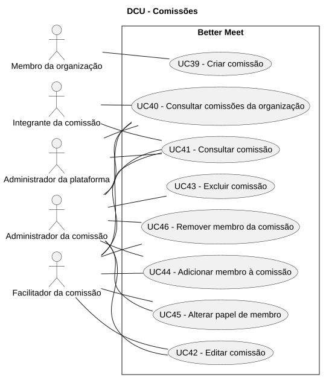

> Entrega final (AF) · Ata, comissões e presença · Versão 1.1 · 27/11/2026.
> Código auditado: `feature/refatoracao-ultima-entrega`, commit <code>614734c</code>. Responsável pela revisão acadêmica: [responsável a informar].
> Estado: implementado, salvo ressalvas expressas. Verificação documental por leitura do código; não equivale à aprovação do professor.

# DCU - Comissões

> **Revisão consolidada.** Esta página contém as fichas atuais UC39 a UC46, o diagrama e a ligação com os requisitos RF48 a RF55. A [página antiga de comissão](https://github.com/MiguelIFSP/BRTPDS2-PROJETO-E-DESENVOLVIMENTO-DE-SISTEMAS-2/wiki/%28revisar%29-Caso-de-uso%3A-comissao) permanece disponível como histórico; suas permissões e seu diagrama antigo não definem o comportamento vigente.

A documentação deve ser consultada nesta página e nos [diagramas de sequência de Comissões](https://github.com/MiguelIFSP/BRTPDS2-PROJETO-E-DESENVOLVIMENTO-DE-SISTEMAS-2/wiki/DS-%E2%80%90-Comiss%C3%B5es). A alteração de navegação não renumera casos de uso nem requisitos.

## Atores

Membro da organização; Administrador da plataforma (`ADMIN`, consulta ampliada); Administrador, Facilitador, Secretário e Membro da comissão. O criador recebe `ADMINISTRADOR`, mas o cargo pode ser transferido mantendo pelo menos um administrador.

DCU significa Diagrama de Casos de Uso. As associações indicam participação; permissões e precondições específicas são detalhadas em cada caso. [Diagramas de sequência](https://github.com/MiguelIFSP/BRTPDS2-PROJETO-E-DESENVOLVIMENTO-DE-SISTEMAS-2/wiki/DS-%E2%80%90-Comiss%C3%B5es) · [RNF58 a RNF60](https://github.com/MiguelIFSP/BRTPDS2-PROJETO-E-DESENVOLVIMENTO-DE-SISTEMAS-2/wiki/RNFS-%E2%80%90-Comiss%C3%B5es).

## Diagrama

Casos de uso de comissões no aplicativo Better Meet.

[Fonte PlantUML](https://github.com/MiguelIFSP/BRTPDS2-PROJETO-E-DESENVOLVIMENTO-DE-SISTEMAS-2/blob/feature/documentacao-ata-comissao-presenca/documentos/entrega5_AF/Diagramas/DCU-Comissoes.puml)

## UC39 - Criar comissão

**Objetivo:** Criar uma comissão vinculada à organização.

**Requisito:** [RF48](https://github.com/MiguelIFSP/BRTPDS2-PROJETO-E-DESENVOLVIMENTO-DE-SISTEMAS-2/wiki/RF48). **Estado:** Implementado.

**Gatilho:** a pessoa solicita “Criar comissão” no aplicativo.

**Precondições:** Sessão válida e vínculo na organização com status ACEITA.

**Entradas:** organizacaoId: inteiro positivo obrigatório; nome: string trim obrigatória até 80 caracteres; descricao: string trim opcional até 500 caracteres.

**Fluxo principal:**

1. O aplicativo recebe a solicitação e os dados.
2. Conferir organização e vínculo; criar Comissao e ComissaoEquipe do autor por escrita aninhada do Prisma.
3. O aplicativo apresenta o resultado: 201: objeto Comissao (id, nome, descricao, createdAt, organizacaoId). O vínculo ADMINISTRADOR é persistido, mas a equipe não integra essa resposta.

**Fluxos alternativos e exceções:** 400 dados inválidos; 403 sem vínculo; 404 organização inexistente; 409 organização não aceita. Todas as rotas exigem sessão (401); erros inesperados retornam 500 com mensagem genérica. Nenhuma resposta de falha deve ser exibida como sucesso.

**Pós-condições:** Comissão vinculada à organização e com administrador inicial.

**Efeitos colaterais:** Criação de vínculo de equipe para o autor.

**Rastreabilidade:** [DS de criar comissão](https://github.com/MiguelIFSP/BRTPDS2-PROJETO-E-DESENVOLVIMENTO-DE-SISTEMAS-2/wiki/DS-%E2%80%90-Comiss%C3%B5es); CT-AF-39; RNF58 a RNF60.

## UC40 - Consultar comissões da organização

**Objetivo:** Listar as comissões visíveis na organização.

**Requisito:** [RF49](https://github.com/MiguelIFSP/BRTPDS2-PROJETO-E-DESENVOLVIMENTO-DE-SISTEMAS-2/wiki/RF49). **Estado:** Implementado.

**Gatilho:** a pessoa solicita “Consultar comissões da organização” no aplicativo.

**Precondições:** Sessão válida; para usuário comum, vínculo na organização.

**Entradas:** organizacaoId: inteiro positivo na URL; identidade e papel global vindos da sessão.

**Fluxo principal:**

1. O aplicativo recebe a solicitação e os dados.
2. Para ADMIN global, consultar todas as comissões da organização; para demais usuários, restringir às comissões cuja equipe contém o usuário.
3. O aplicativo apresenta o resultado: 200: lista de comissões e equipe, em ordem decrescente de criação; lista vazia quando não houver correspondência.

**Fluxos alternativos e exceções:** 400 identificador inválido; 401 sem sessão; 403 usuário comum sem vínculo na organização. Todas as rotas exigem sessão (401); erros inesperados retornam 500 com mensagem genérica. Nenhuma resposta de falha deve ser exibida como sucesso.

**Pós-condições:** Lista exibida de acordo com a visibilidade do solicitante.

**Efeitos colaterais:** Nenhuma alteração persistente.

**Rastreabilidade:** [DS de consultar comissões da organização](https://github.com/MiguelIFSP/BRTPDS2-PROJETO-E-DESENVOLVIMENTO-DE-SISTEMAS-2/wiki/DS-%E2%80%90-Comiss%C3%B5es); CT-AF-40; RNF58 a RNF60.

## UC41 - Consultar comissão

**Objetivo:** Consultar identificação, organização e equipe da comissão.

**Requisito:** [RF50](https://github.com/MiguelIFSP/BRTPDS2-PROJETO-E-DESENVOLVIMENTO-DE-SISTEMAS-2/wiki/RF50). **Estado:** Implementado.

**Gatilho:** a pessoa solicita “Consultar comissão” no aplicativo.

**Precondições:** Sessão válida; ADMIN global ou integrante da organização e da equipe da comissão.

**Entradas:** id: inteiro positivo na URL; identidade e papel global da sessão.

**Fluxo principal:**

1. O aplicativo recebe a solicitação e os dados.
2. Localizar comissão; conferir vínculos ou exceção de consulta do ADMIN global; consultar equipe ordenada por papel e nome.
3. O aplicativo apresenta o resultado: 200: comissão, referência da organização e equipe com id, nome e e-mail das pessoas.

**Fluxos alternativos e exceções:** 400 id inválido; 403 sem autorização; 404 comissão inexistente. Todas as rotas exigem sessão (401); erros inesperados retornam 500 com mensagem genérica. Nenhuma resposta de falha deve ser exibida como sucesso.

**Pós-condições:** Detalhes exibidos sem conceder poderes de gestão pelo simples acesso.

**Efeitos colaterais:** Nenhuma alteração persistente.

**Rastreabilidade:** [DS de consultar comissão](https://github.com/MiguelIFSP/BRTPDS2-PROJETO-E-DESENVOLVIMENTO-DE-SISTEMAS-2/wiki/DS-%E2%80%90-Comiss%C3%B5es); CT-AF-41; RNF58 a RNF60.

## UC42 - Editar comissão

**Objetivo:** Alterar nome e descrição da comissão.

**Requisito:** [RF51](https://github.com/MiguelIFSP/BRTPDS2-PROJETO-E-DESENVOLVIMENTO-DE-SISTEMAS-2/wiki/RF51). **Estado:** Implementado.

**Gatilho:** a pessoa solicita “Editar comissão” no aplicativo.

**Precondições:** Sessão válida; ADMINISTRADOR ou FACILITADOR da própria comissão.

**Entradas:** id: inteiro positivo; nome: string trim obrigatória até 80 caracteres; descricao: string trim opcional até 500 caracteres.

**Fluxo principal:**

1. O aplicativo recebe a solicitação e os dados.
2. Conferir papel atual; validar os campos; atualizar nome e descrição. A organização da comissão não é alterada.
3. O aplicativo apresenta o resultado: 200: comissão atualizada.

**Fluxos alternativos e exceções:** 400 campos inválidos; 403 papel insuficiente; 404 comissão inexistente. Todas as rotas exigem sessão (401); erros inesperados retornam 500 com mensagem genérica. Nenhuma resposta de falha deve ser exibida como sucesso.

**Pós-condições:** Nome e descrição persistidos.

**Efeitos colaterais:** Nenhum papel de equipe é alterado.

**Rastreabilidade:** [DS de editar comissão](https://github.com/MiguelIFSP/BRTPDS2-PROJETO-E-DESENVOLVIMENTO-DE-SISTEMAS-2/wiki/DS-%E2%80%90-Comiss%C3%B5es); CT-AF-42; RNF58 a RNF60.

## UC43 - Excluir comissão

**Objetivo:** Excluir a comissão após confirmação explícita.

**Requisito:** [RF52](https://github.com/MiguelIFSP/BRTPDS2-PROJETO-E-DESENVOLVIMENTO-DE-SISTEMAS-2/wiki/RF52). **Estado:** Implementado.

**Gatilho:** a pessoa solicita “Excluir comissão” no aplicativo.

**Precondições:** Sessão válida; ADMINISTRADOR da própria comissão.

**Entradas:** id: inteiro positivo; confirmação no aplicativo; sem corpo.

**Fluxo principal:**

1. O aplicativo recebe a solicitação e os dados.
2. Solicitar confirmação; conferir papel; excluir Comissao, aplicando os relacionamentos onDelete Cascade do schema.
3. O aplicativo apresenta o resultado: 200: objeto message com “Comissão excluída com sucesso.”.

**Fluxos alternativos e exceções:** 400 id inválido; 403 papel insuficiente; 404 comissão inexistente. Todas as rotas exigem sessão (401); erros inesperados retornam 500 com mensagem genérica. Nenhuma resposta de falha deve ser exibida como sucesso.

**Pós-condições:** Comissão removida.

**Efeitos colaterais:** Equipe e reuniões dependentes são removidas em cascata, incluindo dados dependentes das reuniões.

**Rastreabilidade:** [DS de excluir comissão](https://github.com/MiguelIFSP/BRTPDS2-PROJETO-E-DESENVOLVIMENTO-DE-SISTEMAS-2/wiki/DS-%E2%80%90-Comiss%C3%B5es); CT-AF-43; RNF58 a RNF60.

## UC44 - Adicionar membro à comissão

**Objetivo:** Vincular um integrante da organização à equipe da comissão.

**Requisito:** [RF53](https://github.com/MiguelIFSP/BRTPDS2-PROJETO-E-DESENVOLVIMENTO-DE-SISTEMAS-2/wiki/RF53). **Estado:** Implementado.

**Gatilho:** a pessoa solicita “Adicionar membro à comissão” no aplicativo.

**Precondições:** Sessão válida; ADMINISTRADOR ou FACILITADOR; destinatário integrante da organização.

**Entradas:** comissaoId: inteiro positivo; userId: inteiro positivo obrigatório; papel: ADMINISTRADOR, FACILITADOR, SECRETARIO ou MEMBRO, padrão MEMBRO.

**Fluxo principal:**

1. O aplicativo recebe a solicitação e os dados.
2. Conferir papel; impedir Facilitador de atribuir ADMINISTRADOR; conferir vínculo do destinatário na organização; criar vínculo único.
3. O aplicativo apresenta o resultado: 201: vínculo ComissaoEquipe com comissaoId, userId e papel; não inclui dados pessoais aninhados.

**Fluxos alternativos e exceções:** 400 destinatário fora da organização/dados inválidos; 403 papel insuficiente; 404 comissão inexistente; 409 membro já vinculado. Todas as rotas exigem sessão (401); erros inesperados retornam 500 com mensagem genérica. Nenhuma resposta de falha deve ser exibida como sucesso.

**Pós-condições:** Pessoa incluída uma única vez na equipe.

**Efeitos colaterais:** Pessoa passa a ter permissões compatíveis com o papel atribuído.

**Rastreabilidade:** [DS de adicionar membro à comissão](https://github.com/MiguelIFSP/BRTPDS2-PROJETO-E-DESENVOLVIMENTO-DE-SISTEMAS-2/wiki/DS-%E2%80%90-Comiss%C3%B5es); CT-AF-44; RNF58 a RNF60.

## UC45 - Alterar papel de membro

**Objetivo:** Modificar o papel de um integrante da comissão.

**Requisito:** [RF54](https://github.com/MiguelIFSP/BRTPDS2-PROJETO-E-DESENVOLVIMENTO-DE-SISTEMAS-2/wiki/RF54). **Estado:** Implementado, com ressalva de concorrência em RNF60.

**Gatilho:** a pessoa solicita “Alterar papel de membro” no aplicativo.

**Precondições:** Sessão válida; ADMINISTRADOR ou FACILITADOR; vínculo alvo existente.

**Entradas:** comissaoId e userId: inteiros positivos; papel: enum obrigatório ADMINISTRADOR, FACILITADOR, SECRETARIO ou MEMBRO.

**Fluxo principal:**

1. O aplicativo recebe a solicitação e os dados.
2. Conferir ator e alvo; impedir Facilitador de promover ou alterar Administrador; impedir rebaixamento do último Administrador; atualizar papel.
3. O aplicativo apresenta o resultado: 200: vínculo atualizado; papel idêntico retorna o vínculo sem alteração.

**Fluxos alternativos e exceções:** 400 último administrador/dados inválidos; 403 papel insuficiente; 404 vínculo ou comissão inexistente. Todas as rotas exigem sessão (401); erros inesperados retornam 500 com mensagem genérica. Nenhuma resposta de falha deve ser exibida como sucesso.

**Pós-condições:** Papel atualizado e permissões aplicadas nas próximas ações.

**Efeitos colaterais:** Validação de último administrador existe, mas contagem e atualização não estão na mesma transação; concorrência descrita em RNF60.

**Rastreabilidade:** [DS de alterar papel de membro](https://github.com/MiguelIFSP/BRTPDS2-PROJETO-E-DESENVOLVIMENTO-DE-SISTEMAS-2/wiki/DS-%E2%80%90-Comiss%C3%B5es); CT-AF-45; RNF58 a RNF60.

## UC46 - Remover membro da comissão

**Objetivo:** Desvincular uma pessoa da equipe da comissão.

**Requisito:** [RF55](https://github.com/MiguelIFSP/BRTPDS2-PROJETO-E-DESENVOLVIMENTO-DE-SISTEMAS-2/wiki/RF55). **Estado:** Implementado, com ressalva de concorrência em RNF60.

**Gatilho:** a pessoa solicita “Remover membro da comissão” no aplicativo.

**Precondições:** Sessão válida; ADMINISTRADOR ou FACILITADOR; vínculo alvo existente.

**Entradas:** comissaoId e userId: inteiros positivos; confirmação no aplicativo; sem corpo.

**Fluxo principal:**

1. O aplicativo recebe a solicitação e os dados.
2. Conferir ator e alvo; impedir Facilitador de remover Administrador; recusar remoção do último Administrador; excluir ComissaoEquipe.
3. O aplicativo apresenta o resultado: 200: objeto message com “Membro removido com sucesso.”.

**Fluxos alternativos e exceções:** 400 último administrador/ids inválidos; 403 papel insuficiente; 404 vínculo ou comissão inexistente. Todas as rotas exigem sessão (401); erros inesperados retornam 500 com mensagem genérica. Nenhuma resposta de falha deve ser exibida como sucesso.

**Pós-condições:** Vínculo da equipe removido, sem excluir a conta ou o vínculo na organização.

**Efeitos colaterais:** Acesso às funcionalidades restritas à equipe deixa de ser autorizado. A contagem e exclusão não estão na mesma transação (RNF60).

**Rastreabilidade:** [DS de remover membro da comissão](https://github.com/MiguelIFSP/BRTPDS2-PROJETO-E-DESENVOLVIMENTO-DE-SISTEMAS-2/wiki/DS-%E2%80%90-Comiss%C3%B5es); CT-AF-46; RNF58 a RNF60.

## Histórico de revisão

A revisão registra o recorte documentado nesta entrega.

| Versão | Data | Alteração | Responsável |
|---|---|---|---|
| 1.0 | 27/11/2026 | Consolidação da ata e revisão de comissão e presença conforme código auditado. | [responsável a informar] |
| 1.1 | 27/11/2026 | Consolidação explicitada; navegação atual separada dos textos históricos, com preservação dos endereços anteriores. | [responsável a informar] |
