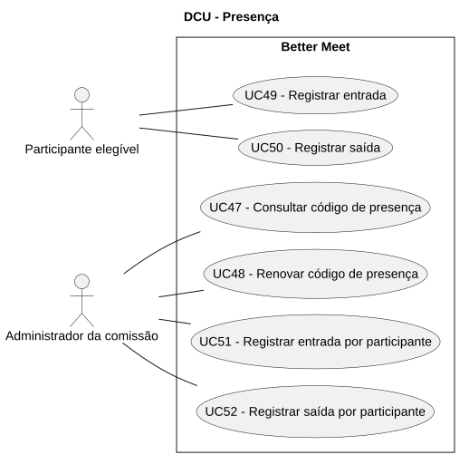

> Entrega final (AF) · Ata, comissões e presença · Versão 1.0 · 27/11/2026.
> Código auditado: `feature/refatoracao-ultima-entrega`, commit <code>614734c</code>. Responsável pela revisão acadêmica: [responsável a informar].
> Estado: implementado, salvo ressalvas expressas. Verificação documental por leitura do código; não equivale à aprovação do professor.

# DCU - Presença

## Atores

Participante elegível: integrante atual da comissão que criou a reunião ou aceitou o convite. Administrador da comissão: consulta e renova o código e registra por outro participante. Autenticação do aparelho é um serviço externo usado apenas na confirmação local.

DCU significa Diagrama de Casos de Uso. As associações indicam participação; permissões e precondições específicas são detalhadas em cada caso. [Diagramas de sequência](https://github.com/MiguelIFSP/BRTPDS2-PROJETO-E-DESENVOLVIMENTO-DE-SISTEMAS-2/wiki/DS-%E2%80%90-Presen%C3%A7a) · [RNF61 a RNF63](https://github.com/MiguelIFSP/BRTPDS2-PROJETO-E-DESENVOLVIMENTO-DE-SISTEMAS-2/wiki/RNFS-%E2%80%90-Presen%C3%A7a).

## Diagrama

Casos de uso de presença no aplicativo Better Meet.

[Fonte PlantUML](https://github.com/MiguelIFSP/BRTPDS2-PROJETO-E-DESENVOLVIMENTO-DE-SISTEMAS-2/blob/feature/documentacao-ata-comissao-presenca/documentos/entrega5_AF/Diagramas/DCU-Presenca.puml)

## UC47 - Consultar código de presença

**Objetivo:** Exibir o código de presença somente ao Administrador da comissão.

**Requisito:** [RF56](https://github.com/MiguelIFSP/BRTPDS2-PROJETO-E-DESENVOLVIMENTO-DE-SISTEMAS-2/wiki/RF56). **Estado:** Implementado.

**Gatilho:** a pessoa solicita “Consultar código de presença” no aplicativo.

**Precondições:** Sessão válida; organização ACEITA e ADMINISTRADOR atual da comissão.

**Entradas:** id: inteiro positivo; identidade da sessão; sem corpo.

**Fluxo principal:**

1. O aplicativo recebe a solicitação e os dados.
2. Conferir acesso e papel; consultar o código; exibir card com ação de copiar no aplicativo. Leitura não gera código automaticamente.
3. O aplicativo apresenta o resultado: 200: { codigoPresenca: string de 6 dígitos ou null em reunião antiga sem código }.

**Fluxos alternativos e exceções:** 400 id inválido; 401 sem sessão; 403 papel insuficiente; 404 reunião inexistente; 409 organização não aceita. Todas as rotas exigem sessão (401); erros inesperados retornam 500 com mensagem genérica. Nenhuma resposta de falha deve ser exibida como sucesso.

**Pós-condições:** Administrador pode informar o código aos participantes presentes.

**Efeitos colaterais:** Copiar usa a área de transferência local; não altera a reunião.

**Rastreabilidade:** [DS de consultar código de presença](https://github.com/MiguelIFSP/BRTPDS2-PROJETO-E-DESENVOLVIMENTO-DE-SISTEMAS-2/wiki/DS-%E2%80%90-Presen%C3%A7a); CT-AF-47; RNF61 a RNF63.

## UC48 - Renovar código de presença

**Objetivo:** Gerar ou substituir o código da reunião.

**Requisito:** [RF57](https://github.com/MiguelIFSP/BRTPDS2-PROJETO-E-DESENVOLVIMENTO-DE-SISTEMAS-2/wiki/RF57). **Estado:** Implementado.

**Gatilho:** a pessoa solicita “Renovar código de presença” no aplicativo.

**Precondições:** Sessão válida; organização ACEITA e ADMINISTRADOR atual da comissão.

**Entradas:** id: inteiro positivo; identidade da sessão; sem corpo.

**Fluxo principal:**

1. O aplicativo recebe a solicitação e os dados.
2. Bloquear reunião; conferir acesso; gerar número criptograficamente aleatório entre 000000 e 999999 diferente do anterior; persistir e atualizar card.
3. O aplicativo apresenta o resultado: 200: { codigoPresenca: string de 6 dígitos }.

**Fluxos alternativos e exceções:** 400 id inválido; 403 papel insuficiente; 404 reunião inexistente; 409 organização não aceita; 429 limite de requisições. Todas as rotas exigem sessão (401); erros inesperados retornam 500 com mensagem genérica. Nenhuma resposta de falha deve ser exibida como sucesso.

**Pós-condições:** Somente o novo código autoriza registros próprios.

**Efeitos colaterais:** O código anterior perde validade imediatamente. Reuniões novas recebem código na criação.

**Rastreabilidade:** [DS de renovar código de presença](https://github.com/MiguelIFSP/BRTPDS2-PROJETO-E-DESENVOLVIMENTO-DE-SISTEMAS-2/wiki/DS-%E2%80%90-Presen%C3%A7a); CT-AF-48; RNF61 a RNF63.

## UC49 - Registrar entrada

**Objetivo:** Registrar a própria entrada com código e confirmação local.

**Requisito:** [RF58](https://github.com/MiguelIFSP/BRTPDS2-PROJETO-E-DESENVOLVIMENTO-DE-SISTEMAS-2/wiki/RF58). **Estado:** Implementado.

**Gatilho:** a pessoa solicita “Registrar entrada” no aplicativo.

**Precondições:** Sessão válida; organização ACEITA; vínculo atual na comissão; participante criador ou com convite ACEITO; reunião não cancelada e relógio do servidor no início da reunião ou depois. Nova entrada própria exige AGENDADA e horário anterior ao fim; ata não finalizada.

**Entradas:** id: inteiro positivo; codigoPresenca: string trim obrigatória com exatamente 6 dígitos. Biometria/PIN do aparelho não é enviado à API.

**Fluxo principal:**

1. O aplicativo recebe a solicitação e os dados.
2. Solicitar código e confirmação local; autenticar no aparelho ou confirmar no Web; enviar à API; bloquear reunião; conferir horário, elegibilidade e código; manter registro existente ou criar entradaAt com hora do servidor e origemEntrada PROPRIO.
3. O aplicativo apresenta o resultado: 201: { registro, jaRegistrado: false, message }; repetição 200 com jaRegistrado true.

**Fluxos alternativos e exceções:** 400 antes do início ou código inválido; 403 sem elegibilidade; 404 reunião inexistente; 409 reunião cancelada/encerrada, organização não aceita ou ata finalizada; 429 limite de requisições. Cancelamento local não envia requisição. Todas as rotas exigem sessão (401); erros inesperados retornam 500 com mensagem genérica. Nenhuma resposta de falha deve ser exibida como sucesso.

**Pós-condições:** Um registro de entrada por pessoa/reunião, preservado em repetições válidas.

**Efeitos colaterais:** Aumenta o número de presentes usado na aprovação da ata e habilita sua consulta/votação.

**Rastreabilidade:** [DS de registrar entrada](https://github.com/MiguelIFSP/BRTPDS2-PROJETO-E-DESENVOLVIMENTO-DE-SISTEMAS-2/wiki/DS-%E2%80%90-Presen%C3%A7a); CT-AF-49; RNF61 a RNF63.

## UC50 - Registrar saída

**Objetivo:** Registrar a própria saída sem perder o horário da entrada.

**Requisito:** [RF59](https://github.com/MiguelIFSP/BRTPDS2-PROJETO-E-DESENVOLVIMENTO-DE-SISTEMAS-2/wiki/RF59). **Estado:** Implementado.

**Gatilho:** a pessoa solicita “Registrar saída” no aplicativo.

**Precondições:** Sessão válida; organização ACEITA; vínculo atual na comissão; participante criador ou com convite ACEITO; reunião não cancelada e relógio do servidor no início da reunião ou depois. Registro de entrada prévio.

**Entradas:** id: inteiro positivo; codigoPresenca: string trim obrigatória com exatamente 6 dígitos; confirmação local do aparelho ou Web.

**Fluxo principal:**

1. O aplicativo recebe a solicitação e os dados.
2. Solicitar código e confirmação local; bloquear reunião; conferir horário, elegibilidade e código; exigir registro existente; gravar saidaAt do servidor e origemSaida PROPRIO apenas na primeira saída.
3. O aplicativo apresenta o resultado: 200: { registro, jaRegistrado, message }, com saída registrada ou mantida em repetição.

**Fluxos alternativos e exceções:** 400 antes do início/código inválido; 403 sem elegibilidade; 404 reunião inexistente; 409 sem entrada, cancelamento ou organização não aceita; 429 limite de requisições. Todas as rotas exigem sessão (401); erros inesperados retornam 500 com mensagem genérica. Nenhuma resposta de falha deve ser exibida como sucesso.

**Pós-condições:** Saída registrada; entrada, contagem de presentes e elegibilidade à ata preservadas.

**Efeitos colaterais:** Não remove voto nem registro de presença. Pode ocorrer após o fim ou após a finalização da ata.

**Rastreabilidade:** [DS de registrar saída](https://github.com/MiguelIFSP/BRTPDS2-PROJETO-E-DESENVOLVIMENTO-DE-SISTEMAS-2/wiki/DS-%E2%80%90-Presen%C3%A7a); CT-AF-50; RNF61 a RNF63.

## UC51 - Registrar entrada por participante

**Objetivo:** Registrar uma entrada esquecida por outro participante.

**Requisito:** [RF60](https://github.com/MiguelIFSP/BRTPDS2-PROJETO-E-DESENVOLVIMENTO-DE-SISTEMAS-2/wiki/RF60). **Estado:** Implementado.

**Gatilho:** a pessoa solicita “Registrar entrada por participante” no aplicativo.

**Precondições:** Sessão válida; organização ACEITA; vínculo atual na comissão; participante criador ou com convite ACEITO; reunião não cancelada e relógio do servidor no início da reunião ou depois. Solicitante ADMINISTRADOR atual; destinatário diferente do solicitante; ata não finalizada para nova entrada.

**Entradas:** id e userId: inteiros positivos na URL; sem código ou credencial do participante. Identidade do administrador vem da sessão.

**Fluxo principal:**

1. O aplicativo recebe a solicitação e os dados.
2. Confirmar ação na lista; bloquear reunião; conferir papel, destinatário e início; criar registro com hora atual, origemEntrada MANUAL e entradaManualPorId do solicitante; atualizar lista. Não permite escolher horário retroativo.
3. O aplicativo apresenta o resultado: 201: { registro, jaRegistrado: false, message }; repetição 200 sem alteração.

**Fluxos alternativos e exceções:** 400 antes do início/ids inválidos; 403 papel insuficiente, destinatário inelegível ou autorregistro manual; 404 reunião inexistente; 409 reunião cancelada, organização não aceita ou ata finalizada. Todas as rotas exigem sessão (401); erros inesperados retornam 500 com mensagem genérica. Nenhuma resposta de falha deve ser exibida como sucesso.

**Pós-condições:** Entrada registrada em nome do participante com autoria auditável.

**Efeitos colaterais:** Pode reparar ausência após o horário final; altera denominador da maioria da ata não finalizada.

**Rastreabilidade:** [DS de registrar entrada por participante](https://github.com/MiguelIFSP/BRTPDS2-PROJETO-E-DESENVOLVIMENTO-DE-SISTEMAS-2/wiki/DS-%E2%80%90-Presen%C3%A7a); CT-AF-51; RNF61 a RNF63.

## UC52 - Registrar saída por participante

**Objetivo:** Registrar uma saída esquecida por outro participante.

**Requisito:** [RF61](https://github.com/MiguelIFSP/BRTPDS2-PROJETO-E-DESENVOLVIMENTO-DE-SISTEMAS-2/wiki/RF61). **Estado:** Implementado.

**Gatilho:** a pessoa solicita “Registrar saída por participante” no aplicativo.

**Precondições:** Sessão válida; organização ACEITA; vínculo atual na comissão; participante criador ou com convite ACEITO; reunião não cancelada e relógio do servidor no início da reunião ou depois. Solicitante ADMINISTRADOR atual; destinatário diferente do solicitante; entrada prévia do destinatário.

**Entradas:** id e userId: inteiros positivos na URL; sem código ou credencial do participante.

**Fluxo principal:**

1. O aplicativo recebe a solicitação e os dados.
2. Confirmar ação; bloquear reunião; conferir papel, destinatário e início; exigir entrada; manter saída existente ou gravar hora atual, origemSaida MANUAL e saidaManualPorId; atualizar lista.
3. O aplicativo apresenta o resultado: 200: { registro, jaRegistrado, message }.

**Fluxos alternativos e exceções:** 400 antes do início/ids inválidos; 403 sem papel ou elegibilidade; 404 reunião inexistente; 409 sem entrada, reunião cancelada ou organização não aceita. Todas as rotas exigem sessão (401); erros inesperados retornam 500 com mensagem genérica. Nenhuma resposta de falha deve ser exibida como sucesso.

**Pós-condições:** Saída registrada com autoria auditável, mantendo a entrada.

**Efeitos colaterais:** Não altera o número de presentes. Aceita reparo após o fim e após exportação da ata.

**Rastreabilidade:** [DS de registrar saída por participante](https://github.com/MiguelIFSP/BRTPDS2-PROJETO-E-DESENVOLVIMENTO-DE-SISTEMAS-2/wiki/DS-%E2%80%90-Presen%C3%A7a); CT-AF-52; RNF61 a RNF63.

## Histórico de revisão

A revisão registra o recorte documentado nesta entrega.

| Versão | Data | Alteração | Responsável |
|---|---|---|---|
| 1.0 | 27/11/2026 | Consolidação da ata e revisão de comissão e presença conforme código auditado. | [responsável a informar] |
