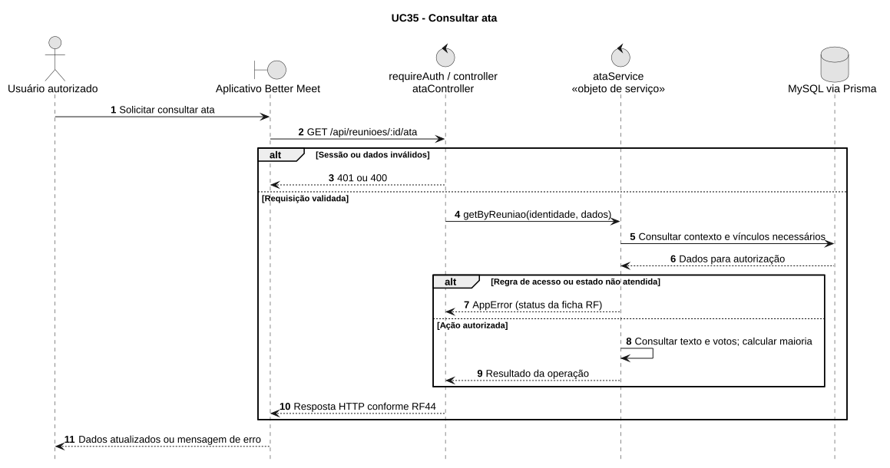
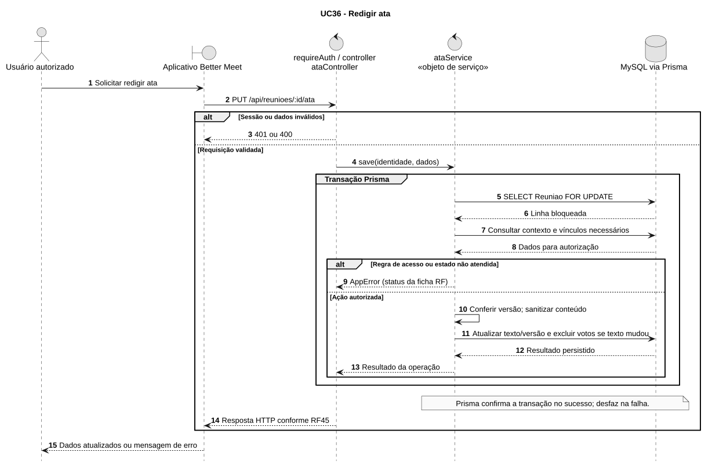
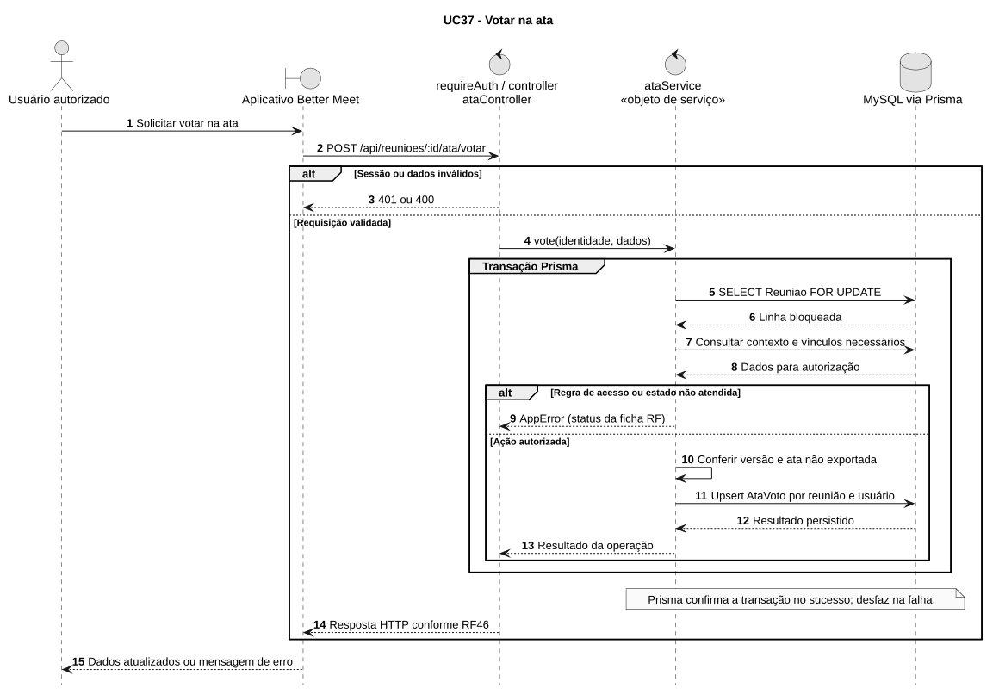
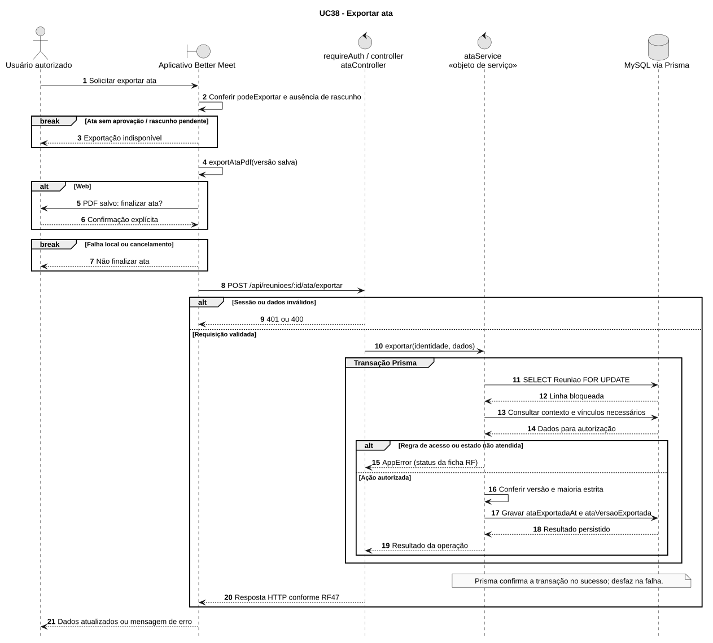

> Entrega final (AF) · Ata, comissões e presença · Versão 1.0 · 27/11/2026.
> Código auditado: `feature/refatoracao-ultima-entrega`, commit <code>614734c</code>. Responsável pela revisão acadêmica: [responsável a informar].
> Estado: implementado, salvo ressalvas expressas. Verificação documental por leitura do código; não equivale à aprovação do professor.

# DS - Ata

DS significa Diagrama de Sequência. Cada seção corresponde a um caso de uso da página [DCU - Ata](https://github.com/MiguelIFSP/BRTPDS2-PROJETO-E-DESENVOLVIMENTO-DE-SISTEMAS-2/wiki/DCU-%E2%80%90-Ata). Os objetos de serviço representam os módulos reais; as mensagens internas resumem operações, sem criar métodos inexistentes.

## Consultar ata

UC35 · [RF44](https://github.com/MiguelIFSP/BRTPDS2-PROJETO-E-DESENVOLVIMENTO-DE-SISTEMAS-2/wiki/RF44) · CT-AF-35. Consultar vínculo, registro e votos da versão atual; sanitizar HTML; calcular maioria estrita (aprovados > presentes / 2, presentes > 0). Sem texto, retornar null e podeVotar false.

Sequência de consultar ata.

[Fonte PlantUML](https://github.com/MiguelIFSP/BRTPDS2-PROJETO-E-DESENVOLVIMENTO-DE-SISTEMAS-2/blob/feature/documentacao-ata-comissao-presenca/documentos/entrega5_AF/Diagramas/DS-UC35.puml)

**Exceções:** 400 id inválido; 401 sem sessão; 403 sem vínculo/presença; 404 reunião inexistente.

**Resultado:** Nenhuma alteração persistente. A tela recebe a versão vigente.

## Redigir ata

UC36 · [RF45](https://github.com/MiguelIFSP/BRTPDS2-PROJETO-E-DESENVOLVIMENTO-DE-SISTEMAS-2/wiki/RF45) · CT-AF-36. Bloquear a reunião na transação; conferir papel, versão e finalização; sanitizar HTML; se o conteúdo mudar, incrementar versaoAta e excluir votos anteriores na mesma transação. Conteúdo idêntico mantém versão e votos.

Sequência de redigir ata.

[Fonte PlantUML](https://github.com/MiguelIFSP/BRTPDS2-PROJETO-E-DESENVOLVIMENTO-DE-SISTEMAS-2/blob/feature/documentacao-ata-comissao-presenca/documentos/entrega5_AF/Diagramas/DS-UC36.puml)

**Exceções:** 400 conteúdo/versão inválidos; 403 papel não editor; 409 versão desatualizada ou ata exportada.

**Resultado:** Texto salvo e votação disponível sem depender de voto do presidente.

## Votar na ata

UC37 · [RF46](https://github.com/MiguelIFSP/BRTPDS2-PROJETO-E-DESENVOLVIMENTO-DE-SISTEMAS-2/wiki/RF46) · CT-AF-37. Bloquear a reunião; conferir versão e disponibilidade; inserir ou atualizar o voto único de reuniaoId/userId; recalcular maioria dos registros de entrada, incluindo quem já saiu.

Sequência de votar na ata.

[Fonte PlantUML](https://github.com/MiguelIFSP/BRTPDS2-PROJETO-E-DESENVOLVIMENTO-DE-SISTEMAS-2/blob/feature/documentacao-ata-comissao-presenca/documentos/entrega5_AF/Diagramas/DS-UC37.puml)

**Exceções:** 400 enum/versão inválidos; 403 sem presença; 409 sem texto, versão desatualizada ou ata exportada.

**Resultado:** Um voto da pessoa existe para a versão vigente. Antes da exportação, pode ser alterado.

## Exportar ata

UC38 · [RF47](https://github.com/MiguelIFSP/BRTPDS2-PROJETO-E-DESENVOLVIMENTO-DE-SISTEMAS-2/wiki/RF47) · CT-AF-38. Gerar PDF com exportAtaPdf; no Web confirmar que foi salvo/impresso. Enviar versão à API; bloquear reunião, conferir versão e maioria; gravar ataExportadaAt e ataVersaoExportada. Repetição da versão finalizada é idempotente.

Sequência de exportar ata.

[Fonte PlantUML](https://github.com/MiguelIFSP/BRTPDS2-PROJETO-E-DESENVOLVIMENTO-DE-SISTEMAS-2/blob/feature/documentacao-ata-comissao-presenca/documentos/entrega5_AF/Diagramas/DS-UC38.puml)

**Exceções:** 400 versão inválida; 403 sem presença; 409 versão desatualizada ou maioria insuficiente. Falha local não finaliza.

**Resultado:** Texto e votos ficam imutáveis após a finalização confirmada no servidor. Reexportar a versão finalizada permanece permitido.

## Histórico de revisão

A revisão registra o recorte documentado nesta entrega.

| Versão | Data | Alteração | Responsável |
|---|---|---|---|
| 1.0 | 27/11/2026 | Consolidação da ata e revisão de comissão e presença conforme código auditado. | [responsável a informar] |
