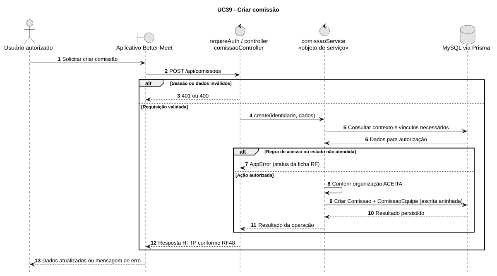
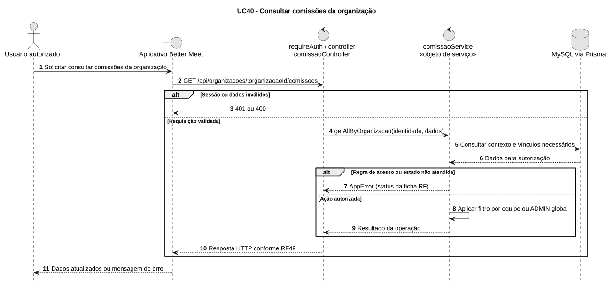
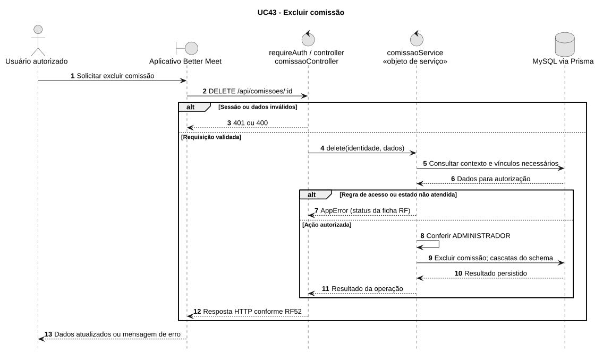
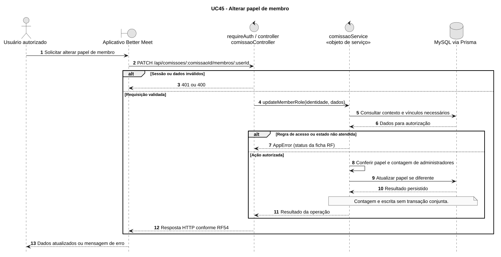

> Entrega final (AF) · Ata, comissões e presença · Versão 1.0 · 27/11/2026.
> Código auditado: `feature/refatoracao-ultima-entrega`, commit <code>614734c</code>. Responsável pela revisão acadêmica: [responsável a informar].
> Estado: implementado, salvo ressalvas expressas. Verificação documental por leitura do código; não equivale à aprovação do professor.

# DS - Comissões

DS significa Diagrama de Sequência. Cada seção corresponde a um caso de uso da página [DCU - Comissões](https://github.com/MiguelIFSP/BRTPDS2-PROJETO-E-DESENVOLVIMENTO-DE-SISTEMAS-2/wiki/DCU-%E2%80%90-Comiss%C3%B5es). Os objetos de serviço representam os módulos reais; as mensagens internas resumem operações, sem criar métodos inexistentes.

## Criar comissão

UC39 · [RF48](https://github.com/MiguelIFSP/BRTPDS2-PROJETO-E-DESENVOLVIMENTO-DE-SISTEMAS-2/wiki/RF48) · CT-AF-39. Conferir organização e vínculo; criar Comissao e ComissaoEquipe do autor por escrita aninhada do Prisma.

Sequência de criar comissão.

[Fonte PlantUML](https://github.com/MiguelIFSP/BRTPDS2-PROJETO-E-DESENVOLVIMENTO-DE-SISTEMAS-2/blob/feature/documentacao-ata-comissao-presenca/documentos/entrega5_AF/Diagramas/DS-UC39.puml)

**Exceções:** 400 dados inválidos; 403 sem vínculo; 404 organização inexistente; 409 organização não aceita.

**Resultado:** Comissão vinculada à organização e com administrador inicial.

## Consultar comissões da organização

UC40 · [RF49](https://github.com/MiguelIFSP/BRTPDS2-PROJETO-E-DESENVOLVIMENTO-DE-SISTEMAS-2/wiki/RF49) · CT-AF-40. Para ADMIN global, consultar todas as comissões da organização; para demais usuários, restringir às comissões cuja equipe contém o usuário.

Sequência de consultar comissões da organização.

[Fonte PlantUML](https://github.com/MiguelIFSP/BRTPDS2-PROJETO-E-DESENVOLVIMENTO-DE-SISTEMAS-2/blob/feature/documentacao-ata-comissao-presenca/documentos/entrega5_AF/Diagramas/DS-UC40.puml)

**Exceções:** 400 identificador inválido; 401 sem sessão; 403 usuário comum sem vínculo na organização.

**Resultado:** Lista exibida de acordo com a visibilidade do solicitante.

## Consultar comissão

UC41 · [RF50](https://github.com/MiguelIFSP/BRTPDS2-PROJETO-E-DESENVOLVIMENTO-DE-SISTEMAS-2/wiki/RF50) · CT-AF-41. Localizar comissão; conferir vínculos ou exceção de consulta do ADMIN global; consultar equipe ordenada por papel e nome.

Sequência de consultar comissão.

[Fonte PlantUML](https://github.com/MiguelIFSP/BRTPDS2-PROJETO-E-DESENVOLVIMENTO-DE-SISTEMAS-2/blob/feature/documentacao-ata-comissao-presenca/documentos/entrega5_AF/Diagramas/DS-UC41.puml)

**Exceções:** 400 id inválido; 403 sem autorização; 404 comissão inexistente.

**Resultado:** Detalhes exibidos sem conceder poderes de gestão pelo simples acesso.

## Editar comissão

UC42 · [RF51](https://github.com/MiguelIFSP/BRTPDS2-PROJETO-E-DESENVOLVIMENTO-DE-SISTEMAS-2/wiki/RF51) · CT-AF-42. Conferir papel atual; validar os campos; atualizar nome e descrição. A organização da comissão não é alterada.

Sequência de editar comissão.

[Fonte PlantUML](https://github.com/MiguelIFSP/BRTPDS2-PROJETO-E-DESENVOLVIMENTO-DE-SISTEMAS-2/blob/feature/documentacao-ata-comissao-presenca/documentos/entrega5_AF/Diagramas/DS-UC42.puml)

**Exceções:** 400 campos inválidos; 403 papel insuficiente; 404 comissão inexistente.

**Resultado:** Nome e descrição persistidos.

## Excluir comissão

UC43 · [RF52](https://github.com/MiguelIFSP/BRTPDS2-PROJETO-E-DESENVOLVIMENTO-DE-SISTEMAS-2/wiki/RF52) · CT-AF-43. Solicitar confirmação; conferir papel; excluir Comissao, aplicando os relacionamentos onDelete Cascade do schema.

Sequência de excluir comissão.

[Fonte PlantUML](https://github.com/MiguelIFSP/BRTPDS2-PROJETO-E-DESENVOLVIMENTO-DE-SISTEMAS-2/blob/feature/documentacao-ata-comissao-presenca/documentos/entrega5_AF/Diagramas/DS-UC43.puml)

**Exceções:** 400 id inválido; 403 papel insuficiente; 404 comissão inexistente.

**Resultado:** Comissão removida.

## Adicionar membro à comissão

UC44 · [RF53](https://github.com/MiguelIFSP/BRTPDS2-PROJETO-E-DESENVOLVIMENTO-DE-SISTEMAS-2/wiki/RF53) · CT-AF-44. Conferir papel; impedir Facilitador de atribuir ADMINISTRADOR; conferir vínculo do destinatário na organização; criar vínculo único.

Sequência de adicionar membro à comissão.

[Fonte PlantUML](https://github.com/MiguelIFSP/BRTPDS2-PROJETO-E-DESENVOLVIMENTO-DE-SISTEMAS-2/blob/feature/documentacao-ata-comissao-presenca/documentos/entrega5_AF/Diagramas/DS-UC44.puml)

**Exceções:** 400 destinatário fora da organização/dados inválidos; 403 papel insuficiente; 404 comissão inexistente; 409 membro já vinculado.

**Resultado:** Pessoa incluída uma única vez na equipe.

## Alterar papel de membro

UC45 · [RF54](https://github.com/MiguelIFSP/BRTPDS2-PROJETO-E-DESENVOLVIMENTO-DE-SISTEMAS-2/wiki/RF54) · CT-AF-45. Conferir ator e alvo; impedir Facilitador de promover ou alterar Administrador; impedir rebaixamento do último Administrador; atualizar papel.

Sequência de alterar papel de membro.

[Fonte PlantUML](https://github.com/MiguelIFSP/BRTPDS2-PROJETO-E-DESENVOLVIMENTO-DE-SISTEMAS-2/blob/feature/documentacao-ata-comissao-presenca/documentos/entrega5_AF/Diagramas/DS-UC45.puml)

**Exceções:** 400 último administrador/dados inválidos; 403 papel insuficiente; 404 vínculo ou comissão inexistente.

**Resultado:** Papel atualizado e permissões aplicadas nas próximas ações.

## Remover membro da comissão

UC46 · [RF55](https://github.com/MiguelIFSP/BRTPDS2-PROJETO-E-DESENVOLVIMENTO-DE-SISTEMAS-2/wiki/RF55) · CT-AF-46. Conferir ator e alvo; impedir Facilitador de remover Administrador; recusar remoção do último Administrador; excluir ComissaoEquipe.

Sequência de remover membro da comissão.

[Fonte PlantUML](https://github.com/MiguelIFSP/BRTPDS2-PROJETO-E-DESENVOLVIMENTO-DE-SISTEMAS-2/blob/feature/documentacao-ata-comissao-presenca/documentos/entrega5_AF/Diagramas/DS-UC46.puml)

**Exceções:** 400 último administrador/ids inválidos; 403 papel insuficiente; 404 vínculo ou comissão inexistente.

**Resultado:** Vínculo da equipe removido, sem excluir a conta ou o vínculo na organização.

## Histórico de revisão

A revisão registra o recorte documentado nesta entrega.

| Versão | Data | Alteração | Responsável |
|---|---|---|---|
| 1.0 | 27/11/2026 | Consolidação da ata e revisão de comissão e presença conforme código auditado. | [responsável a informar] |
