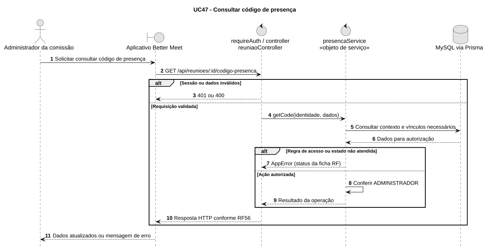
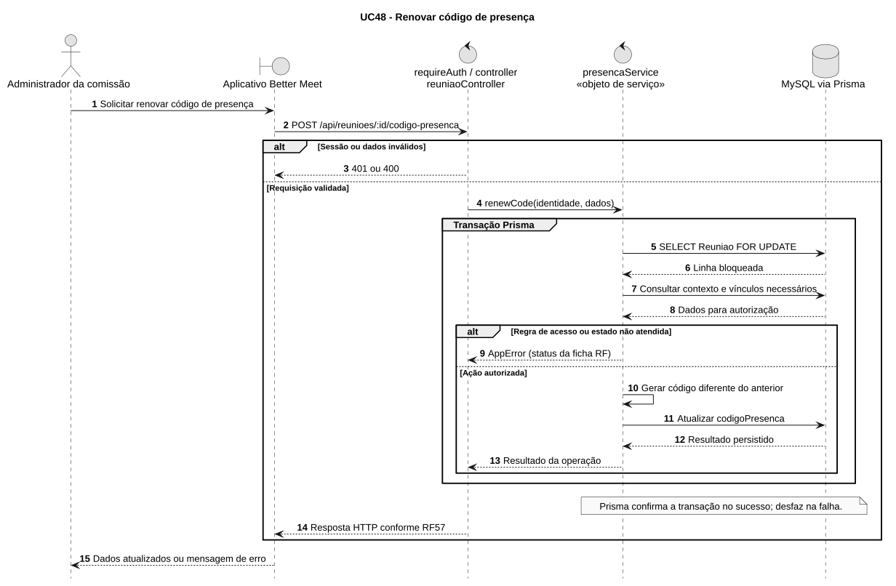
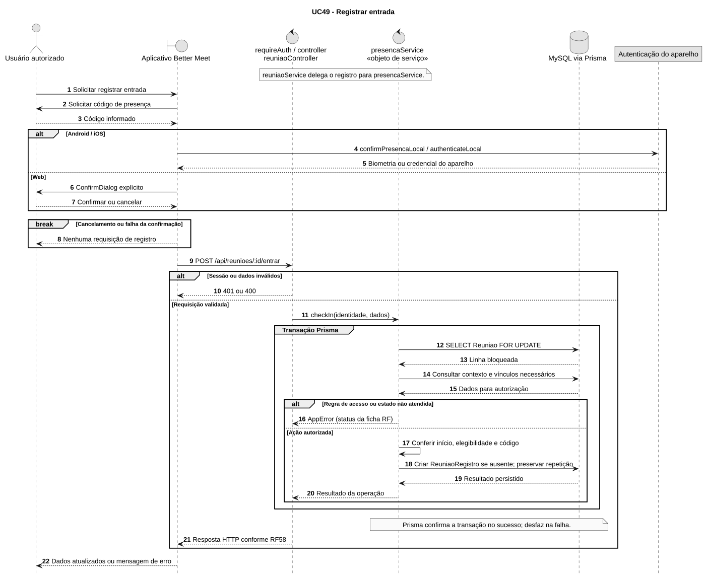
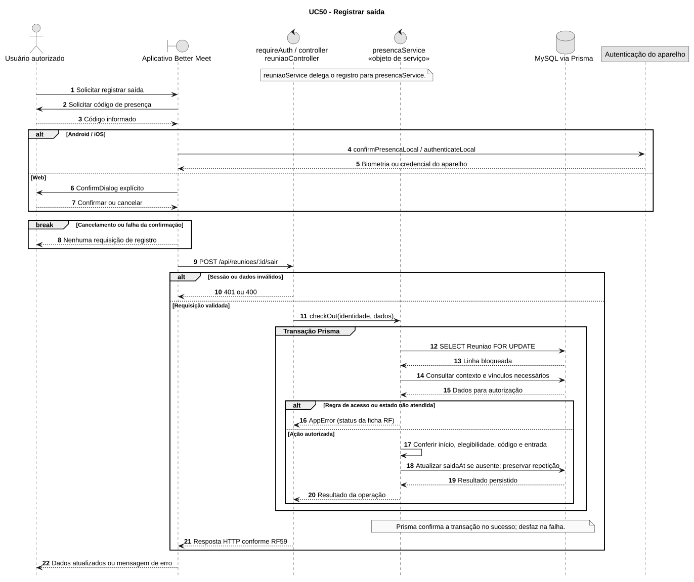
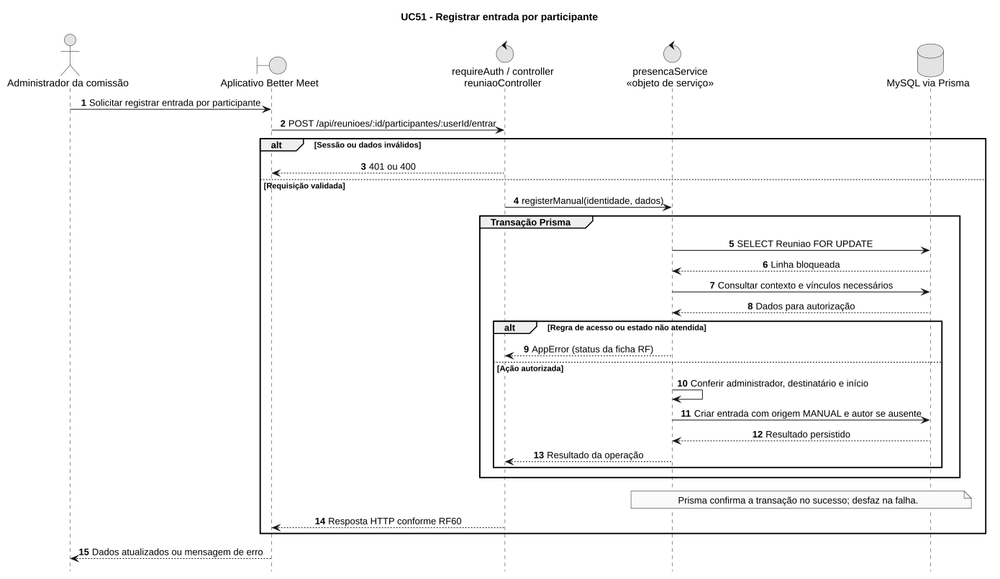
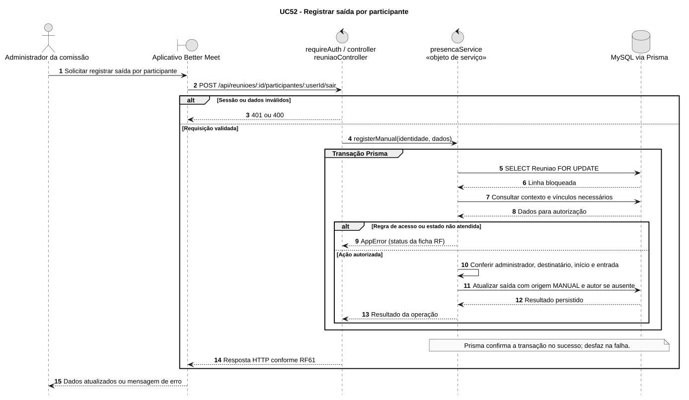

> Entrega final (AF) · Ata, comissões e presença · Versão 1.0 · 27/11/2026.
> Código auditado: `feature/refatoracao-ultima-entrega`, commit <code>614734c</code>. Responsável pela revisão acadêmica: [responsável a informar].
> Estado: implementado, salvo ressalvas expressas. Verificação documental por leitura do código; não equivale à aprovação do professor.

# DS - Presença

DS significa Diagrama de Sequência. Cada seção corresponde a um caso de uso da página [DCU - Presença](https://github.com/MiguelIFSP/BRTPDS2-PROJETO-E-DESENVOLVIMENTO-DE-SISTEMAS-2/wiki/DCU-%E2%80%90-Presen%C3%A7a). Os objetos de serviço representam os módulos reais; as mensagens internas resumem operações, sem criar métodos inexistentes.

## Consultar código de presença

UC47 · [RF56](https://github.com/MiguelIFSP/BRTPDS2-PROJETO-E-DESENVOLVIMENTO-DE-SISTEMAS-2/wiki/RF56) · CT-AF-47. Conferir acesso e papel; consultar o código; exibir card com ação de copiar no aplicativo. Leitura não gera código automaticamente.

Sequência de consultar código de presença.

[Fonte PlantUML](https://github.com/MiguelIFSP/BRTPDS2-PROJETO-E-DESENVOLVIMENTO-DE-SISTEMAS-2/blob/feature/documentacao-ata-comissao-presenca/documentos/entrega5_AF/Diagramas/DS-UC47.puml)

**Exceções:** 400 id inválido; 401 sem sessão; 403 papel insuficiente; 404 reunião inexistente; 409 organização não aceita.

**Resultado:** Administrador pode informar o código aos participantes presentes.

## Renovar código de presença

UC48 · [RF57](https://github.com/MiguelIFSP/BRTPDS2-PROJETO-E-DESENVOLVIMENTO-DE-SISTEMAS-2/wiki/RF57) · CT-AF-48. Bloquear reunião; conferir acesso; gerar número criptograficamente aleatório entre 000000 e 999999 diferente do anterior; persistir e atualizar card.

Sequência de renovar código de presença.

[Fonte PlantUML](https://github.com/MiguelIFSP/BRTPDS2-PROJETO-E-DESENVOLVIMENTO-DE-SISTEMAS-2/blob/feature/documentacao-ata-comissao-presenca/documentos/entrega5_AF/Diagramas/DS-UC48.puml)

**Exceções:** 400 id inválido; 403 papel insuficiente; 404 reunião inexistente; 409 organização não aceita; 429 limite de requisições.

**Resultado:** Somente o novo código autoriza registros próprios.

## Registrar entrada

UC49 · [RF58](https://github.com/MiguelIFSP/BRTPDS2-PROJETO-E-DESENVOLVIMENTO-DE-SISTEMAS-2/wiki/RF58) · CT-AF-49. Solicitar código e confirmação local; autenticar no aparelho ou confirmar no Web; enviar à API; bloquear reunião; conferir horário, elegibilidade e código; manter registro existente ou criar entradaAt com hora do servidor e origemEntrada PROPRIO.

Sequência de registrar entrada.

[Fonte PlantUML](https://github.com/MiguelIFSP/BRTPDS2-PROJETO-E-DESENVOLVIMENTO-DE-SISTEMAS-2/blob/feature/documentacao-ata-comissao-presenca/documentos/entrega5_AF/Diagramas/DS-UC49.puml)

**Exceções:** 400 antes do início ou código inválido; 403 sem elegibilidade; 404 reunião inexistente; 409 reunião cancelada/encerrada, organização não aceita ou ata finalizada; 429 limite de requisições. Cancelamento local não envia requisição.

**Resultado:** Um registro de entrada por pessoa/reunião, preservado em repetições válidas.

## Registrar saída

UC50 · [RF59](https://github.com/MiguelIFSP/BRTPDS2-PROJETO-E-DESENVOLVIMENTO-DE-SISTEMAS-2/wiki/RF59) · CT-AF-50. Solicitar código e confirmação local; bloquear reunião; conferir horário, elegibilidade e código; exigir registro existente; gravar saidaAt do servidor e origemSaida PROPRIO apenas na primeira saída.

Sequência de registrar saída.

[Fonte PlantUML](https://github.com/MiguelIFSP/BRTPDS2-PROJETO-E-DESENVOLVIMENTO-DE-SISTEMAS-2/blob/feature/documentacao-ata-comissao-presenca/documentos/entrega5_AF/Diagramas/DS-UC50.puml)

**Exceções:** 400 antes do início/código inválido; 403 sem elegibilidade; 404 reunião inexistente; 409 sem entrada, cancelamento ou organização não aceita; 429 limite de requisições.

**Resultado:** Saída registrada; entrada, contagem de presentes e elegibilidade à ata preservadas.

## Registrar entrada por participante

UC51 · [RF60](https://github.com/MiguelIFSP/BRTPDS2-PROJETO-E-DESENVOLVIMENTO-DE-SISTEMAS-2/wiki/RF60) · CT-AF-51. Confirmar ação na lista; bloquear reunião; conferir papel, destinatário e início; criar registro com hora atual, origemEntrada MANUAL e entradaManualPorId do solicitante; atualizar lista. Não permite escolher horário retroativo.

Sequência de registrar entrada por participante.

[Fonte PlantUML](https://github.com/MiguelIFSP/BRTPDS2-PROJETO-E-DESENVOLVIMENTO-DE-SISTEMAS-2/blob/feature/documentacao-ata-comissao-presenca/documentos/entrega5_AF/Diagramas/DS-UC51.puml)

**Exceções:** 400 antes do início/ids inválidos; 403 papel insuficiente, destinatário inelegível ou autorregistro manual; 404 reunião inexistente; 409 reunião cancelada, organização não aceita ou ata finalizada.

**Resultado:** Entrada registrada em nome do participante com autoria auditável.

## Registrar saída por participante

UC52 · [RF61](https://github.com/MiguelIFSP/BRTPDS2-PROJETO-E-DESENVOLVIMENTO-DE-SISTEMAS-2/wiki/RF61) · CT-AF-52. Confirmar ação; bloquear reunião; conferir papel, destinatário e início; exigir entrada; manter saída existente ou gravar hora atual, origemSaida MANUAL e saidaManualPorId; atualizar lista.

Sequência de registrar saída por participante.

[Fonte PlantUML](https://github.com/MiguelIFSP/BRTPDS2-PROJETO-E-DESENVOLVIMENTO-DE-SISTEMAS-2/blob/feature/documentacao-ata-comissao-presenca/documentos/entrega5_AF/Diagramas/DS-UC52.puml)

**Exceções:** 400 antes do início/ids inválidos; 403 sem papel ou elegibilidade; 404 reunião inexistente; 409 sem entrada, reunião cancelada ou organização não aceita.

**Resultado:** Saída registrada com autoria auditável, mantendo a entrada.

## Histórico de revisão

A revisão registra o recorte documentado nesta entrega.

| Versão | Data | Alteração | Responsável |
|---|---|---|---|
| 1.0 | 27/11/2026 | Consolidação da ata e revisão de comissão e presença conforme código auditado. | [responsável a informar] |
