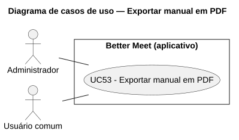
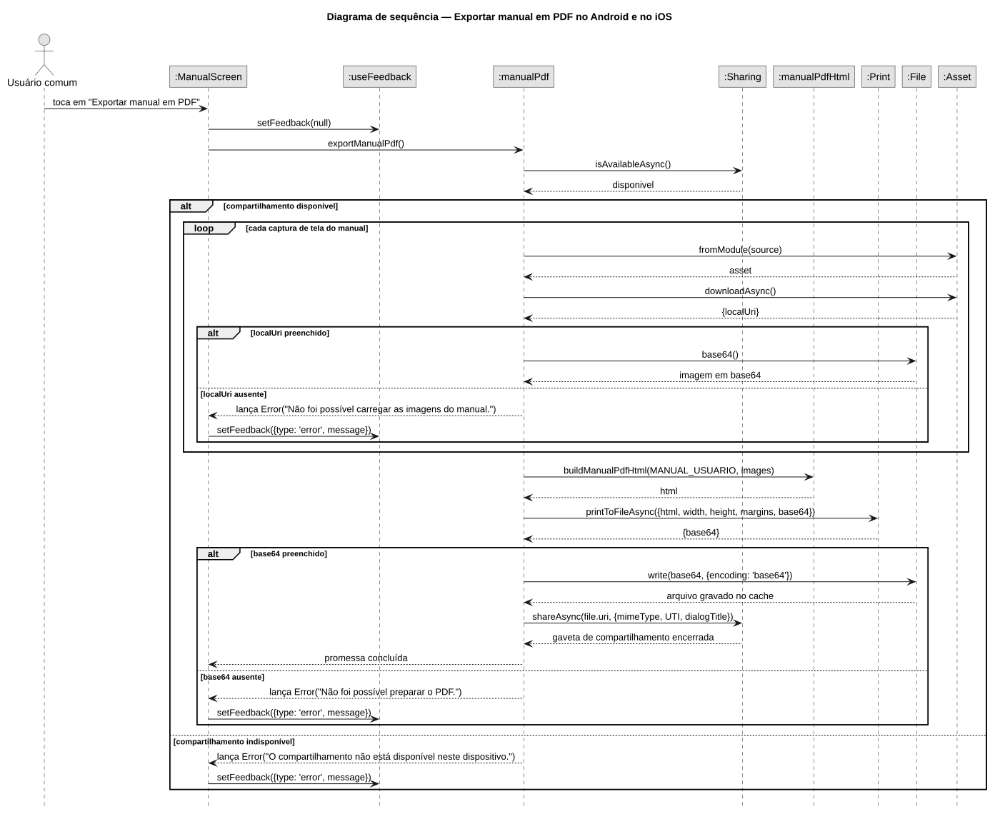
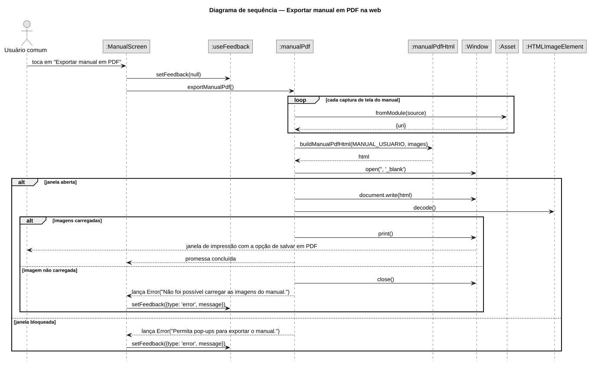
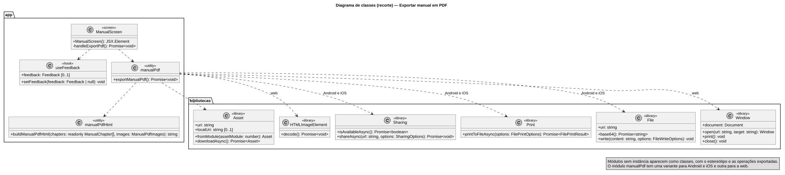

# Exportar o manual em PDF (RF62, UC53)

```text
Incremento: Entrega 5 — Apresentação final
Escopo: RF62 — Exportar manual em PDF (UC53); RNF64
Versão: 1.2
Branch: final-miguel
Commit: ebee539 (base; as alterações deste incremento ainda não têm commit)
Data de revisão: 2026-11-27
Responsável(eis): Bruno Soares Machado
Estado: Parcial (implementado, com testes automatizados e teste manual aprovado no Android; não verificado no iOS nem em navegador)
Fontes: sistema/better-meet/src/app/manual.tsx; sistema/better-meet/src/utils/manualPdf.ts; sistema/better-meet/src/utils/manualPdf.web.ts; sistema/better-meet/src/utils/manualPdfHtml.ts; sistema/better-meet/src/content/manual/manualUsuario.ts; sistema/better-meet/assets/manual/images/; sistema/better-meet/package.json; sistema/better-meet/app.json; sistema/better-meet/src/hooks/useFeedback.ts; sistema/better-meet/src/components/AppGate.tsx; sistema/better-meet/src/app/(tabs)/mais/index.tsx; sistema/better-meet/src/components/PrimeiroAcessoDialog.tsx; documentos/consolidado/softwares_e_licencas.md
```

## Resumo e escopo

A tela do manual do usuário passa a ter o botão **“Exportar manual em PDF”**. O arquivo é gerado no momento do toque, a partir do mesmo conteúdo versionado que a tela exibe (`MANUAL_USUARIO`). O manual dentro do aplicativo continua sendo a forma principal de consulta, e o PDF é uma exportação opcional.

### Justificativa

A pessoa usuária pode enviar o manual em PDF a uma Inteligência Artificial (IA) e perguntar como realizar um processo específico, sem precisar percorrer todo o manual manualmente.

Para atender a essa finalidade, o arquivo é gerado com o conteúdo em texto. Cada captura de tela é incluída no documento e seguida de sua descrição e sua legenda em texto, antecedidas do rótulo “Ilustração”, para que a informação também esteja disponível a ferramentas que leem somente o texto. A geração no momento da exportação evita que o PDF fique diferente do manual exibido no aplicativo.

O envio do arquivo a uma IA é feito pela própria pessoa, fora do Better Meet. O aplicativo não envia o manual a nenhum serviço de IA. As respostas obtidas dependem da ferramenta escolhida e podem conter erros; em caso de divergência, vale o manual do aplicativo.

## RF62 — Exportar manual em PDF (UC53)

### Função

Permite exportar o manual do usuário em um arquivo no formato PDF (*Portable Document Format*).

### Descrição

O sistema deve gerar um documento com o título, o sumário e todos os capítulos e capturas de tela do manual exibido no aplicativo. No Android e no iOS, o sistema deve abrir a gaveta de compartilhamento com o arquivo; na web, deve abrir a janela de impressão, na qual é possível salvar o documento em PDF.

### Entradas

A tabela mostra o dado que o requisito recebe. Não há campo digitado, parâmetro de rota, token nem corpo de requisição.

| Campo | Tipo | Tamanho ou domínio | Obrigatório | Validação | Componente ou origem |
|---|---|---|---|---|---|
| `MANUAL_USUARIO` | `readonly ManualChapter[]` | Capítulos do manual, com blocos dos tipos `section`, `note` e `image` | Sim | Tipos conferidos pelo TypeScript; os caracteres especiais do HTML são substituídos antes da geração | Constante de `src/content/manual/manualUsuario.ts` |
| Capturas de tela | Imagem JPEG (*Joint Photographic Experts Group*) | 19 arquivos | Sim | Caso uma imagem não seja carregada, a exportação é interrompida | `assets/manual/images/`, indicadas no atributo `source` de cada bloco `image` |

### Origem

Tela do manual (`ManualScreen`, em `src/app/manual.tsx`), componente `Button` com o rótulo “Exportar manual em PDF”, exibido em todas as páginas do manual.

### Saída

A tabela mostra o retorno de cada situação. O requisito não envia requisição à API, portanto não há status HTTP (*Hypertext Transfer Protocol*).

| Situação | Status HTTP | Dados ou mensagem | Exibição |
|---|---|---|---|
| Geração concluída no Android ou no iOS | Não se aplica | Arquivo `Manual-do-Usuario-Better-Meet.pdf` | Gaveta de compartilhamento, com o título “Salvar ou compartilhar o manual” (a exibição do título depende do sistema operacional) |
| Geração concluída na web | Não se aplica | Documento do manual | Janela de impressão do navegador |
| Compartilhamento indisponível (Android ou iOS) | Não se aplica | “O compartilhamento não está disponível neste dispositivo.” | `FeedbackBanner` de erro |
| Imagem não carregada | Não se aplica | “Não foi possível carregar as imagens do manual.” | `FeedbackBanner` de erro |
| PDF não gerado (Android ou iOS) | Não se aplica | “Não foi possível preparar o PDF.” | `FeedbackBanner` de erro |
| Janela bloqueada pelo navegador (web) | Não se aplica | “Permita pop-ups para exportar o manual.” | `FeedbackBanner` de erro |
| Erro lançado por uma biblioteca | Não se aplica | Mensagem do erro recebido; caso o valor lançado não seja um `Error`, “Não foi possível exportar o manual.” | `FeedbackBanner` de erro |

O sistema não exibe mensagem de sucesso, porque a gaveta de compartilhamento e a janela de impressão não informam se o arquivo foi salvo ou se a operação foi cancelada.

### Destino

A tabela mostra onde o resultado é gravado ou exibido. Nenhuma tabela de banco de dados é lida ou alterada.

| Banco ou local | Tabela, chave ou tela | Operação | Colunas ou dados |
|---|---|---|---|
| Cache do aplicativo (Android e iOS) | `Manual-do-Usuario-Better-Meet.pdf` | Gravação local | Conteúdo do PDF |
| Destino escolhido na gaveta de compartilhamento | Aplicativo ou pasta escolhida pelo ator | Compartilhamento | Arquivo PDF |
| Janela do navegador (web) | Janela de impressão | Exibição | Documento do manual |

### Ação

1. O ator toca em “Exportar manual em PDF” na tela do manual.
2. A tela remove o aviso anterior, exibe o texto “Preparando PDF...” no botão, com o estado de carregamento, e invoca a função `exportManualPdf`.
3. No Android e no iOS, é feita uma chamada para `Sharing.isAvailableAsync`. Caso o compartilhamento não esteja disponível, o sistema deve lançar um erro e exibir a mensagem correspondente da tabela de Saída.
4. O sistema carrega as capturas de tela. No Android e no iOS, cada arquivo é obtido com `Asset.downloadAsync` e convertido para base64 com `File.base64`. Na web, é obtido o endereço completo de cada imagem. A função `buildManualPdfHtml` monta o documento com o título, o sumário, os capítulos e as imagens, na ordem exibida no aplicativo. Caso uma imagem não esteja disponível, o sistema deve exibir a mensagem “Não foi possível carregar as imagens do manual.” e não gerar o PDF.
5. No Android e no iOS, é feita uma chamada para `Print.printToFileAsync`, em formato A4. Caso o conteúdo do arquivo não seja devolvido, o sistema deve exibir a mensagem “Não foi possível preparar o PDF.”.
6. No Android e no iOS, o sistema grava o arquivo no cache do aplicativo e invoca `Sharing.shareAsync`. O ator escolhe o destino ou cancela a operação.
7. Na web, o sistema abre uma janela separada, escreve nela o documento, aguarda o carregamento das imagens e solicita a impressão. Caso uma imagem não seja carregada, o sistema deve fechar a janela e exibir a mensagem “Não foi possível carregar as imagens do manual.”. Caso o navegador bloqueie a janela, o sistema deve exibir a mensagem “Permita pop-ups para exportar o manual.”. O ator escolhe a opção de salvar em PDF ou cancela a operação.
8. Ao final, com sucesso ou falha, o botão volta ao estado normal.

### Pré-condição

- A pessoa está autenticada, porque a rota `/manual` não consta em `PUBLIC_ROUTES`.
- A tela do manual está aberta.

### Pós-condição

- **Sucesso:** no Android e no iOS, o arquivo está no cache do aplicativo e a gaveta de compartilhamento foi aberta; na web, a janela de impressão foi solicitada. A gravação no destino final depende da escolha do ator.
- **Falha:** a tela do manual permanece aberta, com o aviso de erro, e o botão permite uma nova tentativa.

### Efeitos colaterais

- `Asset.downloadAsync` pode guardar cópias das imagens no cache do aplicativo.
- No Android e no iOS, o arquivo permanece no cache do aplicativo, e uma nova exportação substitui o conteúdo.

## RNF64 — Fidelidade textual do manual exportado

O RNF abaixo define a qualidade que torna o arquivo utilizável para consulta fora do aplicativo, inclusive por ferramentas que leem texto.

```text
RNF64 — Fidelidade textual do manual exportado
Categoria: Produto — confiabilidade
Escopo: documento gerado por buildManualPdfHtml e arquivo PDF exportado no Android, no iOS e na web
Exigência: o documento exportado deve conter, em formato de texto, todo o conteúdo textual do manual definido em MANUAL_USUARIO
Métrica/critério de aceitação: 100% dos títulos e introduções de capítulo, títulos de bloco, textos, passos, descrições e legendas de ilustração presentes no documento; no PDF gerado em cada uma das três plataformas, o texto pode ser selecionado e copiado
Método de verificação: CT-RNF64-01 (teste de unidade sobre o documento gerado) e CT-RNF64-02 (inspeção manual do PDF em cada plataforma)
Versões/configuração: expo-asset 58.0.21; expo-print 58.0.9; expo-sharing 58.0.23; expo-file-system 58.0.14; jest 30.5.2; jest-expo 58.0.15
Evidência: sistema/better-meet/src/utils/__tests__/manualPdf.test.ts
Resultado: Não executado de forma completa. CT-RNF64-01 passou em 2026-11-27; CT-RNF64-02 passou no Android (Samsung Galaxy S21+, Android 15, interface One UI 7.0), em teste de Bruno Soares Machado, e não foi executado no iOS nem na web
```

## Atores e diagrama de casos de uso

O diagrama mostra o único caso de uso do incremento. O código não diferencia os papéis da plataforma na tela do manual. O ator geral “Usuário da plataforma” não é usado porque o catálogo de atores ainda não existe em `documentos/consolidado/`. Não há relações `include`, `extend` ou generalização.



Fonte: [DCU-Exportar-Manual-PDF.puml](Diagramas/DCU-Exportar-Manual-PDF.puml).

A tabela descreve os atores do diagrama.

| Ator | Tipo | Generalização | Responsabilidade | Evidência |
|---|---|---|---|---|
| Administrador | Humano | Nenhuma | Exporta o manual | `Role.ADMIN`; `src/app/manual.tsx` não restringe o papel |
| Usuário comum | Humano | Nenhuma | Exporta o manual | `Role.USER`; `src/app/manual.tsx` não restringe o papel |

A tabela de auditoria confere a cobertura do diagrama.

| Elipse do diagrama | RF | Atores associados | Relações UML | Verificado no código |
|---|---|---|---|---|
| Exportar manual em PDF | RF62 | Administrador e Usuário comum | Nenhuma | Sim |

## Diagramas de sequência

Os dois diagramas mostram as implementações por plataforma. Os arquivos usados na montagem são os listados no campo “Fontes” do cabeçalho. O primeiro mostra o Android e o iOS, com as falhas verificadas pelo próprio código.



Fonte: [DS-Exportar-Manual-PDF-Movel.puml](Diagramas/DS-Exportar-Manual-PDF-Movel.puml).

O segundo mostra a web, com os casos de imagem não carregada e de janela bloqueada.



Fonte: [DS-Exportar-Manual-PDF-Web.puml](Diagramas/DS-Exportar-Manual-PDF-Web.puml).

## Diagrama de classes e dicionário de classes

O diagrama mostra o recorte das classes que participam das sequências. O tipo `ManualChapter` e os tipos das bibliotecas aparecem somente nas assinaturas.



Fonte: [DC-Exportar-Manual-PDF.puml](Diagramas/DC-Exportar-Manual-PDF.puml).

O dicionário a seguir descreve os membros usados neste recorte. Os documentos consolidados de classes ainda não existem (ver Pendências).

### `ManualScreen` <<screen>>

Exibe o manual e coordena a exportação. Arquivo: `sistema/better-meet/src/app/manual.tsx`.

| Membro | Tipo de membro | Assinatura ou tipo | Visibilidade | O que representa |
|---|---|---|---|---|
| `ManualScreen` | Operação | `() => JSX.Element` | Pública | Tela do manual do usuário |
| `handleExportPdf` | Operação | `() => Promise<void>` | Interna | Controla o carregamento do botão, solicita a exportação e exibe o erro |

### `useFeedback` <<hook>>

Guarda o aviso exibido pela tela. Arquivo: `sistema/better-meet/src/hooks/useFeedback.ts`.

| Membro | Tipo de membro | Assinatura ou tipo | Visibilidade | O que representa |
|---|---|---|---|---|
| `feedback` | Atributo | `Feedback`, ou `null` sem aviso | Pública | Aviso exibido pelo `FeedbackBanner` |
| `setFeedback` | Operação | `(feedback: Feedback \| null) => void` | Pública | Define ou remove o aviso |

### `manualPdf` <<utility>>

Gera e disponibiliza o arquivo conforme a plataforma. Arquivos: `sistema/better-meet/src/utils/manualPdf.ts` (Android e iOS) e `manualPdf.web.ts` (web).

| Membro | Tipo de membro | Assinatura ou tipo | Visibilidade | O que representa |
|---|---|---|---|---|
| `exportManualPdf` | Operação | `() => Promise<void>` | Pública | Exporta o manual e lança um erro caso a exportação não possa prosseguir |

### `manualPdfHtml` <<utility>>

Converte o conteúdo do manual no documento a ser impresso. Arquivo: `sistema/better-meet/src/utils/manualPdfHtml.ts`.

| Membro | Tipo de membro | Assinatura ou tipo | Visibilidade | O que representa |
|---|---|---|---|---|
| `buildManualPdfHtml` | Operação | `(chapters: readonly ManualChapter[], images: ManualPdfImages) => string` | Pública | Documento em HTML (*HyperText Markup Language*) com o título, o sumário, os capítulos e as imagens; lança um erro caso falte uma imagem |

### `Asset`, `Sharing`, `Print`, `File` e `Window` <<library>>

Representam as bibliotecas `expo-asset`, `expo-sharing`, `expo-print` e `expo-file-system` e a janela do navegador. A tabela lista somente os membros usados.

| Membro | Tipo de membro | Assinatura ou tipo | Visibilidade | O que representa |
|---|---|---|---|---|
| `Asset.fromModule` | Operação | `(assetModule: number) => Asset` | Pública | Obtém o recurso de uma captura de tela |
| `Asset.downloadAsync` | Operação | `() => Promise<Asset>` | Pública | Disponibiliza o arquivo no aparelho |
| `Asset.localUri` | Atributo | `string \| null` | Pública | Endereço local do arquivo |
| `Asset.uri` | Atributo | `string` | Pública | Endereço do recurso, usado na web |
| `File.base64` | Operação | `() => Promise<string>` | Pública | Lê a imagem em base64 |
| `HTMLImageElement.decode` | Operação | `() => Promise<void>` | Pública | Aguarda o carregamento de uma imagem na janela de impressão |
| `Sharing.isAvailableAsync` | Operação | `() => Promise<boolean>` | Pública | Informa se o aparelho permite compartilhar arquivos |
| `Sharing.shareAsync` | Operação | `(url: string, options: SharingOptions) => Promise<void>` | Pública | Abre a gaveta de compartilhamento |
| `Print.printToFileAsync` | Operação | `(options: FilePrintOptions) => Promise<FilePrintResult>` | Pública | Converte o documento em PDF |
| `File.uri` | Atributo | `string` | Pública | Endereço do arquivo no cache |
| `File.write` | Operação | `(content: string, options: FileWriteOptions) => void` | Pública | Grava o conteúdo do PDF |
| `Window.document` | Atributo | `Document` | Pública | Documento da janela de impressão |
| `Window.open` | Operação | `(url: string, target: string) => Window \| null` | Pública | Abre a janela separada |
| `Window.print` | Operação | `() => void` | Pública | Solicita a impressão do documento |

## Dados

O requisito não usa banco de dados, não chama a API e não altera o `schema.prisma`. Por esse motivo, não há diagrama relacional nem dicionário de dados. No Android e no iOS, são gravados no cache o arquivo PDF e, quando necessário, as cópias das imagens feitas pelo `expo-asset`. O documento é montado somente com o conteúdo fixo do manual e não inclui dados da conta autenticada.

## Rastreabilidade

A matriz liga os requisitos às partes do código, aos diagramas e aos testes. Os casos de teste estão em [testes_exportar_manual_pdf.md](testes_exportar_manual_pdf.md).

| RF/RNF | UC | Atores | Tela ou componente | Rota ou service | Classes | Tabelas e colunas | Diagramas | Testes | Status |
|---|---|---|---|---|---|---|---|---|---|
| RF62 | UC53 | Administrador; Usuário comum | `ManualScreen` | `exportManualPdf` (sem rota da API) | `ManualScreen`, `useFeedback`, `manualPdf`, `manualPdfHtml`, `Asset`, `HTMLImageElement`, `Sharing`, `Print`, `File`, `Window` | Não se aplica | `DCU-`, `DS-…-Movel`, `DS-…-Web` e `DC-Exportar-Manual-PDF` | CT-RF62-01 a CT-RF62-05 e CT-RF62-07 a CT-RF62-09 (Passou); CT-RF62-06 (Passou no Android; não executado no iOS e na web) | Parcial |
| RNF64 | UC53 | Não se aplica: qualidade do arquivo | `ManualScreen` | `buildManualPdfHtml` | `manualPdfHtml` | Não se aplica | `DC-Exportar-Manual-PDF` | CT-RNF64-01 (Passou); CT-RNF64-02 (Passou no Android; não executado no iOS e na web) | Parcial |

## Pendências, divergências e limitações

A tabela registra o que foi encontrado durante a revisão e o que falta concluir.

| Item | Situação encontrada | Encaminhamento |
|---|---|---|
| Documentação do RF19, UC29 e RNF49 | Os documentos de `entrega4_Di3` descrevem o botão “Baixar manual do usuário (PDF)” na aba Mais e o destaque `highlightManual`. O código atual da aba Mais tem o botão “Abrir manual do usuário”; o download foi retirado no commit `8b4ab17` | Atualizar os documentos e os diagramas do manual |
| PDF fixo anterior | `assets/manual/Manual-do-Usuario-Better-Meet.pdf` ainda descreve a lista de presença como “prévia demonstrativa” com dados fictícios (conferido com `pdftotext`) e não é usado pela nova exportação | Decidir sobre a remoção do arquivo e da cópia em `documentos/manual_usuario/` |
| Código sem uso | `src/utils/downloadManualUsuario.ts` não é importado por nenhum arquivo de `src/` | Decidir sobre a remoção |
| Layout do PDF | As capturas são limitadas a 70% da largura e a 110 mm de altura. O tamanho das imagens foi conferido em uma captura do documento em HTML, gerado no Google Chrome fora do aplicativo; o teste manual no Android foi aprovado; as páginas geradas no iOS e na web não foram conferidas | Conferir em CT-RF62-06 |
| Estilo comum dos diagramas | `documentos/estilo-diagramas.iuml` é uma cópia do arquivo do commit `34a84d6` (branch `feature/documentacao-ata-comissao-presenca`), para evitar dois estilos. Ele não contém `skinparam packageStyle rectangle`, previsto no modelo da DOC-28 | Padronizar na integração dos branches |
| Documentos consolidados | Não existem o catálogo de atores, o diagrama de classes oficial nem o dicionário de classes em `documentos/consolidado/` | Criar os consolidados e incluir este recorte |
| Índice de requisitos | Os números RF62, UC53 e RNF64 são os seguintes aos maiores localizados na Wiki em 2026-11-27 (RF61, UC52 e RNF63). A Wiki repete o UC29 nas páginas do manual e de reuniões, e a página do manual cita o RF29, embora o índice registre o requisito de acesso como RF37 | Revisar a numeração anterior com os responsáveis pelas páginas |
| Publicação na Wiki | Em 2026-11-27, o conteúdo foi publicado no commit `e6de4be` da Wiki, antes do commit e do Pull Request desta fonte, a pedido do responsável (a DOC-08 prevê a publicação depois da aprovação). A página RF37 ainda cita seis capítulos, e o manual atual tem oito | Revisar a fonte no Pull Request e atualizar a página RF37 |
| Diagramas do acesso ao manual | `Diagramas/DCU-Manual.puml` (UC29) e `Diagramas/DS-Acessar-Manual.puml` substituem, na Wiki (commit `5f493e6`), um link de imagem quebrado e um diagrama com mensagens narrativas. As classes da sequência de acesso ainda não têm diagrama de classes correspondente (DOC-18) | Atualizar o diagrama de classes do manual |
| Catálogo de softwares | O `expo-asset`, antes instalado somente como dependência do `expo`, passou a ser dependência direta, e `npx expo install` registrou o plugin em `app.json`. O catálogo recebeu a linha do pacote. O uso registrado de `expo-print` e `expo-file-system` cita somente a ata, e a versão registrada do `expo-file-system` está desatualizada | Revisar o catálogo |
| Versões do Expo | Em 2026-11-27, `npx expo install --check` e `npx expo-doctor` apontaram atualizações de patch pendentes em `expo`, `expo-file-system`, `expo-router`, `expo-sharing`, `expo-splash-screen` e `jest-expo` | Atualizar em commit próprio antes da entrega |
| Verificação em plataformas | A exportação foi aprovada no Android (Samsung Galaxy S21+, Android 15, interface One UI 7.0). Não foi executada no iOS nem em navegador | Executar CT-RF62-06 e CT-RNF64-02 nas duas plataformas |

## Histórico de revisões

| Versão | Data | Autor(es) | Alteração |
|---|---|---|---|
| 1.0 | 2026-11-27 | Bruno Soares Machado | Criação do documento |
| 1.1 | 2026-11-27 | Bruno Soares Machado | Inclusão das capturas de tela no PDF |
| 1.2 | 2026-11-27 | Bruno Soares Machado | Registro do teste no Android, geração dos diagramas em SVG, assinatura e renumeração para RF62, UC53 e RNF64 |
