# Informações do sistema — entrega final

> Fonte das páginas da Wiki indicadas em cada seção. Revisão de 2026-11-27, por leitura do código (branch `final-miguel`, commit `185575e`); nada foi executado.

---

<!-- Página da Wiki: DCU-‐-Status-do-sistema -->

```text
Incremento: 1
Escopo: RF38 a RF43
Responsável(eis): Bruno Soares Machado
Fontes: sistema/monitoring-better-meet/src/routes/statusRoutes.ts; sistema/monitoring-better-meet/src/jobs/healthCheckJob.ts
```

# Atores

| Ator | Responsabilidade |
|---|---|
| Pessoa autenticada | Consulta status, relatório diário e histórico |
| Agendador | Executa a checagem a cada 3 horas |
| Cliente ou servidor | Registra status e pede checagem imediata |

## Diagrama

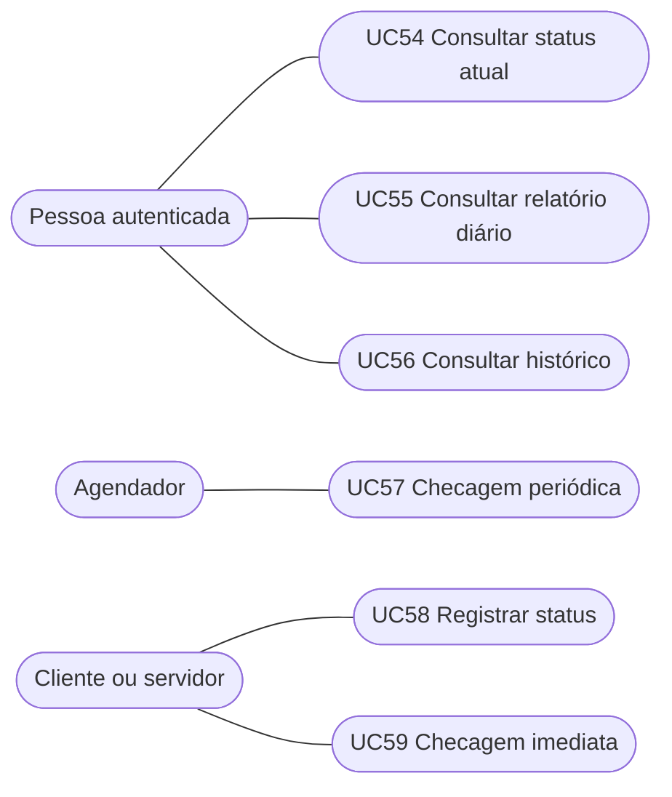

# UC54 - Consultar o status atual

- **Atores:** Pessoa autenticada.
- **RF relacionado:** [RF38](https://github.com/MiguelIFSP/BRTPDS2-PROJETO-E-DESENVOLVIMENTO-DE-SISTEMAS-2/wiki/RF38).
- **Fluxo principal:** `GET /api/status`.
- **Fluxos alternativos e erros:** sem sessão, `401`.
- **Pós-condições (deste caso):** nenhuma gravação.

# UC55 - Consultar o relatório diário

- **Atores:** Pessoa autenticada.
- **RF relacionado:** [RF39](https://github.com/MiguelIFSP/BRTPDS2-PROJETO-E-DESENVOLVIMENTO-DE-SISTEMAS-2/wiki/RF39).
- **Fluxo principal:** `GET /api/status/daily`.
- **Fluxos alternativos e erros:** data inválida, `400`; sem sessão, `401`.
- **Pós-condições (deste caso):** nenhuma gravação.

# UC56 - Consultar o histórico de um subsistema

- **Atores:** Pessoa autenticada.
- **RF relacionado:** [RF40](https://github.com/MiguelIFSP/BRTPDS2-PROJETO-E-DESENVOLVIMENTO-DE-SISTEMAS-2/wiki/RF40-Consultar-o-historico-de-um-subsistema).
- **Fluxo principal:** `GET /api/status/:subSystemId/history`.
- **Fluxos alternativos e erros:** id ou período inválido e subsistema inexistente são recusados.
- **Pós-condições (deste caso):** nenhuma gravação.

# UC57 - Executar a checagem periódica

- **Atores:** Agendador.
- **RF relacionado:** [RF41](https://github.com/MiguelIFSP/BRTPDS2-PROJETO-E-DESENVOLVIMENTO-DE-SISTEMAS-2/wiki/RF41).
- **Fluxo principal:** em `0 */3 * * *`, as seis checagens rodam em paralelo.
- **Fluxos alternativos e erros:** falha grava `DOWN`; o aplicativo não recebe `OPERATIONAL` se houver erro recente.
- **Pós-condições (deste caso):** novos registros em `StatusCheck`.

# UC58 - Registrar status

- **Atores:** Servidor, aplicativo ou painel.
- **RF relacionado:** [RF42](https://github.com/MiguelIFSP/BRTPDS2-PROJETO-E-DESENVOLVIMENTO-DE-SISTEMAS-2/wiki/RF42).
- **Fluxo principal:** `POST /api/status` (chave interna) ou `POST /api/status/report` (sessão).
- **Fluxos alternativos e erros:** credencial ou dado inválido é recusado.
- **Pós-condições (deste caso):** novo registro em `StatusCheck`.

# UC59 - Disparar a checagem imediata

- **Atores:** Administrador, painel ou script.
- **RF relacionado:** [RF43](https://github.com/MiguelIFSP/BRTPDS2-PROJETO-E-DESENVOLVIMENTO-DE-SISTEMAS-2/wiki/RF43).
- **Fluxo principal:** `POST /api/status/:subSystem/check`.
- **Fluxos alternativos e erros:** subsistema desconhecido, `404`.
- **Pós-condições (deste caso):** status atualizado.


---

<!-- Página da Wiki: DCU-‐-Relatórios -->

```text
Incremento: 1
Escopo: RF63 a RF65
Responsável(eis): Bruno Soares Machado
Fontes: sistema/api/src/routes/organizacaoRoutes.ts; sistema/api/src/routes/comissaoRoutes.ts; sistema/api/src/routes/usuarioRoutes.ts
```

# Atores

| Ator | Responsabilidade |
|---|---|
| Pessoa autenticada | Vê relatórios das organizações e comissões de que participa |
| Administrador | Vê os relatórios globais e o de usuários |

## Diagrama

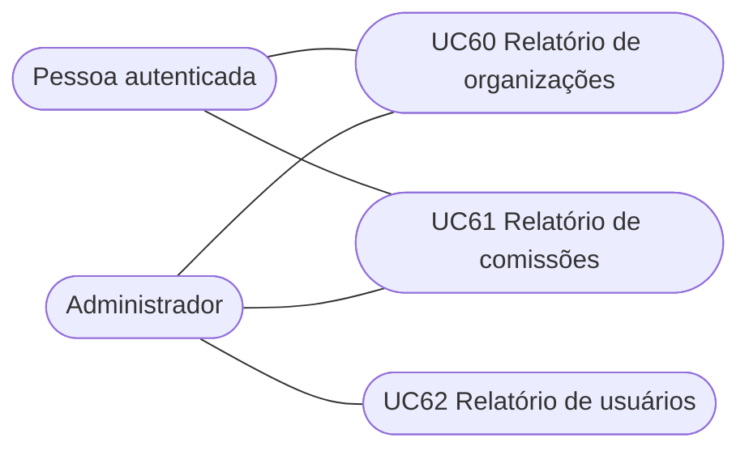

# UC60 - Consultar o relatório de organizações

- **Atores:** Pessoa autenticada e Administrador.
- **RF relacionado:** [RF63](https://github.com/MiguelIFSP/BRTPDS2-PROJETO-E-DESENVOLVIMENTO-DE-SISTEMAS-2/wiki/RF63).
- **Fluxo principal:** `GET /api/organizacoes/relatorio/minhas` ou `/api/organizacoes/relatorio`.
- **Fluxos alternativos e erros:** sem sessão, `401`; sem permissão na rota global, `403`.
- **Pós-condições (deste caso):** nenhuma gravação.

# UC61 - Consultar o relatório de comissões

- **Atores:** Pessoa autenticada e Administrador.
- **RF relacionado:** [RF64](https://github.com/MiguelIFSP/BRTPDS2-PROJETO-E-DESENVOLVIMENTO-DE-SISTEMAS-2/wiki/RF64).
- **Fluxo principal:** `GET /api/comissoes/relatorio/minhas` ou `/api/comissoes/relatorio`.
- **Fluxos alternativos e erros:** sem sessão, `401`; sem permissão na rota global, `403`.
- **Pós-condições (deste caso):** nenhuma gravação.

# UC62 - Consultar o relatório de usuários

- **Atores:** Administrador.
- **RF relacionado:** [RF65](https://github.com/MiguelIFSP/BRTPDS2-PROJETO-E-DESENVOLVIMENTO-DE-SISTEMAS-2/wiki/RF65).
- **Fluxo principal:** `GET /api/usuarios/relatorio`.
- **Fluxos alternativos e erros:** sem sessão, `401`; sem permissão na rota global, `403`.
- **Pós-condições (deste caso):** nenhuma gravação.


---

<!-- Página da Wiki: DCU-‐-Gestão-do-sistema -->

```text
Incremento: 1
Escopo: RF66 a RF68
Responsável(eis): Bruno Soares Machado
Fontes: sistema/management-better-meet/server/src/controllers/subsystemController.ts; sistema/management-better-meet/server/src/middlewares/authMiddleware.ts; sistema/management-better-meet/server/src/schemas/subsystemSchema.ts; sistema/start-all.ps1; sistema/docker-compose.yml
```

# Atores

| Ator | Responsabilidade |
|---|---|
| Administrador | Controla os subsistemas pelo painel ou aplicativo |
| Administrador do servidor | Faz o setup e o reset no terminal |

## Diagrama

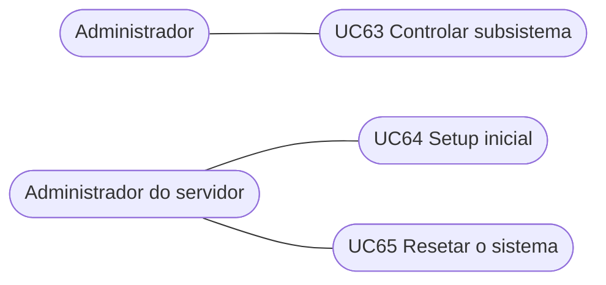

# UC63 - Iniciar, parar ou reiniciar um subsistema

- **Atores:** Administrador.
- **RF relacionado:** [RF66](https://github.com/MiguelIFSP/BRTPDS2-PROJETO-E-DESENVOLVIMENTO-DE-SISTEMAS-2/wiki/RF66).
- **Fluxo principal:** `POST /subsystems/:name/:action`.
- **Fluxos alternativos e erros:** `400`, `401`, `403`, `404` ou `503`.
- **Pós-condições (deste caso):** subsistema no estado pedido.

# UC64 - Preparar e iniciar o sistema

- **Atores:** Administrador do servidor.
- **RF relacionado:** [RF67](https://github.com/MiguelIFSP/BRTPDS2-PROJETO-E-DESENVOLVIMENTO-DE-SISTEMAS-2/wiki/RF67).
- **Fluxo principal:** executar `start-all.ps1`.
- **Fluxos alternativos e erros:** falha de dependência interrompe o script.
- **Pós-condições (deste caso):** sistema no ar.

# UC65 - Resetar o sistema

- **Atores:** Administrador do servidor.
- **RF relacionado:** [RF68](https://github.com/MiguelIFSP/BRTPDS2-PROJETO-E-DESENVOLVIMENTO-DE-SISTEMAS-2/wiki/RF68).
- **Fluxo principal:** parar, fazer backup opcional e `docker compose down -v`.
- **Fluxos alternativos e erros:** sem `-v`, os dados permanecem.
- **Pós-condições (deste caso):** bancos vazios no reset completo.


---

<!-- Página da Wiki: RF40-Consultar-o-historico-de-um-subsistema -->

```text
Incremento: 1
Escopo: RF38 a RF43
Responsável(eis): Cauê Watanabe de Campos
Fontes: sistema/better-meet/src/app/(tabs)/mais/status.tsx; sistema/monitoring-better-meet/src/services/statusCheckService.ts; sistema/monitoring-better-meet/src/schemas/statusSchema.ts
```

# RF40 — Consultar o histórico de um subsistema

## Função

Ver o dia a dia de um subsistema, com os dias vazios incluídos.

## Descrição

Depois do status atual, a tela pede 30 dias de cada subsistema que veio na lista. O painel pede os mesmos 30 dias. Cada dia mostra quantidade, percentual operacional, último status e pior status.

## Entradas

| Campo | Origem | Tipo | Obrigatório | Validação |
|---|---|---|---|---|
| `Authorization` | Sessão | Bearer | Sim | `requireAuth` |
| `subSystemId` | Rota | inteiro | Sim | `parseId`, maior que zero |
| `days` | Query | inteiro | Não | De 1 a 90. Sem valor, 7. A tela envia 30 |

## Origem

`StatusScreen.loadStatus` e a carga do painel.

## Saída

| Situação | HTTP | Tela |
|---|---|---|
| Subsistema existe | `200` | Uma barra por dia |
| Dia sem checagem | `200` | `UNKNOWN`. Texto: "Não houve checagem de status nesse dia." |
| Id inválido | `400` | "Identificador do subsistema inválido." |
| Inexistente | `404` | "Sub-sistema não encontrado." |
| `days` inválido | `400` | "days deve ser um número inteiro de 1 a 90." |
| Falha na carga | — | "Não foi possível carregar o histórico." |

O pior status segue a ordem `DOWN`, `ERROR`, `MAINTENANCE`, `UNKNOWN`, `OPERATIONAL`.

## Destino

Nenhuma tabela.

## Ação

1. `getSubSystemHistory` envia `GET /api/status/:subSystemId/history?days=30`.
2. `getHistory` abre o intervalo em `America/Sao_Paulo`, do primeiro dia até o fim de hoje.
3. Monta um item para cada dia, mesmo sem checagem.

## Pré-condição

A pessoa está autenticada e o subsistema existe.

## Pós-condição

A linha do tempo está na tela.

## Efeitos colaterais

Nenhum.

# Rastreabilidade

| Requisito | Tela | Rota | Diagrama |
|---|---|---|---|
| RF40 | `StatusScreen` | `GET /api/status/:subSystemId/history` | DS-Consultar-Historico-Status |

---

<!-- Página da Wiki: RF41 -->

```text
Incremento: 1
Escopo: RF38 a RF43
Responsável(eis): Cauê Watanabe de Campos
Fontes: sistema/monitoring-better-meet/src/jobs/healthCheckJob.ts; sistema/monitoring-better-meet/src/server.ts
```

# RF41 — Executar a checagem periódica

## Função

Gravar, a cada 3 horas, se cada subsistema responde.

## Descrição

Com a API de monitoramento no ar, `healthCheckJob.start` agenda `0 */3 * * *`. No minuto 0 de cada bloco de 3 horas, no relógio do processo, as seis checagens saem juntas.

## Entradas

Nenhuma. O endereço do banco da aplicação, da API de dados e da API de gestão vem da configuração.

## Origem

`healthCheckJob.start`, chamado em `server.ts` depois que o processo sobe.

## Saída

| Situação | Gravação |
|---|---|
| Banco da aplicação responde a `SELECT 1` | `database` `OPERATIONAL` |
| Banco da aplicação falha ou estoura 5 segundos | `database` `DOWN`, "Banco de dados da aplicação sem resposta." |
| `GET /health` da API de dados responde com sucesso | `data-api` `OPERATIONAL` |
| API de dados falha | `data-api` `DOWN`, "API de Dados sem resposta." |
| `GET /health` da API de gestão responde com sucesso | `management` `OPERATIONAL` |
| API de gestão falha | `management` `DOWN`, "API de Gestão sem resposta." |
| `SELECT 1` no banco do monitoramento responde | `monitoring-database` `OPERATIONAL` |
| Esse banco falha | `monitoring-database` `DOWN`, "Banco de dados do monitoramento sem resposta." |
| O job está rodando | `monitoring` `OPERATIONAL` |
| Aplicativo sem erro recente | `mobile-app` `OPERATIONAL` |
| Aplicativo com erro nas últimas 6 horas | nada novo para `mobile-app` |

## Destino

`StatusCheck`, ligado ao `SubSystem` do nome. O subsistema nasce no primeiro `upsert`.

## Ação

1. O cron dispara `Promise.all` com as seis funções.
2. Cada uma espera no máximo 5 segundos.
3. `record` grava o resultado.

## Pré-condição

O processo da API de monitoramento está em execução.

## Pós-condição

O histórico de quem foi checado tem um registro novo.

## Efeitos colaterais

O erro bruto vai para o log. A mensagem gravada é o texto fixo. Ao subir, o processo também grava `monitoring` `OPERATIONAL` com "Serviço iniciado". Ao receber `SIGINT` ou `SIGTERM`, grava `MAINTENANCE` com "Parada solicitada".

# Rastreabilidade

| Requisito | Tela | Rota | Diagrama |
|---|---|---|---|
| RF41 | sem tela | agendamento interno | DS-Checagem-Periodica |

---

<!-- Página da Wiki: RF42 -->

```text
Incremento: 1
Escopo: RF38 a RF43
Responsável(eis): Cauê Watanabe de Campos
Fontes: sistema/monitoring-better-meet/src/routes/statusRoutes.ts; sistema/monitoring-better-meet/src/schemas/statusSchema.ts; sistema/better-meet/src/services/monitoringService.ts; sistema/management-better-meet/server/src/services/monitoringReporterService.ts
```

# RF42 — Registrar status

## Função

Gravar um status informado por outro sistema ou pela sessão de quem está logado.

## Descrição

Há dois envios. A chave interna usa `POST /api/status` e aceita qualquer status da lista. A sessão usa `POST /api/status/report` e só aceita `mobile-app` ou `management`, com status `ERROR` ou `DOWN`. A própria API de monitoramento grava o início e a parada direto no banco.

## Entradas

| Campo | Origem | Tipo | Obrigatório | Validação |
|---|---|---|---|---|
| `x-api-key` | Servidor | texto | No `POST /api/status` | Igual a `INTERNAL_API_KEY` |
| `Authorization` | Sessão | Bearer | No `POST /api/status/report` | `requireAuth` |
| `subSystem` | Corpo | texto | Sim | Na chave, até 60. Na sessão, `mobile-app` ou `management` |
| `status` | Corpo | enum | Sim | Na chave, `OPERATIONAL`, `MAINTENANCE`, `ERROR`, `DOWN` ou `UNKNOWN`. Na sessão, `ERROR` ou `DOWN` |
| `message` | Corpo | texto | Na sessão, sim | Até 500. Caracteres de controle viram espaço |
| `isBlocking` | Corpo | booleano | Não | Na ausência, falso |

## Origem

`monitoringReporterService`, no início e na parada da API de gestão. `monitoringService.reportError`, no aplicativo. `reportManagementError`, no painel. `server.ts` da API de monitoramento, direto no banco.

## Saída

| Situação | HTTP | Resultado |
|---|---|---|
| Dados válidos | `201` | O `StatusCheck` criado |
| Chave inválida | `401` | "Autenticação necessária." |
| Sessão inválida | `401` | "Sessão inválida. Entre novamente." |
| Nome ou status fora da regra | `400` | A primeira mensagem do esquema |
| Erro do painel sem administrador | `403` | "Somente administradores reportam erros do painel." |
| JSON inválido | `400` | "JSON inválido." |
| Corpo grande demais | `413` | "Corpo da requisição grande demais." |
| Muitos relatos | `429` | "Muitas tentativas. Tente novamente em `<segundos>` segundos." |

O aplicativo e o painel não mostram essas falhas. Eles também pulam um relato se o anterior foi há menos de 5 segundos. Sem sessão, não enviam.

## Destino

`SubSystem`, criado no primeiro nome, e um `StatusCheck` novo.

## Ação

1. `POST /api/status` passa por `requireApiKey` e `statusCheckSchema`.
2. `POST /api/status/report` passa por `requireAuth` e `reportSchema`.
3. `record` faz o `upsert` do nome e o `create` da checagem.

## Pré-condição

Chave interna válida, ou sessão válida. O relato de `management` pela sessão exige administrador.

## Pós-condição

O status informado é o mais recente daquele nome.

## Efeitos colaterais

O limite estrito é 10 chamadas por minuto em `report` e na checagem imediata, quando o limite está ligado. O limite geral da API é 120 por minuto. Os dois usam janela de 60 segundos e ficam desligados fora de produção, salvo `RATE_LIMIT_ENABLED`. O aplicativo só relata falha de sistema: sem conexão ou resposta 5xx. Resposta 4xx não vira relato.

# Rastreabilidade

| Requisito | Tela | Rota | Diagrama |
|---|---|---|---|
| RF42 | sem formulário | `POST /api/status` e `POST /api/status/report` | DS-Registrar-Status |

---

<!-- Página da Wiki: RF43 -->

```text
Incremento: 1
Escopo: RF38 a RF43
Responsável(eis): Cauê Watanabe de Campos
Fontes: sistema/monitoring-better-meet/src/controllers/statusController.ts; sistema/monitoring-better-meet/src/jobs/healthCheckJob.ts; sistema/better-meet/src/app/(tabs)/mais/status.tsx
```

# RF43 — Disparar a checagem imediata

## Função

Checar um subsistema agora, fora do horário das 3 horas.

## Descrição

`POST /api/status/:subSystem/check` roda a mesma checagem da rodada periódica, só para o nome informado, e devolve o status mais recente. Aceita sessão ou chave interna. O aplicativo chama depois de uma ação do administrador, com espera de 5 segundos. O painel chama ao abrir. O script de setup também chama.

## Entradas

| Campo | Origem | Tipo | Obrigatório | Validação |
|---|---|---|---|---|
| `Authorization` ou `x-api-key` | Sessão ou servidor | Bearer ou chave | Um dos dois | `requireAuthOrApiKey` |
| `subSystem` | Rota | texto | Sim | Um de `database`, `data-api`, `mobile-app`, `monitoring-database`, `management`, `monitoring` |

## Origem

`StatusScreen`, depois da ação do administrador. A tela do painel, na abertura. O script de setup.

## Saída

| Situação | HTTP | Tela |
|---|---|---|
| Nome conhecido | `200` | O status atualizado daquele subsistema |
| Sem checagem nova para devolver | `200` | `{ subSystem, status: "UNKNOWN" }` |
| Nome desconhecido | `404` | "Subsistema desconhecido." |
| Sem sessão e sem chave | `401` | "Autenticação necessária." |
| Falha na tela | — | "Não foi possível verificar o status agora." |
| Muitas chamadas | `429` | "Muitas tentativas. Tente novamente em `<segundos>` segundos." |

## Destino

Um `StatusCheck` novo, pela mesma gravação da checagem periódica.

## Ação

1. `checkNow` chama `runSingle`.
2. A função do nome executa a checagem.
3. `getLatest` devolve o item daquele nome.

## Pré-condição

Há sessão válida ou chave interna válida, e o nome é conhecido.

## Pós-condição

O status daquele subsistema reflete a checagem de agora, salvo quando a regra das 6 horas preserva o erro do aplicativo.

## Efeitos colaterais

Vale o mesmo teto de 10 chamadas por minuto do relato, com o limite ligado.

# Rastreabilidade

| Requisito | Tela | Rota | Diagrama |
|---|---|---|---|
| RF43 | `StatusScreen` | `POST /api/status/:subSystem/check` | DS-Checagem-Imediata |

---

<!-- Página da Wiki: RF63 -->

```text
Incremento: 1
Escopo: RF63 a RF65
Responsável(eis): Bruno Soares Machado
Fontes: sistema/api/src/routes/organizacaoRoutes.ts; sistema/better-meet/src/app/(tabs)/mais/relatorios/index.tsx
```

# RF63 — Consultar o relatório de organizações

## Função

Ver os indicadores de organizações.

## Descrição

Na aba Mais, a tela **Relatórios** mostra uma aba por assunto. O administrador vê todos os registros; a pessoa comum vê só os de que participa.

## Entradas

| Campo | Origem | Tipo | Obrigatório | Validação |
|---|---|---|---|---|
| `Authorization` | Sessão | Bearer ou cookie | Sim | `requireAuth` |

## Origem

Tela **Relatórios**, recarregada quando volta ao foco.

## Saída

| Situação | HTTP | Tela |
|---|---|---|
| Relatório calculado | `200` | Indicadores: total, quantidade por status, crescimento em 12 meses, papéis dos membros e média de membros por organização aceita |
| Sem vínculo | `200` | Valores zerados |
| Pessoa comum na rota global | `403` | Acesso negado pela API |
| Sem sessão válida | `401` | Volta ao login |
| Falha na carga | — | A aba afetada mostra o motivo; as outras continuam |

## Destino

Nada é gravado. O relatório é calculado a cada requisição.

## Ação

1. O app envia `GET /api/organizacoes/relatorio` (administrador) ou `GET /api/organizacoes/relatorio/minhas` (pessoa comum).
2. A API confere a sessão e, na rota global, o papel `ADMIN`.
3. A API calcula os indicadores e a tela os exibe.

## Pré-condição

A pessoa está autenticada.

## Pós-condição

Os indicadores atuais estão na tela.

## Efeitos colaterais

A falha de um relatório não impede os outros.

# Rastreabilidade

| Requisito | Tela | Rota | Diagrama |
|---|---|---|---|
| RF63 | `relatorios/index.tsx` | `GET /api/organizacoes/relatorio` e `/relatorio/minhas` | DS-Consultar-Relatorio |

---

<!-- Página da Wiki: RF64 -->

```text
Incremento: 1
Escopo: RF63 a RF65
Responsável(eis): Bruno Soares Machado
Fontes: sistema/api/src/routes/comissaoRoutes.ts; sistema/better-meet/src/app/(tabs)/mais/relatorios/index.tsx
```

# RF64 — Consultar o relatório de comissões

## Função

Ver os indicadores de comissões.

## Descrição

Na aba Mais, a tela **Relatórios** mostra uma aba por assunto. O administrador vê todos os registros; a pessoa comum vê só os de que participa.

## Entradas

| Campo | Origem | Tipo | Obrigatório | Validação |
|---|---|---|---|---|
| `Authorization` | Sessão | Bearer ou cookie | Sim | `requireAuth` |

## Origem

Tela **Relatórios**, recarregada quando volta ao foco.

## Saída

| Situação | HTTP | Tela |
|---|---|---|
| Relatório calculado | `200` | Indicadores: total, organizações envolvidas, comissões por organização, crescimento em 12 meses, papéis da equipe e média de membros |
| Sem vínculo | `200` | Valores zerados |
| Pessoa comum na rota global | `403` | Acesso negado pela API |
| Sem sessão válida | `401` | Volta ao login |
| Falha na carga | — | A aba afetada mostra o motivo; as outras continuam |

## Destino

Nada é gravado. O relatório é calculado a cada requisição.

## Ação

1. O app envia `GET /api/comissoes/relatorio` (administrador) ou `GET /api/comissoes/relatorio/minhas` (pessoa comum).
2. A API confere a sessão e, na rota global, o papel `ADMIN`.
3. A API calcula os indicadores e a tela os exibe.

## Pré-condição

A pessoa está autenticada.

## Pós-condição

Os indicadores atuais estão na tela.

## Efeitos colaterais

A falha de um relatório não impede os outros.

# Rastreabilidade

| Requisito | Tela | Rota | Diagrama |
|---|---|---|---|
| RF64 | `relatorios/index.tsx` | `GET /api/comissoes/relatorio` e `/relatorio/minhas` | DS-Consultar-Relatorio |

---

<!-- Página da Wiki: RF65 -->

```text
Incremento: 1
Escopo: RF63 a RF65
Responsável(eis): Bruno Soares Machado
Fontes: sistema/api/src/routes/usuarioRoutes.ts; sistema/better-meet/src/app/(tabs)/mais/relatorios/index.tsx
```

# RF65 — Consultar o relatório de usuários

## Função

Ver os indicadores das contas da plataforma.

## Descrição

A aba **Usuários** aparece só para o administrador. O atalho **Ver todos os usuários** abre a listagem. A troca de perfil a partir da listagem é parte do [RF03](https://github.com/MiguelIFSP/BRTPDS2-PROJETO-E-DESENVOLVIMENTO-DE-SISTEMAS-2/wiki/RF03).

## Entradas

| Campo | Origem | Tipo | Obrigatório | Validação |
|---|---|---|---|---|
| `Authorization` | Sessão | Bearer ou cookie | Sim | `requireAuth` |

## Origem

Tela **Relatórios**, aba **Usuários**.

## Saída

| Situação | HTTP | Tela |
|---|---|---|
| Relatório calculado | `200` | Total, papéis, crescimento em 12 meses, engajamento, pessoas mais ativas e tema preferido |
| Pessoa comum | `403` | Acesso negado pela API |
| Sem sessão válida | `401` | Volta ao login |
| Falha na carga | — | A aba afetada mostra o motivo; as outras continuam |

## Destino

Nada é gravado.

## Ação

1. O app envia `GET /api/usuarios/relatorio`.
2. A API confere a sessão e o papel `ADMIN`.
3. A API calcula e devolve os indicadores.

## Pré-condição

A pessoa é administradora.

## Pós-condição

Os indicadores estão na tela.

## Efeitos colaterais

Nenhum.

# Rastreabilidade

| Requisito | Tela | Rota | Diagrama |
|---|---|---|---|
| RF65 | `relatorios/index.tsx` | `GET /api/usuarios/relatorio` | DS-Consultar-Relatorio |

---

<!-- Página da Wiki: RF66 -->

```text
Incremento: 1
Escopo: RF66 a RF68
Responsável(eis): Bruno Soares Machado
Fontes: sistema/management-better-meet/server/src/controllers/subsystemController.ts; sistema/management-better-meet/server/src/middlewares/authMiddleware.ts; sistema/management-better-meet/server/src/schemas/subsystemSchema.ts
```

# RF66 — Iniciar, parar ou reiniciar um subsistema

## Função

Controlar um subsistema sem acessar o servidor.

## Descrição

No painel `/admin` ou na tela de status do aplicativo, o administrador usa **Iniciar**, **Parar** ou **Reiniciar**.

## Entradas

| Campo | Origem | Tipo | Obrigatório | Validação |
|---|---|---|---|---|
| `Authorization` | Sessão | Bearer | Sim | `requireAuth` e `requireAdmin` |
| `name` | Rota | texto | Sim | `api`, `monitoring`, `management`, `database` ou `monitoring-database` |
| `action` | Rota | texto | Sim | `start`, `stop` ou `restart` |

## Origem

Painel de gestão e aplicativo (administrador).

## Saída

| Situação | HTTP | Resultado |
|---|---|---|
| Ação executada | `200` | `status` `ok` |
| Ação na própria API de gestão | `202` | Responde antes de executar o comando |
| Ação inválida | `400` | "Ação inválida. Use: start, stop ou restart." |
| Nome desconhecido | `404` | "Subsistema desconhecido." |
| Sem sessão válida | `401` | Volta ao login |
| Sem papel `ADMIN` | `403` | "Acesso restrito ao administrador." |
| API de Dados indisponível | `503` | A sessão não pode ser validada e a ação não roda |

## Destino

PM2 (`api`, `monitoring`, `management`) ou Docker (os dois bancos). A API de gestão não tem banco próprio.

## Ação

1. O cliente envia `POST /subsystems/:name/:action`.
2. A API de gestão lê o perfil atual em `GET /api/usuarios/me` da API de Dados (cache de até 30 segundos).
3. O nome é conferido na lista fixa e a ação roda no PM2 ou no Docker.
4. O cliente pede a checagem imediata ([RF43](https://github.com/MiguelIFSP/BRTPDS2-PROJETO-E-DESENVOLVIMENTO-DE-SISTEMAS-2/wiki/RF43)) e atualiza a tela.

## Pré-condição

Sessão de administrador, com a API de gestão e a API de Dados no ar.

## Pós-condição

O subsistema fica no estado pedido.

## Efeitos colaterais

Com a API de gestão parada, nenhuma ação funciona pelo painel nem pelo aplicativo; ela é religada no servidor (`pm2 start management`). Se a API de Dados for parada, a validação de novas sessões falha, e ela pode precisar ser religada no servidor.

# Rastreabilidade

| Requisito | Tela | Rota | Diagrama |
|---|---|---|---|
| RF66 | Painel e `status.tsx` | `POST /subsystems/:name/:action` | DS-Controlar-Subsistema |

---

<!-- Página da Wiki: RF67 -->

```text
Incremento: 1
Escopo: RF66 a RF68
Responsável(eis): Bruno Soares Machado
Fontes: sistema/start-all.ps1; sistema/ecosystem.config.js; sistema/docker-compose.yml
```

# RF67 — Preparar e iniciar o sistema (setup inicial)

## Função

Preparar e subir todos os subsistemas com um comando.

## Descrição

Na pasta `sistema`, o administrador do servidor executa `.\start-all.ps1`. O script pode ser repetido.

## Entradas

Nenhum campo. É preciso ter Node.js e Docker Desktop instalados.

## Origem

Terminal do servidor.

## Saída

| Situação | Resultado |
|---|---|
| Concluído | Mostra o endereço do painel, na porta 3335, em `/admin` |
| Falha no `npm install` ou versão do Prisma diferente de 7.10.0 | O script para e informa o projeto |
| IP não detectado | Usa `localhost` e avisa |
| Falha de migration | Avisa e continua |

## Destino

Arquivos `.env`, containers e volumes do Docker, migrations dos dois bancos, processos do PM2 e painel exportado.

## Ação

1. Confere o PM2 e roda `npm install` nos cinco projetos.
2. Cria ou corrige os `.env`; gera `INTERNAL_API_KEY` e `BETTER_AUTH_SECRET` quando ainda não há valor válido.
3. Sobe os bancos com `docker compose up -d`.
4. Aplica `prisma migrate deploy` na API de dados e no monitoramento, com baseline para banco antigo.
5. Inicia `api`, `monitoring` e `management` pelo PM2, direto do código-fonte, sem compilação.
6. Entra como o administrador padrão (`POST /api/auth/sign-in/email`), grava o status inicial que faltar e pede a checagem de cada subsistema.
7. Exporta o painel web.

## Pré-condição

Node.js e Docker Desktop em execução.

## Pós-condição

Bancos e APIs no ar e painel acessível.

## Efeitos colaterais

Repetir o script não duplica containers nem troca segredo válido.

# Rastreabilidade

| Requisito | Tela | Rota | Diagrama |
|---|---|---|---|
| RF67 | Terminal | Script `start-all.ps1` | DS-Setup-Inicial |

---

<!-- Página da Wiki: RF68 -->

```text
Incremento: 1
Escopo: RF66 a RF68
Responsável(eis): Bruno Soares Machado
Fontes: sistema/docker-compose.yml; sistema/ecosystem.config.js
```

# RF68 — Resetar o sistema

## Função

Encerrar os subsistemas e, se desejado, apagar os dados.

## Descrição

É um procedimento no servidor. Não há botão nem rota que apague os dados.

## Entradas

Decisão do administrador do servidor sobre fazer backup e apagar os volumes.

## Origem

Terminal do servidor, na pasta `sistema`.

## Saída

| Situação | Resultado |
|---|---|
| Parada | `pm2 list` mostra os processos parados |
| Reset completo | `docker volume ls` não mostra os volumes removidos |

## Destino

Volumes `sistema_db_better_meet_data` e `sistema_db_monitoring_better_meet_data` (o prefixo é o nome do projeto do Compose).

## Ação

1. `pm2 stop api monitoring management`.
2. `docker compose stop`.
3. Backup opcional, um por volume:

```
docker run --rm -v sistema_db_better_meet_data:/data -v ${PWD}/backup:/backup alpine tar czf /backup/db_better_meet_data.tar.gz -C /data .
docker run --rm -v sistema_db_monitoring_better_meet_data:/data -v ${PWD}/backup:/backup alpine tar czf /backup/db_monitoring_better_meet_data.tar.gz -C /data .
```

4. Reset completo: `docker compose down -v`. Sem `-v`, os dados ficam.
5. Reinicialize com `.\start-all.ps1` ([RF67](https://github.com/MiguelIFSP/BRTPDS2-PROJETO-E-DESENVOLVIMENTO-DE-SISTEMAS-2/wiki/RF67)).

Para restaurar um volume, com o container parado:

```
docker run --rm -v sistema_db_better_meet_data:/data -v ${PWD}/backup:/backup alpine sh -c "rm -rf /data/* && tar xzf /backup/db_better_meet_data.tar.gz -C /data"
```

## Pré-condição

Acesso ao terminal do servidor, com PM2 e Docker.

## Pós-condição

Subsistemas encerrados; no reset completo, bancos vazios.

## Efeitos colaterais

Sem backup, os dados removidos não podem ser recuperados. Os arquivos `.env` não são apagados.

# Rastreabilidade

| Requisito | Tela | Rota | Diagrama |
|---|---|---|---|
| RF68 | Terminal | PM2 e Docker Compose | DS-Resetar-Sistema |

---

<!-- Página da Wiki: DS-‐-Status-do-sistema -->

```text
Incremento: 1
Escopo: RF38 a RF43
Responsável(eis): Bruno Soares Machado
Fontes: sistema/monitoring-better-meet/src/routes/statusRoutes.ts; sistema/monitoring-better-meet/src/controllers/statusController.ts; sistema/monitoring-better-meet/src/jobs/healthCheckJob.ts
```

# Consultar status, relatório diário e histórico (UC54 a UC56)

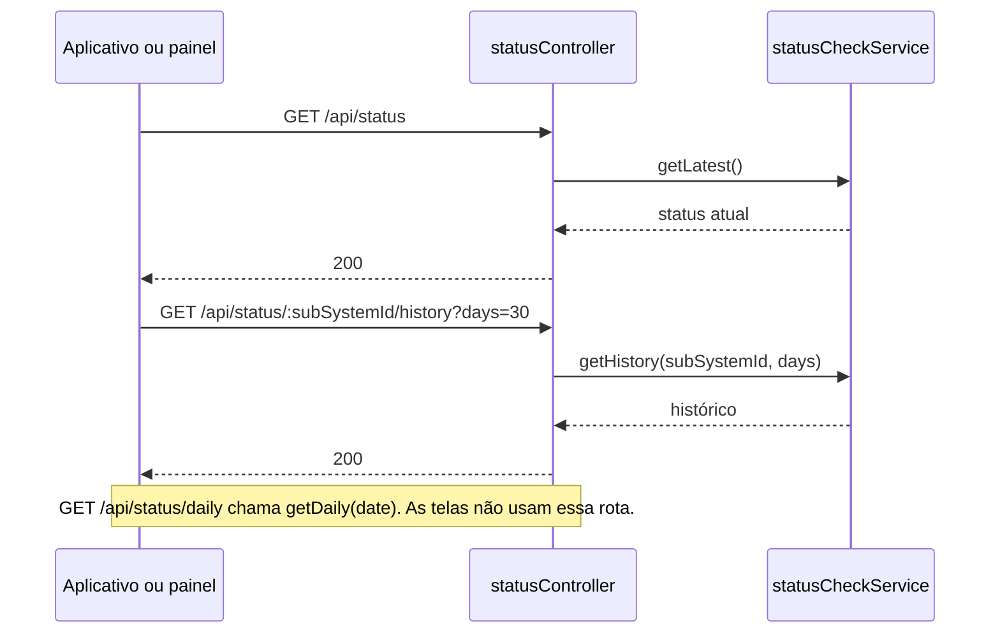

# Checagem periódica (UC57)

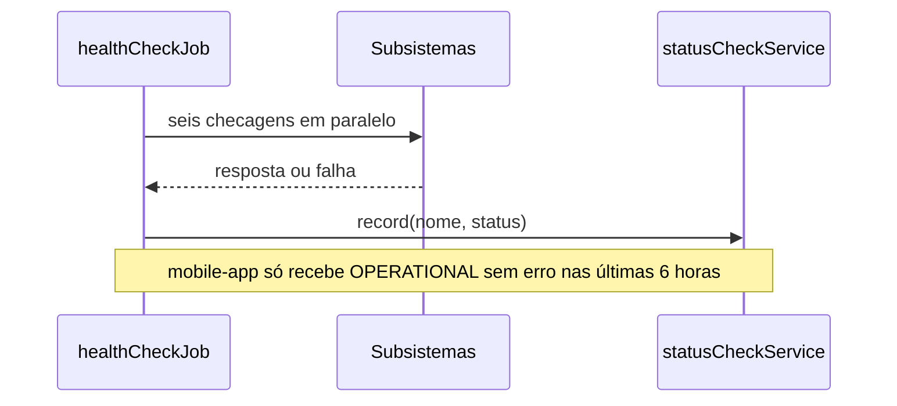

# Registrar status (UC58)

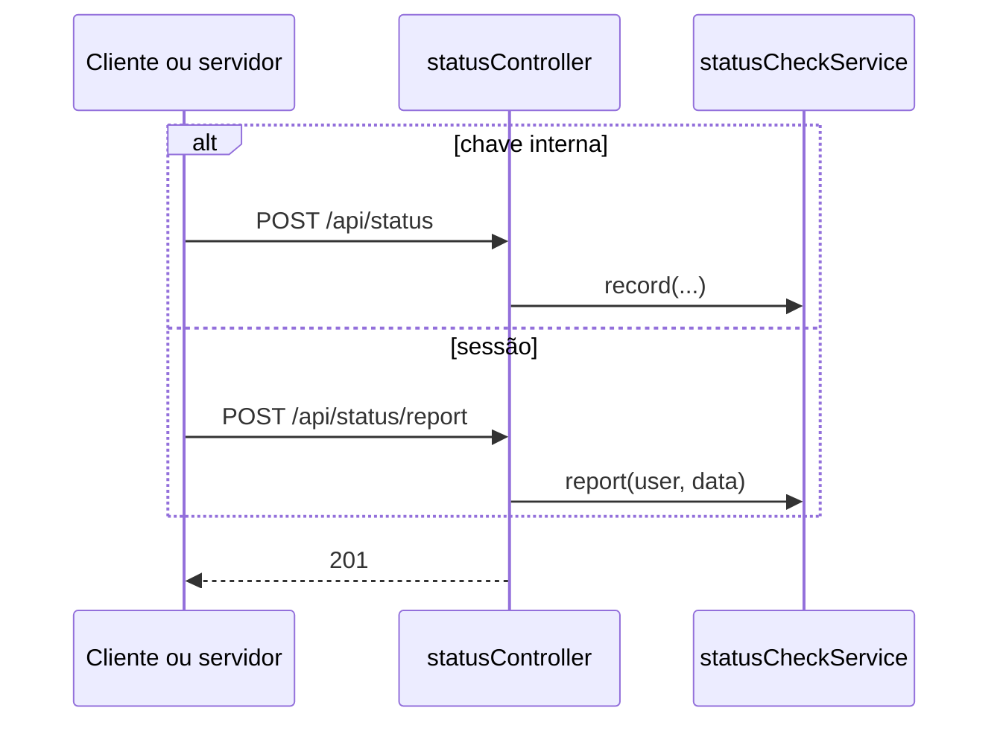

# Checagem imediata (UC59)

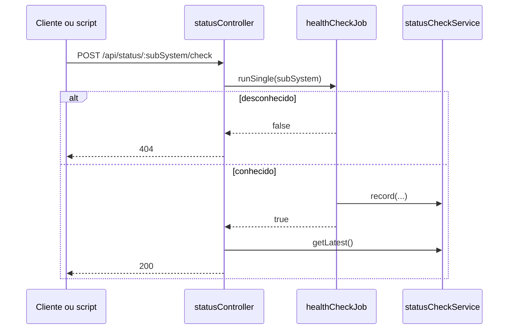


---

<!-- Página da Wiki: DS-‐-Relatórios -->

```text
Incremento: 1
Escopo: RF63 a RF65
Responsável(eis): Bruno Soares Machado
Fontes: sistema/api/src/routes/organizacaoRoutes.ts; sistema/api/src/routes/comissaoRoutes.ts; sistema/api/src/routes/usuarioRoutes.ts
```

# Consultar um relatório (UC60 a UC62)

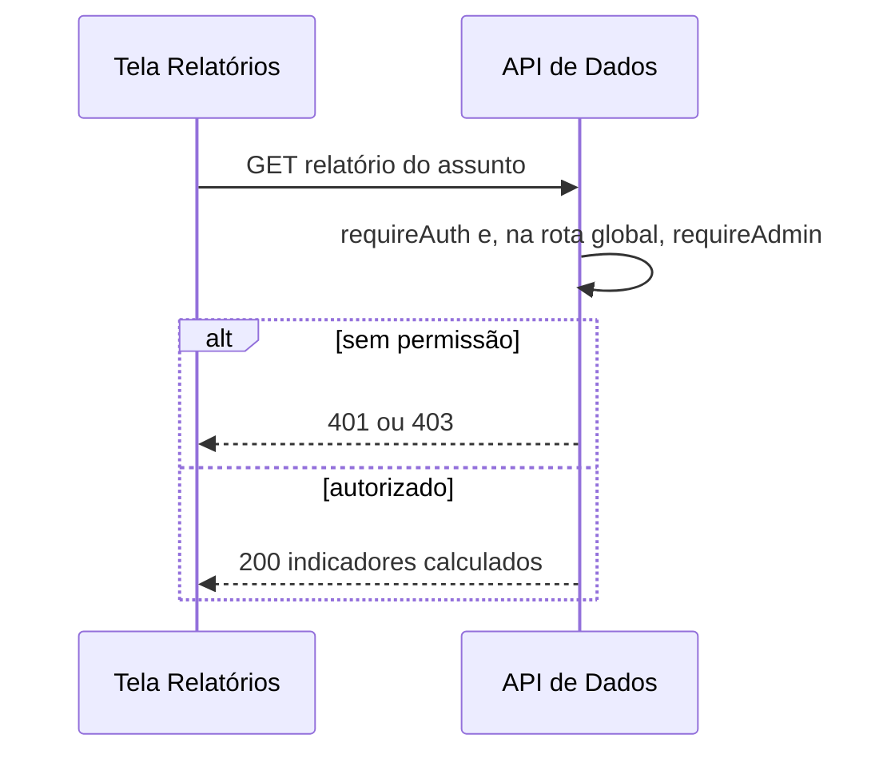


---

<!-- Página da Wiki: DS-‐-Gestão-do-sistema -->

```text
Incremento: 1
Escopo: RF66 a RF68
Responsável(eis): Bruno Soares Machado
Fontes: sistema/management-better-meet/server/src/controllers/subsystemController.ts; sistema/management-better-meet/server/src/middlewares/authMiddleware.ts; sistema/management-better-meet/server/src/schemas/subsystemSchema.ts; sistema/start-all.ps1
```

# Controlar um subsistema (UC63)

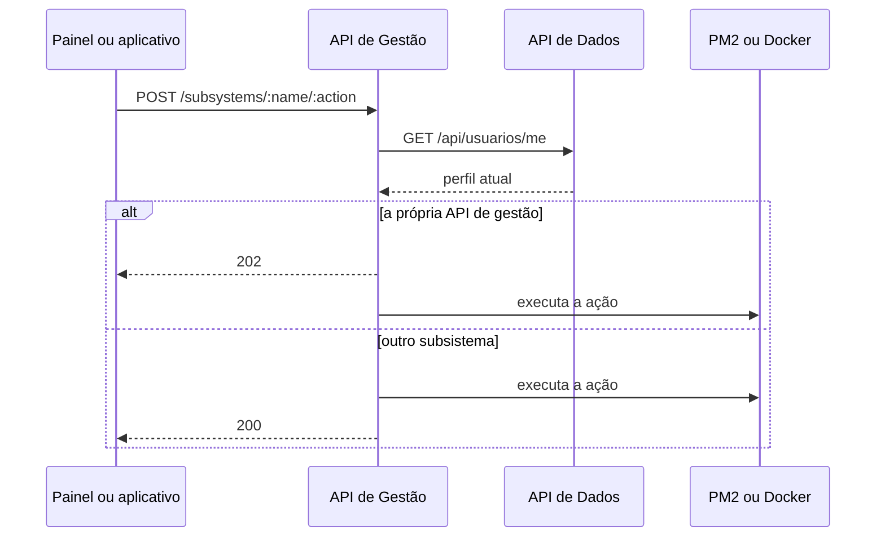

# Setup inicial (UC64)

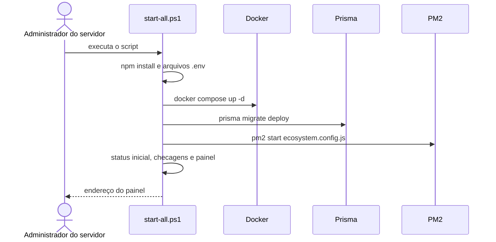

# Reset do sistema (UC65)

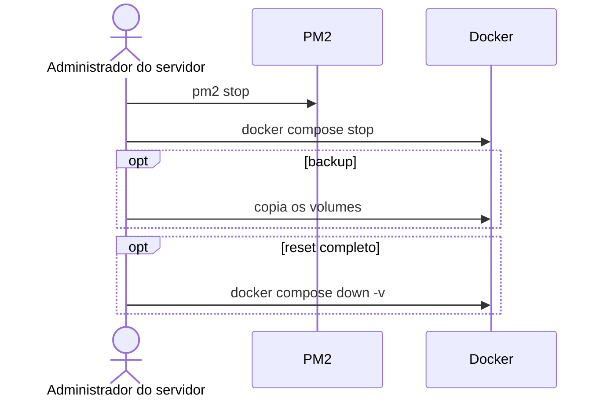


---

<!-- Página da Wiki: RNFS-‐-Status-do-sistema -->

```text
Incremento: 1
Escopo: RNF17 a RNF29
Responsável(eis): Bruno Soares Machado
Fontes: sistema/monitoring-better-meet/src/middlewares/authMiddleware.ts; sistema/monitoring-better-meet/src/middlewares/apiKeyMiddleware.ts; sistema/monitoring-better-meet/src/jobs/healthCheckJob.ts; sistema/monitoring-better-meet/src/utils/timeZone.ts; sistema/monitoring-better-meet/src/app.ts; documentação geral de requisitos não funcionais (gerenciamento e infraestrutura).
```

# RNF17 — Consulta com sessão e registro com a chave conferida
```text
RNF17 — Consulta com sessão e registro com a chave conferida
Categoria: Externo (legal — privacidade e segurança)
Escopo: GET /api/status, GET /api/status/daily e GET /api/status/:id/history; POST /api/status; POST /api/status/report; POST /api/status/:subSystem/check; RF38, RF39, RF40, RF42 e RF43
Exigência: consultar exige sessão válida, conferida na API de dados. Registrar pela chave interna compara x-api-key em tempo constante. O relato do aplicativo e do painel usa a sessão. A checagem imediata aceita sessão ou chave. O erro do painel só entra com Role.ADMIN
Métrica/critério de aceitação: sem token, 401 "Autenticação necessária." Sessão inválida, 401 "Sessão inválida. Entre novamente." Chave ausente ou diferente, 401 "Autenticação necessária." Relato de management sem administrador, 403 "Somente administradores reportam erros do painel."
Método de verificação: inspeção de requireAuth, requireApiKey, requireAuthOrApiKey e report. Sem teste executado nesta revisão
Versões/configuração: express 5.2.1; a chave é INTERNAL_API_KEY
Evidência: safeCompare usa sha256 e timingSafeEqual; authenticate lê o perfil em GET /api/usuarios/me
```
# RNF18 — Checagem em 5 segundos, sem mascarar erro recente do aplicativo
```text
RNF18 — Checagem em 5 segundos, sem mascarar erro recente do aplicativo
Categoria: Produto (confiabilidade)
Escopo: healthCheckJob; RF41 e RF43
Exigência: cada checagem espera no máximo 5 segundos. Uma falha grava DOWN e não cancela as outras. O aplicativo só recebe OPERATIONAL automático se não houve ERROR, DOWN ou MAINTENANCE nas últimas 6 horas
Métrica/critério de aceitação: connectTimeout e AbortController usam 5000 ms. As seis checagens saem em Promise.all. hasRecentErrorReport procura ERROR, DOWN e MAINTENANCE desde agora menos 6 horas. Se achar, checkMobileBetterMeet não chama record
Método de verificação: inspeção de healthCheckJob.ts. Sem teste executado nesta revisão
Versões/configuração: node-cron; o agendamento é 0 */3 * * *, no relógio do processo
Evidência: HEALTH_CHECK_TIMEOUT_MS = 5000; CHECK_INTERVAL_MS = 6 horas; recordDown grava texto fixo e manda o erro bruto só para o log
```
# RNF19 — O dia do status é o de Brasília
```text
RNF19 — O dia do status é o de Brasília
Categoria: Produto (usabilidade)
Escopo: getDaily e getHistory; RF39 e RF40
Exigência: o dia do relatório e o dia do histórico usam America/Sao_Paulo. O horário gravado continua em UTC
Métrica/critério de aceitação: sem data, o relatório usa localDateKey de agora. O intervalo de cada dia vai de startOfLocalDay até o início do dia seguinte nesse fuso. Uma checagem às 22h de Brasília entra no dia de Brasília, mesmo quando UTC já virou o dia
Método de verificação: inspeção de timeZone.ts e statusCheckService. Sem teste executado nesta revisão
Versões/configuração: APP_TIME_ZONE = America/Sao_Paulo
Evidência: localDateKey e startOfLocalDay formatam com timeZone America/Sao_Paulo
```
# RNF20 — Lista de subsistemas autorizados
```text
RNF20 — Lista de subsistemas autorizados
Categoria: Produto (segurança)
Escopo: API de Gestão; operações de controle via PM2 e Docker
Exigência: Somente nomes previamente autorizados podem ser utilizados nas operações de gerenciamento. Valores recebidos no corpo ou nos parâmetros da requisição não podem ser interpretados como comandos arbitrários.
Métrica/critério de aceitação: 100% dos nomes fora da lista devem ser rejeitados sem execução de comandos.
Método de verificação: Testar nomes válidos, desconhecidos e entradas com caracteres de comando; verificar que entradas inválidas não acionam PM2 ou Docker. Sem teste executado nesta revisão.
Versões/configuração: Lista: api, monitoring, management, database, monitoring-database.
Evidência: A documentação geral descreve uma lista fixa de subsistemas. Implementação não conferida nesta revisão.
```
# RNF21 — Autorização por papel
```text
RNF21 — Autorização por papel
Categoria: Produto (segurança)
Escopo: API de Gestão; start, stop e restart
Exigência: As operações de controle exigem sessão válida e papel ADMIN, lido do perfil atual na API de Dados.
Métrica/critério de aceitação: Usuário autenticado sem papel ADMIN recebe HTTP 403; tokens inválidos não autorizam operações.
Método de verificação: Testar operações com administrador, usuário comum e token inválido. Verificar que o rebaixamento vale em até 30 segundos. Sem teste executado nesta revisão.
Versões/configuração: Sessão do Better Auth; cache do perfil de até 30 segundos.
Evidência: authMiddleware.ts e sessaoService.ts da API de Gestão (CACHE_PERFIL_MS = 30000), conferidos por leitura em 2026-11-27.
```
# RNF22 — Resposta antes de interromper a API de Gestão
```text
RNF22 — Resposta antes de interromper a API de Gestão
Categoria: Produto (confiabilidade)
Escopo: API de Gestão; interrupção ou reinicialização do próprio serviço
Exigência: Ao interromper ou reiniciar a si própria, a API deve enviar a resposta HTTP antes de executar o comando.
Métrica/critério de aceitação: A resposta HTTP 202 deve ser recebida antes da interrupção da conexão causada pelo comando.
Método de verificação: Executar stop e restart em ambiente de testes e verificar a ordem entre resposta e interrupção do serviço. Sem teste executado nesta revisão.
Versões/configuração: HTTP 202; integração com PM2.
Evidência: A documentação geral descreve o envio antecipado da resposta. Implementação não conferida nesta revisão.
```
# RNF23 — Ausência de banco de dados próprio
```text
RNF23 — Ausência de banco de dados próprio
Categoria: Organizacional (arquitetura)
Escopo: API de Gestão; autenticação e consulta de status
Exigência: A API de Gestão não deve manter banco de dados persistente próprio. A sessão é validada na API de Dados e a consulta de status é delegada à API de Monitoramento.
Métrica/critério de aceitação: Zero tabelas ou schemas exclusivos da API de Gestão; nenhuma dependência de um banco próprio para sua inicialização.
Método de verificação: Inspecionar dependências, configuração e infraestrutura; verificar a ausência de banco exclusivo. Sem teste executado nesta revisão.
Versões/configuração: Sessão validada em GET /api/usuarios/me; API de Monitoramento.
Evidência: A documentação geral descreve a API de Gestão como serviço sem persistência própria. Implementação não conferida nesta revisão.
```
# RNF24 — Portabilidade do acesso ao Docker
```text
RNF24 — Portabilidade do acesso ao Docker
Categoria: Produto (portabilidade)
Escopo: API de Gestão; comunicação com Docker Engine
Exigência: A conexão deve selecionar automaticamente o mecanismo de acesso ao Docker conforme o sistema operacional.
Métrica/critério de aceitação: Em Windows e Linux com Docker disponível e permissões adequadas, a conexão deve funcionar sem alteração manual do endereço do Docker.
Método de verificação: Executar a conexão nos dois sistemas operacionais e verificar a seleção automática do mecanismo. Sem teste executado nesta revisão.
Versões/configuração: Named pipe no Windows; socket Unix no Linux.
Evidência: A documentação geral descreve a detecção automática do sistema operacional. Implementação não conferida nesta revisão.
```
# RNF25 — Tecnologias da API de Gestão e do painel
```text
RNF25 — Tecnologias da API de Gestão e do painel
Categoria: Organizacional (implementação)
Escopo: API de Gestão; painel administrativo web e aplicativo móvel
Exigência: A API REST deve utilizar Node.js, TypeScript e Express, com integração programática ao PM2 e ao Docker. O painel web deve utilizar React Native Web com Expo e ser disponibilizado em /admin.
Métrica/critério de aceitação: Verificar as dependências declaradas, a geração do build estático e o acesso ao painel em /admin; as operações administrativas também devem estar disponíveis no aplicativo.
Método de verificação: Inspecionar package.json, arquivos de lock e configuração de publicação; executar build e verificar acesso ao painel. Sem teste executado nesta revisão.
Versões/configuração: Node.js, TypeScript, Express, pm2, dockerode, React Native Web e Expo. SDK 58 mencionado na documentação geral; demais versões a confirmar nos manifests.
Evidência: A documentação geral identifica a stack e a rota /admin. Implementação não conferida nesta revisão.
```
# RNF26 — Setup idempotente
```text
RNF26 — Setup idempotente
Categoria: Organizacional (implantação)
Escopo: Script start-all.ps1; containers, variáveis de ambiente e bancos
Exigência: A repetição do setup não deve duplicar containers, substituir segredos válidos ou modificar schemas que já estejam sincronizados.
Métrica/critério de aceitação: Após duas execuções consecutivas sem alterações de configuração, a quantidade de containers e os segredos permanecem iguais; nenhuma migração desnecessária é aplicada.
Método de verificação: Executar o script duas vezes em ambiente de teste e comparar containers, segredos sem expor seus valores e estado das migrações. Sem teste executado nesta revisão.
Versões/configuração: PowerShell; Docker; arquivos .env; migrações da API de dados e schema de monitoramento.
Evidência: A documentação geral identifica start-all.ps1 como script de setup. Implementação não conferida nesta revisão.
```
# RNF27 — Consistência dos segredos compartilhados
```text
RNF27 — Consistência dos segredos compartilhados
Categoria: Produto (segurança)
Escopo: Configuração dos serviços; sessões e comunicação interna
Exigência: Cada segredo compartilhado deve ser gerado aleatoriamente e manter o mesmo valor entre os serviços que dependem dele. INTERNAL_API_KEY e BETTER_AUTH_SECRET são segredos distintos.
Métrica/critério de aceitação: Cada segredo deve ser gerado a partir de 32 bytes aleatórios; todas as cópias do mesmo segredo devem coincidir, sem exposição dos valores na verificação.
Método de verificação: Inspecionar a geração dos segredos e comparar suas configurações de forma segura em ambiente de teste. Sem teste executado nesta revisão.
Versões/configuração: BETTER_AUTH_SECRET; INTERNAL_API_KEY; arquivos .env; geração de 32 bytes.
Evidência: A documentação geral descreve geração aleatória e replicação dos segredos. Implementação não conferida nesta revisão.
```
# RNF28 — Restrição de reset destrutivo
```text
RNF28 — Restrição de reset destrutivo
Categoria: Produto (segurança e integridade)
Escopo: API de Gestão; painel administrativo; volumes Docker
Exigência: O reset integral dos dados não deve estar disponível por endpoint ou botão. Deve exigir acesso administrativo ao servidor e remoção explícita dos volumes.
Métrica/critério de aceitação: Nenhum endpoint ou controle da interface deve permitir reset integral; operações administrativas comuns devem preservar os volumes.
Método de verificação: Inspecionar rotas e interfaces e verificar preservação dos volumes em ambiente descartável. Sem teste executado nesta revisão.
Versões/configuração: Docker Compose; remoção explícita de volumes com docker compose down -v.
Evidência: A documentação geral descreve o reset como operação manual no servidor. Implementação não conferida nesta revisão.
```
# RNF29 — Persistência e recuperação por volumes
```text
RNF29 — Persistência e recuperação por volumes
Categoria: Produto (confiabilidade)
Escopo: Banco da aplicação e banco de monitoramento
Exigência: Os dados devem ser armazenados em volumes Docker nomeados e independentes do ciclo de vida dos containers. Deve ser possível realizar backup e restauração consistentes.
Métrica/critério de aceitação: Após recriação dos containers sem remoção dos volumes, os registros de teste permanecem disponíveis. Após restauração de backup em ambiente isolado, os registros devem corresponder ao conjunto salvo.
Método de verificação: Inserir dados de teste, recriar containers e verificar persistência; realizar backup consistente e testar restauração sem afetar produção. Sem teste executado nesta revisão.
Versões/configuração: Volumes db_better_meet_data e db_monitoring_better_meet_data.
Evidência: A documentação geral identifica os dois volumes nomeados; o procedimento de backup consistente precisa ser confirmado. Implementação não conferida nesta revisão.
```
