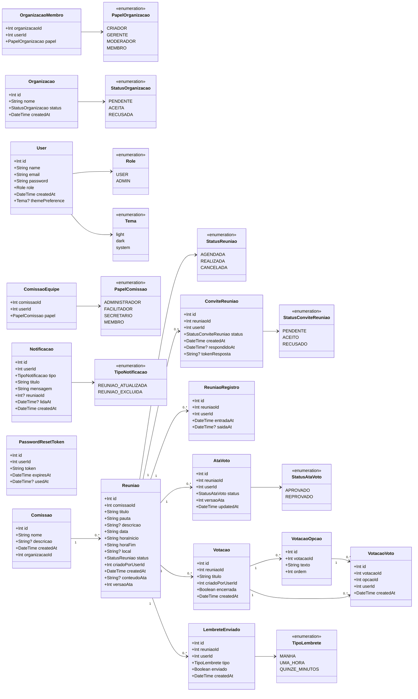

> Entrega final (AF) · Ata, comissões e presença · Versão 1.0 · 27/11/2026.
> Código auditado: `feature/refatoracao-ultima-entrega`, commit <code>614734c</code>. Responsável pela revisão acadêmica: [responsável a informar].
> Estado: implementado, salvo ressalvas expressas. Verificação documental por leitura do código; não equivale à aprovação do professor.

## Atualização: ata, comissões e presença

[Consultar o recorte atualizado, diagramas e dicionários da entrega final](https://github.com/MiguelIFSP/BRTPDS2-PROJETO-E-DESENVOLVIMENTO-DE-SISTEMAS-2/wiki/Dados-%E2%80%90-Ata-Comiss%C3%B5es-e-Presen%C3%A7a). O conteúdo anterior permanece abaixo; para estes três módulos, utilizar o recorte auditado no commit 614734c.

# Diagrama de classes do schema.prisma

## Observações

- A modelagem relacional já representa as associações por meio de chaves estrangeiras e tabelas de junção.
- `OrganizacaoMembro` atua como entidade associativa entre `User` e `Organizacao`.
- `ComissaoEquipe` atua como entidade associativa entre `User` e `Comissao`.
- `PasswordResetToken` guarda tokens temporários para recuperação de senha.
- `Reuniao` pertence a uma `Comissao` e guarda também o texto da ata (`conteudoAta`) e a sua versão (`versaoAta`). `AtaVoto` registra, por pessoa, a aprovação ou reprovação da ata e a versão votada.
- `ConviteReuniao` registra o convite de cada participante e a resposta. `ReuniaoRegistro` registra a entrada e a saída de cada pessoa na reunião (histórico de reuniões).
- `Votacao`, `VotacaoOpcao` e `VotacaoVoto` representam as votações de opções de uma reunião, com um voto por pessoa em cada votação.
- `Notificacao` e `LembreteEnviado` registram os avisos e lembretes de reunião enviados aos usuários.
- `User` e `Reuniao` têm relações adicionais com as demais tabelas pelas chaves estrangeiras (`userId`, `reuniaoId`, `criadoPorUserId`); o diagrama mostra as associações entre os conceitos principais, sem repetir cada chave.
- O diagrama mostra os conceitos principais do domínio, sem redundância com as relações já existentes no banco.
