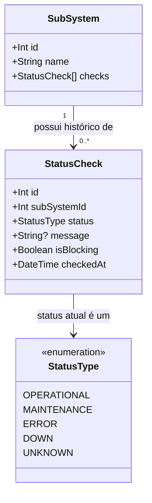
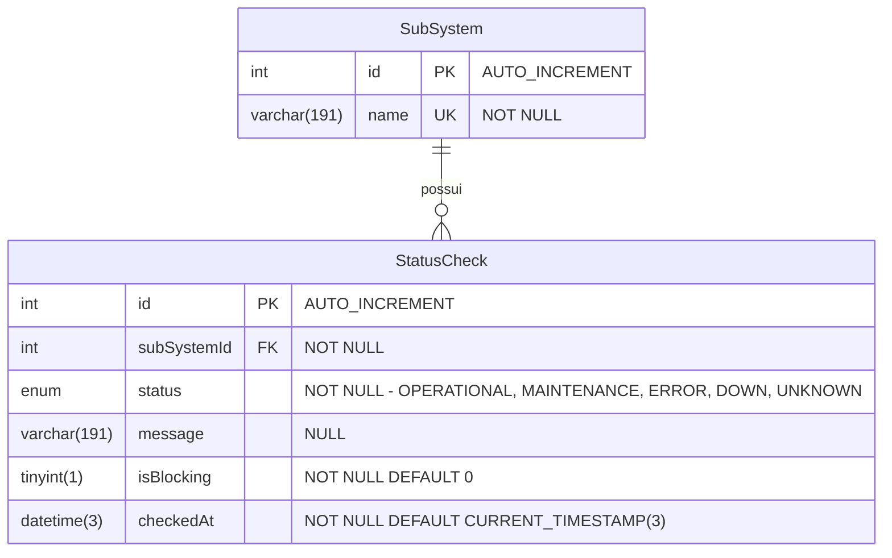
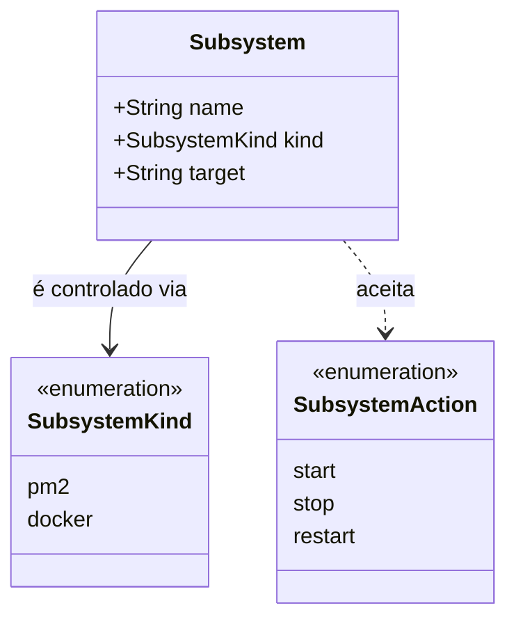
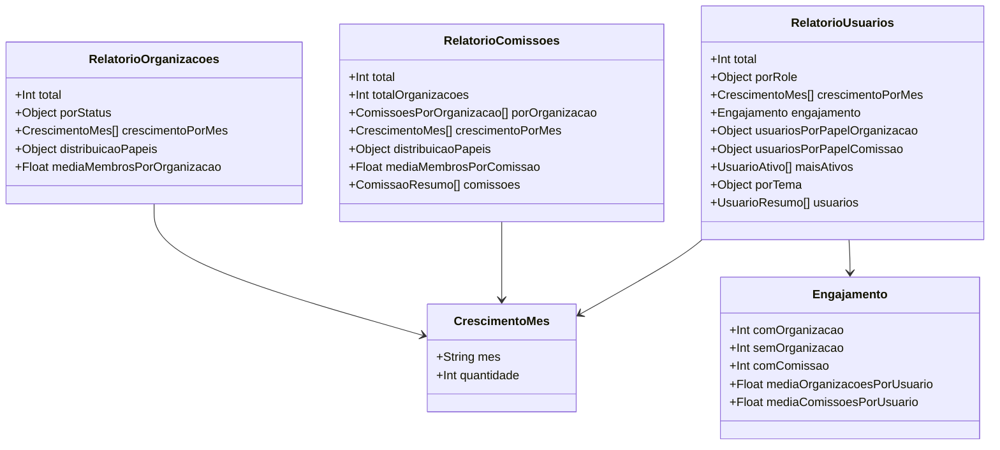

> Entrega final (AF) · Ata, comissões e presença · Versão 1.0 · 27/11/2026.
> Código auditado: `feature/refatoracao-ultima-entrega`, commit <code>614734c</code>. Responsável pela revisão acadêmica: [responsável a informar].
> Estado: implementado, salvo ressalvas expressas. Verificação documental por leitura do código; não equivale à aprovação do professor.

## Atualização: ata, comissões e presença

[Consultar o recorte atualizado, diagramas e dicionários da entrega final](https://github.com/MiguelIFSP/BRTPDS2-PROJETO-E-DESENVOLVIMENTO-DE-SISTEMAS-2/wiki/Dados-%E2%80%90-Ata-Comiss%C3%B5es-e-Presen%C3%A7a). O conteúdo anterior permanece abaixo; para estes três módulos, utilizar o recorte auditado no commit 614734c.

# Dicionário de Dados

Diagramas de classes, diagramas relacionais e dicionários de dados, organizados por requisito. O modelo principal da Data API (usuários, organizações, comissões) está no [Diagrama de Classes](https://github.com/MiguelIFSP/BRTPDS2-PROJETO-E-DESENVOLVIMENTO-DE-SISTEMAS-2/wiki/Diagrama-de-Classes).

* [Informações do Sistema — Status do Sistema e dos Subsistemas](#informações-do-sistema--status-do-sistema-e-dos-subsistemas-api-de-monitoramento) ([RF09](https://github.com/MiguelIFSP/BRTPDS2-PROJETO-E-DESENVOLVIMENTO-DE-SISTEMAS-2/wiki/RF09))
* [Informações do Sistema — Reinicialização de Subsistemas, Setup Inicial e Reset](#informações-do-sistema--reinicialização-de-subsistemas-setup-inicial-e-reset-api-de-gestão-e-infraestrutura) ([RF11](https://github.com/MiguelIFSP/BRTPDS2-PROJETO-E-DESENVOLVIMENTO-DE-SISTEMAS-2/wiki/RF11), [RF12](https://github.com/MiguelIFSP/BRTPDS2-PROJETO-E-DESENVOLVIMENTO-DE-SISTEMAS-2/wiki/RF12), [RF13](https://github.com/MiguelIFSP/BRTPDS2-PROJETO-E-DESENVOLVIMENTO-DE-SISTEMAS-2/wiki/RF13))
* [Informações do Sistema — Relatórios](#informações-do-sistema--relatórios-de-usuários-organizações-e-comissões-data-api) ([RF10](https://github.com/MiguelIFSP/BRTPDS2-PROJETO-E-DESENVOLVIMENTO-DE-SISTEMAS-2/wiki/RF10))
* [Ata de reunião](#ata-de-reunião-rf16) (RF16)
* [Votações](#votações-rf17) (RF17)
* [Histórico de reuniões](#histórico-de-reuniões-rf18) (RF18)
* [Manual de utilização](#manual-de-utilização-rf19) (RF19)

---

## Informações do Sistema — Status do Sistema e dos Subsistemas (API de Monitoramento)

Modelo de dados da `monitoring-better-meet`, definido em `monitoring-better-meet/prisma/schema.prisma`. Duas entidades: `SubSystem` (um por sistema monitorado) e `StatusCheck` (um registro por checagem realizada, histórico imutável).

### Diagrama de Classes

### Diagrama Relacional (MySQL)

Banco `monitoring` (container `mysql_monitoring_better_meet_dev`, MySQL 8.4, `utf8mb4_unicode_ci`). Os nomes de tabelas e colunas abaixo são os nomes reais no banco — o Prisma não usa `@map`, então tabelas ficam em PascalCase e colunas em camelCase.

**Restrições e índices (nomes reais no banco)**:

| Tabela | Nome | Tipo | Colunas | Regra |
|---|---|---|---|---|
| `SubSystem` | `PRIMARY` | PK | `id` | — |
| `SubSystem` | `SubSystem_name_key` | UNIQUE | `name` | — |
| `StatusCheck` | `PRIMARY` | PK | `id` | — |
| `StatusCheck` | `StatusCheck_subSystemId_checkedAt_idx` | Índice composto | `subSystemId`, `checkedAt` | Otimiza as consultas de relatório diário e histórico, que sempre filtram por subsistema e por intervalo de data |
| `StatusCheck` | `StatusCheck_subSystemId_fkey` | FK → `SubSystem.id` | `subSystemId` | `ON DELETE CASCADE ON UPDATE CASCADE` |

**Regra de integridade**: por causa do `ON DELETE CASCADE`, se um `SubSystem` for removido, todo o histórico de checagens associado é removido junto (não há hoje um endpoint que remova `SubSystem`, mas a regra está definida no schema por segurança).

### Dicionário de Dados

#### Entidade: `SubSystem`

Representa um sistema monitorado. Criado automaticamente (*upsert*) na primeira vez que reporta um status — não há endpoint de cadastro manual. No setup inicial (`start-all.ps1`), os 6 subsistemas conhecidos são criados com um registro `UNKNOWN` ("Registro inicial (seed via start-all.ps1)"), seguido da checagem real de cada um.

| Atributo | Tipo | Tamanho / Domínio | Obrigatório | Chave | Descrição |
|---|---|---|---|---|---|
| `id` | Int (`int`) | autoincrement | Sim | PK | Identificador único, gerado pelo banco |
| `name` | String (`varchar(191)`) | até 191 caracteres, único | Sim | UK | Nome do subsistema. Valores em uso hoje: `database`, `data-api`, `mobile-app`, `monitoring-database`, `management`, `monitoring` |

#### Entidade: `StatusCheck`

Representa **uma checagem de status** de um `SubSystem`, em um instante específico. Cada checagem (automática pelo cron ou reportada por um serviço externo) gera um novo registro — a tabela nunca é atualizada (`UPDATE`), só recebe inserções, formando o histórico.

| Atributo | Tipo | Tamanho / Domínio | Obrigatório | Chave | Descrição |
|---|---|---|---|---|---|
| `id` | Int (`int`) | autoincrement | Sim | PK | Identificador único da checagem |
| `subSystemId` | Int (`int`) | — | Sim | FK → `SubSystem.id` | Subsistema ao qual essa checagem pertence |
| `status` | Enum (`StatusType`, `enum` no MySQL) | `OPERATIONAL`, `MAINTENANCE`, `ERROR`, `DOWN`, `UNKNOWN` | Sim | — | Resultado da checagem. Ver semântica abaixo |
| `message` | String (`varchar(191)`) | até 191 caracteres | Não | — | Mensagem de contexto (ex.: mensagem de erro, motivo da manutenção) |
| `isBlocking` | Boolean (`tinyint(1)`) | `true` / `false` | Sim (default `false`) | — | Diferencia um erro que impediu o usuário de completar uma ação essencial (`true`) de um erro genérico sem contexto (`false`) |
| `checkedAt` | DateTime (`datetime(3)`) | timestamp com milissegundos | Sim (default `now()`) | — | Data/hora em que a checagem foi realizada/registrada, gravada em UTC. Nos agrupamentos por dia (relatório diário e histórico), o dia é calculado no fuso `America/Sao_Paulo` (RNF38) |

#### Domínio: `StatusType` (enum)

| Valor | Severidade | Significado |
|---|---|---|
| `DOWN` | 4 (mais grave) | Sistema indisponível de verdade — é o que o cron grava quando uma checagem automática falha (timeout, conexão recusada, etc.) |
| `ERROR` | 3 | Erro capturado, mas o sistema não está necessariamente indisponível (ex.: erro no app mobile reportado pelo próprio usuário) |
| `MAINTENANCE` | 2 | Sistema em manutenção programada |
| `UNKNOWN` | 1 | Status desconhecido (ex.: nenhuma checagem registrada ainda para aquele subsistema/dia) |
| `OPERATIONAL` | 0 (menos grave) | Sistema funcionando normalmente |

A severidade é usada para calcular o **"pior status do dia"** (`worstStatus`) nos relatórios de histórico — evita que um erro no meio do dia seja mascarado por um status bom registrado no fim do dia.

---

## Informações do Sistema — Reinicialização de Subsistemas, Setup Inicial e Reset (API de Gestão e Infraestrutura)

Diferente da `monitoring-better-meet`, a `management-better-meet` **não possui banco de dados próprio** (ver RNF24 em [Requisitos](https://github.com/MiguelIFSP/BRTPDS2-PROJETO-E-DESENVOLVIMENTO-DE-SISTEMAS-2/wiki/Requisitos)) — é uma camada de orquestração sem estado: autenticação é validada via JWT compartilhado com a Data API, e status é sempre delegado à API de Monitoramento. Por isso, **o diagrama relacional não se aplica aqui** — o que existe é uma estrutura fixa em memória (a whitelist de subsistemas controláveis, definida no código, não numa tabela).

### Diagrama de Classes (modelo de domínio)

### Diagrama Relacional

Não aplicável — sem banco de dados próprio (ver justificativa acima e RNF24).

### Dicionário de Dados (whitelist de subsistemas, em memória — `SUBSYSTEMS`)

| Nome (`:name`) | `kind` | `target` real | Descrição |
|---|---|---|---|
| `api` | `pm2` | `api` | Data API (Node/Express), processo PM2 |
| `monitoring` | `pm2` | `monitoring` | API de Monitoramento, processo PM2 |
| `management` | `pm2` (caso especial) | `management` | A própria API de Gestão — self-restart com resposta `202` antes do comando ([RF11](https://github.com/MiguelIFSP/BRTPDS2-PROJETO-E-DESENVOLVIMENTO-DE-SISTEMAS-2/wiki/RF11)) |
| `database` | `docker` | `mysql_better_meet_dev` | Container MySQL da aplicação (porta 3306) |
| `monitoring-database` | `docker` | `mysql_monitoring_better_meet_dev` | Container MySQL da monitoring (porta 3307) |

### Domínio: `SubsystemAction` (enum)

| Valor | Efeito via PM2 | Efeito via Docker |
|---|---|---|
| `start` | `pm2.start(nome)` | `container.start()` |
| `stop` | `pm2.stop(nome)` | `container.stop()` |
| `restart` | `pm2.restart(nome)` | `container.restart()` |

### Dicionário de Dados (volumes persistentes — `docker-compose.yml`)

Os dados dos dois bancos não ficam dentro dos containers, e sim em **volumes Docker nomeados**. É isso que permite recriar containers sem perder dados e é a base do backup e do reset do sistema ([RF13](https://github.com/MiguelIFSP/BRTPDS2-PROJETO-E-DESENVOLVIMENTO-DE-SISTEMAS-2/wiki/RF13)).

| Volume (nome no compose) | Nome real no Docker¹ | Container | Serviço do compose | Ponto de montagem | Conteúdo |
|---|---|---|---|---|---|
| `db_better_meet_data` | `sistema_db_better_meet_data` | `mysql_better_meet_dev` | `db_better_meet` | `/var/lib/mysql` | Banco `bettermeet` da aplicação: usuários, organizações, membros, comissões, equipes, tokens de recuperação, reuniões, convites, registros de presença, notificações e lembretes enviados, além do histórico de migrations do Prisma (`_prisma_migrations`) |
| `db_monitoring_better_meet_data` | `sistema_db_monitoring_better_meet_data` | `mysql_monitoring_better_meet_dev` | `db_monitoring` | `/var/lib/mysql` | Banco `monitoring`: subsistemas e todo o histórico de checagens de status |

¹ O Docker Compose prefixa o nome do volume com o nome do projeto, que por padrão é a pasta do `docker-compose.yml` (`sistema`). Conferir com `docker volume ls` antes de um backup ou remoção.

| Operação | Comando (na pasta `sistema`) | Efeito sobre os dados |
|---|---|---|
| Parar os bancos | `docker compose stop` | Nenhum — containers e volumes preservados |
| Remover só os containers | `docker compose down` | Nenhum — volumes preservados; `start-all.ps1` recria os containers com os dados anteriores |
| Reset completo | `docker compose down -v` | **Apaga** os dois volumes — todos os dados da aplicação e do monitoramento são perdidos |
| Backup de um volume | `docker run --rm -v <volume>:/data -v ${PWD}/backup:/backup alpine tar czf /backup/<volume>.tar.gz -C /data .` | Nenhum — gera um `.tar.gz` com o conteúdo do volume (fazer com o container parado) |
| Restauração de um volume | `docker run --rm -v <volume>:/data -v ${PWD}/backup:/backup alpine sh -c "rm -rf /data/* && tar xzf /backup/<volume>.tar.gz -C /data"` | Substitui o conteúdo do volume pelo backup (container parado, mesma versão `mysql:8.4.0`) |

---

## Informações do Sistema — Relatórios de Usuários, Organizações e Comissões (Data API)

Os relatórios **não possuem entidade nem tabela própria** — são calculados a cada requisição a partir das entidades da Data API (`User`, `Organizacao`, `OrganizacaoMembro`, `Comissao`, `ComissaoEquipe`, descritas no [Diagrama de Classes](https://github.com/MiguelIFSP/BRTPDS2-PROJETO-E-DESENVOLVIMENTO-DE-SISTEMAS-2/wiki/Diagrama-de-Classes)). Por isso, **o diagrama relacional não se aplica** a esta parte; o que se documenta aqui é a estrutura das respostas. Todas as rotas ficam sob o prefixo `/api` da Data API.

A única gravação desta parte é a alteração de perfil ([RF10](https://github.com/MiguelIFSP/BRTPDS2-PROJETO-E-DESENVOLVIMENTO-DE-SISTEMAS-2/wiki/RF10)), que atualiza a coluna `User.role` já existente — ver "Alteração de perfil" no fim desta seção.

### Diagrama de Classes (estrutura das respostas)

### Diagrama Relacional

Não aplicável — relatórios calculados sob demanda, sem persistência própria (ver RNF33 em [Requisitos](https://github.com/MiguelIFSP/BRTPDS2-PROJETO-E-DESENVOLVIMENTO-DE-SISTEMAS-2/wiki/Requisitos)).

### Dicionário de Dados

#### Relatório de organizações — `GET /api/organizacoes/relatorio` (admin) e `GET /api/organizacoes/relatorio/minhas` (membro)

| Campo | Tipo | Domínio | Origem / Regra de cálculo |
|---|---|---|---|
| `total` | Int | ≥ 0 | Quantidade de organizações consideradas (todas, ou aquelas em que o usuário é membro) |
| `porStatus` | Objeto | chaves `PENDENTE`, `ACEITA`, `RECUSADA` | Contagem de `Organizacao.status` |
| `crescimentoPorMes` | Lista de `{ mes, quantidade }` | 12 itens, `mes` no formato `YYYY-MM` | Organizações por mês de `createdAt`, últimos 12 meses no fuso de Brasília (`America/Sao_Paulo`), meses sem registro com `0` |
| `distribuicaoPapeis` | Objeto | chaves `CRIADOR`, `GERENTE`, `MODERADOR`, `MEMBRO` | Contagem de `OrganizacaoMembro.papel`, **só em organizações `ACEITA`** |
| `mediaMembrosPorOrganizacao` | Float | ≥ 0 | Total de membros ÷ número de organizações `ACEITA` (0 se não houver nenhuma) |

#### Relatório de comissões — `GET /api/comissoes/relatorio` (admin) e `GET /api/comissoes/relatorio/minhas` (membro)

| Campo | Tipo | Domínio | Origem / Regra de cálculo |
|---|---|---|---|
| `total` | Int | ≥ 0 | Quantidade de comissões consideradas (todas, ou aquelas em cuja equipe o usuário está) |
| `totalOrganizacoes` | Int | ≥ 0 | Número de organizações distintas às quais essas comissões pertencem |
| `porOrganizacao` | Lista de `{ organizacaoId, nome, quantidade }` | — | Comissões agrupadas por `Comissao.organizacaoId`, da maior para a menor quantidade |
| `crescimentoPorMes` | Lista de `{ mes, quantidade }` | 12 itens, `YYYY-MM` | Comissões por mês de `createdAt`, últimos 12 meses no fuso de Brasília |
| `distribuicaoPapeis` | Objeto | chaves `ADMINISTRADOR`, `FACILITADOR`, `SECRETARIO`, `MEMBRO` | Contagem de `ComissaoEquipe.papel` |
| `mediaMembrosPorComissao` | Float | ≥ 0 | Total de membros de equipe ÷ número de comissões (0 se não houver nenhuma) |
| `comissoes` | Lista de `{ id, nome, descricao, createdAt, organizacao { id, nome }, membros }` | — | Da mais recente para a mais antiga; `membros` = tamanho da equipe. Continua na resposta, mas o app não a exibe mais no relatório: a lista fica na aba Comissões, aberta pelo atalho "Ver comissões" |

#### Relatório de usuários — `GET /api/usuarios/relatorio` (somente admin)

| Campo | Tipo | Domínio | Origem / Regra de cálculo |
|---|---|---|---|
| `total` | Int | ≥ 0 | Quantidade de usuários cadastrados |
| `porRole` | Objeto | chaves `ADMIN`, `USER` | Contagem de `User.role` |
| `crescimentoPorMes` | Lista de `{ mes, quantidade }` | 12 itens, `YYYY-MM` | Cadastros por mês de `User.createdAt`, últimos 12 meses no fuso de Brasília |
| `engajamento.comOrganizacao` / `semOrganizacao` | Int | ≥ 0 | Usuários com / sem pelo menos um vínculo em `OrganizacaoMembro` |
| `engajamento.comComissao` | Int | ≥ 0 | Usuários com pelo menos um vínculo em `ComissaoEquipe` |
| `engajamento.mediaOrganizacoesPorUsuario` / `mediaComissoesPorUsuario` | Float | ≥ 0 | Total de vínculos ÷ total de usuários |
| `usuariosPorPapelOrganizacao` | Objeto | chaves `CRIADOR`, `GERENTE`, `MODERADOR` | Usuários distintos que têm o papel em pelo menos uma organização (cada usuário conta uma vez por papel) |
| `usuariosPorPapelComissao` | Objeto | chaves `ADMINISTRADOR`, `FACILITADOR`, `SECRETARIO` | Idem, para papéis em comissões |
| `maisAtivos` | Lista de `{ id, name, organizacoes, comissoes }` | até 5 itens | Usuários com pelo menos um vínculo, ordenados pela soma de organizações + comissões |
| `porTema` | Objeto | chaves `light`, `dark`, `system` | Contagem de `User.themePreference`; nulo ou valor desconhecido conta como `system` |
| `usuarios` | Lista de `{ id, name, email, role, createdAt, organizacoes[], comissoes[] }` | — | Todos os usuários (mais recentes primeiro), cada vínculo com `{ id, nome, papel }`. **Não inclui** o hash da senha. É a fonte da tela "Usuários" (atalho "Ver todos os usuários"), onde o administrador vê os detalhes de cada pessoa e altera o perfil ([RF10](https://github.com/MiguelIFSP/BRTPDS2-PROJETO-E-DESENVOLVIMENTO-DE-SISTEMAS-2/wiki/RF10)) |

#### Alteração de perfil — `PATCH /api/usuarios/:id/role` (somente admin)

Não cria entidade nova: atualiza `User.role` (enum `Role`, descrito no [Diagrama de Classes](https://github.com/MiguelIFSP/BRTPDS2-PROJETO-E-DESENVOLVIMENTO-DE-SISTEMAS-2/wiki/Diagrama-de-Classes)).

**Requisição**

| Campo | Onde | Tipo | Domínio | Obrigatório | Regra |
|---|---|---|---|---|---|
| `id` | parâmetro da rota | Int | > 0 | Sim | Usuário que terá o perfil alterado. Não pode ser o próprio administrador que faz o pedido (`403`) |
| `role` | corpo (JSON) | Enum `Role` | `ADMIN`, `USER` | Sim | Novo perfil. Valor fora do domínio → `400` "Perfil inválido. Use: ADMIN ou USER." |

**Resposta `200`**: o usuário atualizado com os campos públicos (sem `password`).

**Regras de integridade**

| Regra | Resposta | Como é garantida |
|---|---|---|
| Ninguém altera o próprio perfil | `403` | Comparação entre o `id` do token e o `id` da rota, antes de abrir a transação |
| Sempre existe pelo menos um `ADMIN` | `409` | Ao rebaixar um `ADMIN`, conta os outros `ADMIN` **na mesma transação** da gravação |
| Usuário inexistente | `404` | Busca do usuário dentro da transação |
| Perfil vale na próxima requisição | — | O `requireAuth` da Data API lê `User.role` no banco a cada requisição, e não o `role` gravado no token (RNF39) |

---

## Ata de reunião (RF16)

Este material foi entregue fora do repositório por solicitação de 2026-11-13. Não constitui um segundo modelo oficial do projeto. Ao unificar, preservar os identificadores e confrontar o restante do modelo com o código do respectivo cabeçalho. O DER da ata está em [Diagramas/DER-Ata-Reuniao.puml](https://github.com/MiguelIFSP/BRTPDS2-PROJETO-E-DESENVOLVIMENTO-DE-SISTEMAS-2/blob/main/documentos/entrega4_Di3/Diagramas/DER-Ata-Reuniao.puml) e [.svg](https://github.com/MiguelIFSP/BRTPDS2-PROJETO-E-DESENVOLVIMENTO-DE-SISTEMAS-2/wiki/images/DER-Ata-Reuniao.svg).

### 1. Evidência e limites

**Implementado:** sete modelos Prisma e suas migrations, com 44 colunas escalares no recorte. **Não verificado:** estrutura física aplicada no MySQL; a tentativa de conexão na inspeção retornou ECONNREFUSED. Nenhuma execução de teste ou aplicação de migration é afirmada nesta revisão.

As migrations descrevem a estrutura pretendida no banco principal. Existem histórico de db push/baseline e CREATE TABLE IF NOT EXISTS; ler esses arquivos não demonstra que um banco existente recebeu cada alteração. Não foram inventados nome de database, índices implícitos, tabelas de cache ou FK entre bancos. Nenhuma tabela planejada é misturada às implementadas.

Fontes SQL inspecionadas, todas sob sistema/api/prisma/migrations:

- [20260918235817_config_usuario/migration.sql](https://github.com/MiguelIFSP/BRTPDS2-PROJETO-E-DESENVOLVIMENTO-DE-SISTEMAS-2/blob/945419d84dd6a3dd32aacab736f32f9c7ed806f5/sistema/api/prisma/migrations/20260918235817_config_usuario/migration.sql).
- [20260922140000_papeis_organizacao/migration.sql](https://github.com/MiguelIFSP/BRTPDS2-PROJETO-E-DESENVOLVIMENTO-DE-SISTEMAS-2/blob/945419d84dd6a3dd32aacab736f32f9c7ed806f5/sistema/api/prisma/migrations/20260922140000_papeis_organizacao/migration.sql).
- [20261014120000_alinha_schema_atual/migration.sql](https://github.com/MiguelIFSP/BRTPDS2-PROJETO-E-DESENVOLVIMENTO-DE-SISTEMAS-2/blob/945419d84dd6a3dd32aacab736f32f9c7ed806f5/sistema/api/prisma/migrations/20261014120000_alinha_schema_atual/migration.sql).
- [20261014120100_adiciona_enums_status_tema/migration.sql](https://github.com/MiguelIFSP/BRTPDS2-PROJETO-E-DESENVOLVIMENTO-DE-SISTEMAS-2/blob/945419d84dd6a3dd32aacab736f32f9c7ed806f5/sistema/api/prisma/migrations/20261014120100_adiciona_enums_status_tema/migration.sql).
- [20261021120000_registra_tabelas_reuniao/migration.sql](https://github.com/MiguelIFSP/BRTPDS2-PROJETO-E-DESENVOLVIMENTO-DE-SISTEMAS-2/blob/945419d84dd6a3dd32aacab736f32f9c7ed806f5/sistema/api/prisma/migrations/20261021120000_registra_tabelas_reuniao/migration.sql).
- [20261021120100_registro_entrada_reuniao/migration.sql](https://github.com/MiguelIFSP/BRTPDS2-PROJETO-E-DESENVOLVIMENTO-DE-SISTEMAS-2/blob/945419d84dd6a3dd32aacab736f32f9c7ed806f5/sistema/api/prisma/migrations/20261021120100_registro_entrada_reuniao/migration.sql).
- [20261023120000_local_reuniao/migration.sql](https://github.com/MiguelIFSP/BRTPDS2-PROJETO-E-DESENVOLVIMENTO-DE-SISTEMAS-2/blob/945419d84dd6a3dd32aacab736f32f9c7ed806f5/sistema/api/prisma/migrations/20261023120000_local_reuniao/migration.sql).
- [20261109140000_ata_reuniao/migration.sql](https://github.com/MiguelIFSP/BRTPDS2-PROJETO-E-DESENVOLVIMENTO-DE-SISTEMAS-2/blob/945419d84dd6a3dd32aacab736f32f9c7ed806f5/sistema/api/prisma/migrations/20261109140000_ata_reuniao/migration.sql).

O recorte não representa todas as tabelas da plataforma. OrganizacaoMembro, ConviteReuniao, Votacao e outros modelos têm funções próprias; não substituem ComissaoEquipe, ReuniaoRegistro ou AtaVoto. A FK antiga de Organizacao.solicitanteId foi removida em 20260922140000 e não deve ser reintroduzida na unificação.

### 2. Diagrama de classes

**Tipo: modelo de persistência Prisma**, não classes de implementação TypeScript. Campos são atributos escalares, sem métodos inventados. Associações representam relações Prisma e a FK correspondente. Não há fundamento para desenhar composição, agregação ou herança entre esses modelos ou entre papéis humanos.

[Fonte PlantUML](https://github.com/MiguelIFSP/BRTPDS2-PROJETO-E-DESENVOLVIMENTO-DE-SISTEMAS-2/blob/main/documentos/entrega4_Di3/Diagramas/DC-Ata-Reuniao.puml).

| Model | Responsabilidade no recorte | Estado |
|---|---|---|
| User | Identidade persistida consultada na autenticação; alvo dos vínculos de comissão, autoria, presença e voto | Implementado |
| Organizacao | Contexto da comissão; seu status não é condição direta de loadAccess | Implementado |
| Comissao | Agrupa equipe e reuniões; fornece o escopo de autorização | Implementado |
| ComissaoEquipe | Vínculo atual da pessoa com a comissão e PapelComissao usado pelo RBAC | Implementado |
| Reuniao | Guarda HTML atual e versão, além dos metadados da reunião | Implementado |
| ReuniaoRegistro | Registro único de entrada/saída por reunião/pessoa; saída não revoga acesso à ata | Implementado |
| AtaVoto | Escolha individual da versão atual; alterada por upsert e apagada quando o HTML normalizado muda | Implementado |

#### 2.1 Enums

Enums abaixo são os tipos dos atributos do recorte. Não representam hierarquia entre atores.

| Enum | Valores exatos | Uso |
|---|---|---|
| Role | USER, ADMIN | User.role |
| Tema | light, dark, system | User.themePreference |
| StatusOrganizacao | PENDENTE, ACEITA, RECUSADA | Organizacao.status |
| PapelComissao | ADMINISTRADOR, FACILITADOR, SECRETARIO, MEMBRO | ComissaoEquipe.papel |
| StatusReuniao | AGENDADA, REALIZADA, CANCELADA | Reuniao.status |
| StatusAtaVoto | APROVADO, REPROVADO | AtaVoto.status |

#### 2.2 Relacionamentos e integridade

Todos os filhos têm exatamente um pai em cada FK desta tabela; cada pai pode ter zero ou muitos filhos. Exclusão em cascata não significa composição UML presumida.

| FK física | Filho.coluna → Pai.coluna | Cardinalidade pai/filho | ON DELETE | ON UPDATE | Evidência |
|---|---|---|---|---|---|
| Comissao_organizacaoId_fkey | Comissao.organizacaoId → Organizacao.id | 1 : 0..* | CASCADE | CASCADE | Schema e migration da tabela |
| ComissaoEquipe_comissaoId_fkey | ComissaoEquipe.comissaoId → Comissao.id | 1 : 0..* | CASCADE | CASCADE | Schema e migration da tabela |
| ComissaoEquipe_userId_fkey | ComissaoEquipe.userId → User.id | 1 : 0..* | CASCADE | CASCADE | Schema e migration da tabela |
| Reuniao_comissaoId_fkey | Reuniao.comissaoId → Comissao.id | 1 : 0..* | CASCADE | CASCADE | Schema e migration da tabela |
| Reuniao_criadoPorUserId_fkey | Reuniao.criadoPorUserId → User.id | 1 : 0..* | RESTRICT | CASCADE | Schema e migration da tabela |
| ReuniaoRegistro_reuniaoId_fkey | ReuniaoRegistro.reuniaoId → Reuniao.id | 1 : 0..* | CASCADE | CASCADE | Schema e migration da tabela |
| ReuniaoRegistro_userId_fkey | ReuniaoRegistro.userId → User.id | 1 : 0..* | CASCADE | CASCADE | Schema e migration da tabela |
| AtaVoto_reuniaoId_fkey | AtaVoto.reuniaoId → Reuniao.id | 1 : 0..* | CASCADE | CASCADE | Schema e migration da tabela |
| AtaVoto_userId_fkey | AtaVoto.userId → User.id | 1 : 0..* | CASCADE | CASCADE | Schema e migration da tabela |

A UK de AtaVoto é (reuniaoId,userId), e não (reuniaoId,userId,versaoAta). Não há histórico de votação por versão. Nenhuma FK liga AtaVoto a ComissaoEquipe ou ReuniaoRegistro; a API valida vínculo/presença antes de votar. Também não há FK entre AtaVoto.versaoAta e Reuniao.versaoAta: a coerência depende de loadAccess, comparação de versão, updateMany condicional e transação.

A contagem em present seleciona os votos da versão atual; não refiltra vínculo atual dos votantes. Um ex-integrante não pode fazer nova requisição, mas um voto já registrado pode continuar no total até a edição apagar os votos.

### 3. Dicionário de dados

**Estado das definições: Implementado no schema/migrations. Estado do banco aplicado: Não verificado.**

Nomes físicos coincidem com os models/campos; não há @@map/@map neste recorte. Os CREATE TABLE lidos declaram utf8mb4 e utf8mb4_unicode_ci. “Sem default explícito” para coluna anulável descreve o DDL, não exige que Prisma envie null. Os limites de API não são automaticamente limites SQL.

#### User (7 colunas)

| Coluna física | Tipo físico MySQL | Tipo lógico Prisma | Nula? | Default / geração | Chave | Domínio e descrição |
|---|---|---|---|---|---|---|
| id | INTEGER | Int | Não | AUTO_INCREMENT | PK | Inteiro gerado; identidade da pessoa. |
| name | VARCHAR(191) | String | Não | Sem default | — | Nome; campo de cadastro, não retornado pelo DTO da ata. |
| email | VARCHAR(191) | String | Não | Sem default | UK | E-mail de cadastro; consultado por requireAuth. |
| password | VARCHAR(191) | String | Não | Sem default | — | Credencial persistida; não selecionada pelas consultas da ata. O módulo não define seu algoritmo. |
| role | ENUM('USER','ADMIN') | Role | Não | 'USER' | — | Papel global; não concede edição de ata por si só. |
| createdAt | DATETIME(3) | DateTime | Não | CURRENT_TIMESTAMP(3) | — | Criação da pessoa. |
| themePreference | ENUM('light','dark','system') | Tema? | Sim | 'system' | — | Preferência visual; não participa do RBAC. |

#### Organizacao (4 colunas)

| Coluna física | Tipo físico MySQL | Tipo lógico Prisma | Nula? | Default / geração | Chave | Domínio e descrição |
|---|---|---|---|---|---|---|
| id | INTEGER | Int | Não | AUTO_INCREMENT | PK | Identificador da organização. |
| nome | VARCHAR(191) | String | Não | Sem default | — | Nome da organização. |
| status | ENUM('PENDENTE','ACEITA','RECUSADA') | StatusOrganizacao | Não | 'PENDENTE' | — | Estado da organização; ataService não o filtra. |
| createdAt | DATETIME(3) | DateTime | Não | CURRENT_TIMESTAMP(3) | — | Criação; acrescentada na migration de alinhamento. |

#### Comissao (5 colunas)

| Coluna física | Tipo físico MySQL | Tipo lógico Prisma | Nula? | Default / geração | Chave | Domínio e descrição |
|---|---|---|---|---|---|---|
| id | INTEGER | Int | Não | AUTO_INCREMENT | PK | Identificador da comissão. |
| nome | VARCHAR(191) | String | Não | Sem default | — | Nome da comissão. |
| descricao | VARCHAR(191) | String? | Sim | Sem default explícito | — | Descrição opcional. |
| createdAt | DATETIME(3) | DateTime | Não | CURRENT_TIMESTAMP(3) | — | Criação da comissão. |
| organizacaoId | INTEGER | Int | Não | Sem default | FK | Organizacao.id; contexto da comissão. |

#### ComissaoEquipe (3 colunas)

| Coluna física | Tipo físico MySQL | Tipo lógico Prisma | Nula? | Default / geração | Chave | Domínio e descrição |
|---|---|---|---|---|---|---|
| comissaoId | INTEGER | Int | Não | Sem default | PK composta; FK | Comissao.id; vínculo atual que autoriza acesso. |
| userId | INTEGER | Int | Não | Sem default | PK composta; FK | User.id; cada pessoa aparece uma vez por comissão. |
| papel | ENUM('ADMINISTRADOR','FACILITADOR','SECRETARIO','MEMBRO') | PapelComissao | Não | 'MEMBRO' | — | Administrador e Secretário da comissão editam; os quatro papéis podem consultar, votar e exportar com as demais pré-condições. |

#### Reuniao (14 colunas)

| Coluna física | Tipo físico MySQL | Tipo lógico Prisma | Nula? | Default / geração | Chave | Domínio e descrição |
|---|---|---|---|---|---|---|
| id | INTEGER | Int | Não | AUTO_INCREMENT | PK | Identificador usado no parâmetro :id. |
| comissaoId | INTEGER | Int | Não | Sem default | FK; índice | Comissao.id; escopo do RBAC. |
| titulo | VARCHAR(191) | String | Não | Sem default | — | Título retornado na consulta e escapado no cabeçalho do PDF. |
| pauta | VARCHAR(191) | String | Não | Sem default | — | Pauta da reunião; distinta de conteudoAta. |
| descricao | VARCHAR(191) | String? | Sim | Sem default explícito | — | Descrição opcional; distinta da ata. |
| data | VARCHAR(191) | String | Não | Sem default | Índice | Data civil com contrato AAAA-MM-DD; SQL armazena texto, não DATE. PDF valida o padrão, não a existência da data no calendário. |
| horaInicio | VARCHAR(191) | String | Não | Sem default | — | Horário no contrato HH:mm; não é TIME físico. |
| horaFim | VARCHAR(191) | String | Não | Sem default | — | Horário final no contrato HH:mm; não é TIME físico. |
| local | VARCHAR(500) | String? | Sim | Sem default explícito | — | Endereço/link livre; nulidade preserva registros anteriores. Não integra o DTO da ata. |
| status | ENUM('AGENDADA','REALIZADA','CANCELADA') | StatusReuniao | Não | 'AGENDADA' | — | Estado da reunião; não existe estado final de aprovação da ata neste campo. ataService não filtra esse estado. |
| criadoPorUserId | INTEGER | Int | Não | Sem default | FK; índice | User.id; autor da reunião, sem permissão especial de edição da ata. |
| createdAt | DATETIME(3) | DateTime | Não | CURRENT_TIMESTAMP(3) | — | Criação da reunião. |
| conteudoAta | LONGTEXT | String? | Sim | Sem default explícito | — | Fragmento HTML do Rich Text sanitizado pela API: parágrafos, títulos, listas, marcas e tabelas permitidas. Nulo antes da primeira gravação; API exige texto visível e entrada até 50.000 caracteres. Não é VARCHAR(191), JSON ou PDF. |
| versaoAta | INTEGER | Int | Não | 0 | — | Versão lógica, inicialmente 0; API exige inteiro >= 0 e incrementa ao mudar o HTML normalizado. SQL não declara CHECK de não negatividade. |

#### ReuniaoRegistro (5 colunas)

| Coluna física | Tipo físico MySQL | Tipo lógico Prisma | Nula? | Default / geração | Chave | Domínio e descrição |
|---|---|---|---|---|---|---|
| id | INTEGER | Int | Não | AUTO_INCREMENT | PK | Identificador da presença. |
| reuniaoId | INTEGER | Int | Não | Sem default | FK; parte da UK | Reuniao.id; entrada precisa ser nesta reunião. |
| userId | INTEGER | Int | Não | Sem default | FK; parte da UK; índice | User.id; uma presença por pessoa/reunião. |
| entradaAt | DATETIME(3) | DateTime | Não | CURRENT_TIMESTAMP(3) | — | Momento de entrada; existência do registro é a condição usada por loadAccess. |
| saidaAt | DATETIME(3) | DateTime? | Sim | Sem default explícito | — | Momento de saída; não remove acesso à ata. |

#### AtaVoto (6 colunas)

| Coluna física | Tipo físico MySQL | Tipo lógico Prisma | Nula? | Default / geração | Chave | Domínio e descrição |
|---|---|---|---|---|---|---|
| id | INTEGER | Int | Não | AUTO_INCREMENT | PK | Identificador do voto. |
| reuniaoId | INTEGER | Int | Não | Sem default | FK; parte da UK | Reuniao.id; todos os votos são removidos quando o texto normalizado muda. |
| userId | INTEGER | Int | Não | Sem default | FK; parte da UK; índice | User.id; upsert usa reuniaoId_userId. |
| status | ENUM('APROVADO','REPROVADO') | StatusAtaVoto | Não | Sem default | — | Escolha individual; não é aprovação final da reunião. |
| versaoAta | INTEGER | Int | Não | Sem default | — | Versão avaliada; não participa da UK nem de FK. Consistência com Reuniao.versaoAta é conferida no serviço. |
| updatedAt | DATETIME(3) | DateTime | Não | Sem default SQL; Prisma @updatedAt | — | Atualização gerenciada pelo Prisma. A migration não declara DEFAULT CURRENT_TIMESTAMP nem ON UPDATE. |

#### 3.1 Conteúdo rico e versão

Reuniao.conteudoAta é **LONGTEXT**. Seu domínio lógico é um fragmento HTML, não um documento completo, texto simples ou caminho de PDF. A API valida entrada até 50.000 caracteres de HTML via Yup e depois exige texto visível após sanitização; tabela vazia, espaços e marcas sem texto não liberam a votação.

Tags permitidas: p, br, div, strong, b, em, i, u, s, strike, ul, ol, li, h1, h2, h3, blockquote, pre, code, span, table, thead, tbody, tfoot, tr, td e th. O sanitizador mantém somente text-align (left/center/right/justify) e font-size (10/13/16/18/24/32/48px) no style. Bordas usam data-ata-border; colspan/rowspan aceitam inteiros de 1 a 10. Recuo usa a estrutura HTML permitida, não um estilo margin arbitrário. A transformação normaliza font/align legados. A allowlist exata é a fonte ataHtml.ts, não uma obrigação de aceitar HTML arbitrário.

Reuniao.versaoAta inicia em 0. Salvar HTML normalizado diferente incrementa a versão e remove todos os AtaVoto da reunião na mesma callback de transação. Salvar o mesmo HTML mantém versão e votos. Versão enviada antiga ou updateMany.count igual a zero produz 409. A inspeção de callback e testes com mocks não comprova isolamento/rollback de um MySQL real.

#### 3.2 Chaves e índices

| Tabela | Nome/declaração verificada | Colunas | Tipo |
|---|---|---|---|
| User | PRIMARY | id | PK |
| User | User_email_key | email | UNIQUE |
| Organizacao | PRIMARY | id | PK |
| Comissao | PRIMARY | id | PK |
| ComissaoEquipe | PRIMARY | comissaoId, userId | PK composta |
| Reuniao | PRIMARY | id | PK |
| Reuniao | Reuniao_comissaoId_idx | comissaoId | INDEX |
| Reuniao | Reuniao_criadoPorUserId_idx | criadoPorUserId | INDEX |
| Reuniao | Reuniao_data_idx | data | INDEX |
| ReuniaoRegistro | PRIMARY | id | PK |
| ReuniaoRegistro | ReuniaoRegistro_reuniaoId_userId_key | reuniaoId, userId | UNIQUE |
| ReuniaoRegistro | ReuniaoRegistro_userId_idx | userId | INDEX |
| AtaVoto | PRIMARY | id | PK |
| AtaVoto | AtaVoto_reuniaoId_userId_key | reuniaoId, userId | UNIQUE |
| AtaVoto | AtaVoto_userId_idx | userId | INDEX |

Comissao.organizacaoId e ComissaoEquipe.userId são FKs sem índice secundário nomeado explicitamente nas migrations consultadas. Os índices físicos criados/exigidos pelo mecanismo do MySQL devem ser confirmados com SHOW INDEX; nomes **[A CONFIRMAR NO CÓDIGO]** e no banco aplicado. Não foi presumido um nome de índice igual ao nome da constraint.

### 4. Responsabilidades dos módulos da implementação

Os elementos desta tabela são funções, componentes ou objetos exportados. **Não são classes do diagrama.** Arquivos abaixo são relativos à raiz.

| Arquivo / elemento real | Responsabilidade e métodos relevantes | Persistência/efeito |
|---|---|---|
| sistema/api/src/middlewares/authMiddleware.ts — requireAuth | getToken, verifyToken, consulta User; compõe request.user e chama next | Leitura de User.role/email; identidade de sessão |
| sistema/api/src/middlewares/ataMiddleware.ts — requireAtaEditor | Chama ataService.assertCanEdit após parseId | Sem gravação; exige papel editor e presença |
| sistema/api/src/controllers/ataController.ts — ataController | getByReuniao(request,response), save(request,response), vote(request,response); valida payloads com Yup | Delegação ao serviço; response.json |
| sistema/api/src/services/ataService.ts — ataService | assertCanEdit(userId,reuniaoId), getByReuniao(userId,reuniaoId), save(userId,reuniaoId,conteudoAta,versaoAta), vote(userId,reuniaoId,status,versaoAta) | Transações, updateMany, deleteMany e upsert reais |
| Mesmo módulo — loadAccess, assertEditor, podeEditar, present, conflict | Helpers privados de acesso, DTO e versão | Consulta reunião, equipe, presença e votos |
| sistema/api/src/utils/ataHtml.ts | sanitizeAtaHtml(html), validateAtaHtml(html) | Transforma/valida conteúdo; sem tabela própria |
| sistema/better-meet/src/services/ataService.ts — ataService | getByReuniao(token,reuniaoId), save(token,reuniaoId,conteudoAta,versaoAta), vote(token,reuniaoId,status,versaoAta) | Chama apiRequest nas três rotas |
| sistema/better-meet/src/components/AtaReuniao.tsx — AtaReuniao | prepareSave, save, vote, handleExportPdf; estado local, controles e confirmações | Rascunho em memória; conteúdo salvo vem da API |
| sistema/better-meet/src/components/ata/AtaEditor.tsx e AtaEditor.web.tsx | Pell/WebView no nativo e Tiptap na web; handle getHtml | HTML em edição, sem tabela separada |
| sistema/better-meet/src/utils/ataPdfHtml.ts | buildAtaPdfHtml(input,pageMargin), escapeHtml | Template com título/data escapados, CSS e CSP; sem gravação |
| sistema/better-meet/src/utils/ataPdf.ts | exportAtaPdf(input) | Print gera base64; File escreve cache; Sharing usa file.uri |
| sistema/better-meet/src/utils/ataPdf.web.ts | exportAtaPdf(input) | Sanitiza, abre janela e chama preview.print(); sem API de PDF |

sanitizeAtaHtml e validateAtaHtml recebem html: string; a tabela resume as entradas e não declara assinatura TypeScript completa. O diagrama de classes não atribui esses métodos aos models Prisma.

### 5. Armazenamento fora do banco

| Dado | Armazenamento real | Ciclo de vida / restrição | Evidência |
|---|---|---|---|
| Ata carregada, versão, papel, voto próprio e totais | Estado React em AtaReuniaoScreen e props de AtaReuniao | Consulta ao focar/recarregar; não é cache SQL separado | app/(tabs)/(reunioes)/ata/[id].tsx |
| Rascunho HTML, dirty, confirmação, conflito, busy e flag de exportação | Estado/ref React e estado interno do editor | Não há autosave persistente do rascunho neste módulo; saída/reload pode descartá-lo após confirmação | AtaReuniao.tsx; AtaEditor*.tsx |
| Token e dados de sessão | Zustand persist com AsyncStorage no authStore | Armazenamento local de sessão; a API reconsulta identidade/papel. Não guardar exemplos reais no documento | store/authStore.ts |
| PDF nativo | File em Paths.cache com nome ata-<dataReuniao>-<Date.now()>.pdf | Base64 escrito e aguardado antes de compartilhar; arquivo permanece no cache, gerido pelo sistema operacional | utils/ataPdf.ts |
| Documento de impressão web | DOM de janela preview | Janela fechada após afterprint ou erro; o navegador gerencia destino/impressão | utils/ataPdf.web.ts |
| Presença de demonstração | Memória de useListaPresencaPreview | Não substitui ReuniaoRegistro nem concede acesso à ata | hooks/useListaPresencaPreview.ts |

A ata e o voto são persistidos apenas pelas rotas de ata. Compartilhar não grava registro de envio, destinatário, download ou arquivo PDF no banco. Não há base adicional afetada identificada neste módulo.

### 6. Rastreabilidade e pendências de unificação

| Parte | RF/RNF | UC | Evidência | Verificação vinculada |
|---|---|---|---|---|
| ComissaoEquipe + ReuniaoRegistro + User | RF16 | UC17–UC20 (PDF após consulta) | requireAuth e loadAccess | CT-RF16-02–06 |
| Reuniao.conteudoAta | RF16; RNF44 | UC17/UC18/UC20 | sanitizeAtaHtml, validateAtaHtml, schema/migration | CT-RF16-07–12; CT-RNF44-01/02 |
| Reuniao.versaoAta + AtaVoto | RF16; RNF45 | UC18/UC19 | save/vote e UK | CT-RF16-11–15; CT-RNF45-01–03 |
| Cache/DOM de PDF | RF16 | UC20 | exportAtaPdf nativo/web | CT-RF16-17–19 e manuais 21–23 |

- Unificar os sete models e seis enums com o modelo global, preservando nomes e associações que estiverem comprovados em sua baseline.
- Confirmar estrutura aplicada, índices implícitos, ações de FK e transações em MySQL isolado. **Não executado** nesta revisão.
- Diagrama de classes e dicionário foram entregues separadamente; sua incorporação oficial permanece **Planejada**.
- RNF44/RNF45 não são declarados aprovados a partir deste diagrama. Resultados e roteiros estão em testes_ata_reuniao.md da entrega local.
- Este pacote não inclui dados reais, tokens, senhas nem registros de participantes.

## Votações (RF17)

### Classes

**Tipo de modelo:** persistência Prisma. O diagrama mostra as três tabelas novas e só os campos de `Reuniao` e `User` usados na autorização. As outras relações desses models foram omitidas. `StatusConviteReuniao` não é coluna da votação: o service filtra `ConviteReuniao.status`.

Os models não têm métodos. Os módulos abaixo exportam objetos, não classes, e por isso ficam fora do desenho.

| Classe/modelo | Camada | Responsabilidade | Atributos e operações relevantes | Caminho no código |
|---|---|---|---|---|
| `Votacao` | Persistência | Uma votação de uma reunião | `titulo`, `encerrada`, `criadoPorUserId` | `schema.prisma` |
| `VotacaoOpcao` | Persistência | Texto escolhível, na ordem de criação | `texto`, `ordem` | `schema.prisma` |
| `VotacaoVoto` | Persistência | Escolha de uma pessoa | `opcaoId`, `userId` | `schema.prisma` |
| `Role` | Persistência (enum) | Separa Administrador e Usuário comum | `ADMIN`, `USER` | `schema.prisma` |
| `votacaoController` | Controller (objeto) | Valida id e corpo e devolve o status | `listByReuniao`, `create`, `getById`, `vote`, `close`, `delete` | `votacaoController.ts` |
| `votacaoService` (API) | Service (objeto) | Autoriza e grava | `acessoDaReuniao`, `listByReuniao`, `getById`, `create`, `vote`, `close`, `delete` | `api/src/services/votacaoService.ts` |
| `votacaoService` (app) | Service (objeto) | Chama a API | os mesmos nomes de operação, com `token` | `better-meet/src/services/votacaoService.ts` |
| `VotacoesDaReuniao` | Tela | Lista e cria | não é classe de domínio | `VotacoesDaReuniao.tsx` |
| `VotacaoDetalheScreen` | Tela | Exibe barras, voto, troca, encerramento e exclusão | usa `RNPoll` | `votacao/[id].tsx` |

### Dados

**Banco:** MySQL da API de dados. **Fontes:** `schema.prisma` e a migration `20261107140000_votacoes`. A estrutura física não foi conferida num banco em execução nesta revisão. O monitoramento não recebe tabela desta funcionalidade.

O banco exige pelo menos zero opções. A RN-VT01 exige de 2 a 6 só na validação do `POST`. O diagrama usa a cardinalidade física `0..*`.

**Dados sem banco:** a escolha ainda não enviada fica no estado React do modal (`titulo`, `opcoes`) e, na página, nas variáveis `trocando` e `pollReset`. Isso não é tabela.

#### Dicionário

**Banco:** MySQL da API
**Tabela:** `Votacao`
**Finalidade:** cabeçalho da votação de opções de uma reunião.
**Fonte:** `schema.prisma`; migration `20261107140000_votacoes`.

| Coluna | Tipo físico | Tipo lógico | Tamanho/domínio | Nulo? | Default | Chave/índice | Validação/descrição |
|---|---|---|---|---|---|---|---|
| `id` | `int` | `Int` | Inteiro gerado | Não | `AUTO_INCREMENT` | PK | Identifica a votação |
| `reuniaoId` | `int` | `Int` | Inteiro | Não | — | FK, índice `Votacao_reuniaoId_idx` | Reunião dona |
| `titulo` | `varchar(120)` | `String` | 3 a 120 após `trim` | Não | — | — | Título mostrado no card |
| `criadoPorUserId` | `int` | `Int` | Inteiro | Não | — | FK, índice `Votacao_criadoPorUserId_idx` | Quem enviou o `POST`, não um papel da comissão |
| `encerrada` | `boolean` | `Boolean` | falso ou verdadeiro | Não | `false` | — | Verdadeiro impede voto e troca |
| `createdAt` | `datetime(3)` | `DateTime` | Data e hora com milissegundos | Não | `CURRENT_TIMESTAMP(3)` | — | Ordem da lista, da mais nova para a mais antiga |

**Tabela:** `VotacaoOpcao`
**Finalidade:** uma alternativa da votação.
**Fonte:** os mesmos arquivos.

| Coluna | Tipo físico | Tipo lógico | Tamanho/domínio | Nulo? | Default | Chave/índice | Validação/descrição |
|---|---|---|---|---|---|---|---|
| `id` | `int` | `Int` | Inteiro gerado | Não | `AUTO_INCREMENT` | PK | Vai no `opcaoId` do voto |
| `votacaoId` | `int` | `Int` | Inteiro | Não | — | FK, índice `VotacaoOpcao_votacaoId_idx` | Votação da opção |
| `texto` | `varchar(80)` | `String` | 1 a 80 após `trim` | Não | — | — | Rótulo da barra |
| `ordem` | `int` | `Int` | Índice do array, a partir de 0 | Não | `0` | — | Ordem de exibição |

**Tabela:** `VotacaoVoto`
**Finalidade:** a escolha de uma pessoa.
**Fonte:** os mesmos arquivos.

| Coluna | Tipo físico | Tipo lógico | Tamanho/domínio | Nulo? | Default | Chave/índice | Validação/descrição |
|---|---|---|---|---|---|---|---|
| `id` | `int` | `Int` | Inteiro gerado | Não | `AUTO_INCREMENT` | PK | Identifica a linha |
| `votacaoId` | `int` | `Int` | Inteiro | Não | — | FK, parte da UK | Votação do voto |
| `opcaoId` | `int` | `Int` | Inteiro | Não | — | FK, índice `VotacaoVoto_opcaoId_idx` | Opção escolhida. A troca altera esta coluna |
| `userId` | `int` | `Int` | Inteiro | Não | — | FK, parte da UK, índice `VotacaoVoto_userId_idx` | Pessoa que votou |
| `createdAt` | `datetime(3)` | `DateTime` | Data e hora com milissegundos | Não | `CURRENT_TIMESTAMP(3)` | — | Momento do primeiro voto. A troca não regrava |

**Restrições:**

| Tipo | Nome | Colunas | Integridade referencial |
|---|---|---|---|
| PK | `PRIMARY` | `Votacao.id` | — |
| FK | `Votacao_reuniaoId_fkey` | `reuniaoId` → `Reuniao.id` | `ON DELETE CASCADE`, `ON UPDATE CASCADE` |
| FK | `Votacao_criadoPorUserId_fkey` | `criadoPorUserId` → `User.id` | `ON DELETE RESTRICT`, `ON UPDATE CASCADE` |
| PK | `PRIMARY` | `VotacaoOpcao.id` | — |
| FK | `VotacaoOpcao_votacaoId_fkey` | `votacaoId` → `Votacao.id` | `ON DELETE CASCADE`, `ON UPDATE CASCADE` |
| PK | `PRIMARY` | `VotacaoVoto.id` | — |
| UK | `VotacaoVoto_votacaoId_userId_key` | `votacaoId`, `userId` | RNF46 |
| FK | `VotacaoVoto_votacaoId_fkey` | `votacaoId` → `Votacao.id` | `ON DELETE CASCADE`, `ON UPDATE CASCADE` |
| FK | `VotacaoVoto_opcaoId_fkey` | `opcaoId` → `VotacaoOpcao.id` | `ON DELETE CASCADE`, `ON UPDATE CASCADE` |
| FK | `VotacaoVoto_userId_fkey` | `userId` → `User.id` | `ON DELETE CASCADE`, `ON UPDATE CASCADE` |

O tipo físico `boolean` está escrito assim na migration. Não foi conferido se o servidor MySQL o armazena como `TINYINT(1)`.

## Histórico de reuniões (RF18)

### Classes

**Tipo de modelo:** persistência Prisma. O diagrama mostra as três tabelas do histórico (`Reuniao`, `ReuniaoRegistro`, `ConviteReuniao`) e só os campos de `User`, `Comissao`, `ComissaoEquipe` e `Organizacao` usados na autorização. As outras relações desses models foram omitidas. `Reuniao.conteudoAta` e `versaoAta` pertencem à ata e estão desenhados só para espelhar o schema.

Fonte: [Diagramas/DC-Historico-Reunioes.puml](https://github.com/MiguelIFSP/BRTPDS2-PROJETO-E-DESENVOLVIMENTO-DE-SISTEMAS-2/blob/main/documentos/entrega4_Di3/Diagramas/DC-Historico-Reunioes.puml).

Os models não têm métodos. Os módulos abaixo exportam objetos ou funções, não classes, e por isso ficam fora do desenho.

| Classe/modelo | Camada | Responsabilidade | Atributos e operações relevantes | Caminho no código |
|---|---|---|---|---|
| `Reuniao` | Persistência | A reunião de uma comissão | `data`, `horaInicio`, `horaFim`, `status`, `criadoPorUserId`, `comissaoId` | `sistema/api/prisma/schema.prisma` |
| `ReuniaoRegistro` | Persistência | A presença de uma pessoa em uma reunião | `reuniaoId`, `userId`, `entradaAt`, `saidaAt`; UK `reuniaoId, userId` | `schema.prisma` |
| `ConviteReuniao` | Persistência | Convite da pessoa para a reunião; o status `ACEITO` dá vínculo | `reuniaoId`, `userId`, `status` | `schema.prisma` |
| `ComissaoEquipe` | Persistência | Membros da comissão e seus papéis | `comissaoId`, `userId`, `papel` | `schema.prisma` |
| `Comissao`, `Organizacao`, `User` | Persistência | Pontas da autorização: comissão da reunião, aprovação da organização e conta | `Organizacao.status`, `User.role` | `schema.prisma` |
| `StatusReuniao`, `StatusConviteReuniao`, `PapelComissao`, `StatusOrganizacao`, `Role` | Persistência (enum) | Domínios das colunas de status e papel | Valores no diagrama | `schema.prisma` |
| `reuniaoController` | Controller (objeto) | Lê o usuário e o id, chama o service e escolhe `200` ou `201` | `listMine`, `checkIn`, `checkOut` | `sistema/api/src/controllers/reuniaoController.ts` |
| `reuniaoService` (API) | Service (objeto) | Verifica vínculos e grava a presença | `listMine(userId)`, `checkIn(userId, reuniaoId)`, `checkOut(userId, reuniaoId)`; função interna `assertMembroDaComissao` | `sistema/api/src/services/reuniaoService.ts` |
| `reuniaoService` (app) | Service (objeto) | Chama a API | `listMine(token)`, `checkIn(token, reuniaoId)`, `checkOut(token, reuniaoId)` | `sistema/better-meet/src/services/reuniaoService.ts` |
| `HistoricoReunioesScreen` | Tela | Filtra, ordena e exibe o histórico | `loadReunioes`, `refreshReunioes` | `sistema/better-meet/src/app/(tabs)/(reunioes)/historico.tsx` |
| `ReuniaoCheckIn` | Componente | Botões e selos de entrada e saída | `handleCheckIn`, `handleCheckOut` | `sistema/better-meet/src/components/ReuniaoCheckIn.tsx` |

### Dados

**Banco:** `bettermeet` (MySQL da API de dados). **Fontes:** `schema.prisma` e as migrations `20261021120000_registra_tabelas_reuniao`, `20261021120100_registro_entrada_reuniao`, `20261023120000_local_reuniao`, `20261023140000_token_resposta_convite` e `20261109140000_ata_reuniao`. A estrutura física não foi conferida num banco em execução nesta revisão. O banco de monitoramento não recebe tabela desta funcionalidade.

Fonte: [Diagramas/DER-Historico-Reunioes.puml](https://github.com/MiguelIFSP/BRTPDS2-PROJETO-E-DESENVOLVIMENTO-DE-SISTEMAS-2/blob/main/documentos/entrega4_Di3/Diagramas/DER-Historico-Reunioes.puml).

**Dados sem banco:** a lista do histórico fica no estado React `reunioes` da tela e some ao fechá-la. O `registroConfirmado` de `ReuniaoCheckIn` também é estado do componente. Nada disso é tabela nem é guardado no aparelho.

#### Dicionário

**Banco:** `bettermeet` (MySQL)
**Tabela:** `ReuniaoRegistro`
**Finalidade:** uma linha de presença por pessoa e reunião, com o horário de entrada e o de saída.
**Fonte:** `schema.prisma`; migration `20261021120100_registro_entrada_reuniao`.

| Coluna | Tipo físico | Tipo lógico | Tamanho/domínio | Nulo? | Default | Chave/índice | Validação/descrição |
|---|---|---|---|---|---|---|---|
| `id` | `int` | `Int` | Inteiro gerado | Não | `AUTO_INCREMENT` | PK | Identifica o registro |
| `reuniaoId` | `int` | `Int` | Inteiro | Não | — | FK, parte da UK `ReuniaoRegistro_reuniaoId_userId_key` | Reunião da presença. Vem do path, validado por `parseId` |
| `userId` | `int` | `Int` | Inteiro | Não | — | FK, parte da UK, índice `ReuniaoRegistro_userId_idx` | Pessoa que registrou. Vem do JWT, nunca do corpo (RN-HIST-08) |
| `entradaAt` | `datetime(3)` | `DateTime` | Data e hora com milissegundos | Não | `CURRENT_TIMESTAMP(3)` | — | Horário da entrada, gerado pelo banco. Exibido no histórico por `formatDateTime` |
| `saidaAt` | `datetime(3)` | `DateTime?` | Data e hora com milissegundos | Sim | `NULL` | — | Horário da saída, gravado por `checkOut` com `new Date()`. Nulo enquanto a presença está ativa |

**Restrições:**

| Tipo | Nome | Colunas | Integridade referencial |
|---|---|---|---|
| PK | `PRIMARY` | `id` | — |
| UK | `ReuniaoRegistro_reuniaoId_userId_key` | `reuniaoId`, `userId` | RN-HIST-04 e RNF47 |
| Índice | `ReuniaoRegistro_userId_idx` | `userId` | — |
| FK | `ReuniaoRegistro_reuniaoId_fkey` | `reuniaoId` → `Reuniao.id` | `ON DELETE CASCADE`, `ON UPDATE CASCADE` |
| FK | `ReuniaoRegistro_userId_fkey` | `userId` → `User.id` | `ON DELETE CASCADE`, `ON UPDATE CASCADE` |

**Banco:** `bettermeet` (MySQL)
**Tabela:** `Reuniao`
**Finalidade:** reunião agendada de uma comissão. O histórico lê a data, o horário, o status e a comissão.
**Fonte:** `schema.prisma`; migrations `20261021120000_registra_tabelas_reuniao`, `20261023120000_local_reuniao` e `20261109140000_ata_reuniao`. Validação em `sistema/api/src/schemas/reuniaoSchema.ts`.

| Coluna | Tipo físico | Tipo lógico | Tamanho/domínio | Nulo? | Default | Chave/índice | Validação/descrição |
|---|---|---|---|---|---|---|---|
| `id` | `int` | `Int` | Inteiro gerado | Não | `AUTO_INCREMENT` | PK | Identifica a reunião |
| `comissaoId` | `int` | `Int` | Inteiro | Não | — | FK, índice `Reuniao_comissaoId_idx` | Comissão dona da reunião |
| `titulo` | `varchar(191)` | `String` | Até 80 caracteres na validação | Não | — | — | Título exibido no card |
| `pauta` | `varchar(191)` | `String` | Até 1000 na validação (veja a divergência de tamanho) | Não | — | — | Pauta |
| `descricao` | `varchar(191)` | `String?` | Até 2000 na validação (veja a divergência de tamanho) | Sim | `NULL` | — | Descrição opcional |
| `data` | `varchar(191)` | `String` | Texto `AAAA-MM-DD` | Não | — | Índice `Reuniao_data_idx` | Data da reunião. A ordenação do histórico compara este texto |
| `horaInicio` | `varchar(191)` | `String` | Texto `HH:mm` | Não | — | — | Início; desempata a ordenação |
| `horaFim` | `varchar(191)` | `String` | Texto `HH:mm` | Não | — | — | Término; usado por `isHistorical` na página da reunião |
| `local` | `varchar(500)` | `String?` | Até 500 caracteres | Sim | `NULL` | — | Endereço ou link. Obrigatório na API; nulo só em reuniões antigas |
| `status` | `enum('AGENDADA','REALIZADA','CANCELADA')` | `StatusReuniao` | Os três valores | Não | `AGENDADA` | — | Só `AGENDADA` aceita a primeira entrada (RN-HIST-06) |
| `criadoPorUserId` | `int` | `Int` | Inteiro | Não | — | FK, índice `Reuniao_criadoPorUserId_idx` | Criador. Entra na regra de vínculo e em `listMine` |
| `createdAt` | `datetime(3)` | `DateTime` | Data e hora com milissegundos | Não | `CURRENT_TIMESTAMP(3)` | — | Momento da criação |
| `conteudoAta` | `longtext` | `String?` | Texto longo | Sim | `NULL` | — | Texto da ata; não usado pelo histórico |
| `versaoAta` | `int` | `Int` | Inteiro | Não | `0` | — | Versão da ata; não usado pelo histórico |

**Restrições:**

| Tipo | Nome | Colunas | Integridade referencial |
|---|---|---|---|
| PK | `PRIMARY` | `id` | — |
| Índice | `Reuniao_comissaoId_idx`, `Reuniao_criadoPorUserId_idx`, `Reuniao_data_idx` | `comissaoId`; `criadoPorUserId`; `data` | — |
| FK | `Reuniao_comissaoId_fkey` | `comissaoId` → `Comissao.id` | `ON DELETE CASCADE`, `ON UPDATE CASCADE` |
| FK | `Reuniao_criadoPorUserId_fkey` | `criadoPorUserId` → `User.id` | `ON DELETE RESTRICT`, `ON UPDATE CASCADE` |

**Banco:** `bettermeet` (MySQL)
**Tabela:** `ConviteReuniao`
**Finalidade:** convite de uma pessoa para a reunião. Um convite `ACEITO` dá o vínculo exigido pela entrada, pela saída e pela lista `listMine`.
**Fonte:** `schema.prisma`; migrations `20261021120000_registra_tabelas_reuniao` e `20261023140000_token_resposta_convite`.

| Coluna | Tipo físico | Tipo lógico | Tamanho/domínio | Nulo? | Default | Chave/índice | Validação/descrição |
|---|---|---|---|---|---|---|---|
| `id` | `int` | `Int` | Inteiro gerado | Não | `AUTO_INCREMENT` | PK | Identifica o convite |
| `reuniaoId` | `int` | `Int` | Inteiro | Não | — | FK, parte da UK `ConviteReuniao_reuniaoId_userId_key` | Reunião convidada |
| `userId` | `int` | `Int` | Inteiro | Não | — | FK, parte da UK, índice `ConviteReuniao_userId_status_idx` | Pessoa convidada |
| `status` | `enum('PENDENTE','ACEITO','RECUSADO')` | `StatusConviteReuniao` | Os três valores | Não | `PENDENTE` | Índice `ConviteReuniao_userId_status_idx` | Só `ACEITO` vale como vínculo |
| `createdAt` | `datetime(3)` | `DateTime` | Data e hora com milissegundos | Não | `CURRENT_TIMESTAMP(3)` | — | Momento do convite |
| `respondidoAt` | `datetime(3)` | `DateTime?` | Data e hora com milissegundos | Sim | `NULL` | — | Momento da resposta |
| `tokenResposta` | `varchar(64)` | `String?` | Até 64 caracteres | Sim | `NULL` | UK `ConviteReuniao_tokenResposta_key` | Segredo dos botões do e-mail; fora do escopo do histórico |

**Restrições:**

| Tipo | Nome | Colunas | Integridade referencial |
|---|---|---|---|
| PK | `PRIMARY` | `id` | — |
| UK | `ConviteReuniao_reuniaoId_userId_key` | `reuniaoId`, `userId` | — |
| UK | `ConviteReuniao_tokenResposta_key` | `tokenResposta` | — |
| Índice | `ConviteReuniao_userId_status_idx` | `userId`, `status` | — |
| FK | `ConviteReuniao_reuniaoId_fkey` | `reuniaoId` → `Reuniao.id` | `ON DELETE CASCADE`, `ON UPDATE CASCADE` |
| FK | `ConviteReuniao_userId_fkey` | `userId` → `User.id` | `ON DELETE CASCADE`, `ON UPDATE CASCADE` |

**Tabelas de apoio (só as colunas usadas):** o dicionário completo de `User`, `Comissao`, `ComissaoEquipe` e `Organizacao` está em [dicionario_de_dados.md](https://github.com/MiguelIFSP/BRTPDS2-PROJETO-E-DESENVOLVIMENTO-DE-SISTEMAS-2/blob/main/documentos/entrega4_Di3/entrega2_Di1/dicionario_de_dados.md) e nas migrations `20260918235817_config_usuario`, `20261014120000_alinha_schema_atual` e `20261014120100_adiciona_enums_status_tema`.

| Tabela | Coluna | Tipo físico | Nulo? | Default | Chave | Uso neste requisito |
|---|---|---|---|---|---|---|
| `User` | `id` | `int` | Não | `AUTO_INCREMENT` | PK | Identidade do JWT; `userId` das três tabelas |
| `User` | `role` | `enum('USER','ADMIN')` | Não | `USER` | — | Lido por `requireAuth`. `listMine` não o usa |
| `User` | `name` | `varchar(191)` | Não | — | — | Nome do convidado na lista de `convites` |
| `Comissao` | `id` | `int` | Não | `AUTO_INCREMENT` | PK | Liga a reunião à equipe |
| `Comissao` | `nome` | `varchar(191)` | Não | — | — | "Comissão: nome" no card |
| `Comissao` | `organizacaoId` | `int` | Não | — | FK para `Organizacao.id` (`ON DELETE CASCADE`) | Chega ao status da organização |
| `ComissaoEquipe` | `comissaoId` | `int` | Não | — | PK composta e FK para `Comissao.id` (`ON DELETE CASCADE`) | Pertencimento à comissão |
| `ComissaoEquipe` | `userId` | `int` | Não | — | PK composta e FK para `User.id` (`ON DELETE CASCADE`) | Pertencimento à comissão |
| `ComissaoEquipe` | `papel` | `enum('ADMINISTRADOR','FACILITADOR','SECRETARIO','MEMBRO')` | Não | `MEMBRO` | — | Qualquer papel basta |
| `Organizacao` | `id` | `int` | Não | `AUTO_INCREMENT` | PK | — |
| `Organizacao` | `status` | `enum('PENDENTE','ACEITA','RECUSADA')` | Não | `PENDENTE` | — | Só `ACEITA` permite registrar presença |

## Manual de utilização (RF19)

O fluxo do manual não acrescenta classes de domínio, modelos Prisma ou tabelas ao banco de dados. O diagrama abaixo apresenta, em notação UML, os módulos TypeScript, componentes, tipos e APIs externas que participam do fluxo. Os blocos com estereótipos `screen`, `component` e `utility` representam unidades do código; não significam classes JavaScript/TypeScript instanciadas.

Fonte: [DC-Manual.puml](https://github.com/MiguelIFSP/BRTPDS2-PROJETO-E-DESENVOLVIMENTO-DE-SISTEMAS-2/blob/main/documentos/entrega4_Di3/Diagramas/DC-Manual.puml)

### Leitura do diagrama

- `UsuarioScreen` cria a conta e, após sucesso, tenta registrar a indicação de primeiro acesso.
- `PrimeiroAcessoDialog` usa o usuário autenticado para consultar a indicação local. Ao aceitar, limpa a indicação e navega à tela **Mais**.
- `PrimeiroAcessoDialog` é montado em `_layout.tsx`, fora das abas, e também fecha ao tocar no fundo ou usar o botão voltar.
- `MaisScreen` apresenta o botão na seção **Ajuda**, executa o destaque temporário (parâmetro `highlightManual`) e chama o utilitário de download.
- `downloadManualUsuario` usa o mesmo PDF estático; o navegador inicia o download na Web, enquanto Android e iOS usam o seletor de diretório (`list()` e `createFile()` para achar ou criar o destino), leem os bytes do arquivo de origem, rejeitam arquivo vazio e gravam o conteúdo no destino com `File.write()`.
- Se já existir um arquivo com o nome do manual no diretório escolhido, o utilitário reutiliza esse destino e a gravação substitui seu conteúdo.
- `firstAccessWelcome` grava, consulta e remove a indicação usando `AsyncStorage`. Esse estado não é um registro no banco de dados.
- `usuarioService.create` retorna `AuthUser` (`apiRequest<AuthUser>` em `/usuarios`); é o `id` dele que `UsuarioScreen` usa para marcar a indicação.
- `AuthStore.user` e `PrimeiroAcessoDialog.welcomeUserId` podem estar nulos quando não há usuário autenticado ou aviso pendente, respectivamente.

### Persistência

O fluxo não persiste dados no banco: não há DER nem dicionário de dados do banco. O dado fora do banco é a indicação local no `AsyncStorage` (chave `better-meet:first-access-welcome:<userId>`). Ver [rf19_manual_utilizacao.md](https://github.com/MiguelIFSP/BRTPDS2-PROJETO-E-DESENVOLVIMENTO-DE-SISTEMAS-2/blob/main/documentos/entrega4_Di3/rf19_manual_utilizacao.md).

### Divergências encontradas

Uma correção no diagrama: foram acrescentados `list()` e `createFile()` em `ExpoFileSystem`. `Directory` e `File` do `expo-file-system` continuam agrupados em um único bloco `ExpoFileSystem`. `Role` e `AuthUser` conferem com `authStore.ts`.
