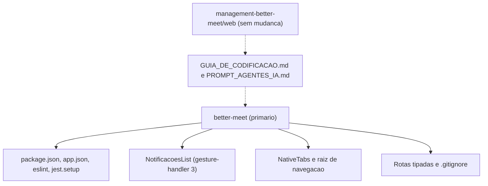
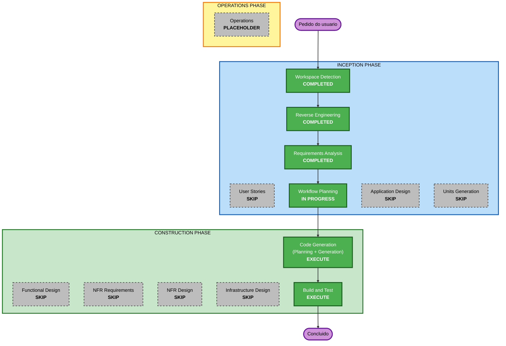

# Execution Plan

## Detailed Analysis Summary

### Transformation Scope (Brownfield Only)
- **Transformation Type**: Single component (o app better-meet). Troca de versão de framework, sem mudança de arquitetura, de infraestrutura nem de modelo de implantação.
- **Primary Changes**: Dependências (SDK 58 e bibliotecas nativas), setup de testes (Jest 30, Worklets, gesture-handler 3), um componente com gestos, configuração, correção de pendências de tipos e documentação.
- **Related Components**: Nenhum outro componente de código muda. Documentos compartilhados na raiz do repositório (`GUIA_DE_CODIFICACAO.md`, `PROMPT_AGENTES_IA.md`) passam a citar a versão de cada app.

### Change Impact Assessment
- **User-facing changes**: Não (intencional). O comportamento visível deve ficar idêntico; a verificação é manual, em Expo Go e development build.
- **Structural changes**: Não. A estrutura de pastas, camadas e rotas se mantém.
- **Data model changes**: Não.
- **API changes**: Não. Os contratos HTTP com as 3 APIs não mudam.
- **NFR impact**: Sim, limitado: compatibilidade de plataforma (Node, Expo Go SDK 58) e portões de qualidade (lint, tipos, testes, `expo-doctor`, bundle).

### Component Relationships (Brownfield Only)



- **Primary Component**: `better-meet`.
- **Infrastructure Components**: nenhum.
- **Shared Components**: documentos da raiz do repositório (Change Type: Configuration-only, Priority: Important).
- **Dependent Components**: `management-better-meet/web` compartilha o guia e o prompt, mas segue no SDK 57 (sem mudança, Priority: Optional).
- **Supporting Components**: nenhum (sem monitoramento, log ou CI neste workspace).

### Risk Assessment
- **Risk Level**: Médio. Um salto de versão maior (gesture-handler 2 para 3), React Native 0.86 para 0.88 e Jest 29 para 30; as telas de `src/app/` não têm teste automatizado.
- **Rollback Complexity**: Fácil. Tudo na branch `feature/migracao-expo-58`, sem commit automático; reversão pelo Git e pelo `package-lock.json`.
- **Testing Complexity**: Moderada. Testes automatizados cobrem componentes, hooks, services e stores; rotas, `AppGate` e `NativeTabs` dependem de verificação manual.

## Workflow Visualization



### Text Alternative
```
Fase 1: INCEPTION
- Workspace Detection (CONCLUÍDO)
- Reverse Engineering (CONCLUÍDO)
- Requirements Analysis (CONCLUÍDO)
- User Stories (PULAR)
- Workflow Planning (EM ANDAMENTO)
- Application Design (PULAR)
- Units Generation (PULAR)
Fase 2: CONSTRUCTION
- Functional Design, NFR Requirements, NFR Design, Infrastructure Design (PULAR)
- Code Generation (EXECUTAR)
- Build and Test (EXECUTAR)
Fase 3: OPERATIONS (placeholder)
```

## Phases to Execute

### INCEPTION PHASE
- [x] Workspace Detection (COMPLETED)
- [x] Reverse Engineering (COMPLETED)
- [x] Requirements Analysis (COMPLETED)
- [x] User Stories (SKIPPED)
- [x] Execution Plan (IN PROGRESS)
- [ ] Application Design - SKIP
  - **Rationale**: Nenhum componente, serviço ou método novo; mudanças ficam dentro das fronteiras existentes.
- [ ] Units Generation - SKIP
  - **Rationale**: Uma única unidade de trabalho (o app). Sem decomposição em módulos. O Code Generation trata a migração como uma unidade, em passos ordenados (ver Package Change Sequence).

### CONSTRUCTION PHASE
- [ ] Functional Design - SKIP
  - **Rationale**: Sem novos modelos de dados nem regras de negócio; o comportamento é preservado.
- [ ] NFR Requirements - SKIP
  - **Rationale**: Os requisitos não funcionais já estão em `requirements.md` (NFR-01 a NFR-05); a pilha tecnológica está definida pelo SDK 58.
- [ ] NFR Design - SKIP
  - **Rationale**: NFR Requirements foi pulado e não há padrões novos a incorporar.
- [ ] Infrastructure Design - SKIP
  - **Rationale**: Sem mudanças de infraestrutura; sem `android/` nem `ios/`.
- [ ] Code Generation - EXECUTE (ALWAYS)
  - **Rationale**: Implementação da migração. Parte 1: plano com caixas de seleção e aprovação; Parte 2: execução.
- [ ] Build and Test - EXECUTE (ALWAYS)
  - **Rationale**: Portões de qualidade do NFR-01 e lista de verificação manual para Expo Go e development build.

### OPERATIONS PHASE
- [ ] Operations - PLACEHOLDER
  - **Rationale**: Reservado pelo AI-DLC v1 para implantação e monitoramento futuros.

## Package Change Sequence (Brownfield Only)
Sequência dentro da unidade única. Cada passo só começa quando o anterior estiver verde; a ordem existe porque os passos seguintes dependem das versões instaladas.

1. **Preparação**: regenerar os tipos do Expo Router (`.expo/types`) e confirmar o ponto de partida (lint, `tsc`, testes). Mapeia os 2 erros pré-existentes.
2. **Dependências**: `npx expo install expo@^58.0.0 --fix`, mais `jest` 30 e os peers que o `jest-expo` 58 exigir; regenerar o `package-lock.json`; rodar `npx expo-doctor`.
3. **Documentação do SDK 58**: conferir em https://docs.expo.dev/versions/v58.0.0/ e no guia `docs.expo.dev/router/migrate/sdk-57-to-58/` as APIs tocadas (NativeTabs, splash, linking, constants), para decidir as trocas do passo 5 (RN-01 do guia).
4. **Gestos e setup de testes**: adaptar `NotificacoesList.tsx` ao gesture-handler 3 e ajustar `jest.setup.ts` e os mocks dos testes de `NotificacoesList` e `ReunioesData` a Reanimated 4.7, Worklets 0.13 e Jest 30.
5. **APIs instáveis ou deprecadas** (escopo C): aplicar só o que a documentação do passo 3 recomendar (por exemplo, o caminho do `NativeTabs`; `Appearance`), e revisar `app.json` e `eslint.config.js`.
6. **Pendências pré-existentes** (escopo B): fechar os 2 erros de rotas tipadas e remover a linha `example` do `.gitignore`, se for seguro.
7. **Documentação**: `better-meet/AGENTS.md` e `README.md`; `GUIA_DE_CODIFICACAO.md` (RN-01 e os dois outros trechos) e `PROMPT_AGENTES_IA.md`, citando a versão de cada app.
8. **Verificação**: lint, `tsc`, Jest, `expo-doctor` e bundle Android/iOS (Build and Test).

Estratégia de teste: validar a cada passo que muda código (3 a 6) com lint, `tsc` e Jest, e só rodar o conjunto completo e o bundle no passo 8. Estratégia de reversão: `git restore` por arquivo ou descarte da branch; o `package-lock.json` volta junto.

## Estimated Timeline
- **Total Phases**: 3 fases do AI-DLC (Inception, Construction e o placeholder de Operations); 3 estágios ainda por executar (Workflow Planning, Code Generation, Build and Test).
- **Estimated Duration**: Cerca de 1,5 a 3 horas de trabalho do agente em Code Generation e Build and Test, sem contar suas aprovações nem a verificação manual em aparelho (Expo Go e development build), que é sua. Estimativa minha, não medida.

## Success Criteria
- **Primary Goal**: App no Expo SDK 58, com o comportamento atual preservado e o padrão de codificação respeitado.
- **Key Deliverables**: `package.json` e `package-lock.json` no SDK 58; `NotificacoesList.tsx`, `jest.setup.ts` e testes adaptados; configuração revisada; pendências fechadas; documentos atualizados; lista de verificação manual.
- **Quality Gates**: `npm run lint` limpo; `npm run typecheck` com 0 erros; `npm test` todo verde; `npx expo-doctor` 21/21; bundle Android e iOS compilando.
- **Integration Testing**: Verificação manual das telas que o Jest não cobre (`AppGate`, abas, reuniões, avisos arrastáveis, tema).
- **Operational Readiness**: Não se aplica (Operations é placeholder).
