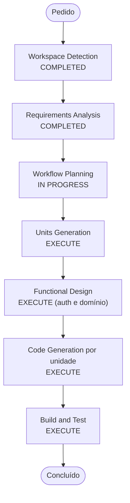

- **Incremento:** Apresentação final (AF) — refatoração de código
- **Escopo:** plano de execução da unidade refatoracao-ultima-entrega
- **Branch:** feature/refatoracao-ultima-entrega
- **Commit:** aed2702
- **Data de revisão:** 2026-11-20
- **Responsável(eis):** [nome de quem revisa e aprova]
- **Estado:** Proposta — aguardando aprovação do Workflow Planning
- **Fontes:** [requirements.md](../requirements/refatoracao-ultima-entrega/requirements.md); [workflow-planning.md](../../../.aidlc-rule-details/inception/workflow-planning.md)

# Plano de execução — refatoração para a última entrega

## 1. Análise

- **Transformação:** várias alterações de código em quatro pacotes, com mudança de schema (migrations), de contratos de API e de autenticação.
- **Impacto:** usuário do app (login, telas, regras de presença e votação), estrutura (Better Auth, sessão), dados (migrations), API (rotas e respostas), requisitos não funcionais (segurança).
- **Risco:** alto. Rollback difícil na autenticação e nas migrations; prazo de 7 dias. Mitigação: corte obrigatório / se der tempo, migrations versionadas, testes por unidade.
- **Restrições:** sem git de escrita; Wiki de origem intocada (só `wiki-local/`); verificação só com `npm test`, lint e typecheck; docker e migrations liberados.

## 2. Etapas

O diagrama mostra a decisão de cada etapa; a lista em texto vem depois.



```text
CONCLUÍDAS: Workspace Detection, Requirements Analysis
EXECUTAR: Units Generation, Functional Design (só unidades de autenticação e de domínio),
          Code Generation (por unidade), Build and Test
DISPENSADAS: Reverse Engineering (cada sub-agente lê o código da sua unidade), User Stories
             (sem funcionalidade nova pedida), Application Design (sem componentes novos além de módulos),
             NFR Requirements e NFR Design (segurança já está nos requisitos e no EX-19),
             Infrastructure Design (só TZ no docker-compose/ecosystem, tratado na unidade da API)
OPERATIONS: não usada
```

## 3. Unidades de trabalho (propostas)

Cada unidade tem um sub-agente de execução. A coluna "Quando" indica a ordem.

| Unidade | Conteúdo principal | Quando |
|---|---|---|
| U1 api-auth-protecao | Better Auth, scrypt, recuperação, e-mail confirmado, login por e-mail, EX-19, rota de validação de sessão, primeira migration | Onda 1 (paralela) |
| U2 monitoring | Scripts e testes, padrões P1 a P4, P9, P22, rota autenticada por JWT (RF-R55) | Onda 1 |
| U3 gestao-server | Perfil lido do banco, scripts e padrões (bug 3) | Onda 1 |
| U4 gestao-web | AGENTS.md, `fetch` do login, scripts, remover chave `EXPO_PUBLIC` depois de U2 | Onda 1 (remoção da chave na onda 2) |
| U5 app-telas | Telas que não dependem da API: erro de campo, vocabulário, ID no perfil, "Voltar", opacidade | Onda 1 |
| U6 documentacao | LICENSE, `documentos/consolidado/`, `wiki-local/`, `.env.example`, `TZ` | Onda 1 |
| U7 api-dominio | Autoria (SetNull), check-in e janelas, fuso, removeMember, votação, ata, presença, convites | Onda 2, depois de U1 liberar o `schema.prisma` (check-in, fuso e removeMember podem começar na onda 1) |
| U8 app-auth-integracao | `apiClient`/401, `authStore`, login, recuperação, verificação de e-mail, sessão, integração com U1 e U7 | Onda 2, depois do contrato de U1 |
| U9 fechamento | Rotas para `/api`, `.env.example`, RELATORIO_BUGS, relatório final, itens "se der tempo" aprovados | Onda 3 |

## 4. Etapas por unidade

1. Units Generation: confirma e detalha as unidades acima em `unit-of-work*.md`.
2. Functional Design: só U1, U7 e U8 (regras de autenticação, estado e horário).
3. Code Generation: plano por unidade com caixas, aprovação (conjunta por onda), execução pelos sub-agentes, resumo curto de cada um.
4. Build and Test: `npm test`, lint e typecheck por subsistema; plano manual para o que não se testa sem aparelho.

## 5. Critérios de sucesso

Itens obrigatórios do `requirements.md` atendidos e verificados por teste; migrations aplicadas ao banco de desenvolvimento nos containers; lint, typecheck e testes verdes ou falhas registradas; nada commitado; Wiki de origem intocada.
