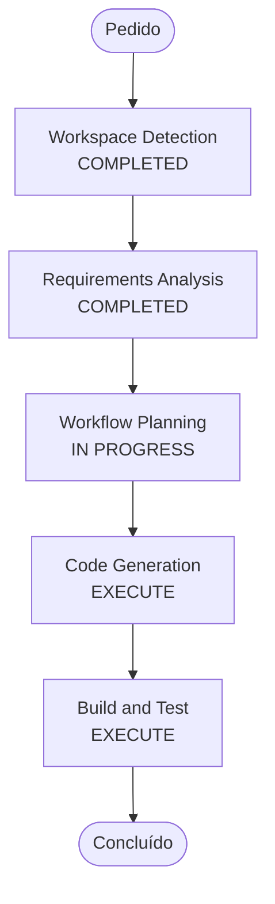

- **Incremento:** Apresentação final (AF) — iteração 2 (retorno da AP)
- **Escopo:** plano de execução da unidade revisao-padroes-ap
- **Branch:** feature/refatoracao-ultima-entrega
- **Commit:** 704478f15192f757223c1efce99f43a7a411888c
- **Data de revisão:** 2026-11-20
- **Responsável(eis):** [nome de quem revisa e aprova]
- **Estado:** Proposta — aguardando aprovação do Workflow Planning
- **Fontes:** [requirements.md](../requirements/revisao-padroes-ap/requirements.md); [workflow-planning.md](../../../.aidlc-rule-details/inception/workflow-planning.md)

# Plano de execução — retorno da AP

## 1. Análise

- **Transformação:** alteração de documentos de padrão, sem código, nos mesmos quatro arquivos da iteração 1.
- **Impacto:** só no processo da equipe; app, API e banco não mudam.
- **Risco:** baixo. Reversão pelo Git. Atenção: os arquivos já contêm as alterações da iteração 1, ainda sem commit; esta iteração acrescenta sobre elas.
- **Sequência:** GUIA_DE_DOCUMENTACAO.md → PROMPT_DOCUMENTACAO_IA.md → GUIA_DE_CODIFICACAO.md → PROMPT_AGENTES_IA.md.

## 2. Etapas

O diagrama mostra as etapas; a lista em texto vem logo depois.



```text
CONCLUÍDAS: Workspace Detection, Requirements Analysis
DISPENSADAS: Reverse Engineering, User Stories, Application Design, Units Generation,
             Functional Design, NFR Requirements, NFR Design, Infrastructure Design
             (sem código, sem componentes, uma unidade; ver requisitos)
EXECUTAR: Code Generation (plano e alteração), Build and Test
OPERATIONS: não usada
```

## 3. Pontos para o plano de alteração

1. DOC-32 e DOC-33 entram na seção 1 e na seção 14 do guia de documentação; o documento de arquitetura fica em `documentos/entrega5_AF/`.
2. GT-07 ("Situações do dia a dia") entra como seção 9.7 do guia de código, com exemplos copiados do código atual (endpoint, tela, tabela, teste); cada exemplo é conferido no código.
3. DOC-22, DOC-23 e GT-04 são ampliados; versões de ferramentas de teste vêm dos `package.json` e lockfiles.
4. O Build and Test desta unidade inclui a conferência pendente da iteração 1 (identificadores, links, termos informais) sobre o estado final dos arquivos.

## 4. Critérios de sucesso

RA-01 a RA-08 escritos; guias e prompts iguais; nenhum identificador renumerado; links válidos; só os arquivos de padrão e o `aidlc-docs/` alterados.
