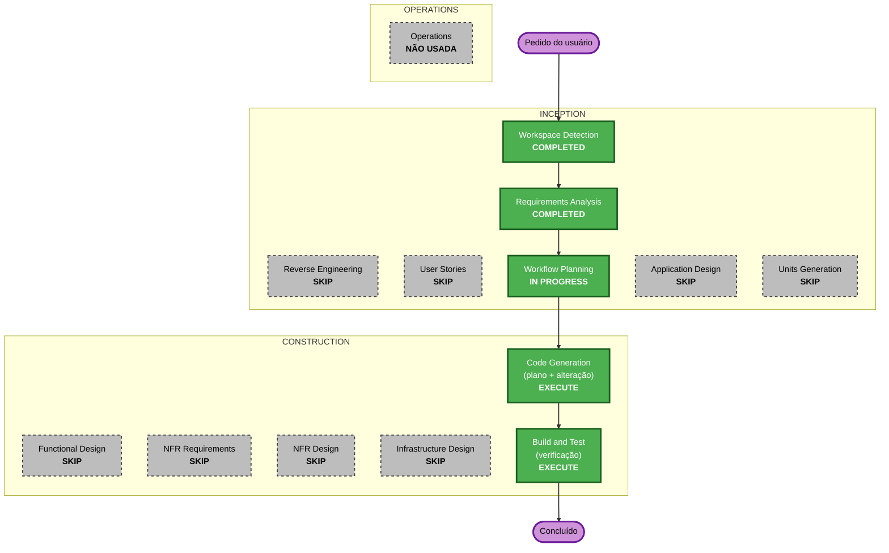

- **Incremento:** Apresentação final (AF) — entrega em 2026-11-27, às 18:00
- **Escopo:** plano de execução da unidade revisao-padroes-entrega-final
- **Branch:** feature/refatoracao-ultima-entrega
- **Commit:** 704478f15192f757223c1efce99f43a7a411888c
- **Data de revisão:** 2026-11-20
- **Responsável(eis):** [nome de quem revisa e aprova]
- **Estado:** Proposta — aguardando aprovação do Workflow Planning
- **Fontes:** [requirements.md](../requirements/revisao-padroes-entrega-final/requirements.md); [respostas](../requirements/revisao-padroes-entrega-final/requirement-verification-questions.md); [análise](../requirements/revisao-padroes-entrega-final/analise-retornos-professor.md); [workflow-planning.md](../../../.aidlc-rule-details/inception/workflow-planning.md)

# Plano de execução — revisão dos padrões

Este plano decide quais etapas do AI-DLC v1 rodam nesta unidade, em que ordem os arquivos são alterados e como o resultado será verificado. O nome do arquivo leva o prefixo da unidade para não sobrescrever o `execution-plan.md` de uma unidade anterior.

## 1. Análise detalhada

### 1.1 Escopo da transformação

A unidade altera só documentos de padrão, sem mudar a arquitetura nem o código.

- **Tipo de transformação:** alteração de documentos de processo, em um único componente lógico (os padrões do projeto).
- **Mudanças principais:** os 34 requisitos funcionais da unidade (RQ-D01 a RQ-D15, RQ-C01 a RQ-C18 e RQ-R01).
- **Arquivos envolvidos:** `GUIA_DE_DOCUMENTACAO.md`, `PROMPT_DOCUMENTACAO_IA.md`, `GUIA_DE_CODIFICACAO.md`, `PROMPT_AGENTES_IA.md` e `RELATORIO_BUGS.md`, todos na raiz do repositório.

### 1.2 Avaliação de impacto

A tabela classifica o impacto em cada área prevista pelo AI-DLC.

| Área | Impacto | Descrição |
|---|---|---|
| Usuário do app | Não | Nenhuma tela muda nesta unidade |
| Estrutura do sistema | Não | Nenhum componente muda |
| Modelo de dados | Não | Nenhum schema ou migration muda |
| Contratos de API | Não | Nenhuma rota muda |
| Requisitos não funcionais do sistema | Não, diretamente | As regras novas (proteção da API, Better Auth, ciclo de vida) só terão efeito quando as unidades de código as aplicarem |
| Processo da equipe | Sim | Mudam o formato de RF, os diagramas, os dicionários, os testes, a entrega final e as regras de código que orientam as próximas unidades |

### 1.3 Relação entre os arquivos

Os arquivos citam uns aos outros, e essa ligação define a ordem de alteração.

- **Arquivo principal da documentação:** `GUIA_DE_DOCUMENTACAO.md`. Ele recebe os números novos (DOC-26 em diante), que os outros arquivos citam.
- **Resumo da documentação:** `PROMPT_DOCUMENTACAO_IA.md`. Repete as regras do guia e cita as regras 83 a 90 do prompt de agentes.
- **Arquivo principal do código:** `GUIA_DE_CODIFICACAO.md`. Cita o guia de documentação no GT-04 (testes) e passará a citá-lo no GT-06 (catálogo de softwares).
- **Resumo do código:** `PROMPT_AGENTES_IA.md`. Repete as regras do guia de código e recebe as regras novas a partir da 91.
- **Registro de pendências:** `RELATORIO_BUGS.md`. Recebe os 14 avisos de divergência antes de eles saírem dos guias, para que nada se perca.

| Arquivo | Tipo de mudança | Motivo | Prioridade |
|---|---|---|---|
| `GUIA_DE_DOCUMENTACAO.md` | Grande | RQ-D01 a RQ-D15; conflitos com a Di3 | Crítica |
| `PROMPT_DOCUMENTACAO_IA.md` | Grande | Acompanha o guia (RNQ-01) | Crítica |
| `RELATORIO_BUGS.md` | Pequena (seção nova) | RQ-R01 | Importante |
| `GUIA_DE_CODIFICACAO.md` | Grande | RQ-C01 a RQ-C17 | Crítica |
| `PROMPT_AGENTES_IA.md` | Grande | Acompanha o guia; RQ-C18 | Crítica |

### 1.4 Avaliação de risco

A tabela resume o risco da unidade.

| Item | Avaliação |
|---|---|
| Nível de risco | Médio: nenhum risco para o sistema em execução, mas cinco arquivos longos (cerca de 4.000 linhas), muitas referências cruzadas e exemplos que precisam ser reconferidos no código |
| Complexidade de reversão | Fácil: cada arquivo é restaurado pelo Git |
| Complexidade de verificação | Moderada: consistência entre guias e prompts, numeração, links, termos proibidos e modelos PlantUML |

## 2. Visualização do fluxo

O diagrama mostra as etapas e a decisão de cada uma. A alternativa em texto vem logo depois.



Alternativa em texto:

```text
INCEPTION
- Workspace Detection ........ CONCLUÍDA
- Reverse Engineering ........ DISPENSADA
- Requirements Analysis ...... CONCLUÍDA
- User Stories ............... DISPENSADA
- Workflow Planning .......... EM ANDAMENTO
- Application Design ......... DISPENSADA
- Units Generation ........... DISPENSADA
CONSTRUCTION
- Functional Design .......... DISPENSADA
- NFR Requirements ........... DISPENSADA
- NFR Design ................. DISPENSADA
- Infrastructure Design ...... DISPENSADA
- Code Generation ............ EXECUTAR (plano + alteração dos arquivos)
- Build and Test ............. EXECUTAR (verificação dos documentos)
OPERATIONS
- Operations ................. NÃO USADA
```

## 3. Etapas

### 3.1 Inception

- [x] Workspace Detection — concluída.
- [x] Reverse Engineering — dispensada. **Motivo:** já existem artefatos de engenharia reversa (regra 85) e a unidade não altera código; os fatos de código foram conferidos diretamente e registrados em `verificacao_codigo.md`.
- [x] Requirements Analysis — concluída e aprovada.
- [x] User Stories — dispensada. **Motivo:** a unidade não cria funcionalidade para o usuário do app; altera só documentos de padrão. O usuário não pediu a etapa na aprovação.
- [x] Workflow Planning — em andamento (este documento).
- [ ] Application Design — dispensada. **Motivo:** não há componente, service nem método novo.
- [ ] Units Generation — dispensada. **Motivo:** uma única unidade; os cinco arquivos são alterados em sequência pelo mesmo plano.

### 3.2 Construction

- [ ] Functional Design — dispensada. **Motivo:** não há lógica de negócio a projetar; o conteúdo das regras já está definido no `requirements.md` e no detalhamento da análise.
- [ ] NFR Requirements — dispensada. **Motivo:** a unidade não muda o comportamento do sistema; os requisitos não funcionais da própria unidade (RNQ-01 a RNQ-07) já estão no `requirements.md` e são verificados no Build and Test.
- [ ] NFR Design — dispensada. **Motivo:** a NFR Requirements foi dispensada.
- [ ] Infrastructure Design — dispensada. **Motivo:** nenhuma infraestrutura muda.
- [ ] Code Generation — executar. **Motivo:** parte 1, plano com um passo por arquivo e por grupo de requisitos, para aprovação; parte 2, alteração dos arquivos no lugar, marcando cada passo.
- [ ] Build and Test — executar. **Motivo:** verificar os documentos alterados (seção 6).

### 3.3 Operations

- Operations — não usada (regra 85).

## 4. Sequência de alteração dos arquivos

A ordem abaixo segue as dependências da seção 1.3. A Code Generation detalha cada passo.

1. **`GUIA_DE_DOCUMENTACAO.md`** — primeiro, porque fixa os números DOC-26 em diante, citados pelos demais. Inclui reescrever os exemplos das seções 4 a 13.
2. **`PROMPT_DOCUMENTACAO_IA.md`** — logo depois do guia, para manter os dois iguais (RNQ-01).
3. **`RELATORIO_BUGS.md`** — recebe os 14 avisos antes de eles saírem do guia de código.
4. **`GUIA_DE_CODIFICACAO.md`** — regras novas e ampliadas, retirada dos avisos e citações aos números novos do guia de documentação.
5. **`PROMPT_AGENTES_IA.md`** — por último, refletindo o guia de código, com a ordem das seções corrigida e as regras novas a partir da 91.

A estratégia é sequencial: cada arquivo depende dos números fixados no anterior. Ao fim de cada arquivo, os links e os identificadores dele são conferidos antes de seguir.

## 5. Pontos a decidir na Code Generation (parte 1)

Estes pontos não mudam as etapas, mas precisam constar do plano de alteração para aprovação.

1. **Exemplos do RF06 e do RNF06:** reconferir no commit atual (`704478f`) ou manter a data do commit `9e48774`. Recomendação: reconferir, porque os exemplos serão reescritos de qualquer forma.
2. **Sessão no app com Better Auth e biometria:** conferir na documentação do Better Auth para Expo como a sessão é guardada no aparelho, antes de escrever a regra que muda o ZS-01. Se a documentação não puder ser consultada, a regra fica marcada como `[A CONFIRMAR]`.
3. **Nome e local do arquivo de estilo dos diagramas** e do catálogo de softwares.
4. **Arquivos do Build and Test:** com o prefixo da unidade (`revisao-padroes-entrega-final-*.md`), em `construction/build-and-test/`, sem sobrescrever os arquivos das unidades anteriores.

## 6. Critérios de sucesso

A unidade termina quando os critérios abaixo forem cumpridos.

- **Objetivo principal:** padrões alinhados aos retornos do professor e às exigências da apresentação final, prontos para orientar as correções de código e de documentação.
- **Entregas:** os cinco arquivos alterados; plano de alteração com todos os passos marcados; resumo da alteração; arquivos de verificação do Build and Test.
- **Verificações do Build and Test:**
  - cada RQ presente no guia e no prompt correspondentes (RNQ-01);
  - nenhum identificador existente renumerado (RNQ-02), conferido contra a lista de identificadores do commit `704478f`;
  - busca pelos termos proibidos da nova regra de redação nos próprios guias (RNQ-03);
  - links relativos e referências entre regras válidos (RNQ-05);
  - modelos PlantUML gerados em SVG, se houver PlantUML disponível, ou "Não executado" com o motivo (RNQ-06);
  - `git status` sem arquivos de `sistema/` (fora de `aidlc-docs/`) ou de `documentos/` alterados (RNQ-07).

## 7. Estimativa

- **Etapas restantes:** Code Generation (parte 1 e parte 2) e Build and Test, com três aprovações: plano, alterações e verificação final.
- **Duração:** a alteração dos cinco arquivos cabe em uma sessão de trabalho. A estimativa não inclui as unidades de código e de documentação que virão depois.

## 8. Depois desta unidade

Estas sugestões estão fora do escopo e não são decididas aqui. Elas ajudam a planejar a semana até 27/11.

1. Unidade de código para autenticação (Better Auth, recuperação de senha, verificação de e-mail, login social e biometria), a de maior risco de prazo.
2. Unidade de código para ciclo de vida e horários (presença, votação e ata) e para as correções de interface (formulário de reunião, "Voltar", "site", ID no perfil, manual no app).
3. Unidade de documentação para refazer RFs, diagramas, dicionários, plano de testes, catálogo de softwares e manual no formato novo.
