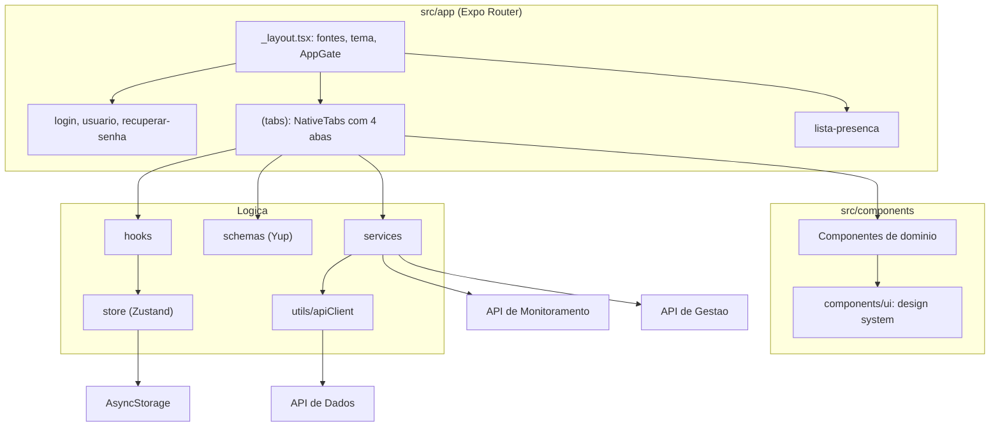
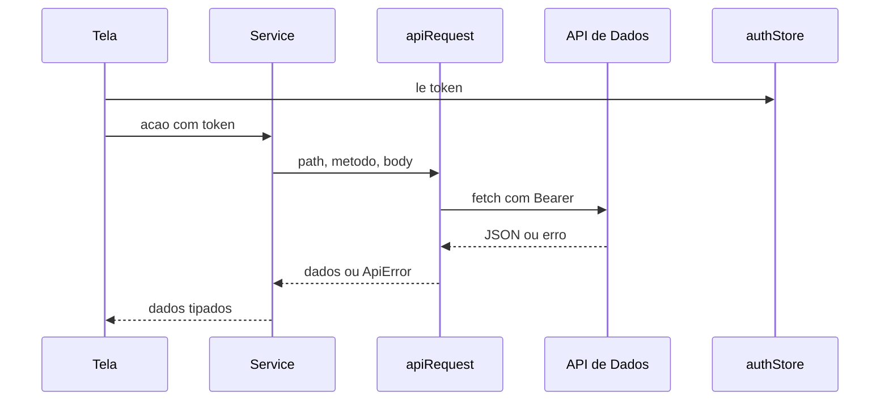

# System Architecture

## System Overview
Aplicativo cliente único, em TypeScript, feito com Expo (SDK 57) e React Native 0.86, navegação por arquivos (Expo Router) e estado global com Zustand. Não tem backend próprio: consome três APIs HTTP por um cliente único (`apiRequest`). Roda em iOS, Android e web (`react-native-web`, saída estática). Os componentes são compilados com o React Compiler (`experiments.reactCompiler`).

## Architecture Diagram

## Component Descriptions
### src/app (rotas)
- **Purpose**: Telas. O `_layout.tsx` raiz carrega as fontes (Plus Jakarta Sans), mantém a splash até estarem prontas, aplica o tema de navegação e monta o `AppGate` (única regra de redirecionamento por login, espera `hasHydrated`).
- **Dependencies**: expo-router, expo-splash-screen, react-native-gesture-handler (`GestureHandlerRootView`), zustand.
- **Type**: Application

### (tabs) (app logado)
- **Purpose**: Barra inferior nativa com `NativeTabs` (de `expo-router/unstable-native-tabs`) e quatro abas: reuniões, organizacao, comissao, mais. Cada aba tem um `Stack` próprio com `unstable_settings = { anchor: 'index' }`. Ícones de aba via `expo-symbols` (SF Symbols no iOS, Material Symbols no Android).
- **Type**: Application

### src/components e src/components/ui
- **Purpose**: Componentes de domínio (cartões, listas, lista de presença, relatórios) e base do design system (Button, TextField, Card, Screen, BottomSheet, ConfirmDialog, Toast, entre outros).
- **Dependencies**: react-native, safe-area-context, `@react-native-vector-icons/ionicons`, gesture-handler (`ReanimatedSwipeable` em `NotificacoesList`), datetimepicker.
- **Type**: Application

### src/services, src/utils/apiClient.ts, src/config/api.ts
- **Purpose**: Uma função por chamada HTTP, sempre via `apiRequest`. As URLs base vêm de variáveis `EXPO_PUBLIC_*` lidas em `config/api.ts`, que falha ao carregar se alguma faltar.
- **Type**: Application

### src/store
- **Purpose**: `authStore` (sessão), `themeStore` (preferência de tema), `notificacaoStore`. Persistência via `AsyncStorage` e `partialize`.
- **Type**: Application

### Testes
- **Purpose**: 18 arquivos de teste (Jest com `jest-expo` e React Native Testing Library) sob `__tests__`. As telas de `src/app/` ficam fora do Jest (`testPathIgnorePatterns`).
- **Type**: Test

## Data Flow

## Integration Points
- **External APIs**: API de Dados (`EXPO_PUBLIC_API_URL`, prefixo `/api`), API de Monitoramento (`EXPO_PUBLIC_MONITORING_API_URL`, chave `x-api-key` em `POST /status` e `POST /status/:sub/check`), API de Gestão (`EXPO_PUBLIC_MANAGEMENT_API_URL`, só ADMIN).
- **Databases**: nenhum; só `AsyncStorage` no aparelho (chave `better-meet-auth`, preferência de tema).
- **Third-party Services**: nenhum serviço de terceiros em tempo de execução. Fontes via pacote `@expo-google-fonts/plus-jakarta-sans`.

## Infrastructure Components
- **CDK Stacks**: nenhum.
- **Deployment Model**: sem pasta `android/` ou `ios/` (geração nativa contínua, CNG). Sem `eas.json`; sem pipeline de CI neste workspace.
- **Networking**: dispositivos acessam as APIs pelo IP da rede local (ver `.env.example`).
