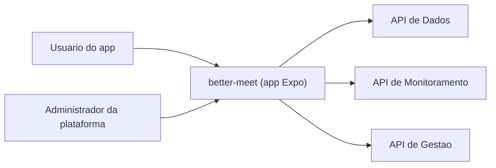

# Business Overview

## Business Context Diagram

## Business Description
- **Business Description**: Better Meet é um aplicativo (iOS, Android e web) para organizar reuniões dentro de organizações e comissões. Usuários se cadastram, participam de organizações e comissões com papéis, agendam reuniões, convidam membros, fazem check-in e check-out, e geram a lista de presença. Administradores da plataforma acompanham relatórios e o estado dos subsistemas.
- **Business Transactions**:
  - Cadastro, login, recuperação de senha e exclusão de conta (com transferência de administração para sucessores).
  - Gestão de organizações: criar, renomear, excluir, aceitar ou recusar (status), adicionar membros, mudar papel, remover.
  - Gestão de comissões dentro de organizações: criar, editar, excluir, adicionar e remover membros com papel.
  - Reuniões: agendar, editar, cancelar, convidar membros, responder convite, check-in e check-out, listar as próprias reuniões e convites pendentes.
  - Lista de presença de uma reunião: gerar, salvar e consultar (parcial ou final).
  - Notificações: avisos de reunião atualizada ou excluída, marcar como lidas, remover.
  - Relatórios: de organizações, comissões e usuários (visão geral para ADMIN, visão própria para os demais).
  - Status dos subsistemas: consultar estado e histórico, pedir checagem, e (ADMIN) iniciar, parar ou reiniciar subsistemas.
  - Preferência de tema (claro, escuro, sistema), persistida no servidor e no aparelho.
- **Business Dictionary**:
  - **Organização**: agrupamento principal. Membros têm papel CRIADOR, GERENTE, MODERADOR ou MEMBRO, com limite por papel.
  - **Comissão**: subgrupo de uma organização. Papéis ADMINISTRADOR, FACILITADOR, SECRETARIO ou MEMBRO.
  - **Reunião**: evento com status AGENDADA, REALIZADA ou CANCELADA e participantes convidados.
  - **Convite**: convite para uma reunião, que o convidado responde.
  - **Lista de presença**: registro consolidado de quem esteve presente, em versão PARCIAL ou FINAL.
  - **Subsistema**: serviço de backend monitorado pela API de Monitoramento.

## Component Level Business Descriptions
### better-meet (app)
- **Purpose**: Interface do usuário final e do administrador para todas as transações acima.
- **Responsibilities**: Navegação e telas, validação de formulários, sessão e tema persistidos no aparelho, chamadas às três APIs, exibição de erros em pt-BR.

### Sistemas externos ao app (não fazem parte deste workspace)
- **API de Dados** (`sistema/api`): regras de negócio e banco.
- **API de Monitoramento** (`sistema/monitoring-better-meet`): status e histórico dos subsistemas, recebe erros reportados pelo app.
- **API de Gestão** (`sistema/management-better-meet`): start, stop e restart dos subsistemas.
