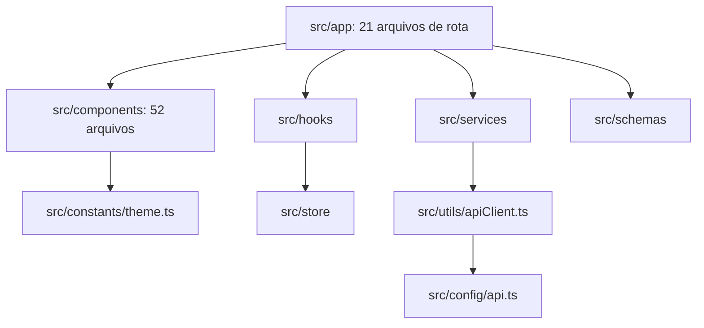

# Code Structure

## Build System
- **Type**: npm (`package.json`, `package-lock.json`); bundler Metro via Expo CLI.
- **Configuration**: `app.json` (plugins `expo-router`, `expo-splash-screen`, `@react-native-community/datetimepicker`; `experiments.typedRoutes` e `reactCompiler` ligados; `web.output: "static"`), `tsconfig.json` (estende `expo/tsconfig.base`, `strict: true`, alias `@/*` para `./src/*`), `eslint.config.js` (CommonJS, `eslint-config-expo` mais regras do guia), `.prettierrc.json`, `jest.setup.ts`. Não há `babel.config.js` nem `metro.config.js` (padrões do Expo).

## Key Classes/Modules

### Existing Files Inventory
Tamanhos aproximados em linhas. Arquivos marcados com (*) são candidatos a modificação na migração para o SDK 58.

**Rotas (`src/app/`)**
- `_layout.tsx` (*) - raiz: fontes, splash, `ThemeProvider`, `AppGate`, `GestureHandlerRootView`.
- `(tabs)/_layout.tsx` (*) - `NativeTabs` e ícones (`expo-symbols`).
- `(tabs)/(reunioes)/index.tsx` (988) - lista, criação e edição de reuniões, convites, `DateTimePicker`.
- `(tabs)/organizacao/index.tsx`, `[id].tsx` - lista e detalhe de organizações.
- `(tabs)/comissao/index.tsx`, `[id].tsx` - lista e detalhe de comissões.
- `(tabs)/mais/index.tsx`, `perfil.tsx`, `excluir-conta.tsx`, `status.tsx`, `relatorios/index.tsx`, `relatorios/usuarios.tsx`.
- `login.tsx`, `usuario.tsx` (cadastro), `recuperar-senha.tsx`, `lista-presenca.tsx`.
- `_layout.tsx` de cada aba (Stack, 9 a 10 linhas).

**Componentes de domínio (`src/components/`)**
- `NotificacoesList.tsx` (*) - usa `GestureHandlerRootView` e `ReanimatedSwipeable` (gesture-handler).
- `ReuniaoCard`, `ReuniaoCheckIn`, `ConvitePendenteCard`, `ConvitesSemAceite`, `LocalReuniaoField`, `MembrosSelector`, `Header`, `IconAndTitle`, `InfoRow`.
- `OrganizacaoCard`, `OrganizacaoEquipe`, `OrganizacaoMembroRow`, `ComissaoCard`, `ComissaoEquipe`, `SucessoresDialog`, `SubsystemStatusCard`.
- `presenca/`: `ListaPresencaButton`, `ListaPresencaEditor`, `ListaPresencaView`.
- `relatorio/`: `ComissaoReportView`, `OrganizacaoReportView`, `UsuarioReportView`, `DistributionBars`, `MonthlyBars`, `StackedBar`, `StatTile`, `ReportLinkCard`, `ReportListRow`, `ReportSection`.

**Design system (`src/components/ui/`)**
- `Screen.tsx` (*) e `BottomSheet.tsx` (*) - usam `react-native-safe-area-context`; `BottomSheet` e `ConfirmDialog` usam `Modal`.
- `Avatar`, `AvatarStack`, `BackButton`, `Badge`, `Button`, `Card`, `Chip`, `ConfirmDialog`, `DashedButton`, `DetailHeader`, `FeedbackBanner`, `KeyboardAwareScrollView`, `PageIntro`, `PersonPickerSheet`, `PickerField`, `ScreenHeader`, `SectionLabel`, `SummaryCard`, `TextField`, `Toast`.

**Lógica**
- `services/`: `authService`, `comissaoService`, `listaPresencaService`, `managementService`, `monitoringService`, `notificacaoService`, `organizacaoService`, `reuniaoService`, `usuarioService`.
- `store/`: `authStore`, `themeStore` (*, usa `Appearance.setColorScheme`), `notificacaoStore`.
- `hooks/`: `useAppColorScheme` (*, usa `Appearance`), `useTheme`, `useThemePreference`, `useFeedback`, `useKeyboard`, `useOrganizacaoActions`, `useListaPresencaPreview`.
- `schemas/`: `authSchema`, `comissaoSchema`, `commonSchema`, `listaPresencaSchema`, `organizacaoSchema`, `reuniaoSchema`, `usuarioSchema`.
- `utils/`: `apiClient`, `formErrors`, `format`, `listaPresenca`, `marcacoesPresenca`.
- `config/api.ts`, `constants/theme.ts`, `constants/status.ts`, `types/assets.d.ts`, `mocks/listaPresencaMock.ts`.

**Fora de `src/`**
- `package.json` (*), `app.json` (*), `jest.setup.ts` (*, mocka `react-native-worklets/src/mock` e chama `setUpTests` do Reanimated), `eslint.config.js` (*), `tsconfig.json`, `.env.example`, `AGENTS.md` e `CLAUDE.md` (citam o Expo 57), `README.md` (cita SDK 57).
- Testes (18): em `src/components/__tests__`, `src/components/ui/__tests__`, `src/components/presenca/__tests__`, `src/hooks/__tests__`, `src/schemas/__tests__`, `src/services/__tests__`, `src/store/__tests__`. Os de `NotificacoesList` (*) e `ReunioesData` (*) mockam `react-native-gesture-handler/ReanimatedSwipeable` e `@react-native-community/datetimepicker`.

## Design Patterns
### Camadas tela, service, apiRequest
- **Location**: `src/app`, `src/services`, `src/utils/apiClient.ts`.
- **Purpose**: Telas nunca chamam `fetch`; toda chamada passa por `apiRequest`, que injeta o token, trata JSON e converte erros em `ApiError`.
- **Implementation**: objeto literal por domínio (`organizacaoService`, etc.), nomes de verbos em inglês e substantivos em português.

### Store Zustand persistido
- **Location**: `src/store`.
- **Purpose**: Sessão e tema sobrevivem ao fechamento do app.
- **Implementation**: `persist` com `AsyncStorage` e `partialize`; flag `hasHydrated` para o `AppGate` esperar a leitura.

### Uniões literais com `as const`
- **Location**: `PAPEIS_*`, `STATUS_*` nos services.
- **Purpose**: Mesma lista serve de valor (validação, menus) e de tipo; sem `enum`.

### Tema único
- **Location**: `constants/theme.ts`, `hooks/useTheme`.
- **Purpose**: Cores, tipografia, espaçamento e raios vêm do tema; `useAppColorScheme` resolve claro, escuro ou sistema.

## Critical Dependencies
### expo-router
- **Version**: ~57.0.28
- **Usage**: Roteamento, `NativeTabs` (`expo-router/unstable-native-tabs`), `useFocusEffect`, `useLocalSearchParams`, `useRouter`, `useSegments`, `ThemeProvider`.
- **Purpose**: Navegação por arquivos, rotas tipadas.

### react-native-gesture-handler
- **Version**: ~2.32.0 (instalado 2.32.0)
- **Usage**: `GestureHandlerRootView` em `_layout.tsx` e `NotificacoesList.tsx`; `ReanimatedSwipeable` para arrastar e remover avisos; `jestSetup` nos testes.
- **Purpose**: Gestos.

### react-native-reanimated / react-native-worklets
- **Version**: 4.5.1 / 0.10.1
- **Usage**: Exigidos pelo `ReanimatedSwipeable`; sem uso direto de `runOnJS`, `withSpring` ou hooks de animação no código de `src/`.
- **Purpose**: Animação e worklets.

### zustand, yup, @react-native-async-storage/async-storage
- **Version**: ^5.0.15 / ^1.7.0 / 2.2.0
- **Usage**: Estado, validação de formulários, persistência.

### @react-native-community/datetimepicker
- **Version**: 9.1.0
- **Usage**: Seleção de data e hora na tela de reuniões; plugin em `app.json`.
