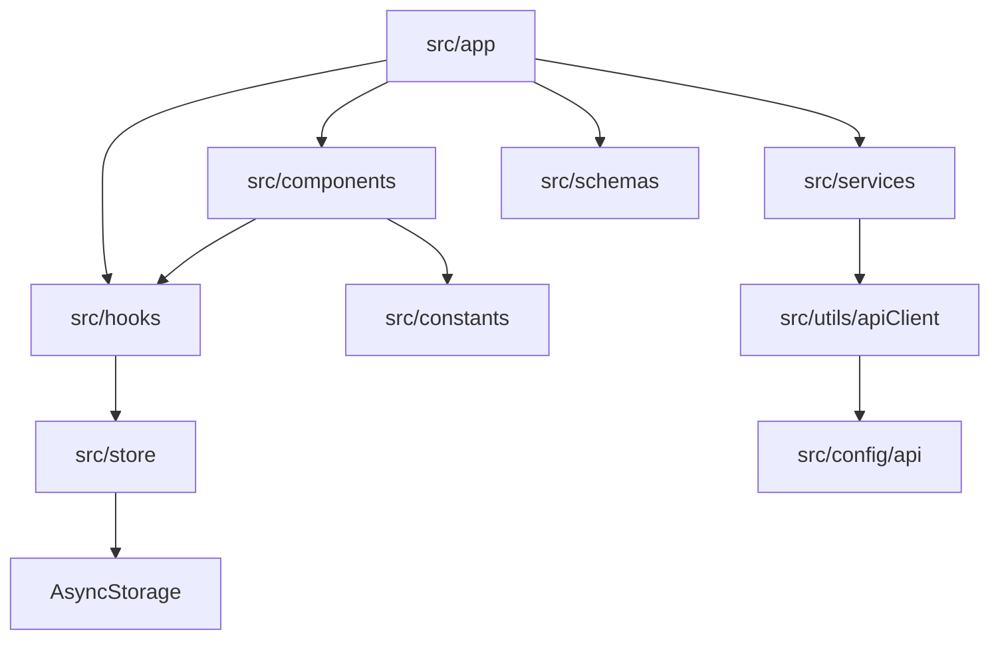

- **Commit:** aed2702 (alterações da refatoração da apresentação final ainda sem commit)
- **Data de revisão:** 2026-11-21
- **Estado:** Versões do bloco "Gerenciadas pelo SDK" conferidas em `package.json` em 2026-11-21 (inclui o SDK 58 e o `expo-secure-store`); a seção de pontos de atenção é histórica [A CONFIRMAR NO CÓDIGO: licença de cada pacote não relida nos `node_modules`]
- **Fontes:** `sistema/better-meet/package.json`

# Dependencies

## Internal Dependencies

### src/app depende de src/components, hooks, services, schemas
- **Type**: Compile
- **Reason**: Telas montam a interface, validam formulários e chamam services. Nenhuma tela chama `fetch` (regra RN-04 do guia).

### src/services depende de src/utils/apiClient e src/config/api
- **Type**: Compile e Runtime
- **Reason**: Ponto único de acesso HTTP; as URLs vêm de `EXPO_PUBLIC_*`.

## External Dependencies
Mapa de uso, com as versões atuais (as do SDK 58 constam no relatório de conflitos, ver `audit.md`).

### Gerenciadas pelo SDK do Expo (mudam de versão com a migração)
- **expo ~58.0.25, expo-constants, expo-font, expo-linking, expo-router ~58.0.31, expo-splash-screen, expo-symbols, expo-system-ui** (58.x) - plataforma, rotas, splash, fontes, ícones de aba, cor da janela. Licença MIT.
- **expo-secure-store ~58.0.3** - guarda o token da sessão no Android e iOS (plugin no `app.json`). Licença MIT. Entrou na refatoração da apresentação final; deve constar no catálogo de softwares.
- **react 19.3.0 / react-dom 19.3.0 / react-native 0.88.1 / react-native-web ~0.21.4** - núcleo. Licença MIT.
- **react-native-gesture-handler ~3.3.0** - gestos; `ReanimatedSwipeable` e `GestureHandlerRootView`. MIT.
- **react-native-reanimated 4.7.1 / react-native-worklets 0.13.0** - dependências do swipeable; mock no Jest. MIT.
- **react-native-safe-area-context ~5.11.1 / react-native-screens ~4.30.1** - áreas seguras, telas nativas. MIT.
- **@react-native-community/datetimepicker 9.2.1** - seleção de data e hora. MIT.
- **@react-native-async-storage/async-storage 2.2.0** - persistência local. MIT.
- **jest-expo ~58.0.14, eslint-config-expo ~58.0.4** - testes e lint, versionados junto com o SDK.

### Independentes do SDK
- **zustand ^5.0.15, yup ^1.7.0** - estado e validação. MIT.
- **@react-native-vector-icons/ionicons ^13.1.5** - ícones (RN-17 do guia). MIT.
- **@expo-google-fonts/plus-jakarta-sans ^0.4.2** - fonte do app. MIT, fonte sob SIL OFL.
- **@testing-library/react-native ^14.1.0, jest ~30.5.2** - testes.
- **eslint ^9, eslint-config-prettier ^10.1.8, prettier ^3.9.10, typescript ~6.0.3, @types/react ~19.2.2, @expo/ngrok ^4.1.3** - ferramentas de desenvolvimento.

### Pontos de atenção de compatibilidade (levantados antes da migração para o SDK 58; os pacotes acima já estão nas versões do SDK 58 em `package.json`)
- O `jest-expo` 58 depende de pacotes `jest-*` na linha 30 e declara peer `@react-native/jest-preset ^0.88.1`, enquanto o projeto fixa `jest ~29.7.0`.
- O `react-native-reanimated` 4.7.1 exige `react-native-worklets` 0.13.x e React Native 0.86 a 0.88.
- O `expo-router` 58 declara `react-native-screens ^4.30.1`, `expo-symbols` e `expo-linking`/`expo-constants` na linha 58 como peers.
