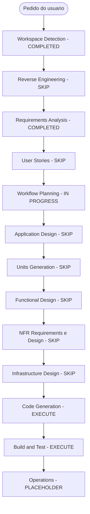

# Execution Plan

## Detailed Analysis Summary

### Transformation Scope (Brownfield Only)
- **Transformation Type**: Single component (`management-better-meet/web`). Troca de versão de framework, sem mudança de arquitetura ou de modelo de implantação.
- **Primary Changes**: dependências do SDK 58, `package-lock.json`, troca do pacote de ícones em `login.tsx`, config de ESLint e eventual ajuste de tipos.
- **Related Components**: `sistema/start-all.ps1` (avaliar). `management-better-meet/server` serve `web/dist` e não muda.

### Change Impact Assessment
- **User-facing changes**: Não (intencional).
- **Structural changes**: Não.
- **Data model / API changes**: Não. Os contratos HTTP com as três APIs não mudam.
- **NFR impact**: Limitado a compatibilidade de plataforma e portões de qualidade.

### Risk Assessment
- **Risk Level**: Baixo a médio. Saltos de React 19.3, React Native 0.88 e Router 58, mas o app usa pouca API; o risco maior é o `npm install` (ERESOLVE) e a troca de ícones no export web.
- **Rollback Complexity**: Fácil (Git + `package-lock.json`; `dist/` e `.expo/` são ignorados).
- **Testing Complexity**: Moderada. Sem testes automatizados; bundle, `tsc`, `expo-doctor`, ESLint e teste no navegador.

## Workflow Visualization

Alternativa em texto: Workspace Detection, Requirements Analysis, Workflow Planning, Code Generation e Build and Test são executados; todas as outras etapas são puladas.

## Phases to Execute

### INCEPTION
- [x] Workspace Detection (COMPLETED)
- [x] Reverse Engineering (SKIP: fluxo curto)
- [x] Requirements Analysis (COMPLETED, profundidade mínima)
- [x] User Stories (SKIP: migração técnica)
- [ ] Workflow Planning (este documento, aguardando aprovação)
- [ ] Application Design - SKIP: sem componentes ou métodos novos
- [ ] Units Generation - SKIP: unidade única

### CONSTRUCTION
- [ ] Functional Design - SKIP: sem lógica nova
- [ ] NFR Requirements - SKIP: sem requisitos de desempenho ou segurança novos (extensões desligadas)
- [ ] NFR Design - SKIP: NFR Requirements foi pulado
- [ ] Infrastructure Design - SKIP: sem mudança de infraestrutura
- [ ] Code Generation - EXECUTE (unidade única `migracao-expo-58-web`)
- [ ] Build and Test - EXECUTE

### OPERATIONS
- [ ] Operations - PLACEHOLDER

## Sequência de mudanças prevista (Code Generation)
1. Registrar a base: `git status` do `web` limpo, versões e hash do `package-lock.json` atuais.
2. Conferir a documentação do SDK 58 (Router, Splash Screen, `expo-doctor`, ícones) antes de alterar.
3. Atualizar `package.json` para o SDK 58 (`npx expo install expo@^58.0.0 --fix`; se der ERESOLVE, gravar as versões à mão, remover `node_modules` e lock, `npm install`).
4. Remover `@expo/vector-icons` e instalar `@react-native-vector-icons/ionicons`; ajustar `login.tsx`.
5. Regenerar tipos do Expo e resolver o erro de `tsc` do `@/global.css`.
6. Conferir `app.json` e `tsconfig.json`; corrigir avisos de depreciação (FR-06).
7. Configurar ESLint (`eslint`, `eslint-config-expo`, `eslint.config.js`) e adicionar o script `lint` se faltar.
8. Avaliar `sistema/start-all.ps1` e ajustá-lo se necessário.

## Build and Test (previsto)
`tsc --noEmit`, `expo-doctor`, `npm run lint`, `expo export -p web`, servidor estático temporário do `dist/` em `/admin` e teste no navegador (login pelo usuário). Servidor encerrado ao final.

## Success Criteria
- **Primary Goal**: `web` no SDK 58 com todos os portões do NFR-01 verdes.
- **Key Deliverables**: `package.json` e lock atualizados, `login.tsx` com o novo pacote de ícones, ESLint funcionando, relatório de Build and Test e decisão registrada sobre `start-all.ps1`.
- **Quality Gates**: os do NFR-01.
